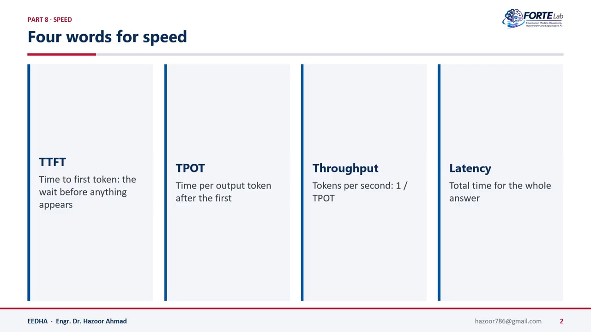
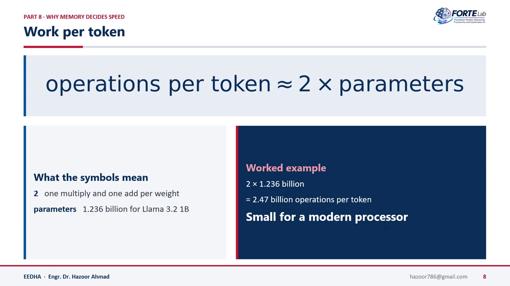
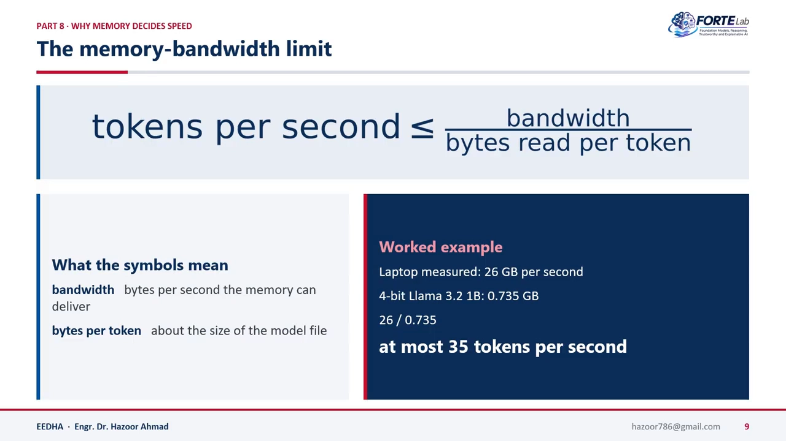
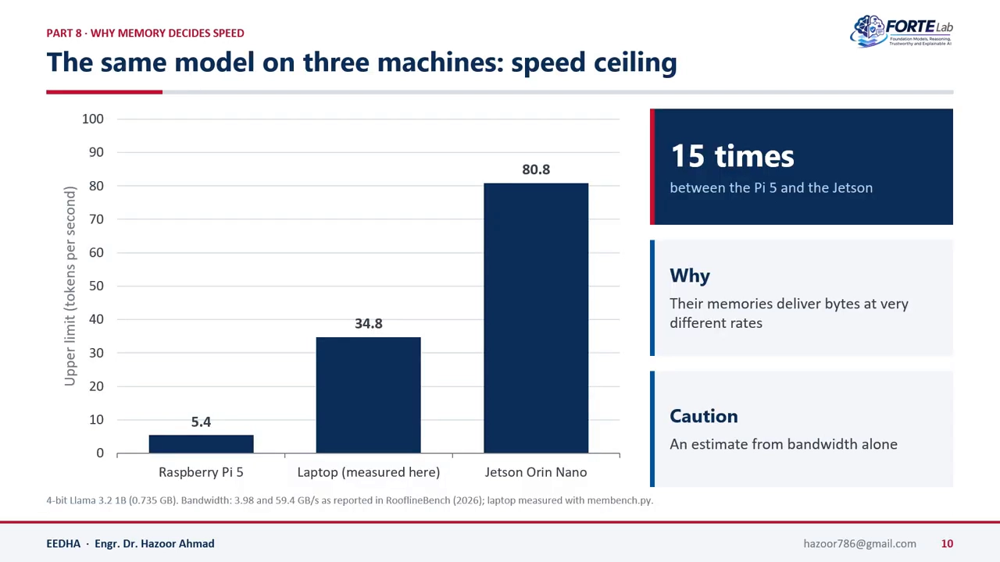
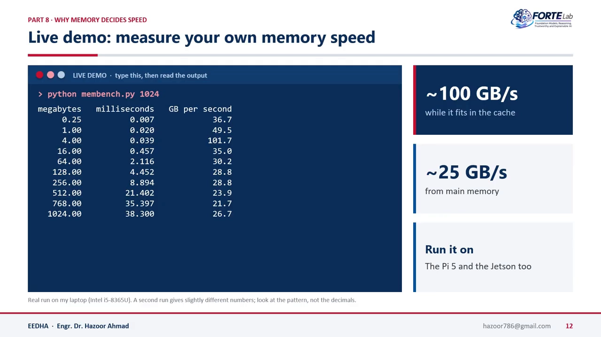
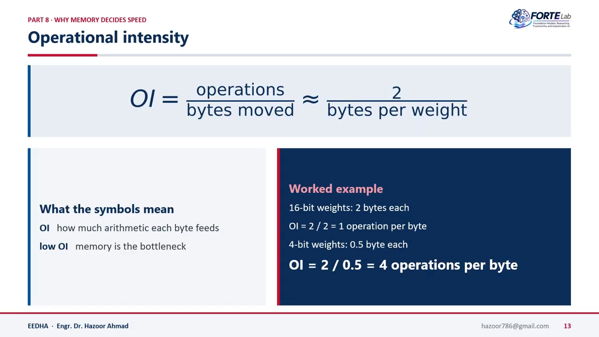
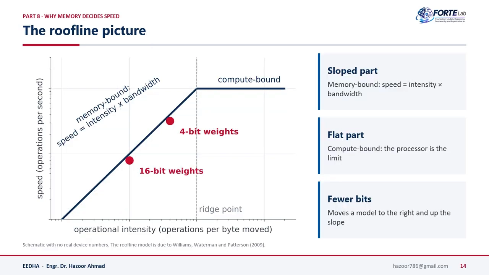
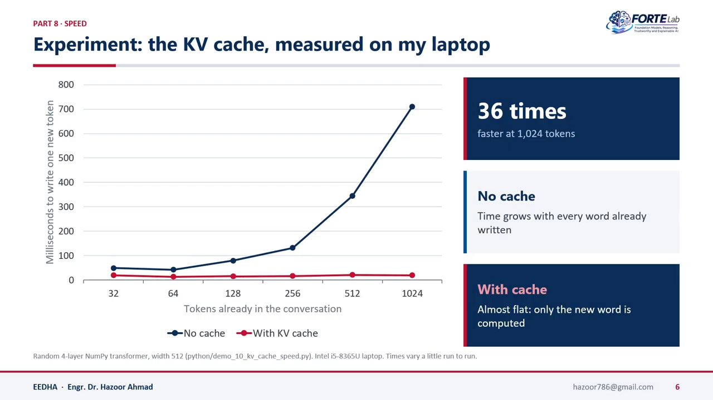
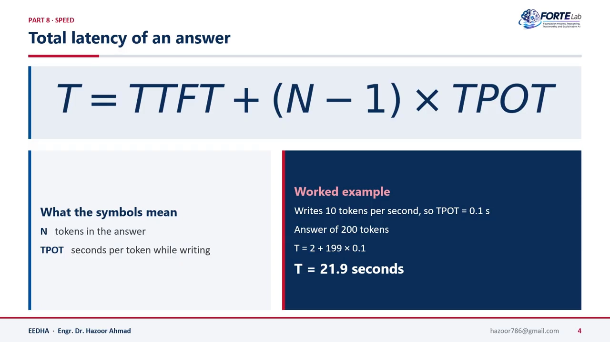
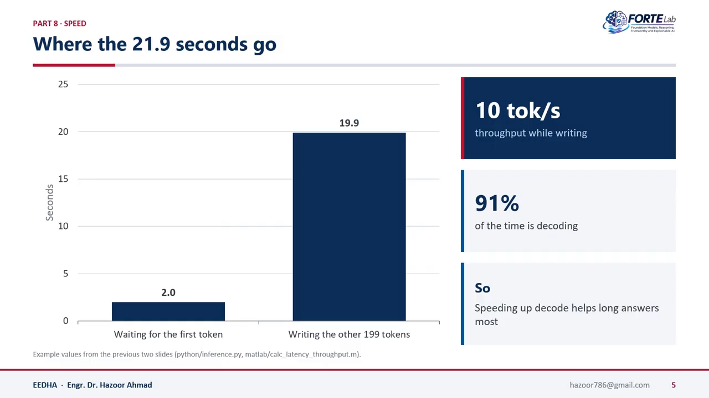

# TPOT 的下界是带宽除以模型字节数，而流畅度只需要每秒几个 token

> 视频来源：[LLM Inference Speed, Memory Bandwidth and Energy per Token | LLMs from Zero Part 8](https://www.youtube.com/watch?v=M6JCqEKzCAQ)（YouTube · 频道 EEDHA · 讲者 Dr. Hazoor Ahmed）｜时长约 15 分钟
> 简要导读：这支视频用一台笔记本、一块树莓派和一块 Jetson，把「出字速度」算成了一个可以手推的下界：**带宽 ÷ 模型文件字节数**。本文只取它的速度部分（0:00–8:30），并把「人读多快」这条线接上，回答「TPOT 到多少才算够」。原片后半段讲每 token 焦耳与电池续航，与本节无关，未收录。权重搬运的机理见 1.2.2，batch 与 Roofline 见 1.2.3，端到端分解见 2.1.3。

## 本讲要解决的核心问题（SCQA）

**背景**：一块消费级板子跑 4-bit 的 1B 模型，每秒写 10 个 token。人读书大约每秒四个词，所以这个速度读起来是**跟得上**的——不会觉得在等。

**冲突**：可这个 10 是怎么来的？为什么不是 100？你换一块更贵的板子，可能变成 35；换一块更便宜的，掉到 5.4。**同一个模型，速度差 15 倍。** 很多人第一反应是「算力不够」，于是去堆更快的处理器——但这不是算力问题。视频给了一句结论式的话：**小设备上 LLM 的速度由内存带宽决定，不由算术决定。**

**疑问**：decode 每一步到底做了什么，为什么瓶颈在「搬字节」而不是「做运算」？能不能事先算出 TPOT 的下界？既然下界由带宽和模型大小决定，那什么样的 TPOT 才算「够快」？

**回答（中心思想）**：**每生成一个 token 都要把全部权重从显存搬一遍，所以出字速度的上限就是「带宽 ÷ 模型文件字节数」，TPOT 的下界就是它的倒数**；量化通过减少每 token 搬运的字节数把这个下界往下压。而「够不够快」不由硬件决定，由**人的阅读速度**决定——每秒几个 token 就已经跟得上，真正毁掉体验的是那几次超过几百毫秒的停顿。

---

## 一、TPOT 是「第一个词之后，每个词花多久」

视频先把四个词摆清楚，因为后面所有推导都挂在它们身上：

| 指标 | 定义 | 来自哪个阶段 |
| --- | --- | --- |
| TTFT | 任何东西出现之前的等待 | 预填充（读 prompt） |
| TPOT | 第一个词之后，每个词的时间 | 解码（写回答） |
| 吞吐量 | tokens per second，等于 $1/\text{TPOT}$ | 解码 |
| 延迟 | 整段回答的总时间 | 全部 |

注意第三行那个等式：**吞吐量与 TPOT 互为倒数**。所以在单请求语境下，「每秒 10 个 token」和「每 token 100 毫秒」是同一句话的两种说法。工程上容易混淆的是：多请求场景里的「吞吐量」指的是**整个系统**每秒产出的 token 总数，那时它和单用户的 TPOT 不再是倒数关系（那是 2.2 的话题）。

[【跳转到 01:13】](https://www.youtube.com/watch?v=M6JCqEKzCAQ&t=73)

---

## 二、decode 每步的算术量很小，搬的字节数很大

### 2.1 每个 token 的运算量约为参数量的两倍

每生成一个 token，模型要对**每一个权重**做一次乘法和一次加法：

$$
\text{ops per token} \approx 2 \times \text{参数量}
$$

对 Llama 3.2 1B（12.36 亿参数）：

$$
2 \times 1.236 \times 10^9 = 2.47 \times 10^9\ \text{次运算}
$$

24.7 亿次运算听起来很多，但视频的评论很关键：**对现代处理器来说这很小，连树莓派每秒都能做几十亿次运算。**

### 2.2 难的不是算术，是把 12 亿个数字搬过来

那么难的是什么？**每个 token 都要把 12 亿个数字从内存送到处理器。**

这就是 1.2.2 讲的「权重重复搬运困境」：decode 是矩阵-向量乘（GEMV），形状决定了它对算力极不友好、对带宽极其依赖。视频用一句话概括：**处理器大部分时间都在等数字送到。**

---

## 三、于是 TPOT 有一个硬下界

### 3.1 出字速度的上限 = 带宽 ÷ 每 token 字节数

$$
\text{tokens per second} \le \frac{\text{内存带宽}}{\text{每 token 读取的字节数}}
$$

而**每 token 读取的字节数大致就是模型文件的大小**，因为每个权重对每个 token 都要读一遍。

视频在笔记本上实测带宽 26 GB/s，4-bit 的 Llama 3.2 1B 文件是 0.735 GB：

$$
\frac{26}{0.735} \approx 35\ \text{tokens/s}
$$

换成 TPOT 就是：

$$
\text{TPOT} \ge \frac{\text{模型文件字节数}}{\text{带宽}} = \frac{0.735\ \text{GB}}{26\ \text{GB/s}} \approx 28\ \text{ms}
$$

讲者反复强调：**这是天花板，不是预测。** 当算术或软件成为瓶颈时，真实速度会更低。但它是一个出奇好的初估——后面你会看到，它甚至能解释 15 倍的机器差距。

### 3.2 同一个模型，三台机器，15 倍

| 机器 | 内存带宽 | 速度上限 |
| --- | --- | --- |
| 树莓派 5 | 3.98 GB/s | 5.4 tokens/s |
| 作者的笔记本 | 26 GB/s（实测） | 34.8 tokens/s |
| Jetson Orin Nano | 59.4 GB/s | 80.8 tokens/s |

同一个 4-bit 模型，Pi 5 和 Jetson 之间差 **15 倍**。原因只有一个：**它们的内存送字节的速率差别很大。** 视频注明 Pi 与 Jetson 的带宽数字来自 roofline bench 论文，笔记本那个是他自己测的。

### 3.3 这个带宽是「主存带宽」，不是「缓存带宽」

视频还给了一个很有说服力的实测：他测了矩阵乘向量（正是 decode 对权重矩阵做的那个运算），从很小的矩阵一直到约 1 GB。

- 矩阵能装进处理器**快速缓存**时：约 **84–100 GB/s**；
- 一旦来自**主存**：约 **22–35 GB/s**。

**几百兆字节的 LLM 永远装不进缓存，所以 26 才是那个有意义的数字。**

这张表是本文最值得记住的一张，因为它解释了为什么「把模型塞进更快的存储」和「换更快的处理器」是两件完全不同的事：**只要权重放不进片上缓存，速度就锁在主存带宽上。**

---

## 四、量化把这个下界往下压

### 4.1 运算强度：每搬一个字节能做几次运算

视频引入一个概念：**运算强度（operational intensity, OI）**，即每从内存搬一个字节能做多少次运算。对解码：

$$
OI \approx \frac{2}{\text{每个权重的字节数}}
$$

| 权重精度 | 每权重字节 | 运算强度 |
| --- | --- | --- |
| 16-bit | 2 | $2/2 = 1$ 次运算/字节 |
| 4-bit | 0.5 | $2/0.5 = 4$ 次运算/字节 |

**量化提高运算强度的机理是：每取一个字节，现在带上四个权重而不是一个。** 于是同一个字节能喂给处理器四倍的运算，模型就相对不那么「饿」。

### 4.2 放回 Roofline 上看

把这件事画进 Williams、Waterman 和 Patterson 在 2009 年提出的 **Roofline 模型**：

- **左边是斜坡（访存受限）**：速度 = 运算强度 × 带宽，**大多数 LLM 解码都在这里**；
- **右边是平顶（计算受限）**：处理器本身是极限；
- 从 16 位到 4 位，把模型**往右移、沿斜坡往上走**。

视频还补了一句容易被忽略的话：**每台设备都有自己的屋顶。**一个模型在一块板子上接近脊点，在另一块上可能远在下方。所以「这个模型能不能跑到 30 token/s」这个问题，离开设备就没有答案。

（Roofline 与 batch 的关系、以及为什么提高 batch 能把 decode 从访存受限推向计算受限，见 1.2.3；量化本身的数学见第 7 章。）

---

## 五、KV Cache 让每步时间「近似恒定」，但仍在缓慢上升

到这里有一个必须回答的问题：如果每步都要搬一遍权重，那每步时间应该是个常数才对，为什么实际会变？

### 5.1 一个能直接看到形状的实验

视频在笔记本上用 NumPy 搭了一个随机 transformer（四层、宽度 512），随着对话变长，测「写一个新 token 要多久」，分别在有缓存和没有缓存的情况下：

| 已有 token 数 | 无缓存 | 有 KV Cache |
| --- | --- | --- |
| 32 | 约 49 ms | 约 14 ms |
| 1024 | 约 710 ms | 约 21 ms |

（表中两个长度是视频口述的数字；曲线中间的点视频只给了图，未逐个念出。）

两个结论：

1. **没有缓存时，时间随长度爆炸式增长**（1024 token 处 710 毫秒，用户早就关页面了）；
2. **有缓存时，时间几乎是平的**——但注意它**不是完全平的**：14 → 21 毫秒，涨了 50%。

### 5.2 那 50% 就是「ITL 随长度缓慢上升」

第 2 条里那个「几乎平但不完全平」，正是本小节第一篇讲的**缓慢上升**：每步除了搬权重（恒定的大头），还要**读一遍越来越长的 KV Cache**（随长度线性增长）。所以一条长回答的 ITL 序列，形状是「先平、后慢慢抬头」。

### 5.3 还有四个会让每步变慢的因素（补充）

视频只覆盖了单用户、单机的场景，所以下面这四条是**补充**的工程事实，不属于讲者原话：

| 因素 | 为什么让每步变慢 | 详见 |
| --- | --- | --- |
| **batch 变大** | 同一个 batch 里塞进更多请求，每步的矩阵从 GEMV 变 GEMM，计算量上升 | 1.2.3 |
| **张量并行（TP）** | 每层要插一次 all-reduce 做跨卡同步，卡越多通信占比越高 | 9.1 |
| **采样策略** | top-k / top-p 要对词表排序或做累积筛选，beam search 成倍放大候选 | 本文补充 |
| **投机采样** | 一次验证多个草稿 token，改变了 ITL 的分布形状（长—短—短—短—长） | 6.1、6.2 |

这四条里最容易被低估的是**采样策略**：词表动辄十几万，一次 top-k 排序的开销在 decode 每步只有几十毫秒的预算里并不算小；而 beam search 让候选数乘上 beam width，等于把每步的读取量成倍放大。

---

## 六、够不够快，由人的阅读速度决定

### 6.1 人读书大约每秒四个词

视频给了一个可以立刻用上的对照：**人读书大约每秒四个词。所以一块板子需要每秒好几个 token 才让人觉得流畅；低于这个数，用户就看着词一个一个往外爬。**

把这句话换算成 TPOT：

| 阅读速度 | 换算成 TPOT | 感受 |
| --- | --- | --- |
| 4 词/秒 | 250 ms/词 | 刚好跟得上 |
| 8 词/秒（快速阅读） | 125 ms/词 | 流畅 |
| 2 词/秒 | 500 ms/词 | 明显在等 |

中文的阅读速度大约每秒 5–10 个汉字（**补充**，视频未涉及中文），按一个汉字约一个 token 粗算，对应 **100–200 ms/token** 就已经「跟得上」了。这也解释了为什么很多本地部署的 10–20 token/s 体验其实可以接受：**它已经超过了人的阅读速度。**

### 6.2 但真正毁体验的不是平均慢，是那几次停顿

这里要把本小节第一篇的结论接回来：**均值达标不等于体验达标。** 一个平均 100 ms/token 的回答，如果中间有三次 800 毫秒的停顿，用户记住的是那三次。

工程上的经验阈值（**补充**，业界经验而非视频原话）：

| 单次间隔 | 用户感受 |
| --- | --- |
| < 100 ms | 几乎察觉不到，像连续输出 |
| 100–300 ms | 能感觉到节奏，但可接受 |
| 300–500 ms | 明显停顿，会怀疑是不是卡了 |
| > 500 ms | 明确的「卡住了」，可能开始重复点击 |

所以 TPOT 的目标应该写成一对数：**中位数（或均值）达标 + P99 不超过某个上限**。

### 6.3 产品形态决定 TPOT 目标

同一个模型，不同产品的 TPOT 目标可以差一个数量级（**补充**，业界常见做法）：

| 产品形态 | 用户在看什么 | TPOT 目标量级 | 理由 |
| --- | --- | --- | --- |
| 聊天对话 | 一段一段读 | 50–100 ms | 略快于阅读速度即可，再快用户也读不完 |
| 代码补全 | 光标处的几行 | 20–50 ms | 补全要「跟着手走」，慢一点就打断思路 |
| 长文生成 / 批处理摘要 | 结果最后才看 | 200 ms 以上也可接受 | 用户不在读流式输出，只等最终结果 |
| 语音对话 | 要合成语音 | 与语速对齐 | 太快反而要缓冲，太慢会断句 |

这张表最重要的一行是**长文生成**：它说明「TPOT 越低越好」是错的。当用户根本不读流式输出时，把 TPOT 压到 30 毫秒只是浪费算力——**这时候应该把算力换成更大的 batch 去提高总吞吐**（2.2 的话题）。

---

## 七、TPOT 与 TTFT 的分工：谁在总时间里占大头

视频给了一个把两者串起来的式子：

$$
T = \text{TTFT} + (N-1) \times \text{TPOT}
$$

用它的算例：板子每秒写 10 个 token（TPOT = 0.1 秒），回答 200 个 token，TTFT 是 2 秒：

$$
T = 2 + 199 \times 0.1 = 21.9\ \text{s}
$$

拆开看这 21.9 秒：**2 秒在等第一个 token，19.9 秒在写剩下 199 个 token——91% 的时间在解码。**

由此得到一条很实用的判据：

- **长回答**（几百 token 以上）：decode 占主导，**优化 TPOT 收益最大**；
- **长 prompt 的短回答**（比如摘要、分类）：prefill 占主导，**优化 TTFT 收益最大**。

而这两者常被同一个 batch 大小反向拉扯：batch 变大，总吞吐上去，但每步变慢、TPOT 变差，排队也可能变长、TTFT 变差。端到端延迟的完整分解与排队建模见 2.1.3。

---

## 小结

- **每生成一个 token 都要把全部权重搬一遍**，所以出字速度的上限是「带宽 ÷ 模型文件字节数」，**TPOT 的下界是它的倒数**（0.735 GB ÷ 26 GB/s ≈ 28 ms，即 1/35 秒）。
- 同一个模型在三台机器上差 15 倍，**只因内存带宽不同**；而且起作用的是主存带宽（约 25 GB/s），不是缓存带宽（约 100 GB/s）。
- **量化通过提高运算强度把下界往下压**：16 位每字节 1 次运算，4 位每字节 4 次运算；Roofline 上表现为沿斜坡上移。
- **KV Cache 让每步时间近似恒定**（14–21 ms），但随长度仍缓慢上升 50%；batch、TP 通信、采样策略、投机采样是另外四个影响因素。
- **够不够快由人的阅读速度决定**：每秒 4 词 ≈ 250 ms/词，100–200 ms/token 就已经跟得上；真正毁体验的是 P99 的停顿（> 500 ms 会被明确感知）。
- **TPOT 目标由产品形态决定**：聊天 50–100 ms、代码补全 20–50 ms、长文生成可以更慢；长回答里 91% 的时间在 decode，长 prompt 短回答里 prefill 才是大头。

## 关键术语速查

| 术语 | 一句话解释 |
| --- | --- |
| TPOT | 每输出 token 时间，第一个 token 之后每个 token 花的时间 |
| 带宽下界 | 出字速度 ≤ 内存带宽 ÷ 每 token 读取字节数，即带宽 ÷ 模型文件大小 |
| 运算强度 OI | 每从内存搬一个字节能做多少次运算，解码时约等于 2 ÷ 每权重字节数 |
| Roofline | 把「访存受限的斜坡」与「计算受限的平顶」画在一起，判断瓶颈在哪一侧 |
| 主存带宽 | 权重放不进片上缓存时实际可用的带宽，消费级设备通常 20–60 GB/s |
| 阅读速度 | 人读书约每秒 4 个词，对应 250 ms/词，是「够快」的天然标尺 |
| P99 间隔 | 最慢的 1% 间隔有多长，决定用户会不会说出「卡住了」 |