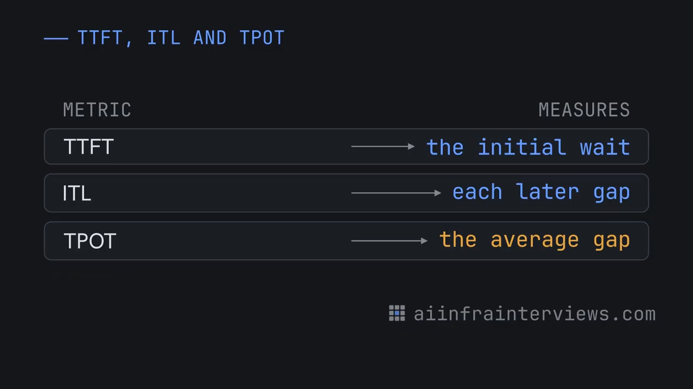
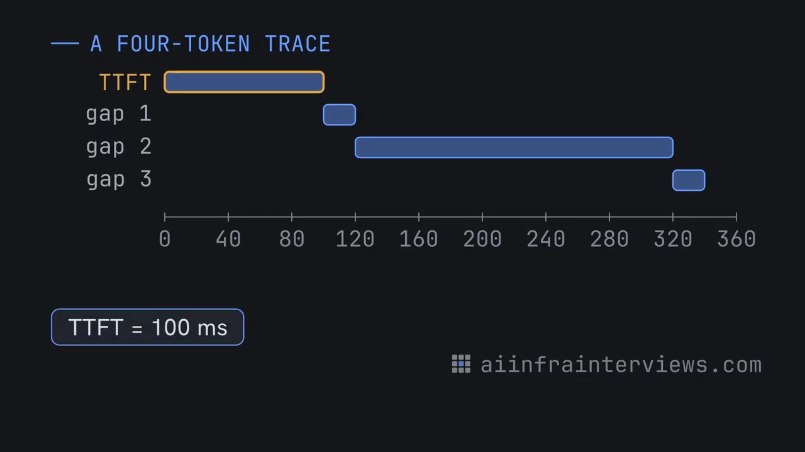
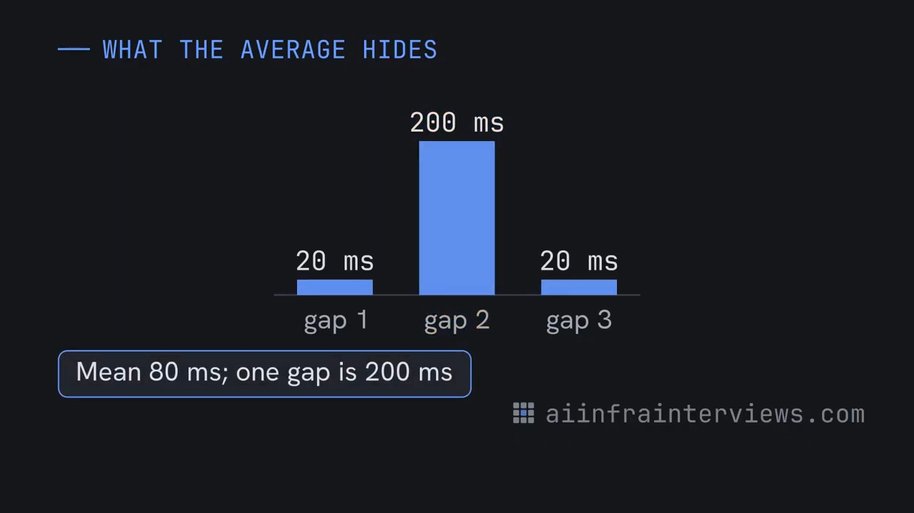
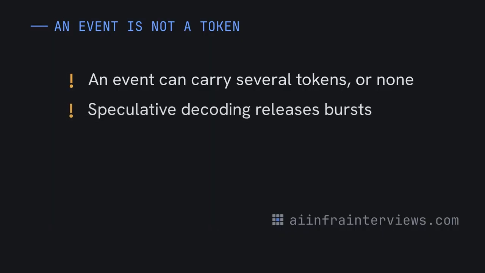
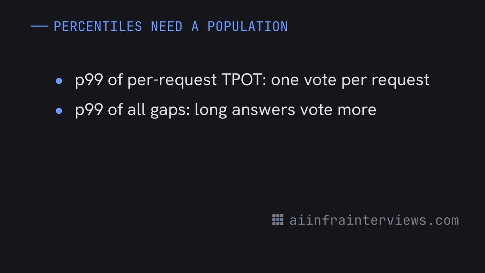
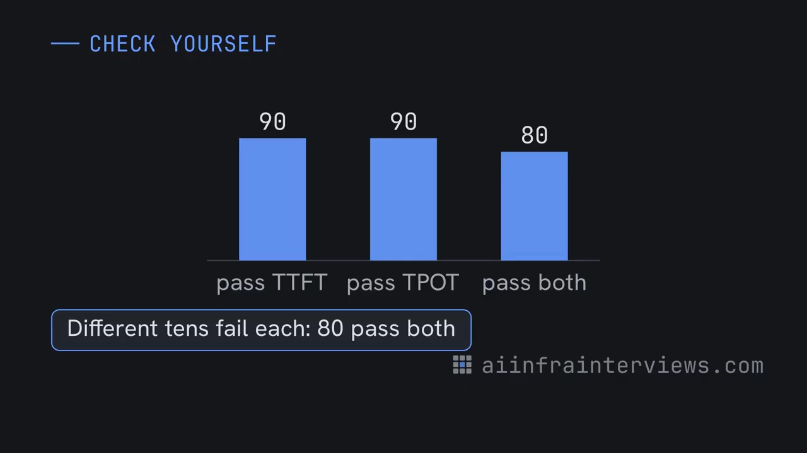
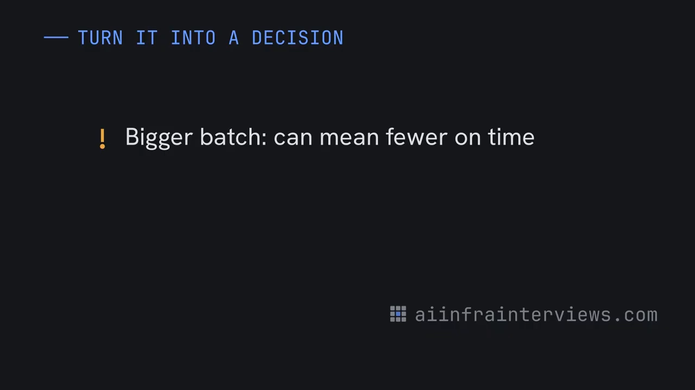
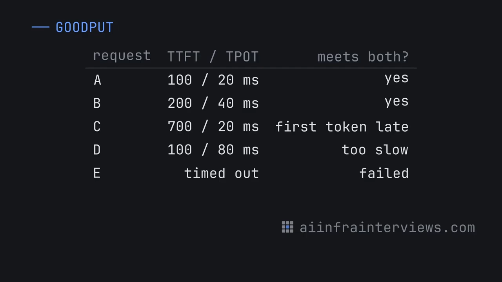

# 四个 token 只有三个间隔：TPOT 的测量口径与分位数陷阱

> 视频来源：[TTFT, TPOT, ITL and goodput explained: measuring LLM latency the right way](https://www.youtube.com/watch?v=_baVzuF3RVY)（YouTube · 频道 AI Infra Interviews）｜时长约 3 分 44 秒
> 简要导读：这支短片不讲原理，只讲**怎么算**——用一条四个 token 的假想 trace 把 TPOT 的分母为什么是 $N-1$、单 token 请求为什么未定义、流式 chunk 为什么不能当 token、以及分位数的「总体」怎么选，一条条算给你看。本文补上了可直接照抄的测量伪代码与分位数口径对照表；有效吞吐（goodput）只作为「TPOT 只是合约的一半」带过，完整讨论见 2.2。

## 本讲要解决的核心问题（SCQA）

**背景**：你已经知道要看 TPOT 和 ITL 了（见本小节另一篇）。接下来落到工程上，问题变成：**这两个数到底怎么从一条流式响应里算出来**。

**冲突**：这里有一连串看起来很小、但会让数字彻底失真的选择。分母该用 $N$ 还是 $N-1$？客户端收到一个 SSE 事件，算一个 token 吗？只有一个 token 的回答，TPOT 是 0 还是别的？把所有请求的间隔混在一起算 P99，和先算每个请求的 TPOT 再算 P99，是同一个数吗？**每一个选错，你报出来的数字都能差出一倍以上。**

**疑问**：一条正确的测量流程长什么样？哪些量必须保留原始序列而不能提前平均？分位数到底该在哪个总体上算？

**回答（中心思想）**：**先决定时钟放在哪里，再严格按「$N$ 个 token 只有 $N-1$ 个间隔」算 TPOT，并且永远保留间隔的原始序列**——因为平均值会藏住单次停顿，而分位数的含义完全取决于你选的总体（每个请求一票，还是每个间隔一票）。至于「客户端看到的一个 chunk」，它**不一定是一个 token**，该叫 chunk gap 就叫 chunk gap。

---

## 一、先决定时钟放在哪里

视频开场先立了一条规矩：**在算任何指标之前，先决定时钟放在哪里。**

| 时钟 | 起点 | 它描述什么 |
| --- | --- | --- |
| 客户端时钟 | 请求**发出**的那一刻 | 交付给用户的真实体验 |
| 服务端时钟 | 请求**到达**服务器的那一刻 | 背后的工作量 |

两者差的正是网络往返。这个区分在 2.1.1 里已经展开过（服务端 TTFT 与客户端 TTFT 是两个数），这里只需要记住它对 TPOT 的影响：**如果你用客户端时间戳算间隔，你算到的是「decode 时间 + 网络抖动 + 客户端渲染」**。在同一个机房里网络抖动可以忽略，跨地域、移动网络下它可能比 decode 本身还大。

[【跳转到 00:00】](https://www.youtube.com/watch?v=_baVzuF3RVY&t=0)

---

## 二、四个 token，三个间隔

### 2.1 一条 340 毫秒的 trace

视频给了一个小到可以口算的例子。一个请求从 0 开始，在 **100、120、320、340 毫秒**依次收到四个 token。

- **TTFT = 100 毫秒**（第一个 token 到达的时刻）；
- 之后的三个间隔是：$120-100=20$、$320-120=200$、$340-320=20$ 毫秒。

### 2.2 TPOT 是这三个间隔的平均

$$
\text{TPOT} = \frac{340 - 100}{3} = 80\ \text{ms}
$$

反过来验算也成立：最后一个 token 落在 $100 + 3 \times 80 = 340$ 毫秒。

### 2.3 为什么分母是 $N-1$

**四个 token 只有三个间隔，不是四个。** 这是最容易写错的一行代码——把分母写成 $N$，TPOT 会系统性偏小 $1/N$；对短回答（比如 20 个 token）就是 5% 的偏差，对长回答可以忽略，于是这个 bug 在长回答上永远暴露不出来。

把公式写成通式：

$$
\text{TPOT} = \frac{t_N - t_1}{N - 1}, \qquad \text{ITL}_i = t_i - t_{i-1}\ (i = 2 \dots N)
$$

### 2.4 只有一个 token 的请求，TPOT 是未定义而不是零

视频专门点出这个边界：**如果只有一个输出 token，就没有后续间隔，此时 TPOT 是未定义，而不是零。**

这一条在统计上很要命。如果你的代码写成「没有间隔就记 0」，那么一大批「只回一个词」的请求（分类、是/否判断、工具调用的短参数）会以 0 毫秒的 TPOT 涌进你的分位数计算，把 P50 拉得极其漂亮，而真实的 decode 速度一点没变。

同样要处理的还有失败：**一个没有产出任何 token 的失败请求，仍然必须被计为失败**，不能因为「它没有 TPOT」就从分母里消失。把它丢掉，等于让服务水平自己给自己加分。

[【跳转到 01:15】](https://www.youtube.com/watch?v=_baVzuF3RVY&t=75)

---

## 三、平均值藏住的那 200 毫秒

现在回头看那条 trace：均值 80 毫秒，但**其中有一个间隔是 200 毫秒**。

$$
\{20,\ 200,\ 20\} \quad\Longrightarrow\quad \text{均值} = 80\ \text{ms}
$$

80 毫秒的平均值，藏住了一次 200 毫秒的停顿。用户感受到的不是 80 毫秒，而是那一次 200 毫秒——以及如果这个 200 毫秒再长一点，就是他说的「卡住了」。

所以视频给的处置很直接：**要么保留每一个单独的间隔，要么至少在停顿重要的时候保留每个请求的最大间隔。**

第二句话是给存储成本让步的方案：不是所有团队都愿意把每个 token 的时间戳都存下来。折中方案是每个请求存三个数——**TPOT（均值）、max ITL（最长间隔）、输出 token 数**。这三个数足以还原「这个请求整体多快、最难受的一下有多长」，而且体积和只存 TPOT 差不多。

---

## 四、事件不是 token：该叫 chunk gap 就叫 chunk gap

这一节是整支视频最实用、也最容易被忽略的部分。视频标题写得很硬：**An event is not a token（一个事件不是一个 token）**。

### 4.1 一个流式事件可能带好几个 token，也可能一个都不带

你在客户端看到的是一串 SSE 事件（或 WebSocket 帧）。但服务端的实现里：

- 一个事件可能携带**好几个 token**（为了减少网络往返，服务端会攒一小批再发）；
- 一个事件也可能**一个 token 都不带**（心跳、usage 统计、结束标记）；
- **投机采样（speculative decoding）会一次放出好几个 token**——一次验证通过 $k$ 个草稿 token，它们在同一瞬间到达客户端。

### 4.2 所以「chunk 之间的间隔」不等于「token 之间的间隔」

如果你把「客户端两次收到数据的时间差」直接当成 ITL，那你测到的是**网络与打包策略**，不是 decode。视频的建议很朴素：**如果客户端只看得到文本块（chunk），那就把这些间隔叫作 chunk gap，而不是假装一个事件等于一个 token。**

### 4.3 那到底该信谁

两条路，各有代价：

| 做法 | 得到什么 | 代价 |
| --- | --- | --- |
| 客户端按 chunk 时间戳算 | chunk gap（含网络与打包） | 与 decode 有偏差，但就是用户真实感受 |
| 服务端按 token 时间戳算 | 真正的 ITL | 需要服务端埋点，且不含网络 |

工程上常见的做法是**两个都采**：服务端 ITL 用来定位「是不是我的 decode 慢」，客户端 chunk gap 用来回答「用户到底等了多久」。两者差得很大时，问题在链路上，不在模型上。

至于投机采样为什么会改变 ITL 的形状（一次放出多个 token，间隔序列变成「长—短—短—短—长」），算法本身归第 6 章。

---

## 五、分位数需要一个总体

### 5.1 两种 P99 回答两个不同的问题

视频的这句话值得原样抄下来：**percentiles need a population（分位数需要一个总体）**。

| 口径 | 每个观测是什么 | 谁在投票 |
| --- | --- | --- |
| 每个请求的 TPOT 的 P99 | 一个请求一个数 | **每个请求一票** |
| 所有 token 间隔的 P99 | 一个间隔一个数 | **长回答投出多得多的票** |

这两种都有人用，但它们回答的不是同一个问题：

- **每请求一票**回答「最难受的那 1% 的**请求**有多难受」——这是产品视角，因为用户是按请求感知的；
- **每间隔一票**回答「所有 token 里最慢的 1% 有多慢」——这是系统视角，一个 2000 token 的长回答会投 1999 票，一个 10 token 的短回答只投 9 票。

**选哪个取决于你要回答谁的问题。** 但必须选一个并写清楚，否则同一个系统在两个团队嘴里会报出两个不同的 P99。

### 5.2 副本的 P99 平均起来不是集群的 P99

视频还补了一句常被踩的坑：**把各副本的 P99 取平均，得不到整个集群的 P99。**

道理和「平均的平均不是总平均」一样：P99 是分位数，不是可加的线性量。正确做法是把所有副本的原始观测**汇到一个池子里**再算分位数（或者用 t-digest / HDR 直方图这类可合并的草图结构做分布式聚合）。

[【跳转到 01:40】](https://www.youtube.com/watch?v=_baVzuF3RVY&t=100)

---

## 六、TPOT 只是合约的一半

视频最后一段转到 goodput（有效吞吐），完整讨论归 2.2，这里只取它对 TPOT 的三点提醒。

### 6.1 联合条件不等于各自达标

假设合约是「TTFT 最多 500 毫秒、TPOT 最多 50 毫秒」。100 个请求里，90 个通过了 TTFT，90 个通过了 TPOT——**两个都通过的只有 80 个**，因为失败的 10 个里可能有 10 个只挂在 TTFT、另外 10 个只挂在 TPOT。

所以：**要在每个请求上评估这个联合条件**，不能拿两个独立的达标率相乘，也不能分别看两个指标就宣布健康。

### 6.2 更大的 batch 可能让更少请求按时

视频里有一句很短但很重的话：**更大的 batch 可以抬高 token 吞吐，但会让更少的请求满足限制。**

这正是 1.2.3 讲的 batch 与 Roofline 的另一面：batch 变大，每步要搬的权重不变但计算变多，**每个用户的每步时间变长**，于是 TPOT 变差。吞吐（tokens/s 总量）和延迟（每用户的 TPOT）在这里是**反向拉扯**的。

### 6.3 一个请求的两条线

视频给了一张 5 个请求的小表，把 TTFT 与 TPOT 放在一起看：

| 请求 | TTFT | TPOT | 是否两条都满足 |
| --- | --- | --- | --- |
| A | 100 ms | 20 ms | 是 |
| B | 200 ms | 40 ms | 是 |
| C | 700 ms | 20 ms | 否，首字太晚 |
| D | 100 ms | 80 ms | 否，出字太慢 |
| E | 超时 | — | 否，失败 |

这张表的价值在于它把「慢」分成了两类：**C 的问题在 prefill 与排队（TTFT），D 的问题在 decode（TPOT）**。看到用户抱怨「慢」，第一步不是加机器，而是先分清是哪一类——因为这两类的优化手段几乎不重叠。

---

## 小结

- **先决定时钟放在哪里**：客户端时钟量体验（含网络），服务端时钟量工作量。
- **$N$ 个 token 只有 $N-1$ 个间隔**，分母写错会让 TPOT 系统性偏小；单 token 请求的 TPOT 是**未定义**，不是 0；失败请求必须留在分母里。
- **永远保留间隔的原始序列**，至少保留每个请求的最大间隔——均值会藏住那一次 200 毫秒。
- **事件不是 token**：一个 chunk 可能含多个或零个 token，投机采样会成批放出；客户端测到的该叫 chunk gap。
- **分位数需要一个总体**：每请求一票还是每间隔一票，是两个不同的问题；副本 P99 平均起来也不是集群 P99。
- **TPOT 只是合约的一半**：联合条件要逐请求评估，更大的 batch 可能让更少请求按时。

## 关键术语速查

| 术语 | 一句话解释 |
| --- | --- |
| TPOT | 每输出 token 时间，$(t_N - t_1)/(N-1)$，一个请求一个数 |
| ITL | token 间隔，相邻两个 token 的时间差，一个请求有 $N-1$ 个 |
| chunk gap | 客户端相邻两个流式事件的时间差，含网络与打包，不等于 ITL |
| 未定义 | 单 token 请求没有间隔，TPOT 不存在，不能记作 0 |
| 分位数总体 | 算 P99 时「谁在投票」：每请求一票，还是每间隔一票 |
| 投机采样 | 一次验证多个草稿 token，成批放出，改变 ITL 的分布形状 |
| goodput | 只统计同时满足 TTFT 与 TPOT 合约的请求，失败计入分母 |