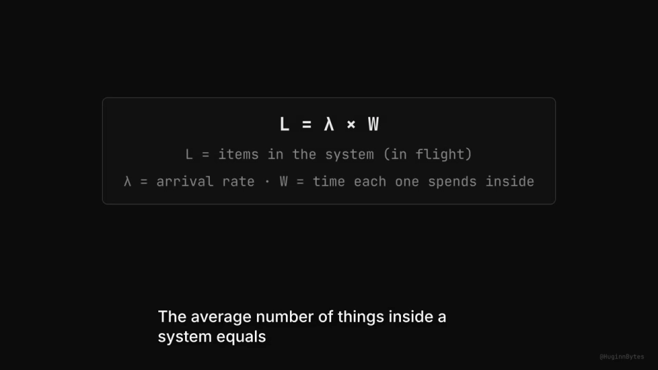
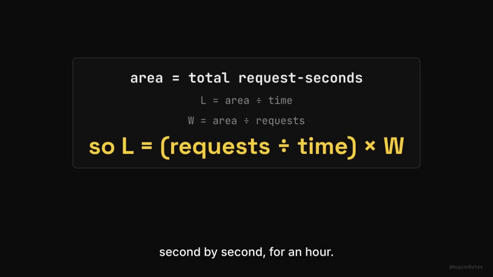
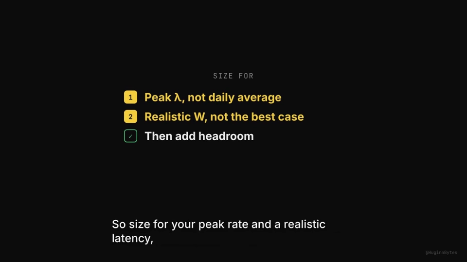
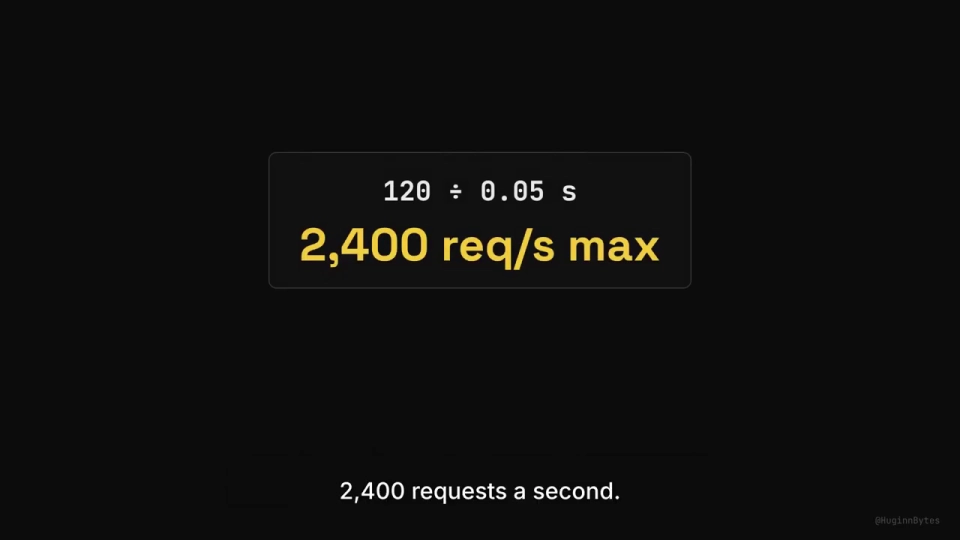
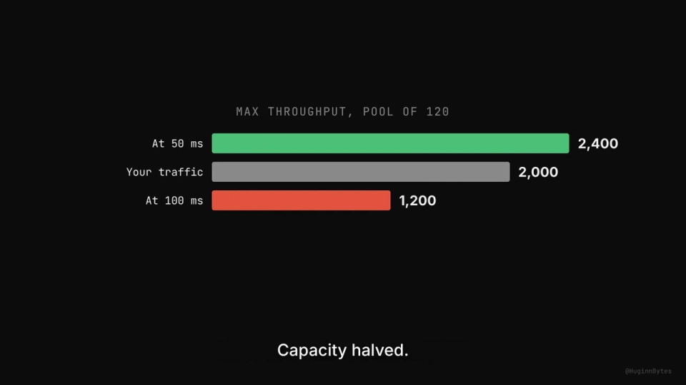
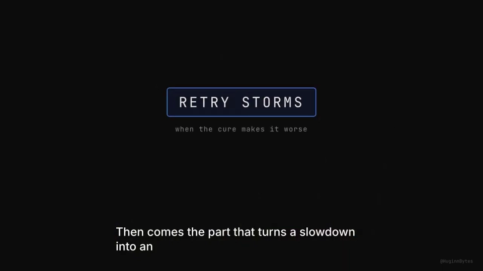
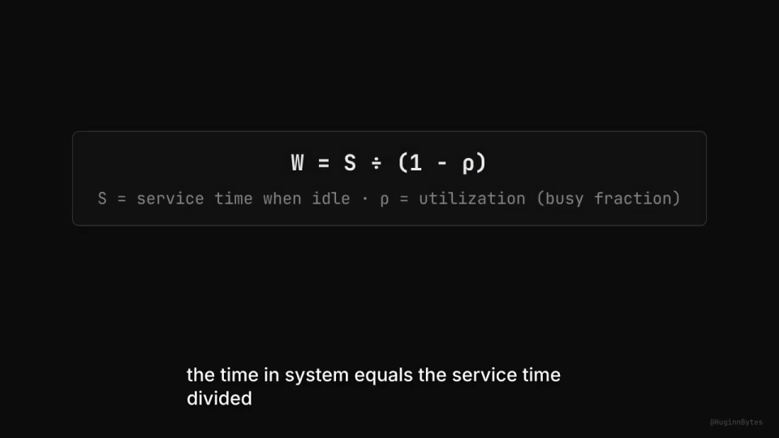
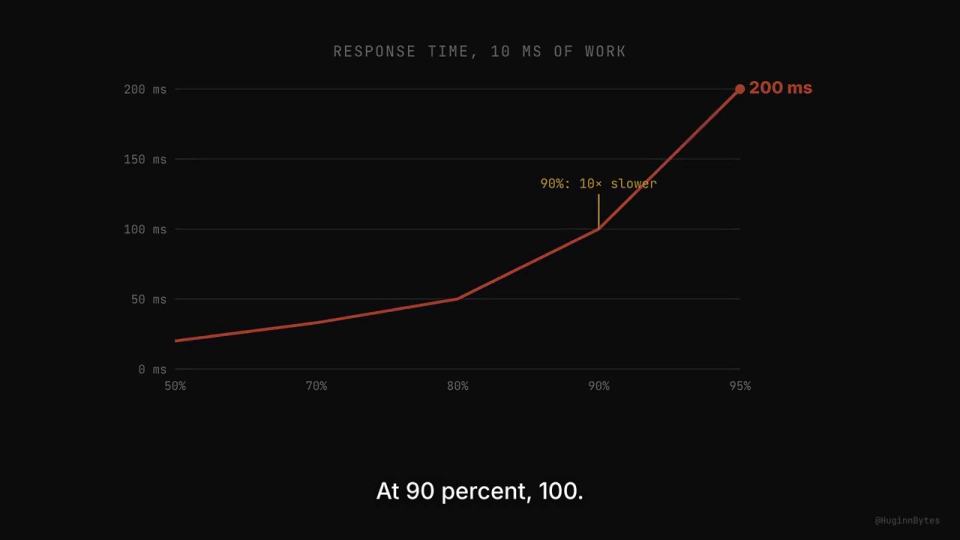
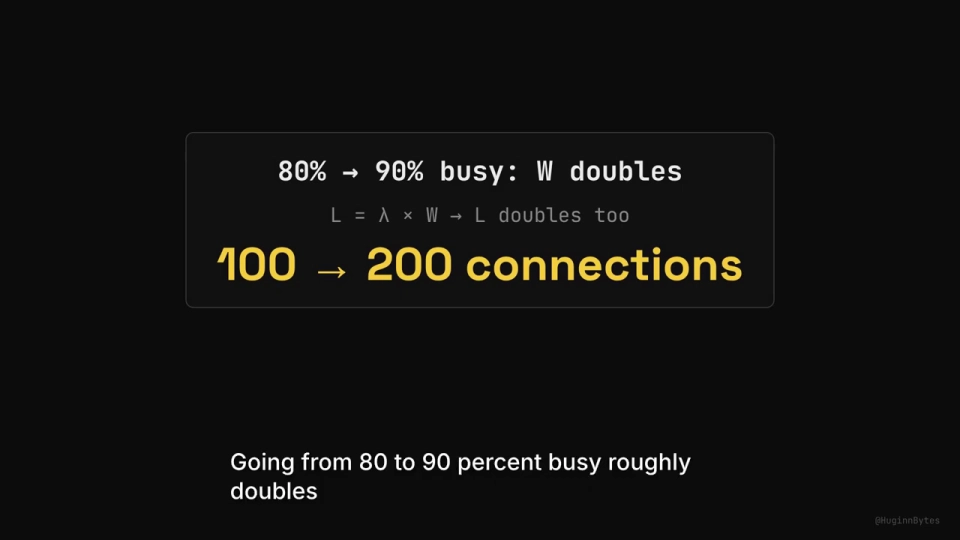

# 排队时间是端到端延迟里唯一不由模型决定的量

> 视频来源：[Little's Law: The Formula Behind Every Pool and Queue](https://www.youtube.com/watch?v=pWePkixjSiw)（YouTube · HuginnBytes）｜时长约 8 分钟
> 简要导读：这支视频用一个数据库连接池的故事，把 **Little 定律**和**利用率曲线**讲成了两个可以直接套用的公式。它讲的不是 LLM，但这正是端到端延迟里最难的那一段——排队。本文保留视频的全部推导与数字，并在每一节后用「搬到 LLM 推理上」标出对应关系（这部分是补充，不是讲者原话）。

## 本讲要解决的核心问题（SCQA）

**背景**：你的服务每秒收到 2000 个请求，每个请求要在数据库上花 50 毫秒。要开多少个连接？答案是可以算出来的：100 个。这就是 Little 定律，一条 1961 年被证明、只有三个字母的公式。

**冲突**：第二天数据库慢了，从 50 毫秒变成 100 毫秒——流量一点没变。现在你需要 200 个连接，而你的池子只有 120 个。请求开始排队，然后开始超时。**你的代码一行没改，容量却凭空少了一半**。更糟的是，很多人遇到这种情况的第一反应是"加应用服务器"，而那会让事情变得更坏。

**疑问**：一条公式怎么能同时预测"需要多少连接"和"为什么会雪崩"？为什么利用率从 80% 涨到 90%（只涨 10 个点）延迟就翻倍？为什么平均值永远低估你需要的容量？

**回答（中心思想）**：因为**在飞请求数 $L$、到达率 $\lambda$、停留时间 $W$ 三者被一条恒等式锁死**：$L = \lambda \times W$。它意味着三件事——容量要按**峰值到达率**和**真实停留时间**算，不能按均值；停留时间 $W$ 里包含排队，量漏了就会全线偏小；而 $W$ 本身又被利用率决定，$W = S/(1-\rho)$，**利用率逼近 1 时排队时间非线性爆炸**。所以"平均负载 70% 看起来还好"和"P99 已经排了很久"可以同时为真：均值描述的是平均请求，$1/(1-\rho)$ 描述的是那 1% 撞上满队列的请求。

---

## 一、一个什么都没坏的故事

视频开场就是一个完整的故障复盘，四句话讲完：

1. 服务每秒 2000 个请求，每个请求和数据库聊 50 毫秒；
2. 平均需要 **100 个连接**（这个 100 是算出来的，下面就给公式）；
3. 数据库慢到 100 毫秒，同样的流量，现在需要 **200 个**；
4. 你的池子只有 **120 个**——于是请求开始排队，然后开始超时。

这个故事的关键在于**没有任何东西"坏掉"**：没有报错、没有内存泄漏、没有配置被改。只是某个下游从 50 毫秒变成了 100 毫秒，然后整条链路的容量被腰斩。讲者的说法是："一条公式预测了这一切，还有第二条公式解释了数据库为什么会变慢。"

---

## 二、Little 定律：$L = \lambda \times W$

### 2.1 三个字母，一句人话

$$
L = \lambda \times W
$$

- $L$：系统里**同时存在**的东西的平均数量（in flight，在飞）；
- $\lambda$：它们**到达**的速率（每秒多少个）；
- $W$：每一个在系统里**停留**的平均时间。

讲者用咖啡店解释：每分钟进来 2 个客人，每人待 5 分钟，那么店里平均有 $2 \times 5 = 10$ 个人。

这条公式真正厉害的地方是**它不需要任何假设**：不假设流量是泊松分布、不假设服务时间是指数分布。只要系统在一段时间内是稳定的，它就成立。

[【跳转到 00:31】](https://www.youtube.com/watch?v=pWePkixjSiw&t=31)

### 2.2 面积直觉：为什么它一定成立

讲者给了一个让人一次记住的推导。把"每秒在飞的请求数"画成一条曲线，画一个小时：

- 曲线下的**面积** = 总的"请求·秒"；
- 面积 ÷ 时间 = 平均在飞数 $L$；
- 面积 ÷ 请求数 = 每个请求的平均停留时间 $W$。

而"请求数 ÷ 时间"就是到达率 $\lambda$。所以 $L = \lambda \times W$ 只是同一个面积的两种除法。

这条公式可以解出任意一个未知量——知道两个，第三个免费。

### 2.3 单位是第一个坑

讲者专门提醒：**速率的单位是每秒，时间的单位是秒**。50 毫秒要写成 0.05 秒。他给了一个规模更大的例子：每分钟 200 万请求 ≈ 每秒 33000 请求，一个耗时 30 毫秒的依赖意味着**每一刻都有约 1000 个调用在飞**。

### 2.4 定容：按峰值 $\lambda$ 与真实 $W$，再加余量

回到那个池子。100 个连接只是"平均"。讲者的三条定容规则：

1. 按**峰值** $\lambda$，不是日均；
2. 按**真实的** $W$，不是最好情况；
3. 然后**加余量**。

算一遍：峰值 3000 请求/秒、每次 60 毫秒 → $3000 \times 0.06 = 180$ 在飞；加 30% 余量 → 约 230。分摊到 10 个 pod，每个 pod 需要 **23~24** 个，而不是 100 个。

同时要检查另一端：数据库对连接数有硬上限。10 个 pod 各开 100 个 = 1000 个连接，足以把数据库压垮。**更大的池子不是免费的**：每个空闲连接都占数据库内存，太多活跃连接会抢同一批 CPU。

### 2.5 反过来用：池子大小就是吞吐上限

把公式翻过来：$\lambda = L / W$。

- 池子 120、每次 50 毫秒 → 最多 **2400 请求/秒**；
- 同样的池子、每次 100 毫秒 → 最多 **1200 请求/秒**。

讲者的结论是这支视频里最值钱的一句：**一个变慢的依赖不只是让你变慢，它悄悄削减了你能处理的请求数**。流量没变，容量腰斩。

这也解释了为什么"加应用服务器"有时会让故障更严重：更多 pod → 更多连接 → 数据库更忙 → 延迟更高 → 每个池子的上限更低 → 多出来的请求无处可去，只能等连接、延迟增长、开始超时。

[【跳转到 02:46】](https://www.youtube.com/watch?v=pWePkixjSiw&t=166)

---

## 三、$W$ 量错了，后面全错

公式是精确的，输入通常不是。讲者列了三个最常见的错法。

### 3.1 $W$ 是"在系统里的全部时间"，不是"查询本身"

$W$ 要包含四段：**等连接池分配、网络往返、查询执行、读取结果**。如果只量查询执行时间，你会把一切定容都定小。

### 3.2 均值被尾部拖走：1% 的慢请求让池子涨了 50%

这是本节最反直觉的一段。假设 99% 的查询 40 毫秒、1% 的查询 2 秒。均值不是 40 毫秒：

$$
W = 0.99 \times 40 + 0.01 \times 2000 = 39.6 + 20 = 59.6\ \text{ms}
$$

接近 60 毫秒。按 2000 请求/秒算，需要约 **120** 个连接，而不是 80 个——**一个百分点的慢请求，给池子加了 50%**。

讲者的总结很干脆：Little 定律用的是平均值，而平均值是被尾部拖着的。

### 3.3 反解 $W$：不用链路追踪也能算出真实停留时间

$W = L / \lambda$。如果面板显示 2500 查询/秒时有 300 个活跃连接，那么真实的平均停留时间是 $300 / 2500 = 120$ 毫秒——不需要任何 tracing。

### 3.4 超时是 Little 定律的伪装

这条很妙：**超时时间其实是在给 $W$ 设上限**，而 $W$ 的上限决定了最多有多少请求能堆在系统里。

- 2 秒超时、2000 请求/秒 → 最多 **4000** 个请求同时卡在飞；
- 30 秒超时、同样流量 → 最多 **60000** 个。

每个卡住的请求都占着内存、线程或 socket。所以超时应该设成"这个调用正常耗时 + 一点余量"，而不是一个慷慨的默认值 30 秒。**短超时 + 有界队列**意味着出问题时快速失败、快速恢复，而不是把内存填满然后倒下。

[【跳转到 04:22】](https://www.youtube.com/watch?v=pWePkixjSiw&t=262)

### 3.5 重试：把"慢"变成"挂"的那一步

超时的请求会被重试。假设一半失败、每次失败重试最多 3 次，**到达率可以从 2000 涨到 5000**。更多到达、同样的天花板 → 更多排队 → 更多超时 → 更多重试。这是一个正反馈回路。

三个修法都来自同一条公式：**限制重试次数、加 jitter 与退避、在队列变长之前就丢弃低优先级请求**（不是之后）。

---

## 四、利用率：为什么 70% 看起来还好，P99 已经在排队

### 4.1 第二条公式

$$
W = \frac{S}{1 - \rho}
$$

$S$ 是空闲时的服务时间，$\rho$ 是利用率（忙碌比例）。这就是最简单的排队模型给出的结论：**停留时间 = 服务时间 ÷ (1 − 利用率)**。

### 4.2 一张表看懂"最后几个百分点最贵"

一个需要 10 毫秒工作的查询：

| 利用率 $\rho$ | 停留时间 $W$ | 相对空闲时 |
| --- | --- | --- |
| 50% | 20 ms | 2× |
| 80% | 50 ms | 5× |
| 90% | 100 ms | 10× |
| 95% | 200 ms | 20× |

**同样的查询，慢了 20 倍**。讲者的评语是："最后几个百分点的利用率最贵。"

这就是"平均负载 70% 看起来还好，但 P99 已经排队很久"的数学来源。注意这条曲线描述的是**平均**停留时间；真实系统的 P99 还要更糟，因为它对应的是那些恰好撞上队列最长的请求——而队列长度的波动在 $\rho \to 1$ 时会被放大。

### 4.3 所以头寸不是浪费

讲者给的经验值：**很多团队把关键依赖在峰值时控制在 60~70% 忙碌**。这份头寸不是浪费，它是让 $W$ 保持平坦的东西。

而且两条公式是**串联**的：利用率从 80% 涨到 90%，$W$ 翻倍；Little 定律说 $W$ 翻倍 → $L$ 翻倍 → 连接数从 100 变 200。这就是开场那个故障的完整因果链：数据库从 80% 漂到 90%，池子按好日子定容，重试再压一层。

### 4.4 监控 $L$，它比故障先动

最后一条操作建议：**直接把 $L$ 画出来**——在飞请求数、活跃连接数、消费滞后。当 $L$ 在流量平坦时开始爬升，延迟马上要出问题。这是一个领先指标，而延迟是滞后指标。

---

## 五、这条公式不只属于数据库

讲者用几行字证明它是通用的：

| 系统 | 参数 | 结果 |
| --- | --- | --- |
| Kafka 消费组 | 50000 消息/秒，每条 4 毫秒 | 约 200 条在飞 = 最少并行度 200 个消费者 |
| 客服团队 | 每天 120 张工单，每张 3 天 | 约 360 张未结（想少就砍 $W$） |
| 自动扩缩容 | 每 pod 安全并发 8，请求 80 毫秒 | 2000 请求/秒需要约 20 个 pod |

---

## 六、搬到 LLM 推理上：三个参数换名字，一个参数换了性质

（以下为**补充**，视频没有涉及 LLM。）

### 6.1 参数映射

| Little 定律里的量 | LLM 推理服务里的对应物 |
| --- | --- |
| $\lambda$ | QPS（请求/秒），注意要取峰值而不是日均 |
| $W$ | 端到端延迟：排队 + Prefill + Decode，即本小节另一篇里的三段公式 |
| $L$ | 同时在飞的请求数 = 全集群必须同时持有的并发槽位 |

于是有一个非常好用的容量估算式：

$$
\text{副本数} \approx \frac{\lambda_{\text{peak}} \times W_{\text{P95}}}{\text{每副本并发槽位}} \times (1 + \text{余量})
$$

算一遍：峰值 20 QPS、端到端 P95 10 秒 → $L \approx 200$ 个请求同时在飞；每副本能安全持有 32 个并发 → 需要约 7 个副本；加 30% 余量 → **10 个副本**。

注意这里用的是 **P95 的 $W$**，不是平均 $W$——这正是 3.2 节的教训：用均值定容会全线偏小。

### 6.2 "池子"在 LLM 里是 KV 显存，不是连接

LLM 服务的并发上限通常不是连接数，而是**KV Cache 能装下多少个序列**（vLLM 里体现为 block 池与 max_num_seqs）。所以 2.5 节那条"池子大小就是吞吐上限"在 LLM 上表现为：

$$
\lambda_{\max} = \frac{\text{可容纳的并发序列数}}{W}
$$

而"可容纳的并发序列数"会随**输出长度**变化——一条 4000 token 的回答占的 KV 是 500 token 回答的 8 倍。这意味着 LLM 的"池子"是一个**会随流量构成缩小的池子**，比数据库连接池更不稳定。

### 6.3 一个性质变了：$S$ 不再是常数

数据库那条 $W = S/(1-\rho)$ 里，$S$ 基本是常数。LLM 不是：

$$
S = t_{\text{prefill}} + \text{TPOT} \times (N_{\text{out}} - 1)
$$

$S$ 本身就是一个**分布**，由输入长度和输出长度共同决定。这带来两个后果：

1. **$W$ 的右尾比数据库更厚**。即使 $\rho$ 只有 60%，只要有一批长输出请求在跑，它们的 $W$ 就是短请求的十倍——这正是"平均看起来还好、P99 很难看"的第二个来源（第一个是 $\rho$）。
2. **利用率 $\rho$ 不能直接读 `nvidia-smi`**。decode 阶段是显存带宽受限的，GPU 利用率显示 100% 是常态，但队列可能还很短。更接近 $\rho$ 的代理指标是**排队请求数 ÷ 并发上限**，或者"running 序列数 ÷ max_num_seqs"。

### 6.4 三个直接可用的动作

1. **把 $L$ 画出来**：vllm:num_requests_waiting 与 vllm:num_requests_running 两条线，就是排队段与在飞段的直接读数。当 waiting 在流量平坦时爬升，端到端延迟马上要变坏。
2. **按输出长度分桶算 $L$**：长回答占的槽位多、停留时间长，混在一起算会同时低估长回答的排队、高估短回答的容量。
3. **把超时与重试当成容量参数**：LLM 请求的 $W$ 本来就是秒级，一个 30 秒的客户端超时意味着最多能堆 30 秒 × QPS 个请求；重试策略不设上限时，一次排队会变成一次雪崩。

---

## 小结

- **$L = \lambda \times W$ 是恒等式**，不是经验公式：在飞数量 = 到达率 × 停留时间。知道两个就能算第三个。
- **容量按峰值 $\lambda$ 与真实 $W$ 定，再加余量**：峰值 3000/秒 × 60 毫秒 = 180 在飞，加 30% → 230，分摊到 10 个 pod 每个只要 23~24。
- **$W$ 必须包含排队**：只量查询执行时间，会把所有定容都定小。
- **均值被尾部拖着**：99% 40 毫秒 + 1% 2 秒，均值是 60 毫秒，池子要多 50%。
- **池子大小就是吞吐上限**：$\lambda = L/W$，依赖慢一倍，容量就少一半——流量没变。
- **$W = S/(1-\rho)$**：10 毫秒的工作在 90% 忙碌时变成 100 毫秒、95% 时变成 200 毫秒。峰值留 60~70% 是头寸，不是浪费。
- **超时是 $W$ 的上限，重试是 $\lambda$ 的放大器**：2 秒超时、2000 请求/秒 → 最多 4000 在飞；重试能把 2000 变成 5000。
- **盯 $L$ 而不是盯延迟**：$L$ 是领先指标。搬到 LLM 上，$L$ 就是 waiting + running 的请求数，"池子"是 KV 显存，而 $S$ 本身是个分布。

## 关键术语速查

| 术语 | 一句话解释 |
| --- | --- |
| Little 定律 | $L = \lambda \times W$：在飞数量 = 到达率 × 平均停留时间，稳定系统下恒成立 |
| 在飞（in flight） | 已经进入系统、还没离开的请求，LLM 里对应 waiting + running |
| 停留时间 $W$ | 请求在系统里的全部时间，包含排队、执行与返回 |
| 利用率 $\rho$ | 系统忙碌的比例；$W = S/(1-\rho)$ 说明它逼近 1 时延迟爆炸 |
| 服务时间 $S$ | 空闲时处理一个请求需要的时间；LLM 里它本身是个分布 |
| headroom（头寸） | 刻意保留的闲置容量，用来吸收突发、压平 $W$ |
| 超时（timeout） | 给 $W$ 设的上限，因此也决定了最多有多少请求能堆在系统里 |
| 重试风暴 | 重试抬高到达率 $\lambda$，与排队互相放大，把"慢"变成"挂" |
| 领先指标 | 比故障更早变化的信号；本文里是 $L$（在飞请求数 / 队列长度） |
| KV Cache 槽位 | LLM 服务的真实"池子"，决定能同时持有多少序列 |