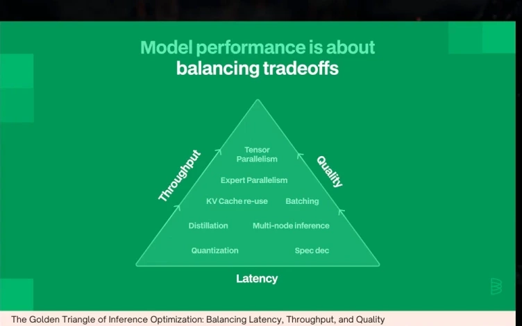
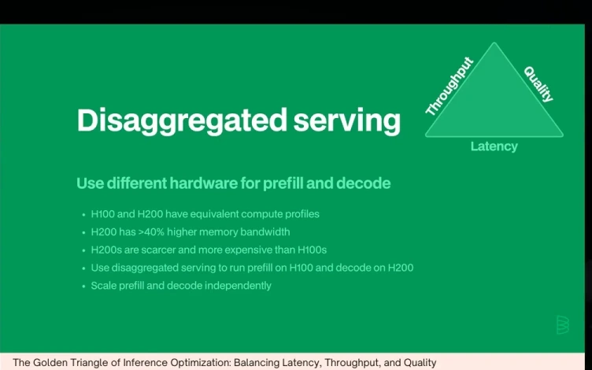
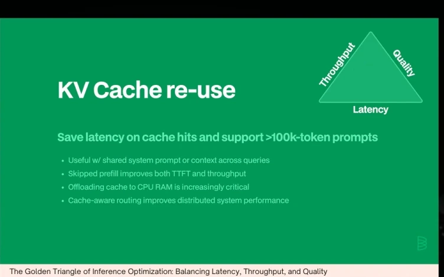
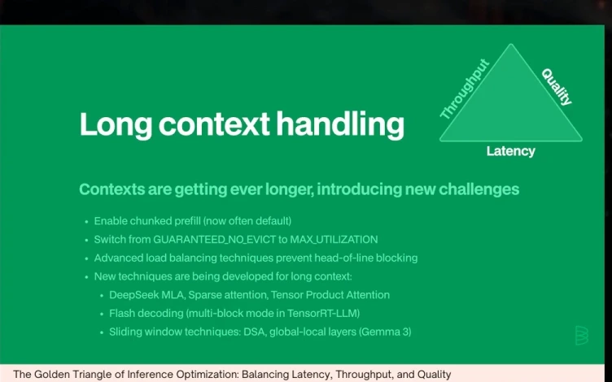
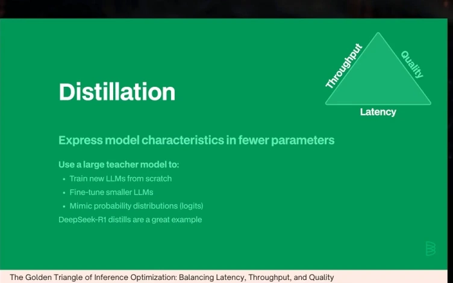
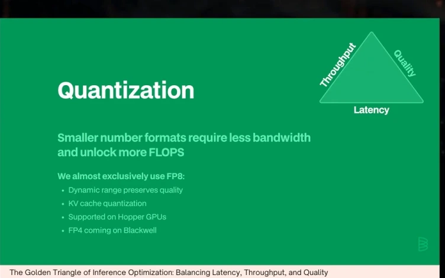
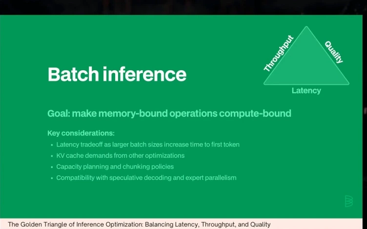
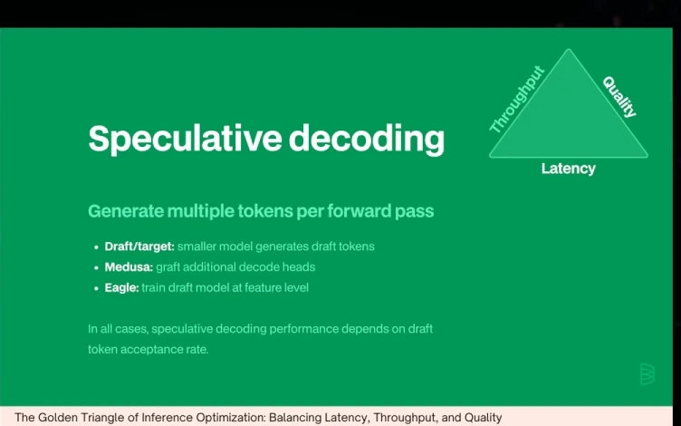
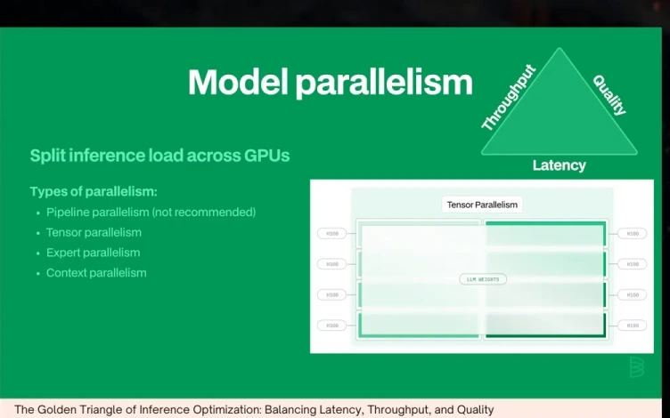
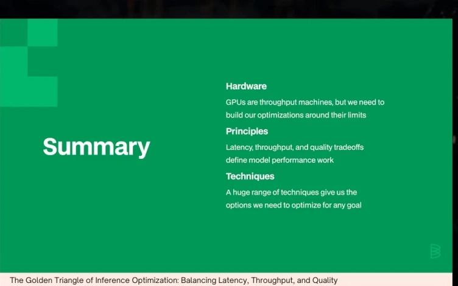

# 每个推理优化手段都在四段延迟之间搬运时间

> 视频来源：[The Golden Triangle of Inference Optimization: Balancing Latency, Throughput, and Quality](https://www.youtube.com/watch?v=fM-gEblrbmU)（YouTube · Optimized AI Conference，讲者 Philip Kiely，Baseten）｜时长约 25 分钟
> 简要导读：这是一场"技术选型"演讲：把延迟、吞吐、质量画成一个三角形，再把 batching、KV 复用、量化、投机采样、并行、PD 分离逐个放进三角形里，标出它主打哪一头、牺牲哪一头。本文按**端到端延迟的四段**重新组织了这些手段：哪个手段压哪一段，代价又落在哪一段。视频里没展开的收尾段与预算换算，用「补充」标出。

## 本讲要解决的核心问题（SCQA）

**背景**：端到端延迟可以拆成排队、Prefill（首字）、Decode（每 token）× 输出长度、收尾四段。拆开之后，下一个问题自然是：**每一段该用什么手段压**。

**冲突**：手段多得让人眼花——batching、KV 复用、量化、蒸馏、投机采样、张量并行、PD 分离、chunked prefill。每一个都被宣传成"更快"，但它们压的根本不是同一段，而且**每一个都要拿别的东西去换**。讲者一开场就把这个冲突讲透了："你把吞吐推上去，延迟就爆；你把延迟压下来，GPU 账单就冲上天；你想省钱，性能就受损。"更麻烦的是有些手段彼此不兼容——比如 KV 复用和超大 batch，它们在抢同一块显存。

**疑问**：这些手段分别压的是哪一段？代价落在哪一段？什么情况下这个手段根本不值得上？

**回答（中心思想）**：把延迟、吞吐、质量画成一个三角形，**每个优化手段都是在这个三角形里选一条边**；换成端到端延迟的语言，就是**每个手段都在四段之间搬运时间**——batching 用 Prefill/Decode 的时长换吞吐，KV 复用用显存换 Prefill 时长，量化用精度换带宽，PD 分离用硬件成本换两段互不干扰。所以选型的正确问法不是"哪个最快"，而是"**我要压的是哪一段，愿意在哪一段付账**"。

---

## 一、黄金三角怎么读：白字是主打，绿字是代价

### 1.1 一张图看懂所有手段的站位

讲者给每张幻灯片都放了同一个小三角形，规则只有两条：

- **白色文字**：这个手段主打的目标；
- **绿色文字**：这个手段会保持不变、或稍微牺牲的目标。

于是整场演讲变成一张地图：**模型选择、蒸馏、量化**靠"变小"同时改善延迟与吞吐，代价是质量；**batching** 主打吞吐，代价是延迟；**KV 复用、并行、投机采样**是罕见的"三赢"（延迟、吞吐、质量都不掉），但都有前置条件。

[【跳转到 01:25】](https://www.youtube.com/watch?v=fM-gEblrbmU&t=85)

### 1.2 四个约束决定了你能用哪些手段

讲者列了四类约束，它们比"哪个手段更快"更能决定选型：

| 约束 | 具体表现 | 对端到端延迟的含义 |
| --- | --- | --- |
| 算力与带宽 | Prefill 是计算受限，Decode 是显存带宽受限 | 压 TTFT 与压 TPOT 用的是两套手段 |
| 流量形态 | 流量低或不稳定时，很多优化从成本上不划算 | 排队段的优化（加副本）在小流量下是浪费 |
| 序列长度与内容 | 有些优化依赖请求内容（例如投机采样的接受率） | 输出长度直接乘在 TPOT 上，内容决定乘数 |
| 特性兼容 | KV 复用与大 batch 抢同一块显存 | 两个"三赢"手段可能互相抵消 |

最后一条最容易被忽略：**显存是公共预算**，KV 缓存要多留、batch 就开不大；batch 开大、KV 缓存就得让位。这不是配置问题，是容量问题。

---

## 二、排队段：能做的只有"加容量"和"别让它排队"

### 2.1 PD 分离：把两段负载放到不同硬件上，顺带让它们各自扩容

讲者把 **disaggregated serving**（PD 分离）归为"吞吐优化器"，但明确说"它也能帮延迟，只是那不是主要目标"。机制是：Prefill 是计算受限、Decode 是显存带宽受限，所以把它们放到**不同硬件**上，各取所需。

他给的例子很具体：H100 与 H200 的计算能力相当，但 **H200 的显存带宽高 40%**，而 H200 更稀缺、更贵。于是"Prefill 跑在 H100 上、Decode 跑在 H200 上"，同样的硬件预算能换来更高吞吐。

对端到端延迟来说，PD 分离的真正价值是**两段可以独立扩容**：Prefill 排队就加 Prefill 池，Decode 排队就加 Decode 池，不用整机一起加。这直接作用在排队段。

[【跳转到 12:11】](https://www.youtube.com/watch?v=fM-gEblrbmU&t=731)

### 2.2 但流量不够时，这些都不划算

讲者对"三赢"手段加了一个很硬的限定：**你需要有足够多的流量**，否则为它们买的硬件摊不平。他的原话是这些系统"每小时可能要花几百美元"，只有当你在足够大的规模上服务 token 时，每 token 成本才会降下来。

这条限定对排队段尤其重要：**排队段的解法本质上是买容量**。流量小的时候，"排队"不是问题；流量大的时候，买容量是唯一解，其他手段只是让同样的容量能扛更多。

---

## 三、TTFT 段：让 Prefill 少算一点

### 3.1 KV 复用：命中一次，Prefill 就省一段

讲者把 **KV cache reuse** 列为"三赢"第一名，并说"你基本上应该一直用它"。理由很直接：命中缓存时 **Prefill 被跳过**，于是 TTFT 与吞吐同时改善，质量不受影响。

它成立的前提是**请求之间有共享前缀**：同一段系统提示词、同一份上下文、同一个多轮对话的历史。讲者还提了两个工程细节：

- **缓存感知路由**：如果能把"前缀相同的请求"路由到同一台服务器，命中率会显著提高；
- **卸载到 CPU 内存**：缓存可以放到主机内存，甚至放到 GPU 之间的共享内存层。

对端到端延迟来说，KV 复用压的是公式里的 $\text{TTFT}_{\text{prefill}}$ 那一项，而且**压得很干净**——它不改变 decode 段，也不改变排队段。

[【跳转到 17:24】](https://www.youtube.com/watch?v=fM-gEblrbmU&t=1044)

### 3.2 长上下文：chunked prefill 与"别让一条长 prompt 堵住所有人"

讲者把长上下文单独列为一节，因为它同时抬高 TTFT 与排队：一条超长 prompt 的 Prefill 会长时间占住 GPU，其他人只能等。

他给的清单里，第一条就是**开启 chunked prefill**（现在多数框架默认开启），另外还有把显存策略从"保证不驱逐"切成"最大利用率"、以及用负载均衡避免队头阻塞。他还提到新模型层面的手段（DeepSeek 的 MLA 把长上下文需要的 KV 缓存减少约 93%、稀疏注意力、滑动窗口注意力等）。

**注意这里有一个方向性的事实**：chunked prefill 保护的是**别人的** TTFT/TPOT，代价是**这条长请求自己的** TTFT 变长——它要分好几轮才轮完。这条权衡的调度细节属于本系列第 3 章，这里只需要记住方向：**它把时间从"全体"搬到了"那一条"**。

[【跳转到 13:27】](https://www.youtube.com/watch?v=fM-gEblrbmU&t=807)

### 3.3 更小的模型：模型选择、蒸馏、量化

讲者把这三件事放在"延迟 + 吞吐，牺牲质量"那一侧，因为它们都通过"让每一步更便宜"来同时改善两段：

- **模型选择**：如果 8B 在你的评测上和 70B 一样好，那是白捡的胜利；
- **蒸馏**：用大模型教小模型，讲者给的量级是 DeepSeek-R1 的 671B 蒸馏进 Llama 3.3 的 70B，"每一个性能问题上都是 10 倍"的缩减；
- **量化**：更小的数制意味着**更少的带宽**和**更多的可用算力**。讲者说 Baseten 现在几乎只用 FP8，因为它的动态范围能保住质量（FP8 保留 4 位指数，而 INT8 一位指数都没有），甚至可以用来量化 KV 缓存；FP4 还在测试。

对端到端延迟来说，这三件事同时压 TTFT 与 TPOT，但**它们改的是公式里的系数，不是结构**：模型小一半，两段都短一截，排队段一点没变。

[【跳转到 09:00】](https://www.youtube.com/watch?v=fM-gEblrbmU&t=540)

---

## 四、TPOT × 长度段：batch 是延迟与吞吐的物理碰撞点

### 4.1 batch 为什么能提吞吐：把 memory-bound 变成 compute-bound

讲者的解释只有一句，但很到位：**读一次权重是固定成本**，如果能用这一次读取算更多请求，硬件的效率就上去了。所以 batching 的目标是"让这些访存受限的操作变成计算受限"。

他还强调了一个工程底线：**必须做 in-flight batching**（请求按 token 级别进出），而不是动态 batching、更不是一条一条处理。

### 4.2 代价：讲者说 TTFT 会涨；补充一句，TPOT 也会涨

讲者对代价的表述是明确的：**batch size 增大时，首字延迟也会增大**。他们的做法是"把 batch size 从 1、2、4、6、8 一路跑到 128，画出一条'总产出 token 数 vs 首字延迟'的权衡曲线，然后交给客户选"。

这里需要补一句（**补充**，视频未展开）：在 decode 阶段，**每 token 的时间同样会随 batch 变大而变长**——一个 decode 步要同时为 batch 里所有序列算一遍注意力与 FFN，batch 越大这一步越久。所以 batching 的真实代价是双向的：

$$
\Delta \text{E2E} \approx \underbrace{\Delta \text{TTFT}}_{\text{排队 + Prefill}} + \underbrace{\Delta \text{TPOT} \times (N_{\text{out}}-1)}_{\text{乘数放大}}
$$

**这就是本节的核心矛盾**：batch 变大 → 吞吐上去 → 排队变短；但同一个 batch 也让 TTFT 与 TPOT 变长。对于短输出请求，TTFT 的增量占主导；对于长输出请求，TPOT 的增量被 $N_{\text{out}}$ 放大，往往才是致命的。所以"batch 开多大"这个问题**没有统一答案，只有按输出长度分桶的答案**。

[【跳转到 11:06】](https://www.youtube.com/watch?v=fM-gEblrbmU&t=666)

### 4.3 投机采样：用算力换 TPOT

讲者把 **speculative decoding** 放在"延迟 + 质量"那一侧：它不改善吞吐的经济性，但能显著压低每 token 时间。原理是"读一次权重，产出多个 token"——草稿模型先猜几个 token，目标模型一次性验证，猜对的部分直接留下。

讲者给了一个具体例子：草稿模型给出 A、B、E、D，目标模型验证后认为 A、B 正确、E 错误，于是 E 之后全部丢弃，A、B 作为前缀进入下一次前向，再产出一个 C——**一次前向拿到三个 token**。

他也点出了这个手段的软肋：**收益取决于接受率，而接受率取决于请求内容**。代码生成这类高度可预测的内容效果好，写诗这类不可预测的内容效果差。所以投机采样要"限制在它真正有意义的领域里"。

对端到端延迟来说，投机采样只压 **TPOT**，而且压的是乘数项——**输出越长，收益越大**。这正好和 batching 的代价形成对冲。

[【跳转到 14:42】](https://www.youtube.com/watch?v=fM-gEblrbmU&t=882)

### 4.4 并行：把单请求的时间切到多张卡上

讲者把并行也归入"三赢"，但加了同样的限定：**你得有足够的流量来摊平这些卡的成本**。他列了四种：

| 并行方式 | 做什么 | 对端到端延迟的影响 |
| --- | --- | --- |
| 流水并行（PP） | 按层切到多卡，顺序执行 | 讲者明确"一般不推荐" |
| 张量并行（TP） | 每层切到多卡，所有卡一起算每个 token | 压低单请求延迟，代价是持续的高带宽通信 |
| 专家并行（EP） | 每个专家整块放在一张卡上 | 适合 MoE，通信量小，适合多节点 |
| 上下文并行（CP） | 把请求的上下文切到多卡 | 长上下文场景有用 |

对端到端延迟来说，**TP 压的是 TTFT 与 TPOT 两段**（每步都更快），但代价是通信开销可能反噬——卡数越多、互联越弱，新增的通信时间可能吃掉收益。这条属于本系列第 9 章，这里只记方向。

[【跳转到 19:36】](https://www.youtube.com/watch?v=fM-gEblrbmU&t=1176)

---

## 五、收尾段：最便宜也最常被忘掉的一段（补充）

视频没有专门讲收尾段，但它在端到端公式里是真实存在的一项。**补充**三条成本极低、收益确定的做法：

| 做法 | 压掉的是什么 | 代价 |
| --- | --- | --- |
| 流式结束检测（明确的结束标记） | 客户端等到超时才认为结束的那段时间 | 需要协议支持，几乎无成本 |
| 连接复用（keep-alive / HTTP2 多路复用） | 每条请求重新握手的时间 | 需要网关配合 |
| 提前关闭（服务端主动 flush 并结束） | 最后一个 token 到连接关闭的等待 | 要注意别截断最后一包 |

这三条之所以值得做，是因为它们**不动模型、不动调度、不影响质量**——纯粹的工程卫生。收尾段通常只占几十毫秒，但在 P99 上它经常是"最后一根稻草"。

---

## 六、把手段放回四段：一张选型对照表

把整场演讲的内容按端到端延迟的四段重新排列，就得到这张表：

| 手段 | 主要压哪一段 | 代价落在哪 | 前置条件 |
| --- | --- | --- | --- |
| 加副本 / 独立扩容（PD 分离） | 排队 | 硬件成本 | 流量要够大，否则摊不平 |
| 限流 / 优先级队列 | 排队（保护高优请求） | 低优请求的延迟 | 需要业务分级 |
| KV 复用 + 缓存感知路由 | TTFT（Prefill） | 显存（挤占 batch 空间） | 请求之间有共享前缀 |
| chunked prefill | 别人的 TTFT/TPOT（防队头阻塞） | 长请求自己的 TTFT | 框架支持 |
| 模型选择 / 蒸馏 / 量化 | TTFT + TPOT | 质量 | 评测能证明质量可接受 |
| batching | 吞吐（间接缩短排队） | TTFT + TPOT × 输出长度 | 必须有 in-flight batching |
| 投机采样 | TPOT（乘数项） | 额外算力、依赖接受率 | 内容可预测、流量足够 |
| 张量并行 | TTFT + TPOT | 通信开销、卡成本 | 互联带宽跟得上 |
| 流式结束检测 / 连接复用 | 收尾 | 几乎为零 | 协议与网关支持 |

这张表最实用的读法是**从右往左看**：先确认前置条件成不成立，再看代价你付不付得起，最后才看它压哪一段。讲者的整场演讲其实就在说这件事——**没有"最快的配置"，只有"为你的目标付对了账的配置"**。

---

## 七、一句话记住整场演讲

讲者的收尾是："GPU 是吞吐机器，但我们要围绕它的限制来建优化；我们要在延迟、吞吐、质量之间做恰当的权衡，并用今天市场上这一大批手段去达成目标。"

翻译成端到端延迟的语言：**每一个手段都是把时间从一段搬到另一段，或者把成本从一处搬到另一处**。所以优化之前先回答三个问题：

1. 我要压的是哪一段？（排队 / TTFT / TPOT × 长度 / 收尾）
2. 这个手段把时间搬到了哪一段？那一段我付得起吗？
3. 它的前置条件（流量、前缀重复度、内容可预测性、互联带宽）我满足吗？

---

## 小结

- **黄金三角**：延迟、吞吐、质量选二。幻灯片上白字是主打、绿字是被牺牲的目标，一张图就能读出每个手段的站位。
- **排队段只能买容量**：加副本、PD 分离让两段独立扩容、限流与优先级队列保护高优请求。流量不够大时，这些都不划算。
- **TTFT 段靠"少算"**：KV 复用跳过 Prefill（三赢，但要显存）、chunked prefill 防队头阻塞（代价是长请求自己的 TTFT）、模型选择/蒸馏/量化把系数整体缩小。
- **TPOT × 长度段的核心矛盾是 batching**：batch 越大吞吐越高、排队越短，但 TTFT 与 TPOT 都变长，而 TPOT 的增量会被输出长度放大。讲者的做法是跑 1~128 的 batch 曲线让客户选。
- **投机采样只压 TPOT**，收益取决于接受率，因此依赖内容；输出越长收益越大，正好对冲 batching 的代价。
- **并行压 TTFT 与 TPOT**，代价是通信；PP 不推荐，TP 适合单节点高带宽，EP 适合 MoE 与多节点。
- **收尾段最便宜**：流式结束检测、连接复用、提前关闭，不动模型不影响质量。
- **选型顺序是"前置条件 → 代价 → 压哪一段"**，不是"哪个最快"。

## 关键术语速查

| 术语 | 一句话解释 |
| --- | --- |
| 黄金三角 | 延迟、吞吐、质量三者的取舍关系，任何优化手段都要在三角形里选一条边 |
| batching | 一次前向处理多个请求，把访存受限变成计算受限，代价是延迟变长 |
| in-flight batching | 请求按 token 级别进出 batch，而不是整批等齐再走 |
| PD 分离（disaggregated serving） | Prefill 与 Decode 跑在不同硬件上，各自独立扩容 |
| KV 复用 | 命中共享前缀的缓存，跳过这段 Prefill，同时改善 TTFT 与吞吐 |
| chunked prefill | 把长 prompt 的 Prefill 切块与 Decode 交错，防止长请求堵住队列 |
| 投机采样 | 草稿模型先猜多个 token，目标模型一次验证，一次前向产出多个 token |
| 张量并行（TP） | 每层切到多卡，所有卡一起算每个 token，压低单请求延迟但需要持续通信 |
| 专家并行（EP） | MoE 模型里把整个专家放到单卡，通信量小，适合多节点 |
| 蒸馏 | 用大模型教小模型模仿其概率分布，把同样的特性塞进更少参数 |
| FP8 | 8 位浮点，保留 4 位指数因而动态范围大，是当前生产环境的量化基线 |
| memory-bound / compute-bound | 受限因素分别是显存带宽 / 算力；Decode 通常是前者，Prefill 通常是后者 |