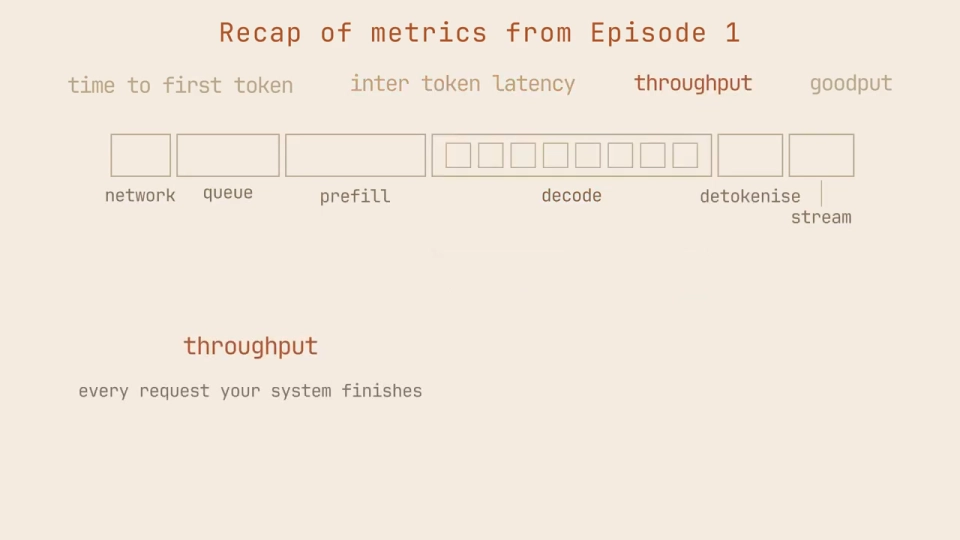
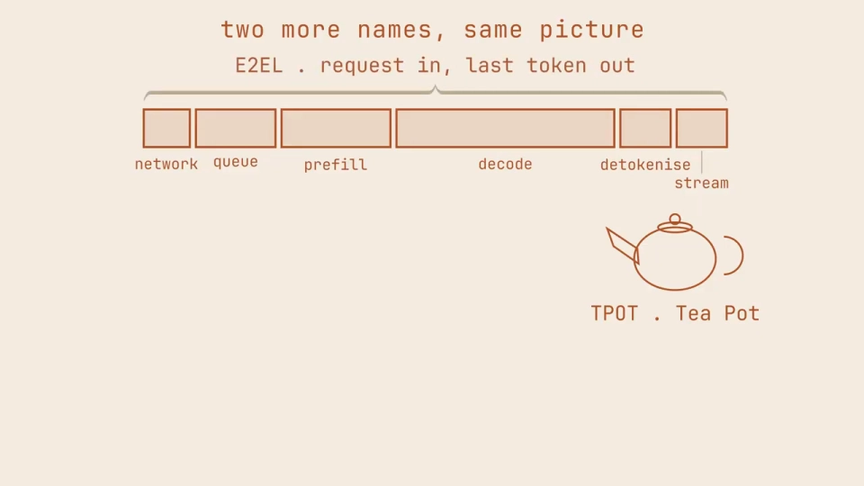
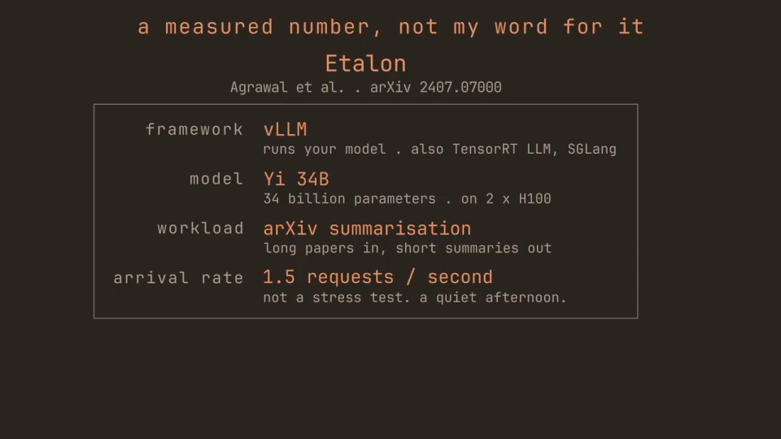
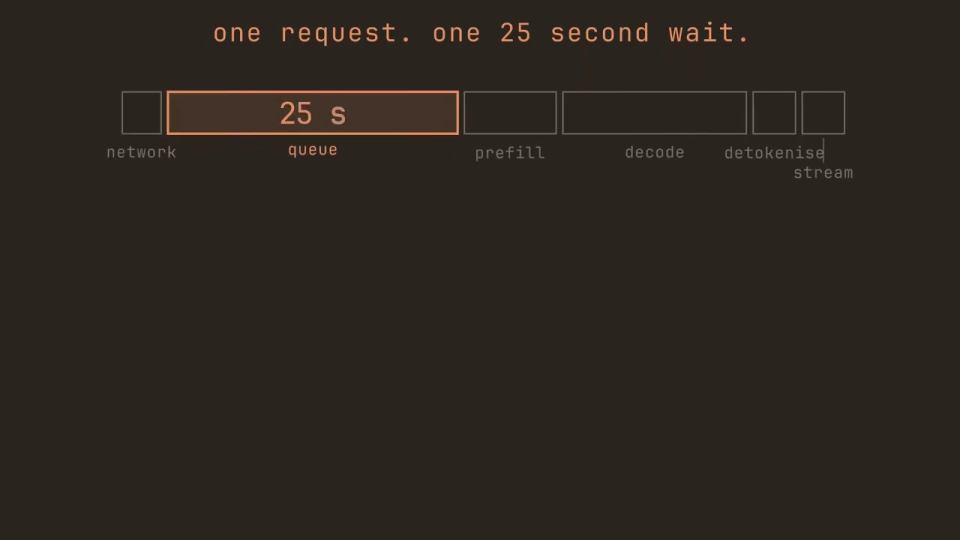
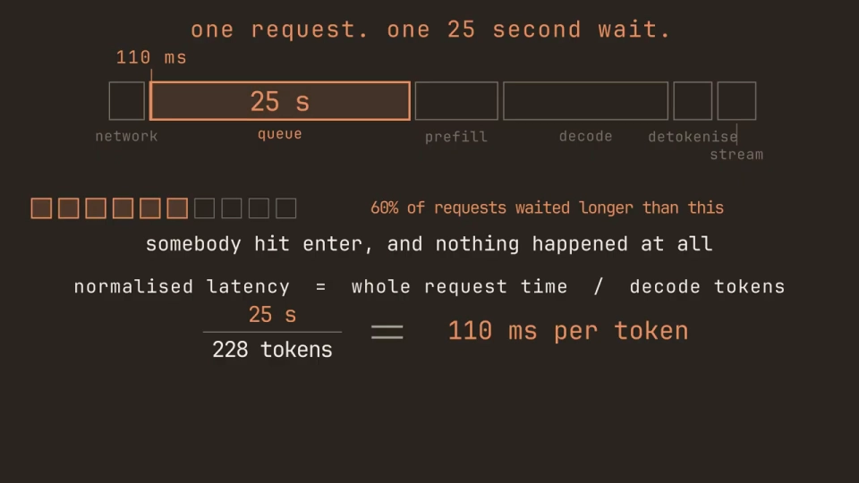
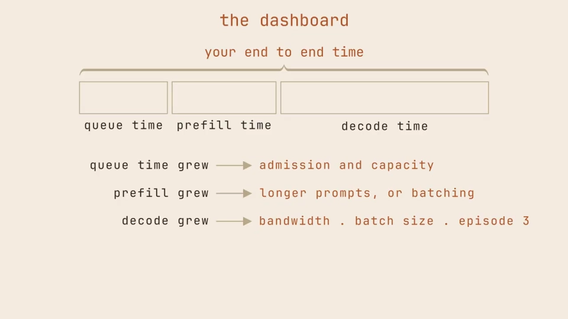
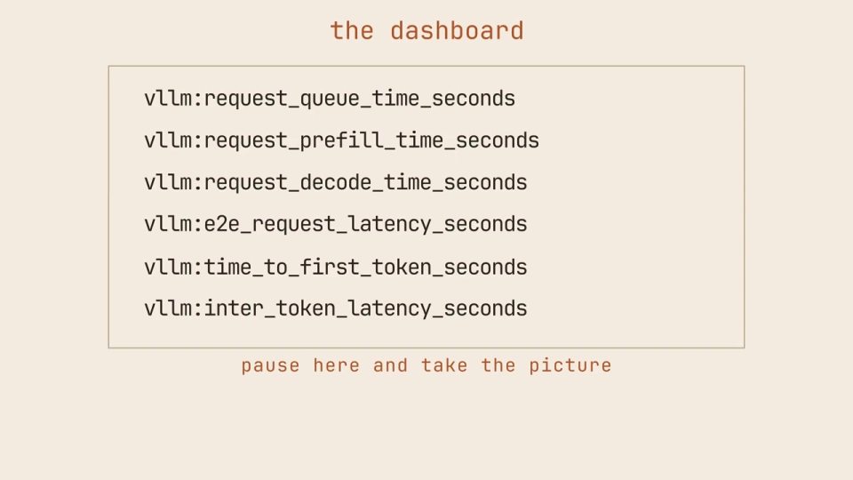
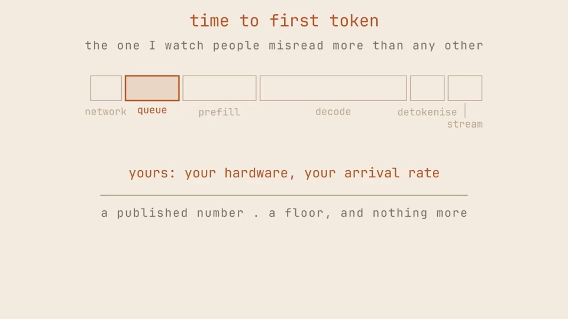
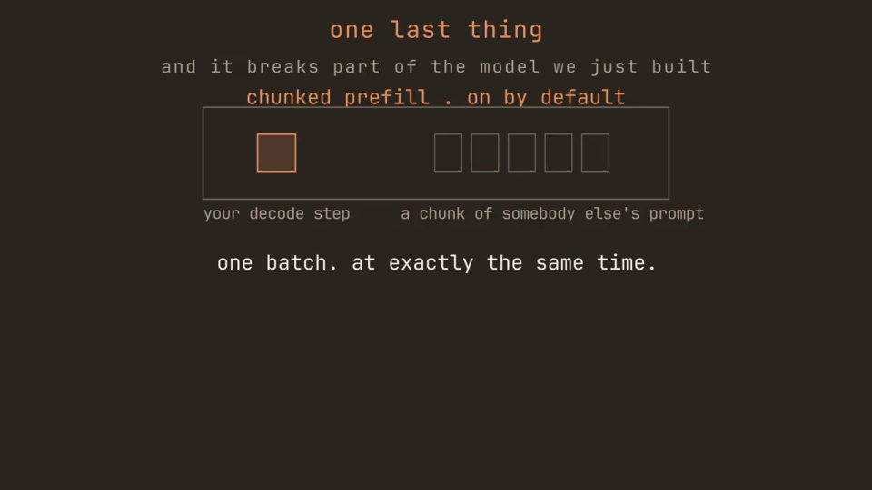

# 端到端延迟必须拆成排队、Prefill、Decode 三段来量

> 视频来源：[LLM Latency Metrics Explained: TTFT, TPOT, ITL, E2EL (And Why They Lie)](https://www.youtube.com/watch?v=lEVGHBcop7c)（YouTube · The Agentic Enterprise，讲者 Mani Khanuja，AWS）｜时长约 10 分钟
> 简要导读：这支视频不讲新指标，讲**你已经挂在面板上的指标为什么会骗你**。它把端到端延迟拆成排队、Prefill、Decode 三段，并用一篇实测论文说明排队段能有多离谱。本文只取"端到端"这一条线：三段分解、排队为什么是最大变量、按 token 归一化如何把排队稀释掉、以及测量口径的四个陷阱。TTFT 的分段拆解与 TPOT/ITL 的口径差异属于本系列相邻小节，本文只引用结论。

## 本讲要解决的核心问题（SCQA）

**背景**：做推理服务的人，面板上迟早会挂上这几个指标：首字延迟（TTFT）、单 token 生成时间（TPOT）、每秒 token 数（吞吐）。它们各自都有明确的定义，也都能画出漂亮的曲线。

**冲突**：视频开场给了一个让人不舒服的场景——**屏幕上每一张图都是绿的，延迟稳稳落在和产品团队约定的目标之内，而用户在悄悄流失**。讲者的诊断只有一句话：最直觉的那种测法，恰好也是把问题藏起来的那种测法。指标没坏，配置没错，测量忠实地执行了它的设计——而设计本身把一次 25 秒的卡顿埋掉了。

**疑问**：端到端延迟到底由哪几段构成？哪一段最不可预测、最容易被面板掩盖？为什么"平均每个 token 110 毫秒"可以和"用户等了 25 秒"同时成立？要怎样才能让一次延迟回归只留下三个可能的答案？

**回答（中心思想）**：端到端延迟不是一个数，而是**排队时间 + Prefill 时间 + Decode 时间**三段相加；三段里只有后两段由你的模型和推理栈决定，**排队段由到达率和调度决定，是最大的变量**；而所有"按 token 数归一化"的指标（TPOT、normalized latency）都会把排队时间摊薄到几百个 token 上，于是**一次 25 秒的静默在图上只剩 110 毫秒**。解决办法不是换指标，而是**三段分开存、分开看**，再配一个客户端口径的端到端数字。

---

## 一、端到端延迟是三个数相加，不是一个"总时长"

### 1.1 时间轴上其实有六段，但只有三段归你管

视频把一次请求画成一条横向时间轴，从左到右依次是：

| 段 | 里面发生什么 | 谁负责 |
| --- | --- | --- |
| 网络（network） | 请求从客户端走到服务端 | 链路、CDN、地域 |
| 排队（queue） | 请求进了系统，但还没轮到 GPU | 准入控制与容量 |
| 预填充（prefill） | 整条 prompt 一次前向，产出第一个 token | 模型 + 推理栈 |
| 解码（decode） | 一个 token 一个 token 往外吐 | 模型 + 推理栈 |
| 反分词（detokenise） | token id 还原成文字 | 推理栈 |
| 流式回传（stream） | 逐段推给客户端 | 链路 + 前端 |

讲者的做法很干脆：**只把中间三段当作"你的端到端时间"**，因为网络与前端渲染属于另一条时间线（客户端口径）。

$$
\text{E2E}_{\text{服务端}} = t_{\text{排队}} + t_{\text{prefill}} + t_{\text{decode}}
$$

这就是本节要记住的第一句话：**端到端 = 排队 + Prefill + Decode**。视频的原话是"你的端到端时间是三样东西加起来的，把三段分开留着，你的回归就不再是谜案"。

[【跳转到 06:52】](https://www.youtube.com/watch?v=lEVGHBcop7c&t=412)

### 1.2 换成 TTFT / TPOT 的写法，就出现那个"减一"

同一件事有两种等价写法。用首字延迟和单 token 时间表达时，公式长这样（**补充**：视频只给了三段相加的版本，下面这个换算是把 TPOT 的定义代进去得到的）：

$$
\text{E2E} = t_{\text{排队}} + \text{TTFT}_{\text{prefill}} + \text{TPOT} \times (N_{\text{out}} - 1) + t_{\text{收尾}}
$$

其中 $N_{\text{out}}$ 是输出的 token 数。**为什么要减一**：第一个 token 的生成时间已经包含在 TTFT 里了——TTFT 的定义就是"请求进入到第一个 token 产出"。如果 decode 段再乘一个完整的 $N_{\text{out}}$，第一个 token 就被算了两次。所以 decode 段真正要付的是**剩下 $N_{\text{out}}-1$ 个 token** 的时间。

各项的口径与典型量级（量级为**补充**的工程经验值，不是视频给出的数字）：

| 分段 | 口径 | 典型量级 | 谁决定 |
| --- | --- | --- | --- |
| $t_{\text{排队}}$ | 请求入队到被调度上 GPU | 空载 0 ms，满载可达秒级到几十秒 | 到达率、batch 调度、副本数 |
| $\text{TTFT}_{\text{prefill}}$ | 开始 prefill 到第一个 token | 100 ms ~ 1 s（随 prompt 长度增长） | prompt 长度、前缀命中率 |
| $\text{TPOT}$ | decode 段总时长 ÷ 输出 token 数 | 10 ~ 50 ms/token | batch 大小、显存带宽、量化 |
| $t_{\text{收尾}}$ | 最后一个 token 到流关闭 | 几 ms ~ 几十 ms | 流式结束检测、连接复用 |

这张表最重要的一列是最后一列：**四段里只有第一段和你的模型无关**。模型换不掉排队，加卡才能。

---

## 二、排队时间是端到端延迟里最大的变量

### 2.1 一篇实测论文：安静的下午，60% 的请求排了 25 秒以上

视频没有停在"排队可能很长"这种笼统说法上，而是引了一篇叫 **Etalon** 的论文（Agrawal 等，arXiv 2407.07000），并把实验设置逐项念了一遍，因为每一项都影响结论：

- **框架**：vLLM（开源推理框架，负责真正跑模型、把 token 递回给用户；同类还有 TensorRT-LLM 与 SGLang）；
- **模型**：Yi 34B，340 亿参数，跑在 **2 张 H100** 上；
- **负载**：真实的 arXiv 摘要请求——长论文进、短摘要出；
- **到达率**：约 **1.5 请求/秒**。

讲者对最后这个数字的评价是："这不是压力测试，这是一个安静的下午。"

然后他们量了 **scheduling delay**——请求在队列里干等、什么也没发生的那段时间。结果是：**60% 的请求，这个数字超过 25 秒**。

[【跳转到 03:44】](https://www.youtube.com/watch?v=lEVGHBcop7c&t=224)

25 秒在用户那一端是什么？讲者的描述是："有人按了回车，然后屏幕什么都没发生，久到超过大多数人愿意为任何事等待的时间。"

这就是本节的核心事实：**端到端延迟里最大的一段，往往不是模型算得慢，而是请求根本没开始算**。而且它出现在一个"每秒 1.5 个请求"的低负载场景里——按直觉，两台 H100 服务 34B 模型不该排队。

### 2.2 排队为什么不属于模型：它由到达率与调度决定

模型决定的是"服务一个请求要多久"（service time），排队决定的是"轮到你要多久"（waiting time）。后者只和两件事有关：

1. **到达率** $\lambda$ 与服务能力 $\mu$ 的比值——也就是利用率；
2. **调度策略**：先来先服务、按 token 计费的公平份额、还是给交互流量优先权。

讲者把这一点压缩成一句可操作的判断：**排队时间涨了，问题在准入与容量；Prefill 涨了，是 prompt 变长或 batch 变了；Decode 涨了，是带宽与 batch 大小**。三句话分别指向三套完全不同的修法。

至于"利用率接近 1 时排队为什么非线性爆炸"——那是 Little 定律与 $1/(1-\rho)$ 的地盘，本系列另一篇专门讲，这里只需要记住结论：**排队段是四段里唯一会随负载突然失控的一段**。

---

## 三、按 token 归一化的指标会把排队稀释掉

### 3.1 25 秒除以 228 个 token，等于 110 毫秒

接下来是整支视频最锋利的一段。业界比较推理系统时最常用的指标叫 **normalized latency**（归一化延迟），算法极简单：

$$
\text{normalized latency} = \frac{\text{整个请求耗时}}{\text{生成的 token 数}}
$$

在 Etalon 那条 trace 里，中位数请求产出 **228 个 decode token**。把那 25 秒的等待摊到这 228 个 token 上：

$$
\frac{25\ \text{s}}{228} \approx 110\ \text{ms/token}
$$

于是**一次 25 秒的冻结，落到你的图上只有 110 毫秒**。讲者特意强调："这里没有任何东西坏掉——没人配错参数，测量完全按设计执行，而正是这个设计把 25 秒的卡顿埋了。"

[【跳转到 04:09】](https://www.youtube.com/watch?v=lEVGHBcop7c&t=249)

### 3.2 TPOT 有同样的问题，因为它也在除以 token 数

讲者顺手把 TPOT 也归进这一类：TPOT 的定义就是"一个请求 decode 段的总时间 ÷ 它产出的 token 数"，所以它**同样会把一次卡顿摊薄**。任何形状是"总时间 ÷ token 数"的指标都有这个性质。

他的建议不是扔掉 TPOT——TPOT 在容量规划和每 token 成本上确实有用——而是：

- **两个都画**：TPOT 旁边必须并排放 ITL 的 P99；
- **一条墙上的规则**：如果你的告警阈值全都设在均值上，那你等于**对卡顿完全没有告警**，你会从用户那里得知。

（TPOT 与 ITL 的口径差异、以及为什么卡顿只在 P99 上显形，属于本系列 2.1.2 的内容，这里只引用结论。）

---

## 四、三段分开之后，回归就只剩三个答案

### 4.1 一张归因表

视频把"端到端变慢了"这件事压缩成一张三行的表，每行一个段、一个原因域：

| 哪一段涨了 | 说明什么 | 先查什么 |
| --- | --- | --- |
| 排队时间 | 准入与容量 | 副本数、并发上限、优先级队列、是否有限流 |
| Prefill 时间 | prompt 变长，或 batch 在下面变了 | 输入长度分布、前缀缓存命中率、batch 组成 |
| Decode 时间 | 带宽与 batch 大小 | batch 大小、量化、显存带宽是否打满 |

这张表的用法是**先分类再动手**：看到端到端变慢，先问"是哪一段涨了"，而不是直接去调 batch 或者换模型。

[【跳转到 07:17】](https://www.youtube.com/watch?v=lEVGHBcop7c&t=437)

### 4.2 vLLM 里这三段都有现成的指标名

讲者把指标名放在幻灯片上而不是念出来，理由是"名字是用来截图的"。这六个名字值得抄下来：

| 指标 | 对应哪一段 |
| --- | --- |
| vllm:request_queue_time_seconds | 排队 |
| vllm:request_prefill_time_seconds | Prefill |
| vllm:request_decode_time_seconds | Decode |
| vllm:e2e_request_latency_seconds | 端到端（三段之和） |
| vllm:time_to_first_token_seconds | 首字（排队 + Prefill） |
| vllm:inter_token_latency_seconds | token 间隔（分布，不是均值） |

注意 `e2e_request_latency_seconds` 与三段之和的关系：**端到端指标本身没有诊断能力**，它的价值只在于和三段对照——三段之和与它对不上，说明还有一段没被计入（比如收尾、或框架外的网关耗时）。

---

## 五、测量口径的四个陷阱

### 5.1 厂商公布的 TTFT 是地板，不是目标

视频对"拿别人的数字当目标"这件事很不客气：你读到的 TTFT 来自厂商 benchmark、模型卡、发布会——而**那些服务器在测量时几乎什么都没干**。空载服务器上排队时间是零，所以他们的 TTFT 基本就等于 Prefill，也就是"快而可预测的那一半"。

你的数字不会长这样，而这**不是你配置错了，是你的服务器上有别人**。所以：

> 把公布的数字当成地板，仅此而已。唯一值得拿来调参的，是你自己在自己的硬件上、按你用户真实产生的到达率量出来的那个数。

[【跳转到 06:02】](https://www.youtube.com/watch?v=lEVGHBcop7c&t=362)

### 5.2 客户端计时 vs 服务端计时

服务端量的是"请求体收完 → 第一个 token 送出"，客户端量的是"按下按钮 → 第一个字渲染出来"。后者多了上行、下行与渲染，才是用户真正等的那段空白。**端到端延迟同理**：服务端的 $t_{\text{排队}}+t_{\text{prefill}}+t_{\text{decode}}$ 不含网络，客户端的端到端才含。

（这两个口径的完整拆解在 2.1.1，这里只记住一条：**报端到端 SLO 时必须说清是谁量的**。）

### 5.3 流式首包与末包、重试与超时、连接建立

这三个问题视频没有逐条展开，但都是**补充**里必须点名的口径陷阱，因为它们每一个都能让数字差出数倍：

| 陷阱 | 错在哪 | 正确口径 |
| --- | --- | --- |
| 流式首包 vs 末包 | 把"连接建立事件"当成第一个 token | 取**含真实内容**的第一个 SSE 事件；末包要取最后一个内容 token，不是 `[DONE]` |
| 重试与超时 | 只统计成功请求，把超时的那批悄悄丢掉 | 超时与重试要么计入失败率，要么计入端到端（重试的耗时也是用户等的） |
| 连接建立 | 把 TCP/TLS 握手算进服务端时间 | 服务端从**请求体收完**起算；TLS 属于客户端口径 |
| 特殊 token | 把静默的角色标记当成"第一个可见 token" | 量第一个**用户可见**的输出 token |

### 5.4 chunked prefill 让 token 间隔变成"调度数字"

最后一个坑很现代，讲者说它"打破了我们刚建好的模型"：新版 vLLM 默认开启 **chunked prefill**，于是一个 batch 里可以同时装着"你这个请求的一个 decode 步"和"别人 prompt 的一个分块"。

后果是：**你在忙的共享服务器上量到的 token 间隔，不是纯 decode 时间，而是调度器在那一刻的选择**。讲者的处理方式很务实——不要关掉它（它是好东西），而是**把忙服务器上的 token 间隔当成调度数字来读**。

[【跳转到 07:53】](https://www.youtube.com/watch?v=lEVGHBcop7c&t=473)

---

## 六、从端到端 SLO 反推每段预算（补充，一个可算的例子）

视频给了三段分解，但没有给"预算怎么分"。这一步是**补充**，也是三段分解最实用的用途：**端到端 SLO 是总预算，三段是分项预算**。

假设产品要求：**端到端 P95 < 10 秒**，典型输出 **500 个 token**。按 1.2 的公式拆：

$$
t_{\text{排队}} + \text{TTFT} + \text{TPOT} \times 499 + t_{\text{收尾}} \le 10\ \text{s}
$$

先给三段分配预算（分配的依据是历史 P95，不是拍脑袋）：

| 分项 | 预算 | 依据 |
| --- | --- | --- |
| 排队 | 1.5 s | 允许峰值时排一小会儿，但不超过 1.5 s |
| TTFT | 1.0 s | 当前 prompt 长度分布的 P95 |
| 收尾 | 0.2 s | 流关闭 + 最后一包传输 |
| Decode | 剩下的 7.3 s | 由总预算倒挤 |

于是 TPOT 的上限就被算出来了：

$$
\text{TPOT} \le \frac{10 - 1.5 - 1.0 - 0.2}{499} = \frac{7.3}{499} \approx 14.6\ \text{ms/token}
$$

这个数字立刻能回答三个工程问题：**batch 能开多大**（TPOT 超过 14.6 ms 就不能再开）、**要不要上投机采样**（把 TPOT 压到 10 ms 以下就换来 2 秒余量）、**前缀缓存值不值得做**（TTFT 从 1.0 s 降到 0.4 s，等于给 decode 多让出 0.6 s，TPOT 上限升到 15.8 ms）。

反过来算一遍更能说明问题：如果同一个 10 秒 SLO 下，输出长度变成 **2000 个 token**：

$$
\text{TPOT} \le \frac{10 - 2.7}{1999} \approx 3.65\ \text{ms/token}
$$

3.65 ms/token 在多数模型上是做不到的。**这不是"优化不够"，这是"这个 SLO 和这个输出长度不兼容"**——唯一的产品级解法是限制 max_tokens，或者对长输出单独定一档 SLO。

---

## 七、输出长度是乘数，所以必须按长度分桶

### 7.1 平均 200 token 和 P99 2000 token，差一个数量级

上面的例子已经说明了机制：TPOT 在公式里是**乘数**，它乘的是 $N_{\text{out}}-1$。所以输出长度的分布直接决定了端到端延迟的分布：

- 输出 200 token、TPOT 15 ms → decode 段 3.0 s；
- 输出 2000 token、TPOT 15 ms → decode 段 30.0 s。

**同样的模型、同样的 TPOT，端到端差了 10 倍**。这就是为什么"平均端到端 4 秒"这种数字没有意义：它把一个 3 秒的短回答和一个 30 秒的长回答平均成了同一个数。

### 7.2 所以必须按输出长度分桶

正确的统计口径是**先分桶、再算分位数**：

| 桶 | 输出长度 | 该桶该看的指标 |
| --- | --- | --- |
| 短回答 | < 200 token | TTFT 主导，看 TTFT P95 |
| 中回答 | 200 ~ 800 token | 排队 + TTFT + decode 三者可比 |
| 长回答 | > 800 token | decode 主导，看 TPOT P95 与是否触顶 max_tokens |

不分桶的端到端 P95 会被长回答完全支配，于是你为了一个"长尾"去优化 TTFT，白忙一场。

### 7.3 产品上限制 max_tokens 是延迟治理，不只是省钱

max_tokens 在公式里是 $N_{\text{out}}$ 的上界。把它设成一个明确的值，等于**给端到端延迟设了一个硬上界**：

$$
\text{E2E}_{\max} \approx t_{\text{排队}} + \text{TTFT} + \text{TPOT} \times (\text{max\_tokens} - 1) + t_{\text{收尾}}
$$

这也解释了为什么长输出场景（报告生成、代码生成）常常要单独定 SLO、单独配容量——它们的 $N_{\text{out}}$ 分布和聊天完全不同。

---

## 小结

- **端到端是三段相加**：排队 + Prefill + Decode。换成 TTFT/TPOT 写法时是 $\text{TTFT} + \text{TPOT}\times(N_{\text{out}}-1)$，减一是因为第一个 token 已经算在 TTFT 里。
- **排队是最大变量，而且它不属于模型**：Etalon 的实测里，1.5 请求/秒的"安静下午"，60% 的请求排队超过 25 秒。
- **按 token 归一化会把排队稀释掉**：25 秒 ÷ 228 token = 110 ms/token，一次冻结在图上只剩一百多毫秒。TPOT 有同样的性质。
- **三段必须分开存、分开看**：排队涨→准入与容量；Prefill 涨→prompt 或 batch；Decode 涨→带宽与 batch。vLLM 六个指标名可以直接抄。
- **公布的 TTFT 是地板**：厂商数字是在空载服务器上量的，排队为零；只有你自己按真实到达率量的数才值得调。
- **测量口径先钉死**：客户端 vs 服务端、首包 vs 末包、重试超时算不算、TLS 算不算；忙服务器上的 token 间隔是调度数字，不是纯 decode。
- **SLO 要反推成分项预算**：10 秒 P95 + 500 token → TPOT ≤ 14.6 ms；同样 10 秒 + 2000 token → TPOT ≤ 3.65 ms，说明该限 max_tokens 而不是继续优化。
- **输出长度是乘数**：按输出长度分桶统计，否则端到端 P95 会被长回答支配。

## 关键术语速查

| 术语 | 一句话解释 |
| --- | --- |
| E2E（端到端延迟） | 请求进入到最后一个 token 离开的总时间，服务端口径下等于排队 + Prefill + Decode |
| 排队时间（queue time / scheduling delay） | 请求已进入系统但还没轮到 GPU 的那段时间，由到达率与调度决定 |
| Prefill | 把整条 prompt 一次前向算完、产出第一个 token 的阶段 |
| Decode | 一个 token 一个 token 往下生成的阶段，耗时正比于输出长度 |
| TTFT | 首字延迟，服务端口径下等于排队 + Prefill |
| TPOT | 单 token 生成时间，等于 decode 段总时长 ÷ 输出 token 数（一个均值） |
| ITL | 相邻两个 token 的间隔，是一个分布，P99 才能看见卡顿 |
| normalized latency | 整个请求耗时 ÷ 生成 token 数，会稀释排队与卡顿 |
| Etalon | 一篇 LLM 服务评测论文（Agrawal 等，arXiv 2407.07000），本文的 25 秒排队数据来自它 |
| chunked prefill | 把长 prompt 的 Prefill 切块，与正在进行的 Decode 装进同一个 batch |
| SLO | 服务等级目标，例如"端到端 P95 < 10 秒"；本文用它反推每段预算 |
| max_tokens | 输出长度的硬上界，等于给端到端延迟设了一个上界 |