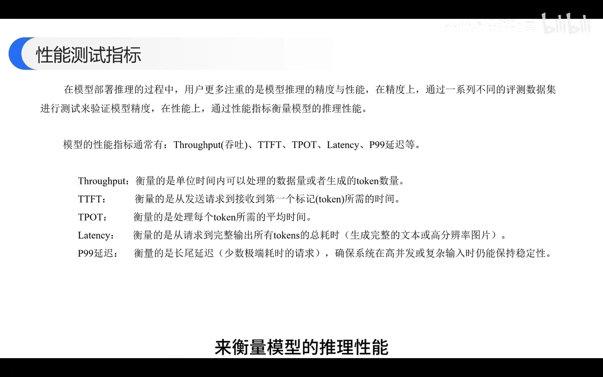
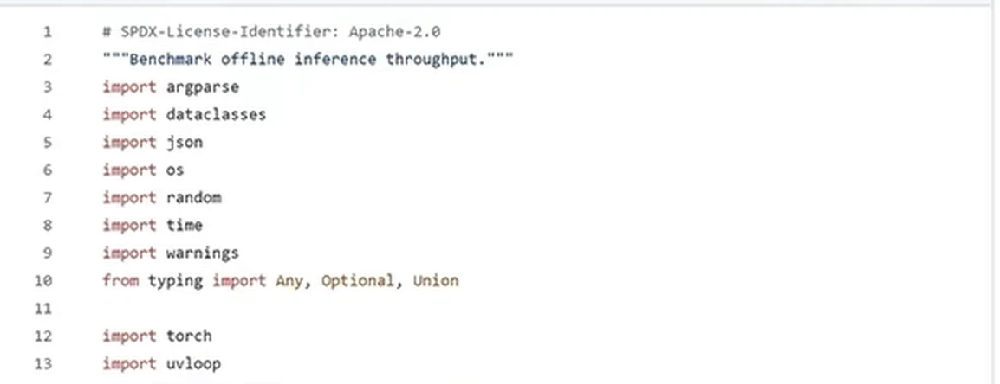
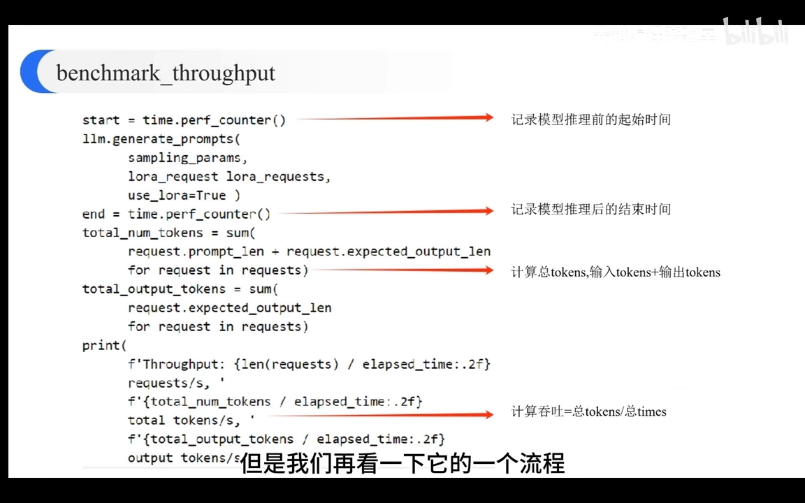
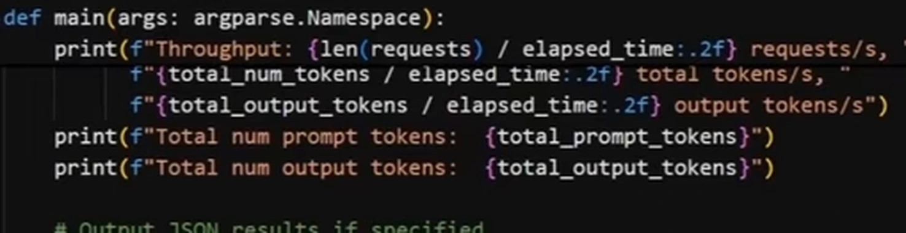
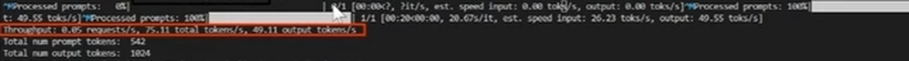
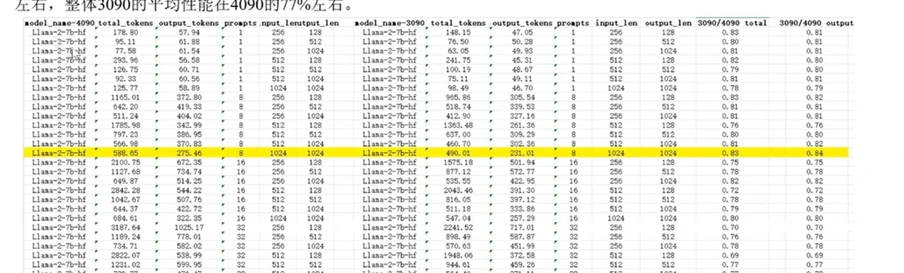
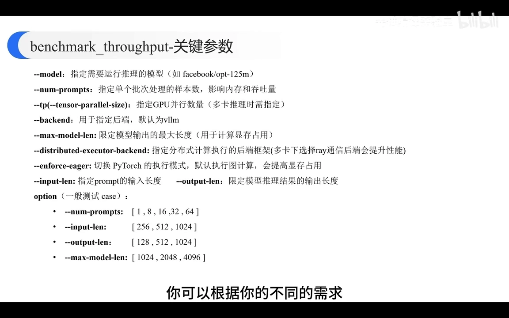
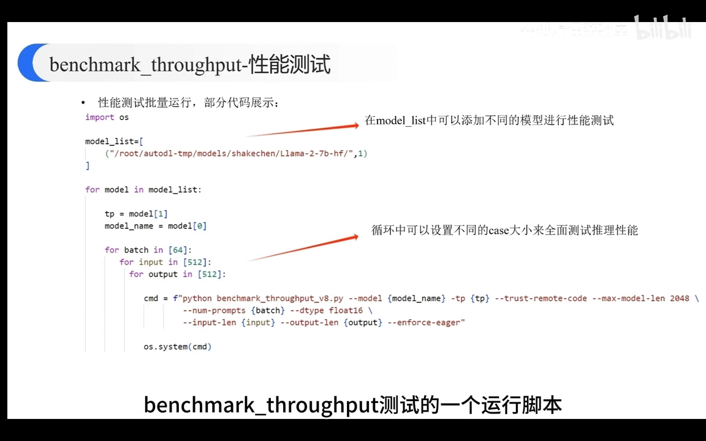

# 吞吐量不是一个数：同一个 4090 上总吞吐能差 41 倍，QPS 能差 137 倍

> 视频来源：[【大模型推理系统课】第12期｜性能测试指标：吞吐量Throughput怎么测才准](https://www.bilibili.com/video/BV1k4JC6GEVF)（Bilibili · 先进编译实验室）｜时长约 16 分钟
> 简要导读：这支视频把 vLLM 自带的 `benchmark_throughput.py` 从头拆到尾——它算了什么、参数怎么设、结果怎么读、35 个 case 的对照表怎么比。本文只取「吞吐量口径」这一条线：四种口径、为什么不能互相换算、报数时必须附带什么。TTFT/TPOT 的定义与测量见 2.1.x，Goodput 见 2.2.2，本文不展开。

## 本讲要解决的核心问题（SCQA）

**背景**：模型部署完，第一件事是压测。压测脚本跑完会打印一行数字，通常就叫「吞吐量」。

**冲突**：同一个脚本、同一张 RTX 4090、同一个 Llama-2-7b-hf，只改三个参数（请求数、输入长度、输出长度），打印出来的「吞吐」从 77.58 到 3187.64，差 41 倍；而同一张表里另一个数「每秒请求数」从 0.06 到 8.30，差 137 倍。**两个倍数不一样**——如果它们只是同一个量的两种写法，倍数必须相同。

**疑问**：那到底哪个才是吞吐量？为什么两个数差得不一样多？把结果报给别人时，该报哪个？

**回答（中心思想）**：**吞吐量不是一个数，是四个口径**——每秒请求数（QPS/RPS）、每秒输入 token 数、每秒输出 token 数、以及把它们相加得到的每秒总 token 数。四者的分母都是同一段墙钟时间，只是分子不同；**知道其中一个推不出另一个，除非同时知道输入长度、输出长度和并发**。所以「报告吞吐」的正确形式是一个四元组：口径 + 长度分布 + 并发或到达率 + 伴随延迟。



---

## 一、吞吐走离线测，延迟走在线测：vLLM 一开始就把两件事分开了

视频先列出部署推理时要看的五个指标：Throughput（吞吐）、TTFT、TPOT、Latency、P99 延迟。前四个里，吞吐量是唯一一个「越大越好」的指标，其余三个都是「越小越好」。

紧接着是一句很容易被跳过、但决定了后面所有数字含义的话：**vLLM 对这五个指标提供了两套测试**——吞吐量用**离线**形式的 `benchmark_throughput`，TTFT / TPOT / Latency / P99 用**在线**形式的 `benchmark_serving`。

[【跳转到 01:41】](https://www.bilibili.com/video/BV1k4JC6GEVF/?t=101)

为什么这么分？因为两者量的东西不一样：

- **离线吞吐**：把一批 prompt 一次性全部灌给引擎，让它跑到完，量的是**这台机器在这个负载下的产出上限**。没有到达过程，也就没有排队。
- **在线服务**：起一个 HTTP 服务端，客户端按某种节奏把请求打进去，量的是**用户在等待的情况下，系统还能产出多少**。有到达过程，就有排队，就有分位数。

本文讲的四种口径，两套测试都会打印，但含义不同。这一点在后面第六节还会回来。



---

## 二、三行 print 里藏着四个口径

### 2.1 代码只打印了三行，但第四个口径可以推出来

视频把 `benchmark_throughput.py` 里真正算吞吐的那几行代码单独截了出来，一共三行 `print`：

```python
start = time.perf_counter()
llm.generate_prompts(
    sampling_params,
    lora_request=lora_requests,
    use_lora=True )
end = time.perf_counter()
total_num_tokens = sum(
    request.prompt_len + request.expected_output_len
    for request in requests)
total_output_tokens = sum(
    request.expected_output_len
    for request in requests)
print(
    f'Throughput: {len(requests) / elapsed_time:.2f} requests/s, '
    f'{total_num_tokens / elapsed_time:.2f} total tokens/s, '
    f'{total_output_tokens / elapsed_time:.2f} output tokens/s')
```



[【跳转到 07:56】](https://www.bilibili.com/video/BV1k4JC6GEVF/?t=476)

三个分子分别是：**请求条数**、**输入 token + 输出 token 的总数**、**输出 token 数**。分母是同一个 `elapsed_time`——从 `generate_prompts` 调用前到返回后的墙钟时间。

这里有个容易被忽略的口径问题：分子用的是 `expected_output_len`（**请求里期望的输出长度**），不是实际生成的 token 数。如果模型提前遇到停止符、或者被截断，实际输出比期望少，这个分子就会偏大，算出来的吞吐也就偏高。跨引擎比较时，要确认双方都按同一口径数分子。



第四个口径不用打印，减一下就有：**输入吞吐 = 总吞吐 − 输出吞吐**。

### 2.2 四个口径的定义

| 口径 | 常见写法 | 分子 | 单位 | 常被用来回答什么问题 |
| --- | --- | --- | --- | --- |
| 每秒请求数 | QPS / RPS / req/s | 跑完的请求条数 | req/s | 这套系统能同时服务多少用户 |
| 输入吞吐 | input tokens/s | 所有请求的 prompt token 总数 | tok/s | prefill 侧一共搬了多少 token |
| 输出吞吐 | output tokens/s | 所有请求生成的 token 总数 | tok/s | decode 侧一共搬了多少 token |
| 总吞吐 | total tokens/s | 输入 + 输出 | tok/s | 厂商报价单上那个「一个数」 |

写成式子，四个口径之间只有一个恒等关系：

$$
\text{总吞吐} = \text{输入吞吐} + \text{输出吞吐}
$$

以及一个把它们和 QPS 连起来的换算关系（$\bar L_{\text{in}}$、$\bar L_{\text{out}}$ 是平均输入、输出长度）：

$$
\text{QPS} = \frac{\text{总吞吐}}{\bar L_{\text{in}} + \bar L_{\text{out}}}
$$

注意第二个式子里出现了长度。**这就是「不能互相换算」的全部原因**：从 tokens/s 到 QPS 之间隔着一个「平均每请求多少 token」，而这个数完全由负载决定，不由硬件决定。

### 2.3 一次真实运行：四个数描述的是同一件事

视频里单 case 跑了一次：1 个请求、`--input-len 512`、`--output-len 1024`。屏幕上打印出来是：



[【跳转到 10:31】](https://www.bilibili.com/video/BV1k4JC6GEVF/?t=631)

把四个口径补齐（耗时用 542 + 1024 个 token 除以 75.11 反推，约 20.85 秒，与进度条上的 20.67 s/it 对得上）：

| 口径 | 计算 | 结果 |
| --- | --- | --- |
| 每秒请求数 | $1 \div 20.85$ | 0.05 req/s |
| 输入吞吐 | $542 \div 20.85$ | 26.00 tok/s |
| 输出吞吐 | $1024 \div 20.85$ | 49.11 tok/s |
| 总吞吐 | $1566 \div 20.85$ | 75.11 tok/s |

四个数全部自洽：$26.00 + 49.11 = 75.11$，$75.11 \div (512 + 1024) \approx 0.049$。

这里还有个细节值得记下：**`--input-len 512` 是「期望长度」，实际 prompt token 数是 542**。因为长度是脚本按参数构造的，真正的 token 数要由 tokenizer 数出来，两者差 6%。所以「输入长度」这个参数不能直接当分子用。

---

## 三、为什么四个口径不能互相换算

### 3.1 同一张卡，QPS 差 137 倍，总吞吐差 41 倍

视频把 35 个 case 的结果并成一张表，每行是一个三元组（请求数、输入长度、输出长度），列里同时给了总吞吐和输出吞吐。取其中四行，用 $\text{QPS} = \text{总吞吐} \div (\text{输入} + \text{输出})$ 补上 QPS 一列：

| 请求数 | 输入长度 | 输出长度 | 总吞吐 tok/s | 输出吞吐 tok/s | 每请求 token | QPS req/s |
| --- | --- | --- | --- | --- | --- | --- |
| 1 | 256 | 128 | 178.80 | 57.94 | 384 | 0.47 |
| 1 | 256 | 1024 | 77.58 | 61.54 | 1280 | 0.06 |
| 32 | 256 | 128 | 3187.64 | 1025.17 | 384 | 8.30 |
| 32 | 1024 | 1024 | 734.71 | 582.02 | 2048 | 0.36 |

两件反直觉的事：

1. **总吞吐最高的那一行，QPS 也最高**（3187.64 对 8.30），看起来还行；但第二行和第四行就翻过来了——第四行的总吞吐是第二行的 9.5 倍，QPS 却只从 0.06 涨到 0.36，因为每请求 token 数从 1280 涨到 2048。
2. **总吞吐 734.71 的那一行，QPS 比总吞吐 178.80 的那一行还低**（0.36 对 0.47）。如果只看 tokens/s，你会说前者快 4 倍；如果只看 QPS，你会说前者慢 23%。

### 3.2 一个更干净的反例：8k 输入 200 输出 vs 500 输入 50 输出

（以下为补充推算，不是视频原话。）假设某引擎在两种负载下都跑出 1000 tok/s 的总吞吐：

| 负载 | 每请求 token | QPS |
| --- | --- | --- |
| 8000 输入 + 200 输出 | 8200 | $1000 \div 8200 = 0.12$ |
| 500 输入 + 50 输出 | 550 | $1000 \div 550 = 1.82$ |

同样是 1000 tok/s，QPS 差 **15 倍**。这就是为什么「只报 QPS 而不报长度分布，等于没报」——一个 0.12 的 QPS 和一个 1.82 的 QPS，配上不同的长度分布，可能是同一台机器。

反过来也一样：一个「每秒 3000 token」的漂亮数字，如果负载是 8k 输入 + 200 输出，折算下来只有 0.37 QPS，也就是**每秒服务不到半个用户**。

---

## 四、输入吞吐与输出吞吐不对称：一个吃算力，一个吃带宽

### 4.1 单请求的输出吞吐几乎是常数

回到那张表，把所有「请求数 = 1」的行挑出来看输出吞吐：57.94、61.88、61.54、56.58、60.71、60.56、58.89。**输出长度从 128 一路变到 1024，输出吞吐始终在 57–62 tok/s 之间**，几乎不动。

这不是巧合。2.1.2 与 1.2.2 已经推导过：decode 每生成一个 token 都要把全部权重从显存搬一遍，所以单请求的出字速度上限是「带宽 ÷ 每 token 字节数」。视频里 vLLM 打印的模型加载占用是 12.55 GB，RTX 4090 的显存带宽约 1008 GB/s（补充：显卡规格数据），于是

$$
\frac{1008\ \text{GB/s}}{12.55\ \text{GB}} \approx 80.3\ \text{tok/s}
$$

实测 57–62 tok/s，是这个上界的 72%–77%，量级完全对得上（剩下的差额来自 KV Cache 读写与算子开销）。**输出长度变，输出吞吐不变**——因为每个 token 的代价是固定的。

### 4.2 输入侧不是这样

同样是请求数 = 1 的行，用「总吞吐 − 输出吞吐」算输入吞吐：

| 输入长度 | 输出长度 | 输入吞吐 tok/s | 输出吞吐 tok/s |
| --- | --- | --- | --- |
| 256 | 128 | 120.86 | 57.94 |
| 256 | 1024 | 16.04 | 61.54 |
| 1024 | 1024 | 66.88 | 58.89 |

输入吞吐从 16 跳到 121，差 7 倍；输出吞吐稳如常数。

这里必须说清一个容易误解的点：**这四个数都是「某方向 token 总数 ÷ 整段墙钟时间」，不是分阶段速度**。输入吞吐 16.04 的那一行，不是 prefill 慢，而是那 16 秒里绝大部分时间在 decode，输入 token 被摊薄了。所以输入吞吐只有在**固定输出长度**下横向比较才有意义。

真正的不对称在机理上：prefill 是 compute-bound（1.1.2），一次矩阵乘能把成千上万个输入 token 一起处理；decode 是 memory-bound（1.2.2），一次只能出一个 token，且必须把全部权重搬一遍。**同一块卡每秒能「读进去」的 token 数，远多于每秒能「写出来」的 token 数**。

### 4.3 「总 tokens/s」把两种资源加在了一起

厂商最爱的那个数——总吞吐——恰好是上面两种完全不同资源的总和。视频里那次运行：总吞吐 75.11，其中 26.00 来自输入、49.11 来自输出；输入那部分吃的是算力，输出那部分吃的是带宽。

把算力指标和带宽指标相加，得到的数**没有物理意义**，它只是一个记账口径。它的用处是「同一负载下横向比较两台机器」，一旦负载变了，这个数就不再可比——这正是 3.1 节那张表在演示的事。

作为对照，同系列第 13 期（在线压测）打印的是输入 69.04 tok/s、输出 128.53 tok/s，输出反而比输入大——因为那次负载的输出 token 总数是输入的 1.86 倍。**这两个数由负载决定，不由硬件决定**，详见另一篇《在线压测一次打印四种吞吐》。

---

## 五、35 个 case 的对照表：比值本身也在变

视频最后拿 RTX 3090 和 RTX 4090 各跑一遍同样的 35 个 case，逐行算比值：



[【跳转到 11:04】](https://www.bilibili.com/video/BV1k4JC6GEVF/?t=664)

视频给出的三条结论：

- 最差的 case 是 `64 / 512 / 128`，3090 只有 4090 的 **68%**；
- 最好的 case 是 `8 / 1024 / 1024`，3090 达到 4090 的 **84%**；
- 整体平均，3090 约为 4090 的 **77%**。

[【跳转到 12:19】](https://www.bilibili.com/video/BV1k4JC6GEVF/?t=739)

注意这三句话的关系：**同一个「A 卡比 B 卡慢多少」的问题，答案在 68% 到 84% 之间浮动，跨度 16 个百分点**。所以「4090 比 3090 快 30%」这种说法，离开 case 就没有意义；反过来，任何一张显卡的「吞吐量」如果不带 case，也不能拿来比较。

---

## 六、要测出可比的数字，五条硬约束

视频在讲参数时其实已经把方法给出来了，只是分散在各处。整理成五条：

**1）固定输入/输出长度分布。** 脚本用 `--input-len`、`--output-len` 造 prompt，视频给的常用档位是输入 `[256, 512, 1024]`、输出 `[128, 512, 1024]`。这是「可控分布」；换成 ShareGPT 这类真实数据集，就是「真实分布」。两种都能用，但必须写明用的是哪种。



[【跳转到 02:29】](https://www.bilibili.com/video/BV1k4JC6GEVF/?t=149)

**2）固定并发。** `--num-prompts` 是「单个批次处理的样本数」，视频的档位是 `[1, 8, 16, 32, 64]`。离线测试里它同时是并发度和样本量——这一点很重要，因为 64 个请求的 P99 和 8 个请求的 P99 不是一回事。

**3）注明预热与测量窗口。** 计时从 `generate` 前开始、返回后结束，**模型加载不计入**（画面里模型加载 12.55 GB 用了 2.2 秒，engine 初始化 2.23 秒，都在计时之外）。如果换成在线服务，服务端启动、首次请求的编译与显存分配同样要在测量之前完成。

**4）区分离线批处理吞吐与在线服务吞吐。** 同一台机器、同一个引擎，`benchmark_throughput` 和 `benchmark_serving` 打出来的数字不可直接比较：前者没有到达过程，后者有排队。

**5）报告伴随延迟。** 只有吞吐没有延迟，读者无法判断这个数字是「用户能接受的服务」还是「把并发拉满换来的」。在线测试里这一条是强制的（见第 13 期那篇），离线测试里至少要给出 batch size。



[【跳转到 08:35】](https://www.bilibili.com/video/BV1k4JC6GEVF/?t=515)

这张脚本截图值得单独看一眼：`for batch in [...]`、`for input in [...]`、`for output in [...]` 三重循环，把每个 case 拼成一条命令行交给 `os.system`。**「扫参数网格」是让吞吐数字变得可比的唯一办法**——单点测量只能告诉你「在这个点上跑出多少」，扫完网格才知道这台机器的吞吐量是「一条曲线」而不是「一个数」。

---

## 七、三个常见误读

（以下为补充，视频未展开。）

**误读一：把 GPU 利用率当吞吐。** 利用率高只说明 SM 没闲着，不说明产出了多少 token。decode 阶段 SM 大量空转是常态（1.2.3），此时利用率低但吞吐可能已经到顶；反过来，一个 bug 让引擎空转也能把利用率打满。

**误读二：把 tokens/s 当用户体验。** 用户感受到的是 TTFT 和 TPOT（2.1.1、2.1.2），不是系统总吞吐。总吞吐翻倍而 TPOT 变差，用户只会觉得更卡。

**误读三：把单卡数字线性外推到集群。** 第五节已经看到，同一对卡的比值随 case 在 68%–84% 之间浮动；到了集群，还要叠加调度、KV Cache 命中率、网络与负载均衡，线性外推的误差只会更大。

---

## 小结

- **吞吐量是四个口径**：每秒请求数（QPS/RPS）、输入吞吐、输出吞吐、总吞吐；后三者单位都是 tok/s，但分子不同。
- 四个口径唯一的关系是 $\text{总吞吐} = \text{输入吞吐} + \text{输出吞吐}$ 与 $\text{QPS} = \text{总吞吐} \div (\bar L_{\text{in}} + \bar L_{\text{out}})$。**没有长度分布，就没有 QPS**。
- 同一张 4090 上，35 个 case 的总吞吐跨 41 倍、QPS 跨 137 倍——**倍数不一样，说明它们不是同一个量**。
- 单请求输出吞吐恒定在 57–62 tok/s，接近「带宽 ÷ 权重字节数」的上界；输入侧则随负载大幅变化。**prefill 吃算力、decode 吃带宽，把两者相加得到的总吞吐只是记账口径。**
- 「A 卡比 B 卡快多少」随 case 在 68%–84% 之间浮动，**比值本身也是负载的函数**。
- 可比的测法有五条：固定长度分布、固定并发、注明预热与测量窗口、区分离线与在线、报告伴随延迟。
- 吞吐必须在延迟约束下才有意义——这条留给 2.2.2 的 Goodput 展开。

## 关键术语速查

| 术语 | 一句话解释 |
| --- | --- |
| QPS / RPS | 每秒完成的请求条数；RPS 是 Requests Per Second，QPS 是 Queries Per Second，在推理服务里通常混用 |
| 输入吞吐 | 所有请求的 prompt token 总数 ÷ 墙钟时间，单位 tok/s |
| 输出吞吐 | 所有请求生成的 token 总数 ÷ 墙钟时间，单位 tok/s |
| 总吞吐 | 输入吞吐 + 输出吞吐，厂商最常引用的单一数字 |
| `num-prompts` | 单批请求条数，离线测试里同时是并发度与样本量 |
| `input-len` / `output-len` | 构造 prompt 时指定的期望输入、输出长度；实际 token 数由 tokenizer 数出，可能略有出入 |
| 离线吞吐 | 一次性灌一批请求、无到达过程的测量，量机器产出上限 |
| 在线吞吐 | 起服务端、按某种节奏打请求的测量，含排队，必须配延迟分位数看 |
| 墙钟时间 | 从计时开始到结束的真实耗时，四个口径共用同一个分母 |