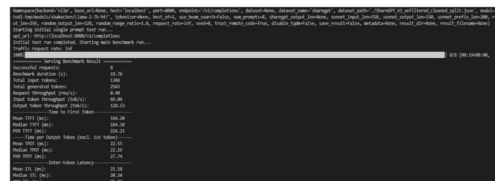
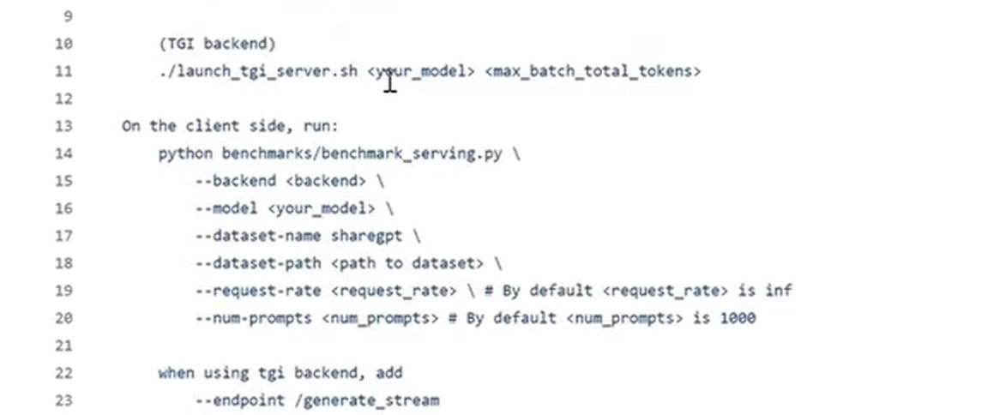
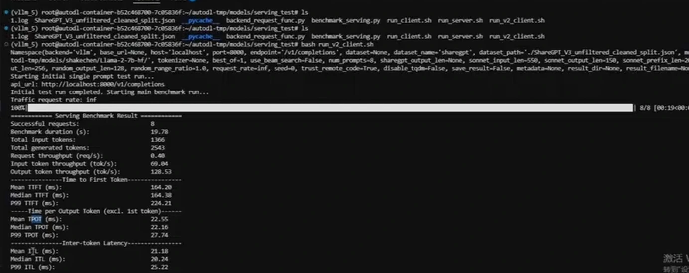
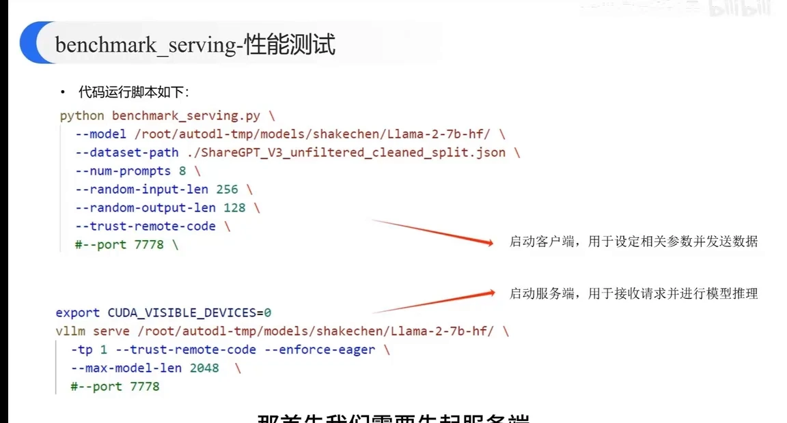
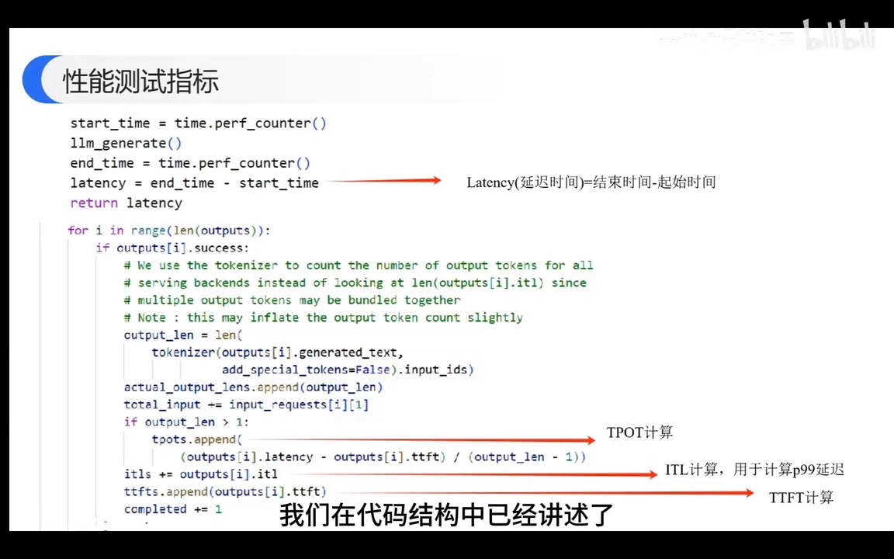
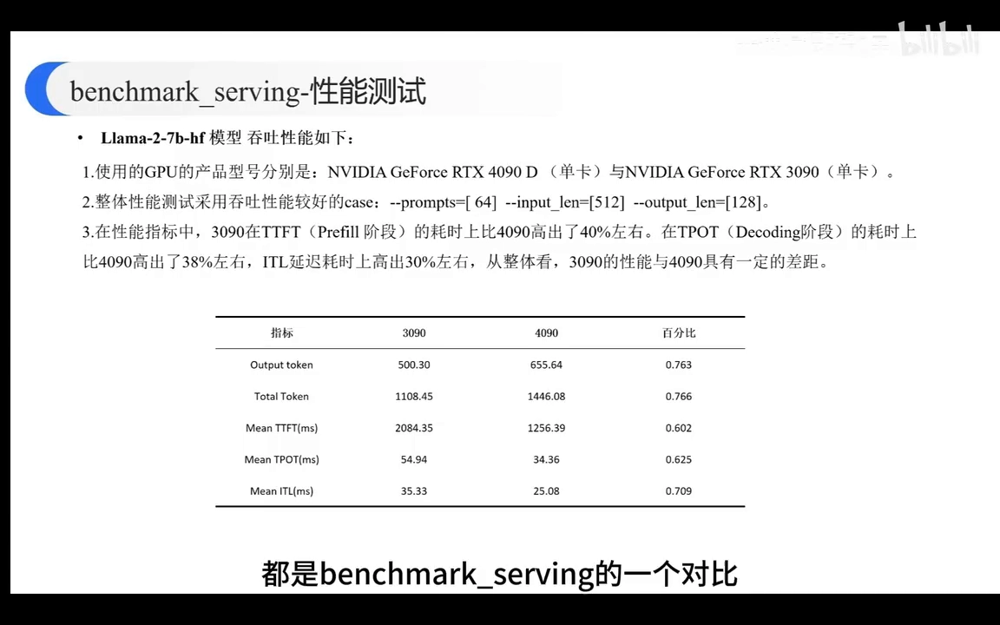
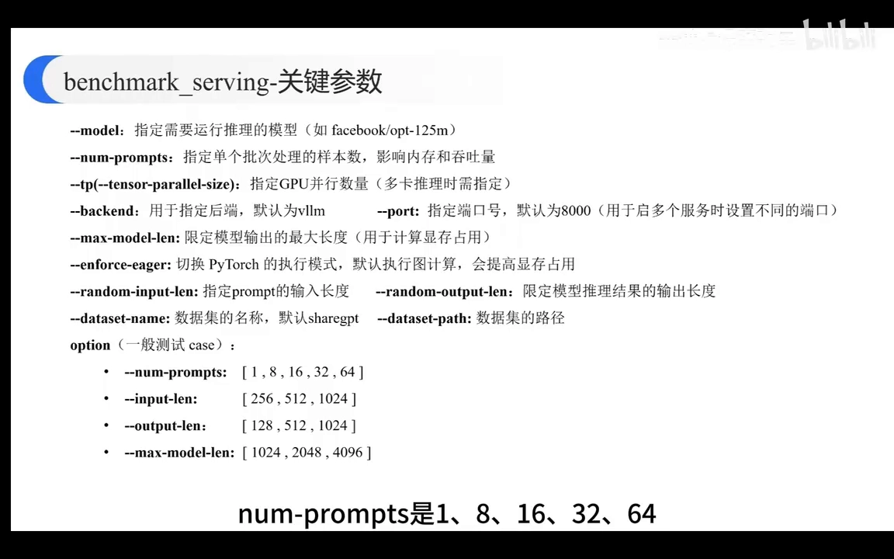

# 在线压测一次打印四种吞吐：吞吐必须连延迟分位数一起报

> 视频来源：[【大模型推理系统课】第13期｜性能测试指标：在线Serving场景怎么压测](https://www.bilibili.com/video/BV1NDJU6wETd)（Bilibili · 先进编译实验室）｜时长约 13 分钟
> 简要导读：这支视频讲 vLLM 的 `benchmark_serving.py`——服务端/客户端怎么起、参数怎么设、结果表怎么读。本文只取「吞吐口径」这条线：一次压测同时打印的四种吞吐、它们为什么必须与 TTFT/TPOT/ITL 的分位数一起出现、以及在线压测有哪些坑。TTFT/TPOT 的定义见 2.1.x，本文不重复；Goodput 见 2.2.2。

## 本讲要解决的核心问题（SCQA）

**背景**：上一支视频（第 12 期）讲的是离线吞吐：把 64 条 prompt 一次性灌进引擎，量出这台机器能产出多少 token/s。

**冲突**：上线之后请求是一条一条来的。同一个引擎、同一张卡，压测表上打印的「每秒请求数」只有 0.40，而「每秒输出 token 数」是 128.53。这两个数差 320 倍，却来自同一次运行。更麻烦的是：**你没法从 128.53 这个数判断用户要等多久**——它可能对应 160 毫秒的首字延迟，也可能对应 2 秒。

**疑问**：在线场景到底该报哪些吞吐？为什么一张结果表里塞了十几个数字？这些数字之间是什么关系，怎么读才不会被误导？

**回答（中心思想）**：**在线压测一次打印四种吞吐（req/s、输入 tok/s、输出 tok/s、以及相加得到的总 tok/s），并且必须与 TTFT/TPOT/ITL 的均值、中位数、P99 同表出现**。因为在线吞吐不是一个固定属性，而是「在某个延迟水平下换来的产出」；脱离延迟分位数的吞吐数字，无法判断是服务能力还是压榨结果。



---

## 一、离线与在线是两套测法：一个量上限，一个量服务

`benchmark_serving.py` 的文件头 docstring 只有一句：**Benchmark online serving throughput**。紧接着它告诉你这套测试需要两侧配合：

- **服务端**：跑 vllm serve 加上模型路径，起一个 OpenAI 兼容的 HTTP 服务；
- **客户端**：跑 benchmark_serving.py，按参数构造请求、并发地打过去。

[【跳转到 00:00】](https://www.bilibili.com/video/BV1NDJU6wETd/?t=0)





这两行默认值很关键，后面会反复用到：

- `--request-rate` 默认 **inf**：不限速，所有请求尽可能早地发出去；
- `--num-prompts` 默认 **1000**：一共发多少个请求。

视频里的实操把两者都改了：`--num-prompts 8`、`--random-input-len 256`、`--random-output-len 128`，端口用 7778 避开默认的 8000。



[【跳转到 05:26】](https://www.bilibili.com/video/BV1NDJU6wETd/?t=326)

**离线与在线的差别不在于用哪个脚本，而在于有没有到达过程**。离线测试里，一批请求同时进引擎，谁也不用等谁；在线测试里，请求按某种节奏到达，晚到的要排队。排队会拉长延迟，也会改变吞吐——这正是为什么两套测试的数字不能互相替代。

---

## 二、结果表怎么读：四种吞吐

### 2.1 一次真实运行的完整输出

视频里跑的是 8 个请求、随机输入长度 256、随机输出长度 128。结果表长这样：

```text
============ Serving Benchmark Result ============
Successful requests:                     8
Benchmark duration (s):                  19.78
Total input tokens:                      1366
Total generated tokens:                  2543
Request throughput (req/s):              0.40
Input token throughput (tok/s):          69.04
Output token throughput (tok/s):         128.53
---------------Time to First Token----------------
Mean TTFT (ms):                          164.20
Median TTFT (ms):                        164.38
P99 TTFT (ms):                           224.21
-----Time per Output Token (excl. 1st token)------
Mean TPOT (ms):                          22.55
Median TPOT (ms):                        22.16
P99 TPOT (ms):                           27.74
---------------Inter-token Latency----------------
Mean ITL (ms):                           21.18
Median ITL (ms):                         20.24
P99 ITL (ms):                            25.22
```

[【跳转到 06:39】](https://www.bilibili.com/video/BV1NDJU6wETd/?t=399)

### 2.2 四种口径，分母相同、分子不同

| 口径 | 表里的字段 | 分子 | 这次的值 |
| --- | --- | --- | --- |
| 每秒请求数 | Request throughput (req/s) | 成功请求条数 | 0.40 |
| 输入吞吐 | Input token throughput (tok/s) | 输入 token 总数 1366 | 69.04 |
| 输出吞吐 | Output token throughput (tok/s) | 生成 token 总数 2543 | 128.53 |
| 总吞吐 | 表里没打印，要自己加 | 1366 + 2543 = 3909 | 197.62 |

分母都是同一个 `Benchmark duration`：19.78 秒。四个数可以逐个验算：

$$
\frac{8}{19.78} = 0.404,\quad
\frac{1366}{19.78} = 69.06,\quad
\frac{2543}{19.78} = 128.56,\quad
\frac{3909}{19.78} = 197.62
$$

与打印值 0.40 / 69.04 / 128.53 完全对得上（末位差异来自四舍五入）。

**注意最后一行：vLLM 的结果表并不直接打印「总吞吐」**。它只给你输入和输出两个方向，总吞吐要自己加。这不是疏漏——因为把两个方向相加得到的数没有物理意义（见第四节），所以它不主动提供。

### 2.3 为什么这次输入吞吐比输出吞吐还低

直觉上 prefill 是 compute-bound、比 decode 快得多，输入吞吐应该远大于输出吞吐。但这次是 69.04 对 128.53，输入反而更低。

原因在负载：这次一共生成了 2543 个 token，却只读进去 1366 个 token，**输出 token 数是输入的 1.86 倍**。两个方向的吞吐都是「该方向 token 总数 ÷ 同一段墙钟时间」，所以谁的 token 多，谁的吞吐就高。

**这两个数由负载决定，不由硬件决定。** 换一个「长 prompt、短回答」的负载（比如 RAG 摘要），输入吞吐会立刻反超。所以看到「输入吞吐 < 输出吞吐」不要下结论说 prefill 慢，先看长度分布。

---

## 三、同一张表里为什么必须有延迟分位数

### 3.1 吞吐是「在什么条件下」的吞吐

0.40 req/s 这个数字，是在这样一组条件下得到的：8 个请求、`request-rate=inf`（全部同时发出）、TTFT 中位数 164 毫秒、P99 224 毫秒、TPOT 中位数 22 毫秒。

如果换一组条件——比如把 `num-prompts` 提到 64、把输出长度提到 512——吞吐会上升，但 TTFT 和 TPOT 也会变差。**同一台机器没有唯一的吞吐量，只有「某个延迟水平下的吞吐量」**。

这就是为什么结果表把吞吐和延迟塞在一起：它们是同一个实验的两个坐标，拆开看任何一个都会失真。

[【跳转到 04:56】](https://www.bilibili.com/video/BV1NDJU6wETd/?t=296)

### 3.2 三个延迟指标各管一段，这里不重复定义

表里的九个延迟数字分三组，分别对应 2.1.x 讲过的三个指标：

- **TTFT**（Time to First Token）：从发请求到收到第一个 token，管的是「用户等多久才看到字」；
- **TPOT**（Time per Output Token）：第一个 token 之后每个 token 的平均耗时，管的是「字出来得顺不顺」；
- **ITL**（Inter-Token Latency）：相邻 token 的间隔，管的是「有没有卡顿」。

三者的定义、测量口径与分位数陷阱在 2.1.1 / 2.1.2 / 2.1.3 已经展开，这里只取结论：**吞吐的伴随指标至少要给 TTFT 和 TPOT 的分位数，否则这个吞吐无法被复核**。

### 3.3 均值和中位数一起报，是因为它们会打架

这次运行里，TPOT 的均值是 22.55 ms、中位数 22.16 ms，两者接近；但 TTFT 的均值 164.20 ms 与中位数 164.38 ms 几乎相等，P99 却是 224.21 ms——**最慢的那个请求比典型请求多等了 60 毫秒**。

只报均值，你会以为所有用户都等 164 毫秒；只报 P99，你会以为所有人都等 224 毫秒。三个数一起看，才知道「大多数人在 164，少数人在 224」。

---

## 四、分子是数出来的，不是声明的

### 4.1 output_len 由 tokenizer 重新数一遍

视频把 `calculate_metrics` 的核心几行截了出来：`total_input` 是把每个请求的 `prompt_len` 累加，而 `output_len` 不是直接用请求里声明的长度，而是**用 tokenizer 把生成的文本重新编码，再数 token 个数**。

代码注释给了理由：某些后端会把多个 token 打包成一个返回，`len(outputs[i].itl)` 不一定是真实 token 数；同时注释也承认，重新数 token **可能让计数略微偏大**。



[【跳转到 05:01】](https://www.bilibili.com/video/BV1NDJU6wETd/?t=301)

这件事对吞吐的影响很直接：**吞吐的分子是「数出来的 token」，分母是「墙钟时间」，两者都有口径误差**。跨引擎比较时，如果一方按 tokenizer 数、另一方按请求声明的长度算，差几个百分点是常事。

### 4.2 跨模型比较 tokens/s 没有意义

（以下为补充。）不同模型的 tokenizer 不同，同一段中文在 A 模型里可能是 300 个 token，在 B 模型里是 500 个。所以「A 模型 2000 tok/s、B 模型 1500 tok/s」这句话，不能推出 A 更快——除非把 token 折算成字符数或词数。**tokens/s 只在同一个 tokenizer 下可比。**

---

## 五、吞吐与延迟的耦合：同一对卡，两个比例不一样

视频最后拿 RTX 3090 和 RTX 4090 各跑一遍，case 是 64 个请求、输入 512、输出 128（视频说这是「吞吐性能较好」的 case）：



[【跳转到 07:20】](https://www.bilibili.com/video/BV1NDJU6wETd/?t=440)

| 指标 | 3090 | 4090 | 表中百分比 |
| --- | --- | --- | --- |
| Output token（tok/s） | 500.30 | 655.64 | 0.763 |
| Total Token（tok/s） | 1108.45 | 1446.08 | 0.766 |
| Mean TTFT（ms） | 2084.35 | 1256.39 | 0.602 |
| Mean TPOT（ms） | 54.94 | 34.36 | 0.625 |
| Mean ITL（ms） | 35.33 | 25.08 | 0.709 |

这张表能读出三件事：

**第一，吞吐只差 24%。** 4090 的总吞吐是 3090 的 1.31 倍（$1446.08 \div 1108.45$），输出吞吐是 1.31 倍。这个 case 下两张卡差距不大。

**第二，延迟差得多。** 4090 的 TTFT 只有 3090 的 60%（$1256.39 \div 2084.35$），换句话说 **3090 的首字延迟是 4090 的 1.66 倍**。视频讲稿里说「3090 在 TTFT 上比 4090 高出 40% 左右」，但按表里的数值算，$2084.35 \div 1256.39 = 1.659$，是高出 66%。这里以表格数值为准——讲稿的口播数字与表格对不上，很可能是把「4090 是 3090 的 60%」说成了「高出 40%」。

**第三，每个指标的比例都不一样**（0.602 / 0.625 / 0.709 / 0.763 / 0.766）。这说明「A 卡比 B 卡快多少」没有唯一答案，取决于你看吞吐还是看延迟、看首字还是看间隔。

### 5.1 顺手算一下这个 case 的 QPS

表里没有 QPS，但可以推：每请求 token 数 $= 512 + 128 = 640$，

$$
\text{QPS}_{4090} = \frac{1446.08}{640} \approx 2.26\ \text{req/s},\qquad
\text{QPS}_{3090} = \frac{1108.45}{640} \approx 1.73\ \text{req/s}
$$

64 个请求、QPS 2.26，意味着整轮压测跑了约 28 秒。**这个 QPS 只对「512 进 128 出」的负载成立**，换成 8k 进 200 出，它会掉到 0.1 以下——这就是为什么报吞吐必须带长度分布（详见另一篇《吞吐量不是一个数》）。

---

## 六、在线压测的六条可比清单

把视频里散落的做法整理成清单，下次压测照着填：

**1）写明到达率。** `--request-rate` 默认 `inf`，意思是「能发多快发多快」。这时测出来的是**不限速下的最大吞吐**，不是真实业务节奏。如果要模拟真实流量，就设一个具体的 req/s（比如 5），让请求按泊松过程到达。

**2）写明并发。** `--num-prompts` 是**总共发多少个请求**，不是并发度。在 `request-rate=inf` 时，这 8 个请求会同时发出，此刻并发恰好等于 8；一旦设了到达率，并发就由「到达率 × 平均服务时间」决定，不再是 num-prompts。

**3）写明长度分布。** `--random-input-len` / `--random-output-len` 是可控分布，`--dataset-name sharegpt` 是真实分布。两者都能用，但必须写明。视频里把随机输入长度上限设成 256，跑出来 8 个请求共 1366 个输入 token（平均 171），说明长度是在区间内随机采样的，**不是每条都 256**。



[【跳转到 01:15】](https://www.bilibili.com/video/BV1NDJU6wETd/?t=75)

**4）先做一次预热。** 结果表上面有一行 `Initial test run completed. Starting main benchmark run...`——客户端先单独发一个请求，把服务端的编译、显存分配、KV Cache 初始化都跑热，再开始正式测量。**这一步不做，第一个请求的 TTFT 会污染整张表。**

**5）样本量要够。** 这次只有 8 个请求，P99 实际上就是「第 8 名」那个请求的值，与最大值几乎重合。**用 8 个样本的 P99 去定 SLO 是没有意义的**，至少要几百个请求，分位数才稳定。

**6）区分离线与在线。** `benchmark_throughput` 与 `benchmark_serving` 打出来的数字不可直接比较：前者没有到达过程，后者有排队。同一台机器，在线数字通常明显低于离线数字。


[【跳转到 01:40】](https://www.bilibili.com/video/BV1NDJU6wETd/?t=100)

这张 case 矩阵和离线版完全一样。**同一组 case 分别跑离线与在线，才能看出「排队」值多少钱**：两者的差值就是到达过程带来的损失。

---

## 七、三个常见误读

（以下为补充，视频未展开。）

**误读一：把输出吞吐当用户体验。** 128.53 tok/s 是**系统总产出**，不是某个用户看到的出字速度。单个用户看到的是 TPOT：这次是 22 毫秒/token，约合每秒 45 个 token。系统吞吐翻倍，单个用户可能反而更慢。

**误读二：把单卡数字线性外推到集群。** 第五节已经看到，两张卡在不同指标上的比例从 60% 到 77% 不等；到了多卡多机，还要叠加 TP 通信、KV Cache 命中率、负载均衡与网络，线性外推的误差只会放大。

**误读三：用一次压测的数字当容量规划。** 0.40 req/s 是在「8 个请求、256 进 128 出、不限速」这组条件下测出来的。真实业务的长度分布、到达率、超时重试都不一样，**这个数字只能当上界参考，不能当承诺**。

---

## 小结

- 在线压测一次打印**四种吞吐**：req/s、输入 tok/s、输出 tok/s，总 tok/s 要自己加（这次是 197.62）。
- 四个数共用同一个分母（19.78 秒），分子不同；**输入吞吐 69.04 低于输出吞吐 128.53，是负载决定的，不是硬件决定的**。
- 在线吞吐必须与 **TTFT / TPOT / ITL 的均值、中位数、P99** 同表出现，因为吞吐是「某个延迟水平下」的吞吐。
- 分子是 **tokenizer 数出来的 token**，不是请求里声明的长度；跨引擎、跨模型比较时要确认口径一致。
- 同一对卡（3090 vs 4090），吞吐比 0.76、TTFT 比 0.60、TPOT 比 0.63——**「快多少」取决于你看哪个指标**。
- 可比的在线压测要写清：到达率、并发、长度分布、预热、样本量、离线还是在线。
- 至于「在满足 TTFT/TPOT 目标的前提下，吞吐还能剩多少」——那是 2.2.2 的 Goodput 要回答的问题。

## 关键术语速查

| 术语 | 一句话解释 |
| --- | --- |
| `benchmark_serving` | vLLM 的在线压测脚本，起服务端 + 客户端，按参数构造请求并统计延迟分位数 |
| Request throughput | 每秒完成的请求条数，单位 req/s，就是 QPS/RPS |
| Input / Output token throughput | 输入、输出两个方向各自的 token 总数 ÷ 墙钟时间 |
| Total token throughput | 输入与输出吞吐之和；vLLM 结果表不直接打印，需自己相加 |
| `request-rate` | 客户端发请求的速率，默认 `inf` 即不限速；设成具体值可模拟真实到达过程 |
| `num-prompts` | 总共发送的请求条数，不是并发度 |
| `random-input-len` / `random-output-len` | 构造请求时的长度上限，实际长度在区间内随机采样 |
| ShareGPT 数据集 | 真实对话数据集，用来提供「真实长度分布」而非可控分布 |
| 预热请求 | 正式测量前先发一个请求，把编译、显存分配、KV Cache 初始化跑热 |
| P99 | 99% 的请求不超过该值；样本量小时它与最大值几乎重合，不能当 SLO 依据 |