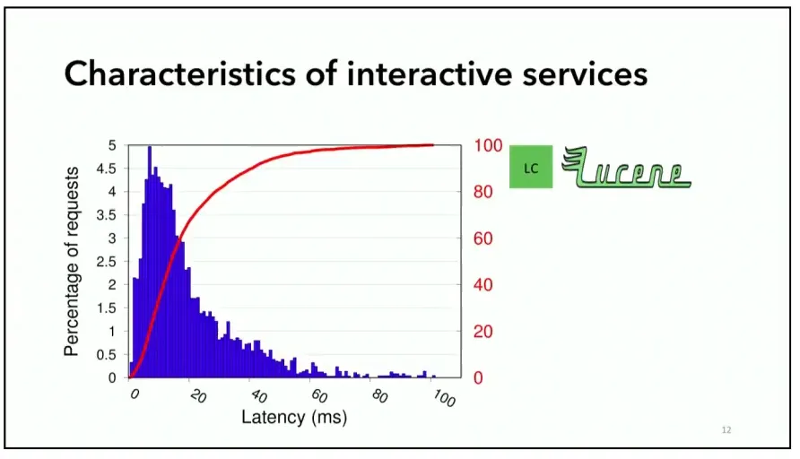
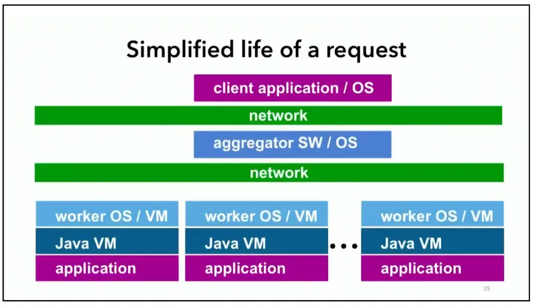
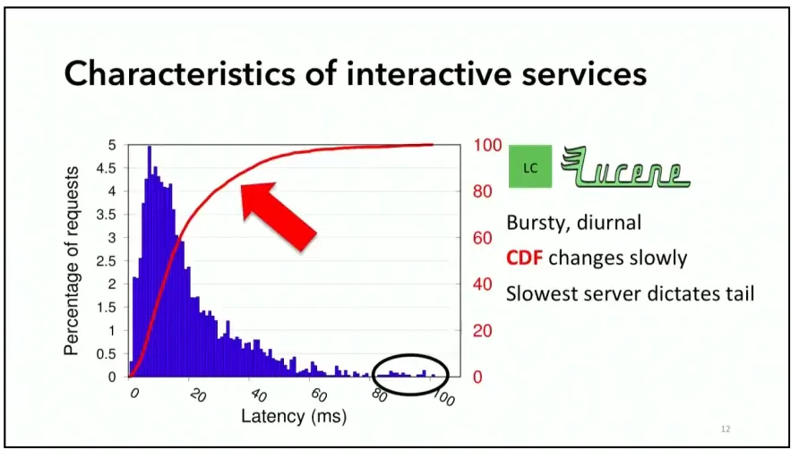
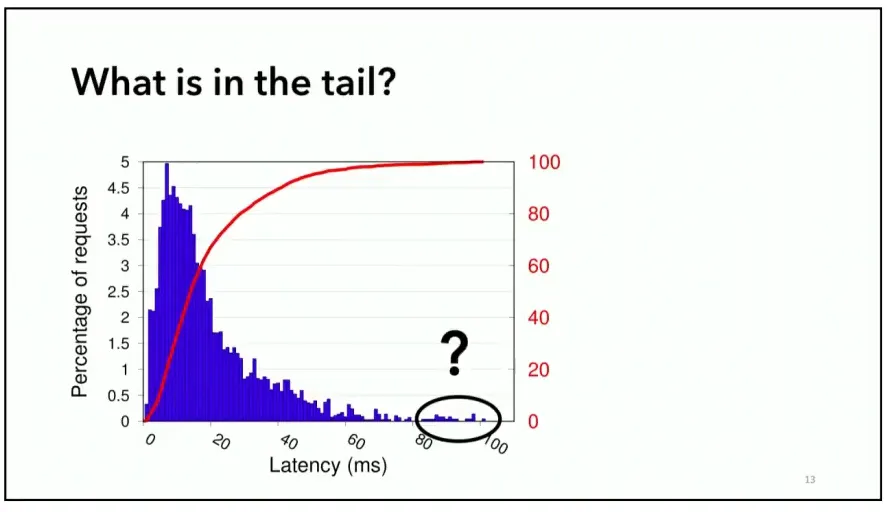
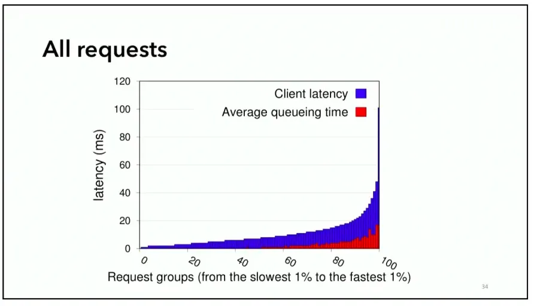
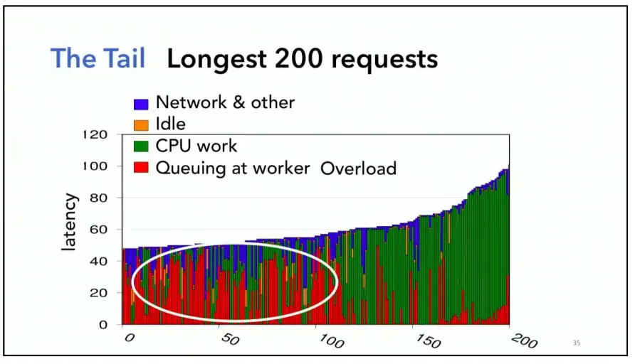
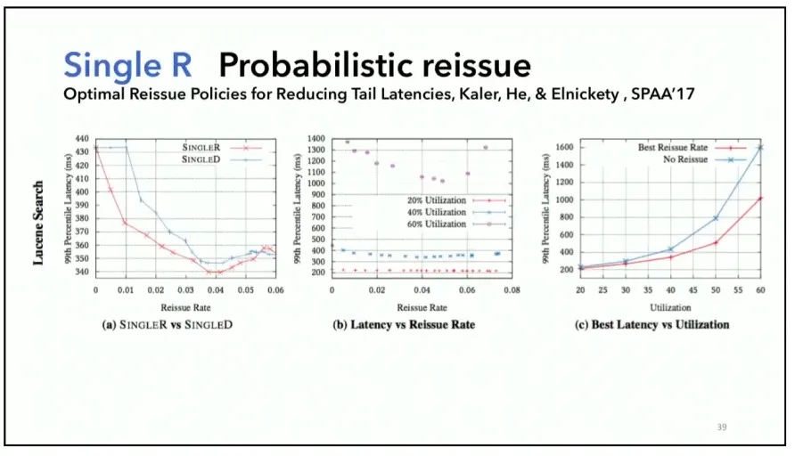
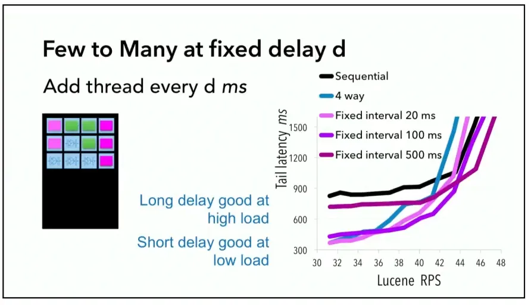
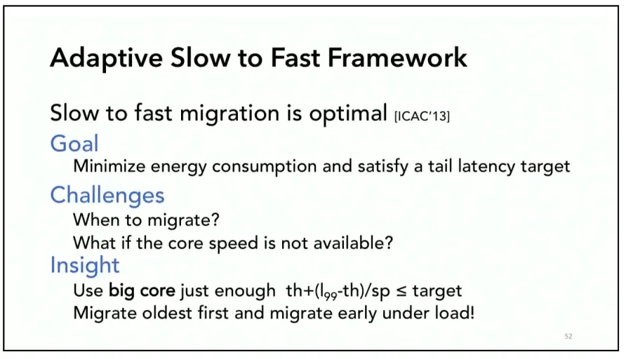
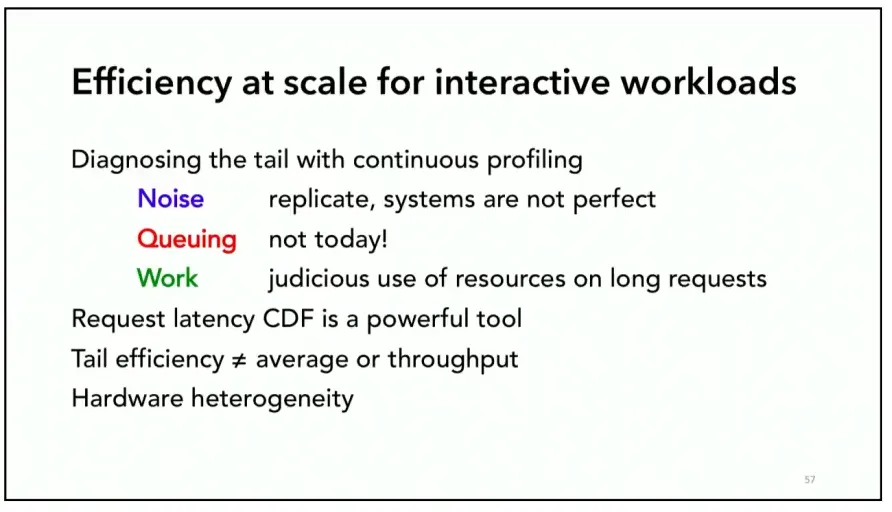

# 尾部延迟的三段解剖：噪声、排队与真正的工作

> 视频来源：[Measuring and Optimizing Tail Latency](https://www.youtube.com/watch?v=_Zoa3xkzgFk)（YouTube · Kathryn McKinley，Strange Loop 2017）｜时长约 51 分钟
> 简要导读：这是一场关于「尾部延迟」的系统性方法论演讲，用 Lucene 搜索引擎做实验对象，但它给出的框架对 LLM 服务同样成立：**先造一把能看清尾部的尺子，再把尾部拆成噪声、排队、工作三段，最后对每一段用完全不同的手段**。本文按这个顺序展开，并把演讲里没有的 LLM 对应关系标为「补充」。演讲末段关于 DVFS 与大小核的能耗优化部分，本文只保留与「牺牲均值换尾部」直接相关的结论。TTFT / TPOT / 端到端延迟的定义见 2.1.1–2.1.3，本文不重复。

## 本讲要解决的核心问题（SCQA）

**背景**：交互式服务的延迟分布是一条严重右偏的曲线——绝大多数请求很快，一小撮请求慢得离谱。工程师习惯用平均值和吞吐来评判系统，因为这两个数好算、好比较。

**冲突**：平均值和吞吐都看不见尾部。一次请求的响应时间**不可能优于它最慢的那个下游**，所以用户实际体验到的，是这条分布最右边的那一小撮。演讲给的量级是：**平均延迟和尾部延迟之间差一个数量级**。更麻烦的是，当你把平均值优化好之后，尾部往往还在原地——因为尾部不是「平均地慢」，而是被少数几个特定原因打出来的。

**疑问**：尾部里到底装着什么？怎么才能看见它？看见之后，不同成因该用不同的手段吗？为什么「优化平均值」有时反而把尾部弄得更糟？

**回答（中心思想）**：**尾部延迟不是一个数，而是三段不同病因的叠加——噪声（noise）、排队（queuing）、工作（work）**。噪声要靠冗余与重发，排队要靠过载控制与副本，工作要靠「把资源精准地投给已经暴露自己的长请求」。而这三件事都建立在一个前提上：你得先有一把能连续、低开销地看清整条延迟分布（CDF）的尺子。演讲的两条贯穿全文的洞见是：**CDF 的形状变化很慢，所以可以离线求解、在线套用**；以及**长请求会自我暴露，所以来得及对它特殊处理**。

---

## 一、尾部为什么比均值高一个数量级：串联与扇出

### 1.1 一条请求要穿过六层，每一层都可能慢

演讲给了「一条请求的简化一生」：客户端应用/OS → 网络 → 聚合器（aggregator）软件/OS → 网络 → worker 的 OS/VM → JVM → 应用，再原路返回。

这张图是理解「尾部为什么长」的地基。**总延迟是这些段的串联和**，而串联系统的分位数有一个残酷的性质：它不取各段分位数的平均，而是**趋近于各段尾部的叠加**。

> 补充：把这件事写成一个极简模型。若一条请求由 $n$ 段串联组成，第 $i$ 段的耗时是随机变量 $T_i$，总耗时 $T=\sum_i T_i$。若各段独立，则

$$
P(T > x) \;\ge\; 1 - \prod_{i=1}^{n}\left(1 - P(T_i > x)\right)
$$

> 直觉是：**只要有一段踩到它的尾部，整条请求就落在尾部**。$n$ 越大，尾部被「撞上」的机会越多。这就是为什么微服务化之后尾部会变差——不是因为某一段变慢了，而是因为段数变多了。

### 1.2 扇出把这个问题再放大一次

还没完。演讲指出，聚合器会把一条请求**扇出**给一群 worker，等所有 worker 返回后再汇总。于是：

> **整体响应时间不可能优于最慢的那个服务器。**

这句话把「尾部」从「概率事件」变成了「必然事件」：一次请求要等 $k$ 个 worker，只要其中任意一个慢，整条就慢。$k$ 越大，命中「至少一个慢 worker」的概率越接近 1。演讲对此的表述是：**那个最慢的服务器，才是决定用户体验的东西，而那通常是 P99 甚至更高**。

> 补充：LLM 服务里的对应物是**张量并行 / 流水并行的每一级**，以及**多副本路由**。一次 decode 步要等所有 TP rank 的 all-reduce 完成，任意一个 rank 被别的进程抢了 SM，整步就慢。这和「等最慢的 worker」是同一个数学结构。

### 1.3 平均与尾部差一个数量级，而且分布形状极其稳定

演讲给的实测特征是三条：

- **突发性与昼夜性**：飓风来了、球赛开踢了，某个区域的人同时开始搜同样的东西。
- **平均延迟和尾部延迟差一个数量级**。
- **CDF 的形状变化很慢**：即使底层查询内容变化很大（比如周末突然所有人都在搜同一件事），这条累积分布曲线的形状几乎不动。

第三条是整场演讲的方法论支点：**因为形状稳定，所以可以离线把优化问题解出来，在线只查表**。在线还要做一件事——检测这条曲线的形状是否发生了大变化，一旦变了就重新离线求解。这条思路在 LLM 服务里同样适用：你的输入/输出长度分布、你的并发到达模式，在一段时间内是稳定的，可以离线标定；流量形态变了（比如上线了一个长上下文功能），就得重标。

---

## 二、先把尺子造出来：看不见尾部，就谈不上治理

### 2.1 传统做法的两个死结：1% 采样预算与探针开销

演讲先回顾了此前的最好做法（Dick Sites 在 Google 的工作）：**手工埋点**。它要求工程师对整个系统有极深的理解，而现在系统是几十个微服务拼起来的，没人能全部懂。

而且埋点有两个硬约束：

1. **采样预算通常只有 1%**，所以探针必须能开能关。
2. **探针本身在关键路径上**，会拖慢被测系统，所以你得提前测出「我的探针带来了多少开销」。

于是陷入一个循环：为了看清尾部要埋点，埋点本身又会污染尾部。

### 2.2 Shim profiler：从另一个核上「偷看」，用时钟做基准真相

演讲团队的解法是**自动化、低干扰的连续在线剖析（shim profiler）**。核心观察是：硬件一直在产生信号，这些信号既可以通过硬件性能计数器读出，也可以通过**内存位置**传递——而内存位置可以被**另一个线程**读走。于是不需要中断，也不需要修改被测代码。

做法是：在另一个核上跑一个极简循环，读最后一级缓存缺失、周期数等计数器，塞进缓冲区；**不在采样时做处理，把计算留到离线**。

但这里有一个陷阱，演讲专门讲了：**采样不是原子的**。开始读计数器、再读别的计数器，如果两次采样花的时间不一样（中间发生了 cache miss、被换页），两个样本就不可比。症状很直观——这台机器每周期最多发射 4 条指令，可数据里出现了大于 10 的 IPC，这显然不可能。

修法很巧：**用时钟做基准真相**。在相邻两个区间的开始和结束都读一次周期数，如果两次读数一致，说明这次采样花的时间相同，样本有效；否则丢弃。这个判据的好处是它**自适应**——如果别人开始干扰你、或者共享硬件状态变了，采样耗时变了，它也会自动把那些样本筛掉，而不需要你事先知道「应该花多久」。

效果对比很惊人：用中断驱动采样，即使把频率拉到 100 Hz，各方法的 IPC 看起来是**一条平线**（信噪比太低，什么都看不出来）；用 shim 以 10 MHz 采样，就能清楚地把「第 4 号方法」识别成真正的热点。

开销方面也有明确结论：从同一个核上读，开销永远很大；从另一个核上读，如果每 30 个周期读一次，会有 2 倍开销；**把间隔放宽到约每 1000 个周期读一次，就基本不干扰那个线程了**。

### 2.3 把「谁在拖」画出来：CDF 拆成排队时间与工作时间

演讲在这里先问了一个问题：那条细长的尾巴里，**到底装着什么**？

有了能按请求 ID 归因的采样，就可以把那条 CDF 换个画法：横轴是**按延迟从最慢 1% 到最快 1% 分组的请求**，纵轴是延迟，每一根柱子拆成**排队时间**与**实际工作时间**。

然后只取最慢的那 200 条，用程序计数器告诉我们是哪些代码在耗时，并按颜色分类：

这张图是整场演讲的核心证据，它直接给出了尾部的三段解剖：

| 颜色 | 含义 | 病因归类 |
| :--- | :--- | :--- |
| 红色 | worker 上的排队 / 过载 | **排队（queuing）** |
| 蓝色 | 网络与其他 | **噪声（noise）** |
| 橙色 | 线程就绪却没在跑（OS 没调度上） | **噪声（noise）** |
| 绿色 | 真正的 CPU 工作 | **工作（work）** |

演讲对这张图的解读有两句关键的话：

1. **很多请求里，worker 上的排队占了很大一块**——这是过载，不是代码慢。
2. **有些最长的请求几乎全是绿色（工作）**。而且：**无论你怎么优化排队、怎么消除噪声，你都不会把「长请求里的工作」消掉**。

第二句是全文的分水岭。它意味着治理手段必须分家：**噪声和排队可以用「让系统更完美」的方式消掉，工作不能**。工作只能靠「给这条特定的长请求更多资源」或者「让它别那么长」。

> 补充：LLM 服务里这三段的对应物非常清晰。红色 ≈ 请求在调度队列里等 KV Cache 块、等 batch 槽位；蓝色 ≈ 网络与 tokenize/detokenize；橙色 ≈ CPU 侧调度抖动、Python GIL、日志与监控开销；绿色 ≈ prefill 与 N 次 decode 步的真实计算。而「长 prompt + 长输出」正是那种**几乎全是绿色**的长请求——它就是第 2.2 节里说的「输出长度重尾分布」在时间轴上的样子。

---

## 三、噪声：靠冗余与重发，但要盯住负载

### 3.1 固定延迟重发的两个毛病

如果尾部是噪声造成的（网络抖动、OS 没调度上、某个核被抢），最自然的办法是**复制并重发（replicate and reissue）**：同一条请求发给两个副本，谁先回用谁。

演讲指出系统架构里本来就有副本，所以「一个服务器慢，另一个大概不慢」——**除非你过载了**。这句话是后面所有讨论的前提。

此前的最好做法是**固定延迟重发**：设一个延迟 $d$，超时就重发，并把重发预算控制在比如 10%。它有两个毛病：

- **过载时它有害**：你本来就已经忙不过来，再加 10% 的请求，只是给系统添更多工作、制造更多排队。
- **它治不了「工作型」的长请求**：重发一条本来就计算量大的请求，只是把同样的活干两遍。

于是实践中会把预算压到 5% 以缓解额外成本，但**预算本身仍然要付代价**。

### 3.2 概率重发：把「什么时候重发」随机化

演讲引用了她前同事在 SPAA'17 的论文（Kaler、He、Elmikety）：**不要总在固定延迟重发，而是随机化重发时机**。他们的证明很漂亮——**一个带随机性的重发时机，等价于多个基于不同特征的重发时机**。

三张图分别说明三件事：

- **左**：同样的重发预算（比如 1%），随机化之后可以**更早**重发，P99 曲线更低。
- **中**：**这是问题所在**——一旦系统接近过载，哪怕很小的重发率（5%–6%）也会把 P99 顶上去。**所以必须盯着负载**。
- **右**：最佳重发率随利用率变化，利用率越高，最佳重发率越低甚至不该重发。

> 补充：LLM 服务里「重发」的等价物是**请求级的 hedge**（向第二个副本再发一份）以及**客户端重试**。它们的失效模式完全一样：在系统已经排队的时候重试，会把排队进一步放大，形成雪崩。这也是为什么 2.2.2 里强调「限流与拒绝优于排队」——拒绝是显式的、可控的，重试风暴不是。

---

## 四、工作：把资源精准投给「已经暴露自己」的长请求

### 4.1 第二条贯穿全文的洞见：长请求会自我暴露

演讲的第二条洞见是：**在一条请求正在变长的过程中，存在某些时刻你可以识别出它**。原因是一个数量级的差距——**所有「只是慢」的请求这时早该结束了，而这条还在跑**，所以你有足够的时间对它做点什么。

这个洞见的价值在于它把「预测」换成了「观察」：你不需要预知谁会变成长请求，你只需要在它已经跑了一段时间之后，确认它还没结束。

### 4.2 并行要「延迟启用」，不能对所有人开

第一个应用是**按需并行（judicious parallel-sum）**。把一条请求拆成多个线程并行做，这在历史上是用来提吞吐的；如果用它来降尾部，一个自然的想法是「所有请求都并行」。

**这不是个好主意**，因为并行有开销。对短请求来说，这份开销纯属浪费，会拉低吞吐。演讲的对比很清楚：

右图是这张幻灯片的核心：横轴是每秒请求数，纵轴是尾部延迟。

- **延迟 0 就四路并行**（蓝线）：在低 RPS 处尾部确实好，但**很快就撞顶**——因为给所有请求都加了开销，系统的最大处理能力被压低了。
- **等一会儿再加**（紫线们）：等得越久，越可能只把并行用在真正落在尾部的请求上，于是能撑到更高的 RPS。
- **顺序执行**（黑线）：尾部最差，但能撑到最高 RPS。

理想是那条「既能把 RPS 推出去、又能把尾部压下来」的绿线。演讲的做法是：

1. 用 CDF 剖析长请求上的并行度与并行效率，得到一个**目标并行度**（他们在 Bing 上实测是 **4 路**，有时 3 路就够）。
2. **离线穷举**一个调度表：输入是「系统里有多少请求（负载）」和「可加的并行度」，目标是同时最小化尾部响应时间与最大化吞吐。
3. 在线只查这张**区间表**：按当前负载决定给这条请求加多少并行。

演讲用一段动画说明了在线行为：系统空闲时，两条同时到达的请求都被并行化，缩短执行时间，从而**降低未来排队的概率**；当第三条到达、资源不够时，它就以并行度 1 排队等待，等有线程退出再逐步加并行。结果是「贴着那条理想曲线的底部走」。

### 4.3 用硬件帮软件：慢到快迁移，且「最老的先升级」

如果并行对你的请求不友好（很多请求本身不可并行），还有一条路：**用硬件频率/核型来给长请求加速**。

思路是**反过来的**：让短请求跑在**低频**（省电），只让长请求跑在**最高频**（保尾部）。演讲把这类做法叫 **slow-to-fast**：请求到达时先跑在低频或小核上，然后在某个时刻迁移到高频或大核。

两个挑战：**什么时候迁移**、**最快的核被占了怎么办**。洞见是：

- **大核只用「刚好够命中尾部目标」那么多**——用目标延迟反推迁移时刻。
- **竞争时「最老的先迁移」**——这和操作系统经典调度完全相反（OS 通常惩罚跑得久的任务），这里要给**执行时间最长**的请求最高优先级。

于是稳态下形成了一个「年龄分层」的系统：最年轻的在最慢的核上，中年的在中核上，**最老的跑在最快的核上**——「和现实生活相反」。

演讲给了实测结果：在 Broadwell 服务器上用 DVFS，逐核动态调整（EETL）相比「全局一起调速」（Pegasus）能再省**约 10%** 的能量，同时仍然命中尾部目标；用大小核（AMP）模拟则能把 RPS 推得更远，负载越高省得越多。

> 补充：这一节对 LLM 服务的直接映射是**优先级队列 + 异构算力**。把「已经跑了很久的请求」提到高优先级、给它独占的 SM 或更快的卡，等价于「最老的先升级」。而「短请求降频」在 LLM 里对应的是「短请求用小模型/小 batch 通道」——也就是 2.2.2 里说的按 SLO 分池。

### 4.4 这里藏着「优化均值会恶化尾部」的完整因果

演讲在结尾把这件事说成了一句判词：**尾部效率不等于平均值，也不等于吞吐**；我们关于「为吞吐优化系统」的一些假设，必须用「**牺牲一点平均值来换尾部**」来 temper（调和）。

机制就在上面两节里：

- **给短请求降频 / 放小核** → 短请求变慢 → **平均值变差**，但长请求拿到了快核 → **尾部变好**。
- **给长请求加并行** → 需要额外线程 → 短请求要多等资源 → **平均值略差**，但尾部被削平。

> 补充：LLM 服务里最典型的那条因果链是**加大 batch**：它让每一步的矩阵乘更饱满，吞吐上升、平均值可能还略降（因为单位时间出更多 token），但**每一步的 TPOT 变长，所有在跑的请求一起变慢**——而尾部受害最深，因为尾部请求本来就要跑更多步，每一步的增量会被步数乘起来。这就是 2.3.1 要展开的「batch 与 TPOT」的另一面；本文只保留这条因果，不展开 roofline 推导。

---

## 五、测量陷阱：P99 这个数字本身很容易骗人

演讲里散落着几条关于「怎么量」的硬约束，集中起来是一份很好的检查清单。

### 5.1 尾部是稀有事件，样本不够就量不到

尾部按定义就是「最慢的 1%」。要让它稳定，样本量得是**几百到上千条请求**这个量级。演讲的实验设置可以直接借用：用 10,000 条查询学习、2,000 条做测试；而展示尾部时，看的是**一次运行里最慢的 200 条**。

### 5.2 「最慢的那批请求」每次运行都不一样

这是演讲在问答环节给出的一个非常实用的观察：**这一次运行里落在尾部的 200 条查询，换一次运行就是另外 200 条**；只有大约 **10%** 是「每次都在尾部」的——而那 10% 恰恰就是**有真实工作量的那些**。

这条观察有两层含义：

- **不要拿一次运行的尾部请求列表当「问题清单」**。大部分成员是随机的（噪声、排队），修掉它们不会改变下一次的尾部。
- **那稳定的 10% 才是真问题**。它们对应「工作型」长请求，只能靠给它资源或缩短它来治。

### 5.3 把不同分布的请求混在一起算 P99 没有意义

演讲反复强调 CDF 的形状是「一类工作负载」的属性。如果把长短差异极大的请求混在一个池子里算一个 P99，你算出来的其实是**混合比例**的函数，而不是任何一类请求的体验。

> 补充：LLM 服务的正确做法是**按输入长度、输出长度分桶**分别看 P99，再看每桶的流量占比。否则一次「上线长上下文功能」就会让整体 P99 变差，而你可能误以为是系统退化了。

### 5.4 不要对分位数再求平均

演讲没有直接说这一条，但它的方法论隐含了：他们做的是**离线求解 + 在线查表**，而不是「把多个时间窗口的 P99 平均一下」。分位数不是线性算子，**P99 的平均值不等于平均之后的 P99**。跨窗口聚合应该聚合**原始分布（直方图）**，再重新算分位数。

> 补充：这一条在工程上最常被违反——监控面板上「过去 24 小时平均 P99」几乎必然失真，因为它把高峰期的尾部和低谷期的尾部等权平均了。

---

## 六、把三段拼回一套流程

演讲最后的总结页把整场内容压缩成了五行：

把它落成一套可执行的流程：

1. **先造尺子**。低开销、连续、能按请求归因的采样；用「时钟做基准真相」筛掉不可比的样本。没有这一步，后面全是猜。
2. **把尾部拆开**。按「排队 / 网络 / OS / 工作」四类给最慢的那批请求上色，看它们各自占多少。
3. **对噪声用冗余**。重发要随机化时机、要盯负载；过载时重发是有害的。
4. **对排队用过载控制**。演讲在这一节明确说「今天不讲」，但它的判据很清楚：排队是过载的函数，不是代码的函数。
5. **对工作用「延迟启用的额外资源」**。等它暴露自己，再给并行或给快核；不要对所有人一视同仁。
6. **接受「牺牲均值换尾部」**。这是设计选择，不是妥协——因为用户只记得最差的那一次。

---

## 小结

- **尾部是串联与扇出的产物**。一条请求穿过六层、扇出给一群 worker，总延迟不可能优于最慢的那一段；段数越多，命中尾部的机会越大。
- **CDF 的形状变化很慢**，所以可以离线求解、在线查表；形状大变时再重新标定。这是整场演讲的方法论支点。
- **看不见尾部就治不了尾部**。低开销连续剖析 + 用时钟筛样本，才能拿到可信的归因。
- **尾部有三段病因：噪声、排队、工作**。噪声靠冗余重发（要盯负载），排队靠过载控制，工作只能靠给它更多资源或让它变短。
- **长请求会自我暴露**。所以并行与快核都应该「延迟启用」，只投给已经跑了一段时间还没结束的请求。
- **优化均值常常恶化尾部**。给短请求降频、给长请求加并行，都是「牺牲一点平均值换尾部」；LLM 里加大 batch 是同一个结构的例子。
- **P99 很容易骗人**：样本要够、尾部的成员每次都在换、不同长度分布不能混算、分位数不能再求平均。

## 关键术语速查

| 术语 | 一句话解释 |
| :--- | :--- |
| 尾部延迟（tail latency） | 分布最右端那部分请求的延迟，通常用 P99 表示 |
| CDF（累积分布函数） | 横轴延迟、纵轴「不超过该延迟的请求占比」，形状稳定是离线优化的前提 |
| 扇出（fan-out） | 一条请求被拆给多个 worker 并行处理，整体耗时由最慢的那个决定 |
| 噪声（noise） | 网络抖动、OS 未及时调度等与工作量无关的随机延迟 |
| 排队（queuing） | 系统过载时请求在队列里等待的时间 |
| 工作（work） | 请求本身真实需要的计算量，无法靠「让系统更完美」消掉 |
| 概率重发（probabilistic reissue） | 把重发时机随机化，用同一份预算换更低的 P99 |
| 按需并行（judicious parallel-sum） | 延迟 d 之后才对仍未完成的请求增加并行度 |
| slow-to-fast | 短请求跑低频/小核、长请求迁到高频/大核，最老的先迁移 |
| DVFS | 动态电压频率调节，用频率换能耗 |
| 异构多核（AMP） | 大核与小核混排，用核型差异代替频率差异 |