# 显存容量墙把「最大并发」变成一道除法，撞墙之后系统靠抢占与排队活着

> 视频来源：[vLLM Explained: How an LLM Inference Engine Really Works (Infra View)](https://www.youtube.com/watch?v=XyZ0ephVQXM)（YouTube · subr.dev）｜时长约 20 分钟
> 简要导读：这支视频按基础设施工程师的视角拆开 vLLM，其中最有价值的一段是「启动时怎么切出 KV 池」和「流量尖峰时引擎内部发生什么」。本文只取与容量墙有关的部分：容量怎么算、上限怎么读、撞墙后系统有哪几种反应。进程架构、PagedAttention 块表、PD 分离等细节留给本系列其它章节。文中凡是讲者没讲、由我按它给的数字补算的地方，都标了「补充」。

## 本讲要解决的核心问题（SCQA）

**背景**：2.3.1 已经算清了一件事——batch 越大，一步 decode 里同一份权重被越多行复用，吞吐往上走；但越过拐点 $B^*$ 之后每步变长，TPOT 跟着变长。所以「batch 该开多大」看起来是一个在吞吐和延迟之间找平衡点的连续优化问题。

**冲突**：可真实系统里，你往往还没走到那个平衡点就被按住了。视频里给了一个非常具体的数字：一张 80 GB 的 H100、一个 8B 的模型，权重只占 16 GB，剩下 55 GB 全给了 KV 池，能装 45 万个 token；一旦每个请求要 2500 个 token，并发就只有 180 左右。**这时候限制你的既不是算力也不是带宽，而是一次内存分配能不能成功。**

**疑问**：并发上限到底怎么算出来？为什么它不像算力那样「慢一点还能跑」，而是非黑即白？撞上这堵墙之后，引擎内部到底发生了什么？

**回答（中心思想）**：**显存容量墙是一条除法，不是一条曲线：最大并发 ≈ 可用 KV 池字节数 ÷ 单请求 KV 字节数。** 它之所以是硬约束，是因为撞墙的表现不是「变慢」而是「分配失败」——引擎必须立刻做出选择：抢占某个请求的 KV、把新请求挡在门外、降低服务规格，或者干脆崩掉。因此容量必须被当作**准入控制**（决定谁能进来）来设计，而不是当作性能调优（决定跑多快）来调。

---

## 一、容量墙的算式：从总显存减到 KV 池

### 1.1 引擎不是猜的，它先跑一次假前向把峰值量出来

vLLM 启动到第三步时会做一件很聪明的事：它需要知道能给 KV Cache 多少显存，而 KV Cache 是它为每段活跃对话保留的东西。它不猜，而是**用假输入跑一次假的前向**，量出模型真正需要的峰值显存。

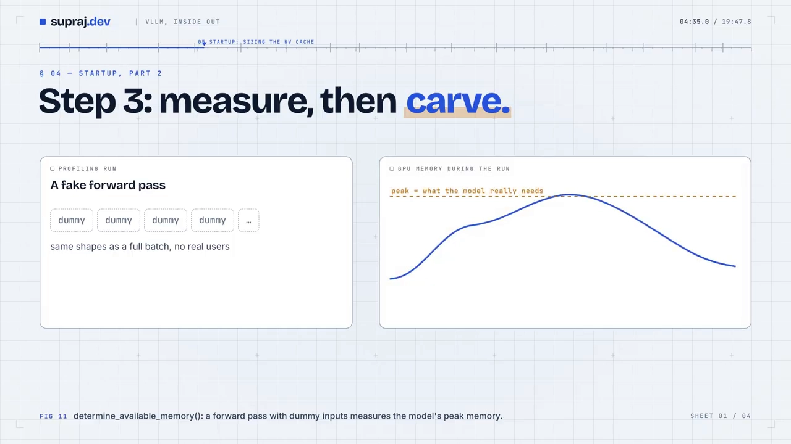

[【跳转到 04:35】](https://www.youtube.com/watch?v=XyZ0ephVQXM&t=275)

为什么必须实测？因为「工作内存」这一项（激活值、临时缓冲、kernel workspace）不是一个能靠参数个数推出来的常数，它随 batch 形状、序列长度、算子实现变化。1.1.3 已经讲过激活峰值怎么随长 prompt 抬起来，这里只需要接受一个结论：**它是一个必须被量出来的量，不是一个可以估出来的量**。

### 1.2 然后做一道减法

量完峰值，引擎才开始做减法。视频把这道减法写在了幻灯片上：

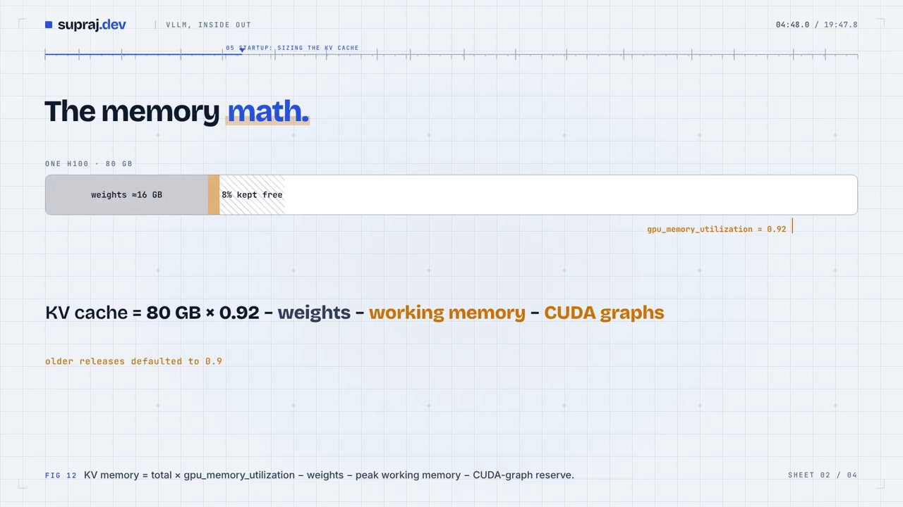

[【跳转到 04:48】](https://www.youtube.com/watch?v=XyZ0ephVQXM&t=288)

$$
\text{KV 池} = M_{\text{total}} \times u - M_{\text{weights}} - M_{\text{peak working}} - M_{\text{cuda graph}}
$$

其中 $u$ 就是那个著名的参数 `gpu_memory_utilization`，视频里说默认 92%（老版本教程写 90%）。这张幻灯片画的是 80 GB 的 H100：权重约 16 GB，最右边留 8% 不碰，中间那一大段白色才是 KV 池。

把这条减法写成通用形式，就是：

$$
\text{可用显存} = \underbrace{M_{\text{total}} \times u}_{\text{引擎被允许用的部分}} - \underbrace{M_{\text{weights}}}_{\text{权重}} - \underbrace{M_{\text{act}}}_{\text{激活峰值}} - \underbrace{M_{\text{ws}}}_{\text{workspace / CUDA context}} - \underbrace{M_{\text{reserve}}}_{\text{预留}}
$$

$$
\text{最大并发} \approx \left\lfloor \frac{\text{可用显存}}{\text{单请求 KV 字节数}} \right\rfloor
$$

这两行就是整节的骨架。第一行把「显存」从一个模糊的担心变成四个可减的项；第二行把它变成一条除法。**注意第一行里没有一项是「性能」，全是容量**——这就是它和 2.3.1 那条吞吐曲线的本质区别。

> **补充**：`gpu_memory_utilization` 之所以必须小于 1，是因为显存里还住着不属于引擎的东西：CUDA context、NCCL 缓冲、CUDA graph 的静态池、监控 agent，以及（在统一内存机器上）操作系统本身。视频后面专门提到，vLLM 文档为 DGX Spark 这类统一内存机器单独提醒过：别把整块内存都交给模型。

### 1.3 剩下的字节被切成块，块数就是你的并发预算

减法剩下的那块显存不会按请求整块切，而是先切成固定大小的块。视频给的例子是：默认每块装 16 个 token 的 KV，Llama 3 8B 每 token 128 KiB，于是每块 2 MiB；55 GiB 的池子约 45 万个 token，约 28000 个块。

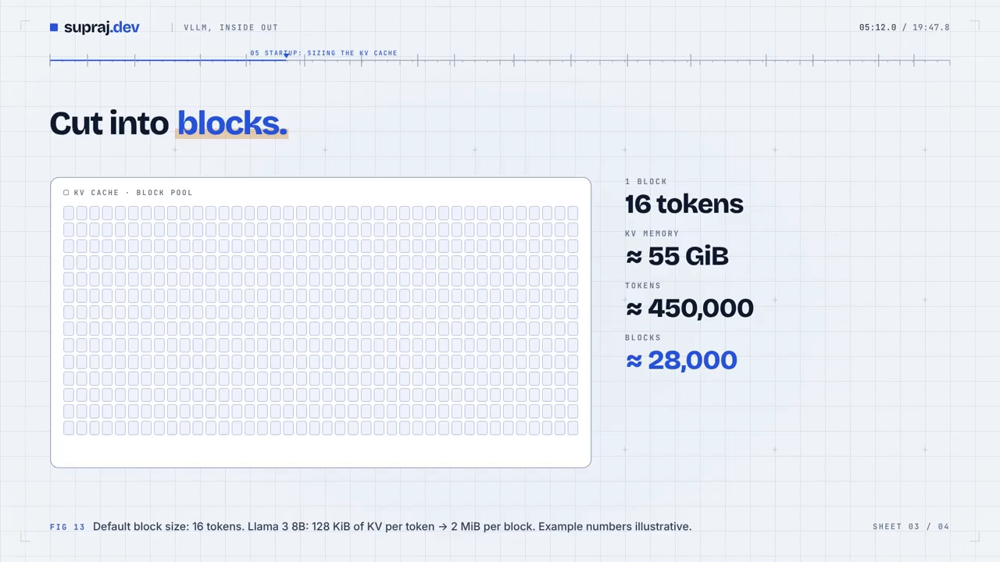

[【跳转到 05:12】](https://www.youtube.com/watch?v=XyZ0ephVQXM&t=312)

块化的意义在这里只点到一句：**它让「按需分配」成为可能，于是「一个请求要预留多长」不再由 `max_model_len` 决定，而由它真实长了多长决定**。块表怎么组织、物理块池怎么回收，是第 4 章的内容，本文不展开。

### 1.4 日志里那一行，就是这张卡的真实并发上限

启动日志会打印一行，视频把它单独拎出来讲，说「如果只记一行日志，就记这一行」：

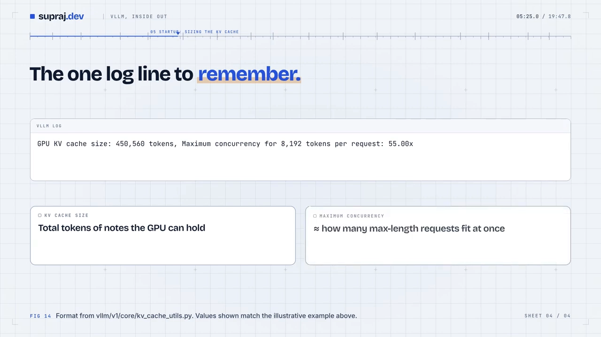

[【跳转到 05:25】](https://www.youtube.com/watch?v=XyZ0ephVQXM&t=325)

```
GPU KV cache size: 450,560 tokens, Maximum concurrency for 8,192 tokens per request: 55.00x
```

这一行是两个数的除法，两个数都要会读：

- **KV cache size（450,560 tokens）**：这张卡一共能装多少 token 的「笔记」。它是一个**总量**，与你怎么切分无关。
- **Maximum concurrency（55.00x）**：按 8192 token 一个请求算，能同时装 55 个。它是一个**条件数**——分母换了，这个数就换。

$450{,}560 \div 8{,}192 \approx 55$，就这么简单。但正因为它是条件数，同一个池子在不同上下文长度下会给出完全不同的答案：

| 每请求长度 | 能同时装几个 | 说明 |
| --- | --- | --- |
| 2,048 | 约 220 | 短对话，容量宽裕 |
| 8,192 | 55 | 视频里的默认示例 |
| 32,768 | 约 13 | 长文档问答 |
| 131,072 | 约 3 | 满上下文，几乎只能单飞 |

**这张表就是「容量墙随上下文长度收紧」的最直接形式**：池子没变，分母变四倍，并发就掉到四分之一。

---

## 二、单请求 KV 字节数：分母从哪来

### 2.1 分母的公式

单请求 KV 字节数 = 每 token 的 KV 字节数 × 序列长度。每 token 的那一项，1.3.2 已经推导过，这里直接当输入用：

$$
\text{bytes/token} = 2 \times L \times H_{kv} \times d_{head} \times b
$$

其中 $L$ 是层数，$H_{kv}$ 是 KV 头数（GQA 下小于注意力头数），$d_{head}$ 是每个头的维度，$b$ 是每个元素的字节数（fp16 是 2，fp8 是 1），最前面的 2 是 key 和 value 各一份。

代入 Llama 3 8B：$2 \times 32 \times 8 \times 128 \times 2 = 128$ KiB/token，与视频里那句「Llama 3 8B 每 token 128 KiB」对上。一个请求要 8192 token，就是 1 GiB；55 GiB 的池子装 55 个，正好是日志里那个 55.00x。

**所以「最大并发」这条除法的三个输入分别是：池子多大（第一节）、每 token 多少字节（本节）、每个请求多长（业务决定）。** 前两个是系统参数，第三个是业务参数——这也是为什么容量问题永远不能只靠调引擎解决。

### 2.2 同一张卡的三天：1 个用户、100 个用户、1000 个用户

视频用一组示意数字把「总 token 预算」这个视角讲得非常清楚。设定：每个请求 2000 token prompt、写 500 token，也就是每个请求约 2500 token 的 KV。

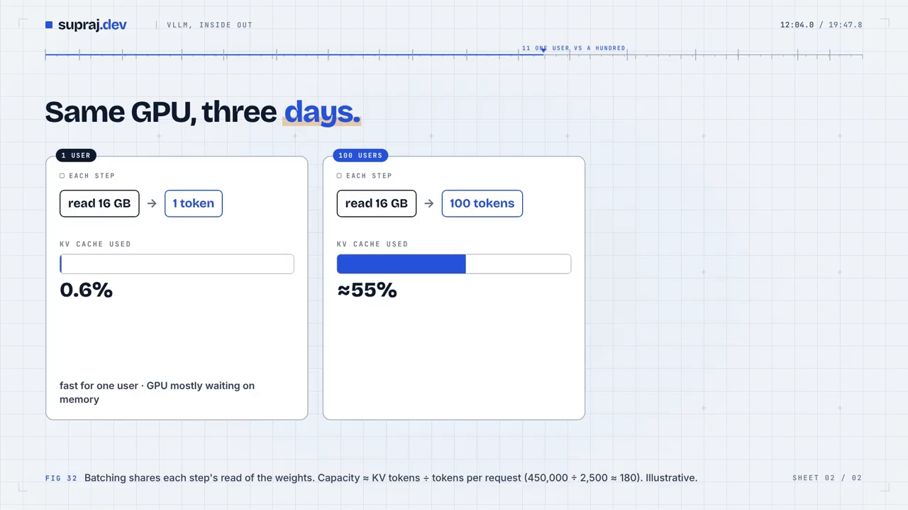

[【跳转到 12:04】](https://www.youtube.com/watch?v=XyZ0ephVQXM&t=724)

- **1 个用户**：每一步读完 16 GB 权重只产出 1 个 token，KV 池用了 0.6%。对这一个用户很快，但对 GPU 极其浪费。
- **100 个用户**：同一步读一遍权重、产出 100 个 token，吞吐暴涨，每人略慢一点。100 × 2500 = 25 万 token，池子（45 万）还装得下，KV 使用率约 55%。

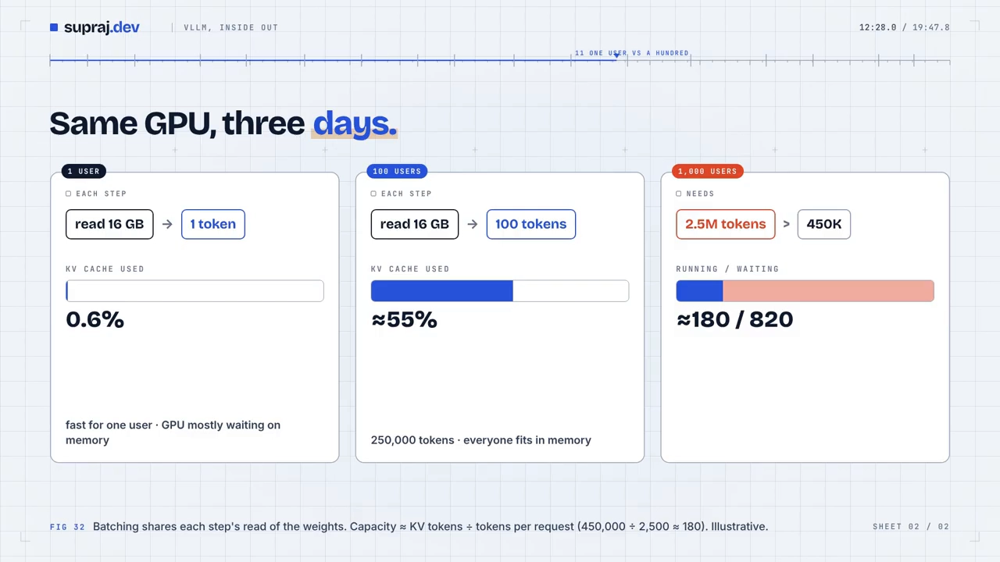

[【跳转到 12:28】](https://www.youtube.com/watch?v=XyZ0ephVQXM&t=748)

- **1000 个用户**：需要 250 万 token 的 KV，池子只有 45 万。于是**约 180 个在跑，820 个在队列里等**，它们的首字越来越慢。

这张图是整节最重要的一张。它把「并发 × 平均长度 ≈ 常数」这个统一视角画出来了：

$$
N_{\text{并发}} \times \bar{T}_{\text{每请求 token}} \approx \frac{\text{KV 池字节数}}{\text{bytes/token}} = \text{常数}
$$

**同一张卡、同一个模型，能服务的「并发数 × 上下文长度」乘积是一个常数。** 你想让每个请求更长，就必须接受同时在线的人更少；你想同时在线的人更多，就必须接受每个人能用的上下文更短。这不是调参能绕过的，这是除法。

再补一句视频里点明的话：**这里的限制不是算力，是 KV Cache 显存。** 也就是说，即使 GPU 的 SM 还有空闲、带宽还没跑满，你也进不来更多人。

---

## 三、为什么它是硬约束：撞墙不是变慢，是分配失败

### 3.1 算力和带宽是软的，容量是硬的

对比一下三类资源撞墙时的表现，差别一目了然：

| 资源 | 撞墙的表现 | 系统能否「凑合着继续」 |
| --- | --- | --- |
| 算力 | 每步变长，TPOT 上升 | 能。慢，但每个请求都在推进 |
| 显存带宽 | 每步变长，吞吐上不去 | 能。慢，但每个请求都在推进 |
| 显存容量 | 要块的时候没有块 | **不能。必须立刻做一个取舍** |

前两者是**连续退化**：你多塞一点，所有请求一起慢一点，但没人被丢掉。容量是**离散失败**：某个请求在这一步需要第 19 个块，而空闲队列是空的——这一步要么抢别人的，要么自己退出，没有第三种可能。

这就是为什么容量必须被当作**准入控制**：它决定的不是「跑多快」，而是「谁有资格进来、谁必须出去」。一个只在性能维度调优的系统，在容量墙前面会直接崩掉，而不是优雅地降级。

### 3.2 撞墙之后的四种行为

把视频里散落的描述整理成一张表，就是本节要的四种行为：

| 行为 | 触发条件 | 代价 | 用户感知 |
| --- | --- | --- | --- |
| 抢占 preemption | 正在跑的请求需要新块，空闲队列空 | 被抢者的进度被丢弃或换出，之后重算 | 被抢者延迟暴涨 |
| 拒绝 / 排队 | 等待队列已满，或池子装不下新请求 | 新请求进不来 | TTFT 飙升，或直接 503 |
| 降级 | 运维主动缩短长度上限、换小模型、降精度 | 能力缩水 | 回答变短、质量下降 |
| OOM 崩溃 | 预留给运行时的余量被吃穿 | 整个进程挂掉 | 全部请求失败 |

下面分开讲前两种（视频讲得最细），后两种只做点题。

---

## 四、抢占：把别人的 KV 拿走

### 4.1 尖峰时引擎内部发生了什么

视频用四张指标图把一次流量尖峰拆开看：

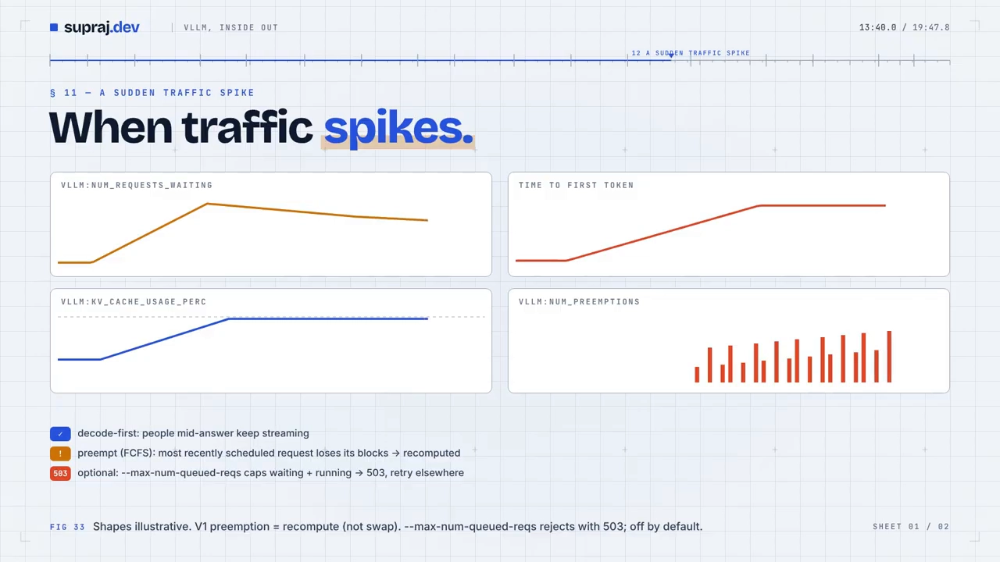

[【跳转到 13:40】](https://www.youtube.com/watch?v=XyZ0ephVQXM&t=820)

按时间顺序读这四张图：

1. **等待队列跳起来**。scheduler 在 token 预算和显存允许的范围内尽量多拉新请求进来，于是每个 step 里塞满 prefill 的活，**TTFT 往上爬**。
2. **但已经在出答案的人还在继续流式输出**。因为调度是 decode 优先的：先给正在跑的请求各发下一个 token，剩下的预算才给新请求做 prefill。这一条是尖峰期间体验不至于全面崩掉的关键。
3. **KV 使用率逼近 100% 并顶住**。池子满了，没有余量。
4. **抢占计数开始跳动**。当一个正在跑的请求需要新块而没有空闲块时，scheduler 必须动手。

### 4.2 抢占具体抢谁、抢完怎么办

视频给的默认策略很具体：**挑最近才被调度的那个请求，释放它所有的块，把它扔回等待队列**。之后它的工作会被重算——除了那些还在 prefix cache 里的块。

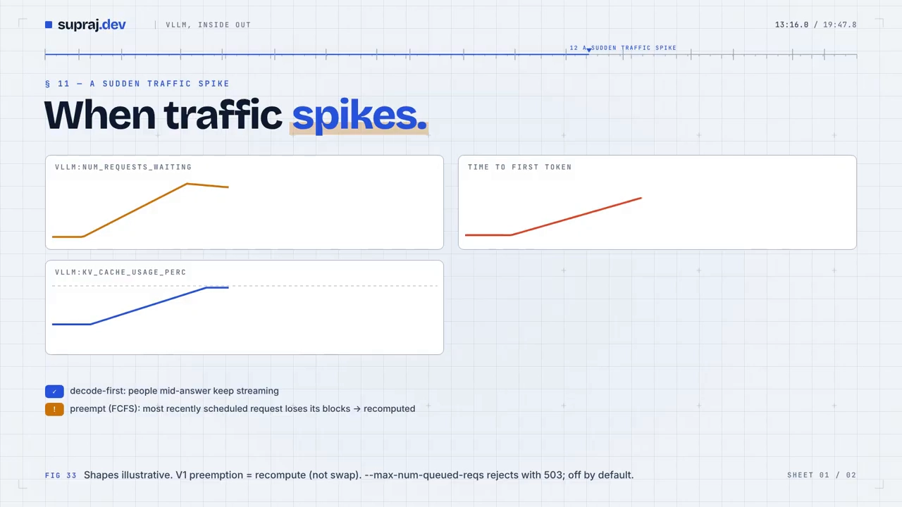

[【跳转到 13:16】](https://www.youtube.com/watch?v=XyZ0ephVQXM&t=796)

为什么抢「最近被调度的」？因为它的已生成内容最少，丢掉它浪费的算力最少——这是一种「损失最小化」的贪心。代价也很直接：**这个请求的 TTFT 和端到端延迟会暴涨**，它前面做过的 prefill 白做了。

视频还点明了一个版本差异：**在 vLLM v1 里是重算（recompute），不是换出（swap）**。这两种做法代表两条不同的取舍：

| 做法 | 机制 | 换来的 | 付出的 |
| --- | --- | --- | --- |
| recompute | 丢掉 KV，之后重新 prefill | 不占 CPU 内存，实现简单 | 浪费 GPU 算力，延迟暴涨 |
| swap | 把 KV 拷到 CPU 内存，之后再拷回 | 不浪费算力 | 占 CPU 内存与 PCIe 带宽，延迟同样暴涨 |

**两者都是「用延迟换容量」**，区别只是把成本记在算力账上还是记在带宽账上。工程上的判断标准很简单：如果 prefill 很贵（长 prompt），swap 更划算；如果 CPU 内存紧张或 PCIe 是瓶颈，recompute 更划算。

### 4.3 抢占计数是一个一级指标

视频的原话是：**抢占让引擎活着，但浪费了 GPU 的工作，所以抢占计数在涨是一个警告信号。**

这句话值得单独强调，因为它把「容量」从静态配置变成了动态信号。抢占次数不为零，说明你的池子在当前负载下**已经不够用了**，系统正在靠丢弃别人的进度来维持运转。这时候看吞吐可能还行（因为 GPU 一直在忙），但用户侧的长尾已经烂掉了——这与 2.2.3 讲的尾部延迟抖动是同一件事的两种观测角度。

---

## 五、拒绝与排队：503 是准入控制，不是故障

### 5.1 默认行为是排队

如果什么都不配，超出的请求就是排队。本节另一篇《权重决定装不装得下 KV Cache 决定能服务多少人》里有一个很直观的压测：一次发 16 个长请求，KV 使用率爬到 87% 就停住，引擎只跑装得下的 6 个，其余 10 个在队列里等，每完成一个就放一个进来。**什么都没崩，只是变慢。**

这条默认行为有它的好处：不丢请求，客户端只要肯等就能拿到结果。坏处是**等待时间没有上界**——队列可以无限长，TTFT 可以无限涨，最后表现成「服务还活着但没人能用」。

### 5.2 想快速失败，就得主动设上限

视频给的解法是给在途请求设上限：当 `maximum queued requests`（等待 + 运行一起算）到顶时，新请求**立刻拿到 503**，客户端可以去别的服务器重试。

这个 503 不是故障，是**准入控制的显式表达**：与其让请求在队列里烂掉，不如立刻告诉它「这台机器满了，去别处」。它把「不可控的无限等待」换成了「可控的快速失败」，代价是客户端必须会重试、且前面得有一个能把请求转走的负载均衡。

视频顺带说了一句很现实的话：**一台服务器扛不住大尖峰，而新副本要几分钟才能起来**（冷启动 = 下载 + 加载 + profiling + 编译 + 捕获 CUDA graph）。所以容量规划不能只算单机，还要算「尖峰到来时你有多少余量、扩出来要多久」。这部分属于容量与扩缩容的工程问题，本文只点到。

---

## 六、降级与 OOM：剩下两种结局

**降级**是运维主动做的第三种选择：既然池子装不下「最长可能」，那就把「最长可能」改小。具体手段在下一篇会看到实测——把 `max_model_len` 从模型的原生窗口改小、把 `max_num_seqs`（同时跑的请求数）压低、把权重或 KV 换成更低的精度。它们的共同点是：**用能力换容量**。用户感知到的是回答变短、或者质量轻微下降。

**OOM 崩溃**是最坏的一种。它通常不是「KV 池算错了」造成的——池子是启动时按实测切出来的，运行时不会超。真正会 OOM 的是那些**没被算进池子的部分**：`gpu_memory_utilization` 设得太高、同一张卡上还有别的进程、CUDA graph 的静态池比预留的大、或者统一内存机器上操作系统把内存吃掉了。

> **补充**：这也是为什么 `gpu_memory_utilization` 不是「越大越好」的旋钮。它调大，KV 池变大、并发变多；但它同时压缩了运行时自己的余量，一旦有别的进程来抢，就会从「并发变多」直接跳到「进程挂掉」。留 5%~10% 的余量是买保险，不是浪费。

---

## 七、把并发锁在墙以内：三个工程动作

### 7.1 用实测峰值定池子，别用参数个数估

第一节那道减法的每一项都必须来自实测，尤其激活峰值这一项。vLLM 的做法值得抄：**启动时用和真实 batch 同形状的假输入跑一次前向，量峰值**。你自己写的推理服务也应该这么做——把「最大 batch、最长序列」这个最坏组合跑一遍，看峰值，再决定留多少余量。

### 7.2 用两个上限把并发按在墙以内

视频里给了每个 step 的两条限制，它们正好是准入控制的两个抓手：

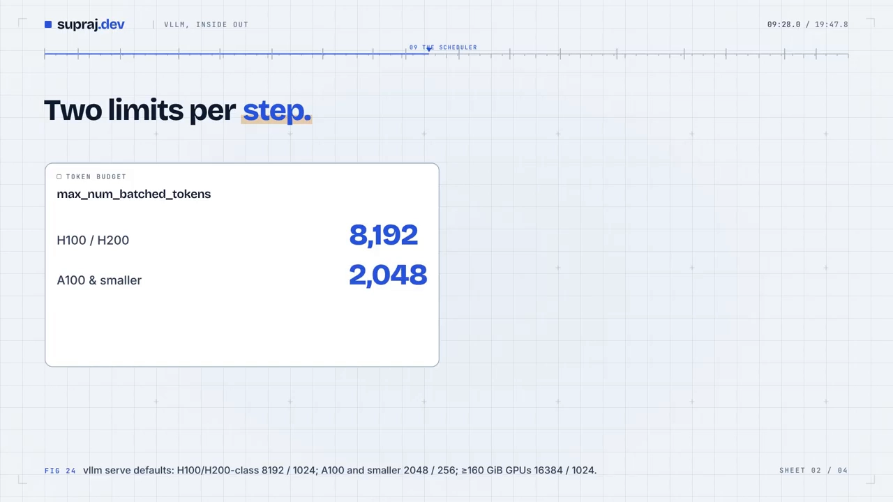

[【跳转到 09:28】](https://www.youtube.com/watch?v=XyZ0ephVQXM&t=568)

- **`max_num_batched_tokens`**：一个 step 里最多处理多少 token。它约束的是**这一步的计算量**，也间接约束了 prefill 的激进程度。视频给的默认值是 H100/H200 上 8192、A100 及更小卡上 2048。
- **`max_num_seqs`**：一个 step 里最多同时跑多少个请求。它约束的是**并发数**，也就是「同时占着 KV 的人头数」。

两者与容量墙的关系是：`max_num_seqs` 必须小于等于容量墙算出来的并发上限，否则引擎会不断触发抢占；`max_num_batched_tokens` 则决定你把这些并发压进多少个 step 里完成。**前者是容量约束，后者是延迟约束**——这也解释了为什么它们经常需要一起调。

### 7.3 监控三件套：等待数、KV 使用率、抢占次数

视频最后把 `/metrics` 上的指标映射回引擎的各个部件，并说「如果只对三件事告警，就这三件」：

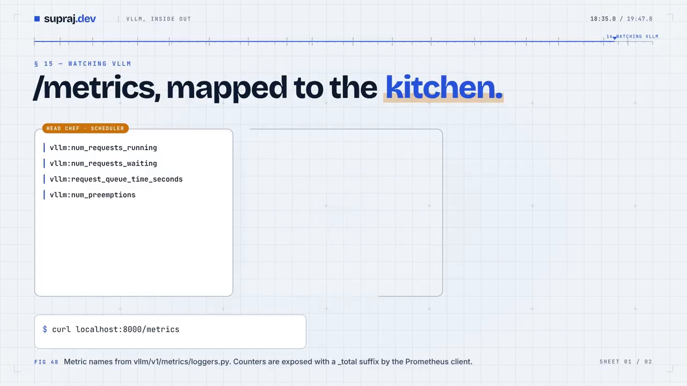

[【跳转到 18:35】](https://www.youtube.com/watch?v=XyZ0ephVQXM&t=1115)

1. **等待请求数在涨**（vllm:num_requests_waiting）：说明进来的比出去的快，容量或算力不够了。
2. **KV Cache 使用率卡在接近满**（vllm:kv_cache_usage_perc）：说明池子已经没有余量，下一步就是抢占。
3. **抢占次数在爬**（vllm:num_preemptions）：说明已经越线了，系统正在靠丢弃别人的进度维持运转。

视频的原话是：**三者一起，能在 503 出现之前告诉你麻烦来了。** 这句话把容量墙从「一个静态数字」变成了「一条可以提前看到的曲线」——这正是把它当准入控制而不是当性能调优的实际含义。

---

## 八、缓解手段与各自的代价

容量墙的除法只有三个输入，所以缓解手段也只有三类：**把分子做大、把分母做小、把同一份容量用得更省**。

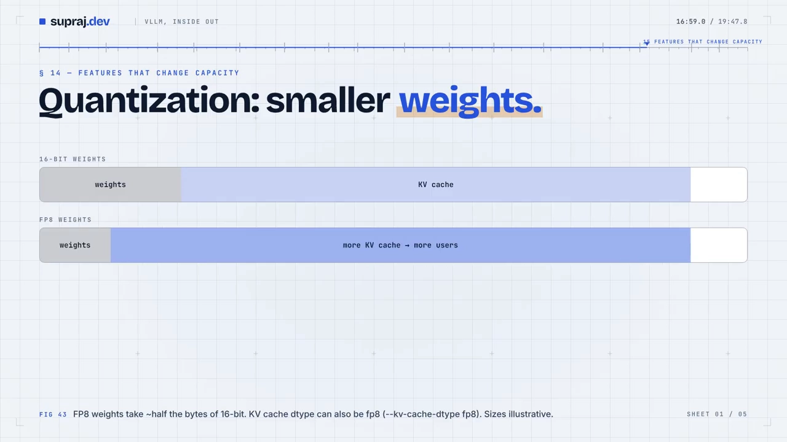

[【跳转到 16:59】](https://www.youtube.com/watch?v=XyZ0ephVQXM&t=1019)

| 手段 | 作用在哪一项 | 换来的 | 代价 |
| --- | --- | --- | --- |
| PagedAttention 按需分块 | 分子（消除预留浪费） | 池子可用比例从 60~80% 浪费降到 4% 以下 | 块表与寻址开销，实现复杂 |
| KV 量化 fp16 → fp8/int8 | 分母（bytes/token 减半） | 并发直接翻倍 | 精度受损，需自己验答案 |
| GQA / MLA 减少 KV 头数 | 分母（$H_{kv}$ 变小） | 同尺寸模型能装更多人 | 模型结构决定，不能事后改 |
| 滑动窗口 / 稀疏注意力 | 分母（有效长度变短） | 长对话不再线性吃显存 | 丢失远处上下文，能力下降 |
| PD 分离 | 分子（Prefill 节点不长期占 KV） | Prefill 与 Decode 各自按最优配置 | 架构复杂，KV 要跨节点搬 |
| CPU / NVMe 分层卸载 | 分子（把冷 KV 挪出显存） | 显存容量被放大 | 延迟换容量，命中率决定收益 |

关于 PagedAttention 那一行，视频只给了一句结论（老式服务器为每个请求预留一整块、按可能的最长答案来留，vLLM 团队测过其中 60%~80% 是浪费的，分页把它压到 4% 以下），块表机制本身留给第 4 章。这里只需要记住它对**这条除法**的影响：它改的是分子里「真正可用的比例」，不改分母。

关于 KV 量化，视频在下一篇给了实测：同一个模型、同一个池子，只是把 KV 存成 FP8，最大并发从 4.21 变成 8.63——**一个 flag 换两倍用户**。代价是精度，所以视频的建议是先在自己的 prompt 上验答案。

---

## 小结

- **容量墙是一条除法**：最大并发 ≈ 可用 KV 池字节数 ÷ 单请求 KV 字节数。分子来自「总显存 × 利用率 − 权重 − 激活峰值 − workspace − 预留」，分母来自「每 token KV 字节数 × 序列长度」。
- **日志里那一行就是答案**：`GPU KV cache size` 是总量，`Maximum concurrency for N tokens per request` 是条件数。分母换了，这个数就换。
- **总 token 预算是常数**：并发 × 平均长度 ≈ 常数。1000 个用户要 250 万 token 而池子只有 45 万时，就是 180 个在跑、820 个在等。
- **它是硬约束不是软约束**：算力和带宽撞墙是连续退化（一起变慢），容量撞墙是离散失败（必须立刻取舍）。所以它属于准入控制，不属于性能调优。
- **四种撞墙行为**：抢占（recompute 或 swap，被抢者延迟暴涨）、拒绝/排队（TTFT 飙升或 503）、降级（缩短长度、压并发、降精度）、OOM（进程挂掉）。
- **抢占计数是一级指标**：它不为零就说明池子不够用，系统正在靠丢弃别人的进度维持运转。
- **监控三件套**：等待请求数、KV 使用率、抢占次数。三者一起能在 503 之前报警。

## 关键术语速查

| 术语 | 一句话解释 |
| --- | --- |
| KV Cache | 每个请求在每一层为历史 token 保留的 key/value 向量，是「模型对这段对话的记忆」 |
| 容量墙 | 显存容量决定的最大并发上限，表现为一条除法而非一条性能曲线 |
| gpu_memory_utilization | 引擎被允许使用的显存比例，默认 0.92；乘上总显存后减去各项余量才是 KV 池 |
| KV 池 | 启动时切出来专门放 KV Cache 的那块显存，被切成固定大小的块 |
| 块 block | KV 池的分配单位，默认装 16 个 token 的 KV；按需分配而不是按最长预留 |
| 最大并发 | 池子能同时容纳多少个「满长度请求」，等于池子 token 数除以每请求长度 |
| 抢占 preemption | 空闲块耗尽时，引擎强制收回某个正在跑的请求的 KV，把它退回等待队列 |
| recompute | 抢占后丢弃 KV、之后重新 prefill；省 CPU 内存但浪费 GPU 算力 |
| swap | 抢占后把 KV 拷到 CPU 内存、之后再拷回；省算力但吃 PCIe 带宽 |
| 准入控制 admission control | 决定「谁有资格进来」的机制，如 max_num_seqs、max_num_queued_requests 的 503 |
| max_num_batched_tokens | 一个 step 的 token 预算，H100/H200 默认 8192、A100 及更小卡 2048 |
| max_num_seqs | 一个 step 里最多同时跑多少个请求，直接受容量墙约束 |
| decode 优先 | 调度时先给正在跑的请求发下一个 token，剩余预算才给新请求做 prefill |
| GQA | Grouped Query Attention，多个查询头共享一组 KV 头，直接减小 bytes/token |
| MLA | Multi-head Latent Attention，把 KV 压成低秩潜向量，进一步减小 bytes/token |