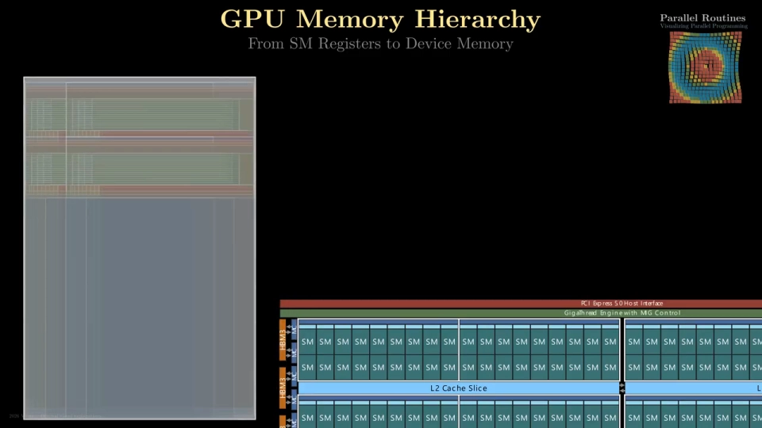
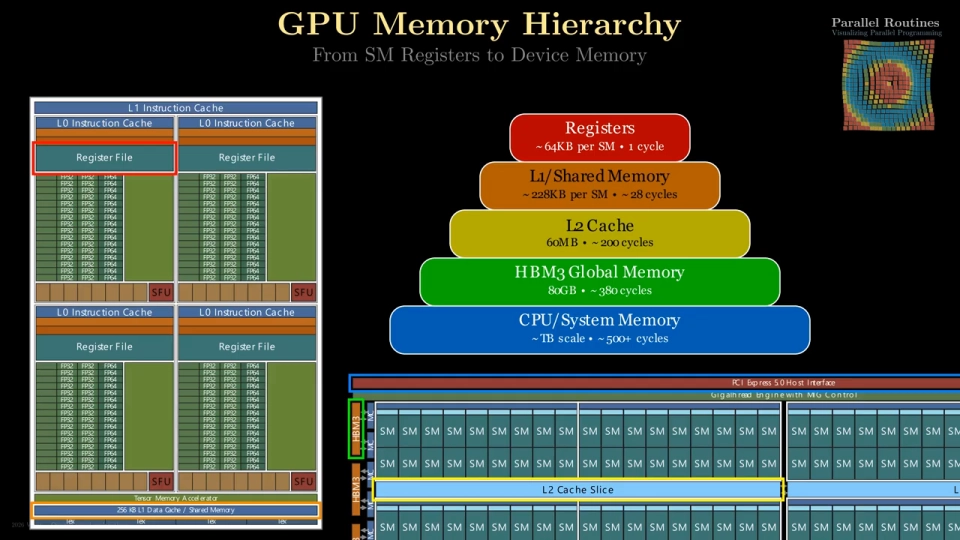
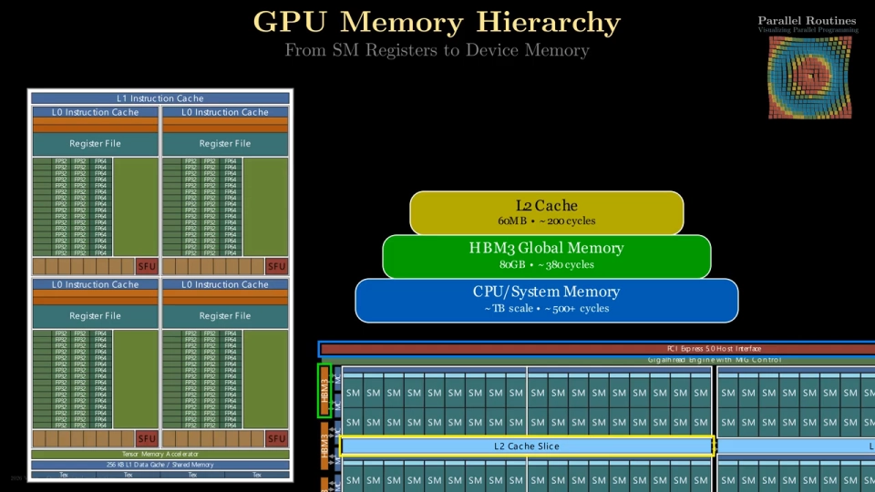
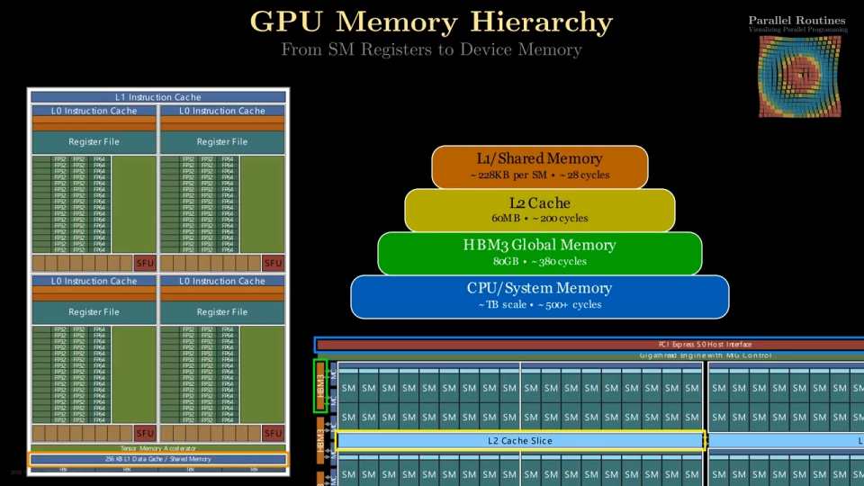
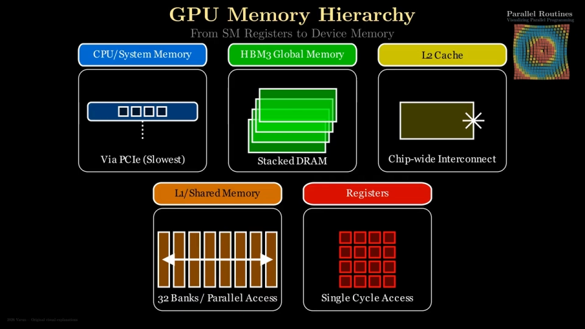
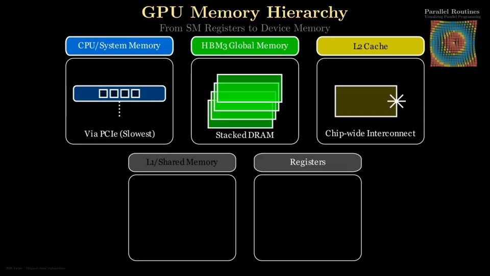

# GPU 存储层次全景：L2 全局共享，L1 与共享内存由程序员掌控

> 视频来源：[GPU Memory Hierarchy Explained: Registers, Shared Memory, L2, HBM, and PCIe (Visual)](https://www.youtube.com/watch?v=Q1Y-vkXqCKM)（YouTube · Parallel Routines）｜时长约 4.5 分钟
> 导读：一支用剖面图讲清 GPU 存储层次的短片。本文按“容量—延迟—谁能控制”三条线索重排视频内容，重点落在 L2 的全局共享与 L1／共享内存的程序员可控性上；视频中给出的具体容量与周期数按原画面保留，仅作量级参考。

## 本讲要解决的核心问题（SCQA）

**背景**：写 CUDA 内核时，我们都知道“数据放得越近越快”，但 GPU 里到底有哪几层存储、每层归谁管，往往说不清楚。

**冲突**：同样一次访存，有的落在寄存器上 1 个周期就回来，有的要穿过 L2、HBM 甚至 PCIe 花上几百个周期；更麻烦的是，有些层硬件自动帮你缓存，有些层必须你亲手搬数据。

**疑问**：GPU 的存储层次如何划分？哪些层是所有 SM 共享的，哪些层是每个 SM 私有的？程序员能控制到哪一层？

**回答（中心思想）**：GPU 存储是一条“容量换速度”的阶梯：寄存器 → L1／共享内存 → L2 → HBM → CPU 系统内存。其中 **L2 由全芯片所有 SM 共享、由硬件自动缓存**，而 **L1 与共享内存位于每个 SM 内部，共享内存更是由程序员显式管理**；理解这条分界线，才能决定什么时候靠 L2 自动复用、什么时候用共享内存手工分块。

## 一、一条用容量换速度的阶梯

视频先给出一张 GPU 剖面图：一堆标着 SM 的小方块排成阵列，中间横贯一条 “L2 Cache Slice”，最上方是 PCIe 主机接口，两侧是 HBM 显存堆栈。[【跳转到 00:15】](https://www.youtube.com/watch?v=Q1Y-vkXqCKM&t=15)

这张图已经暗示了层次结构的关键：**越靠近 SM 的存储越快、越小；越远的越慢、越大**。视频用一张金字塔把五层存储的容量与访问延迟并列出来：

| 存储层 | 容量（视频示例） | 访问延迟（约） | 位置 |
| --- | --- | --- | --- |
| 寄存器 Registers | 约 64 KB / SM | 1 个周期 | SM 内部 |
| L1／共享内存 | 约 228 KB / SM | 28 个周期 | SM 内部 |
| L2 Cache | 60 MB | 200 个周期 | 全芯片共享 |
| HBM3 全局内存 | 80 GB | 380 个周期 | 芯片外、同一封装 |
| CPU 系统内存 | TB 级 | 500+ 个周期 | 主板，经 PCIe |

这张表最值得记住的不是具体数字（它们会随 GPU 代际变化），而是**数量级差距**：从寄存器到 HBM 差了约两个半数量级的延迟，到 CPU 内存还要再高一些。所谓“优化访存”，本质就是把尽可能多的访问留在金字塔的上半部分。[【跳转到 01:45】](https://www.youtube.com/watch?v=Q1Y-vkXqCKM&t=105)

### 1.1 片外两层：HBM 与 CPU 系统内存

HBM3 显存由多个独立的堆栈组成，每个堆栈有自己的内存控制器，硬件会自动把请求路由到正确的堆栈，因此可以并行处理大量访问。它容量大、带宽高，但仍在芯片之外，延迟约 380 个周期。[【跳转到 00:30】](https://www.youtube.com/watch?v=Q1Y-vkXqCKM&t=30)

再往外是 CPU 系统内存，经 PCIe 等互连访问，带宽有限、延迟最高（500+ 周期）。视频特别提醒：**互连带宽往往才是这一层的限制因素**，数据搬运可以显式发起，也可以交给统一页锁定内存（unified page-locked memory）管理。

对这两层，视频给出一条实操建议：**把全局内存传输批量化，并与计算重叠**，用计算去掩盖这段长延迟。[【跳转到 02:12】](https://www.youtube.com/watch?v=Q1Y-vkXqCKM&t=132)

## 二、L2：全芯片共享的“公共缓存”

L2 是这条阶梯上第一个“共享”层。视频的原话是：**L2 cache is shared across all SMs via the GPU's chip-wide interconnect**——它通过全芯片互连被所有 SM 共享，位置夹在 SM 与全局内存之间。[【跳转到 01:00】](https://www.youtube.com/watch?v=Q1Y-vkXqCKM&t=60)

这带来两个直接后果：

1. **跨 SM 复用**：一个 SM 取回的数据，可能被另一个 SM 直接命中，而不必再走一趟 HBM。
2. **命中率取决于访问模式**：L2 是硬件自动管理的缓存，你无法像分配数组那样“申请”它；能做的只是把访问模式组织得更容易命中。视频提到，现代 GPU 还支持**持久化缓存提示（persistent caching hints）**，用于让频繁使用的数据更久地留在 L2 里。

所以对 L2 的正确心态是：**它是自动的、全局的、不可直接编程的**。你能影响它，但不能指挥它。[【跳转到 02:42】](https://www.youtube.com/watch?v=Q1Y-vkXqCKM&t=162)

## 三、L1 与共享内存：每个 SM 自己的“可编程 SRAM”

再往上一层，L1 与共享内存在物理上位于每个 SM 内部，视频给出的量级是每 SM 约 228 KB、约 28 个周期。[【跳转到 01:15】](https://www.youtube.com/watch?v=Q1Y-vkXqCKM&t=75)

两者虽然同处一层，性格却完全不同：

- **L1 是缓存**：由硬件自动管理，负责“快速缓存”，行为与 L2 类似，只是范围缩小到单个 SM。
- **共享内存是显式管理的 SRAM**：视频强调它 “explicitly managed per SM”，**只对运行在该 SM 上的线程可见**（实际使用中按 block 分配，block 内的线程共享同一块）。也就是说，共享内存不是缓存，不会自动帮你保存什么；你在核函数里声明一块 `__shared__` 数组，就得自己负责把数据搬进去、自己负责同步。

共享内存内部还被划分为 **32 个 bank**，支持并行访问：

bank 化是共享内存快的原因，也是它容易踩坑的原因：如果同一个 warp 的线程访问落到同一个 bank，就会发生 **bank conflict**，并行访问退化成串行，性能显著下降。视频把细节留给了配套的 bank conflict 专题，这里只需记住：**共享内存的延迟不是一个固定值，它由你的访问模式决定**。[【跳转到 02:57】](https://www.youtube.com/watch?v=Q1Y-vkXqCKM&t=177)

### 3.1 寄存器：最快但最“贵”的一层

金字塔顶端是寄存器：每个 SM 约 64 KB，访问只要 1 个周期[【跳转到 01:30】](https://www.youtube.com/watch?v=Q1Y-vkXqCKM&t=90)。视频指出两个关键机制：

- 寄存器在**编译期按线程分配**，并在整个 kernel 执行期间保持占用；
- SM 内的寄存器文件分成多个分区，每个分区有自己的寄存器堆；**warp 切换只是换一组寄存器**，没有保存、拷贝或恢复的开销。

这也解释了为什么“寄存器用太多”会变成性能问题：它会挤占同时驻留的线程数（occupancy）。这部分属于后续小节的内容，这里先建立直觉即可。

## 四、把层次结构变成优化策略

视频最后把整张金字塔收束成四条可执行的原则：

1. **把最热的数据留在寄存器里**；[【跳转到 03:42】](https://www.youtube.com/watch?v=Q1Y-vkXqCKM&t=222)
2. **通过共享内存共享中间结果**，让同一 block 的线程不必各自去全局内存取同一份数据；
3. **组织算法以最大化 L2 复用**，让跨 SM 的数据也能被二次利用；
4. **批量发起全局内存传输并与计算重叠**，用并行度掩盖长延迟。

此外还有一条贯穿全局的前提：**合并访存（coalesced access）至关重要**。层次结构决定了“数据在哪”，合并访存决定了“一次搬多少”，两者共同决定实际带宽。[【跳转到 02:27】](https://www.youtube.com/watch?v=Q1Y-vkXqCKM&t=147)

## 小结

- GPU 存储是一条容量换速度的阶梯：寄存器（1 周期）→ L1／共享内存（约 28 周期）→ L2（约 200 周期）→ HBM（约 380 周期）→ 系统内存（500+ 周期）。
- **L2 是全芯片共享层**，由硬件自动缓存，作用是让一个 SM 取回的数据能被其它 SM 复用，并削减 HBM 流量；命中率取决于访问模式，可用持久化缓存提示影响。
- **L1 是每个 SM 私有的自动缓存；共享内存是每个 SM 私有的、由程序员显式管理的 SRAM**，只对同一 SM 上的线程可见。
- 共享内存按 32 个 bank 组织，访问模式决定是否发生 bank conflict，因此它的“快”是有条件的。
- 寄存器在编译期按线程分配并全程占用，warp 切换只是换寄存器组，无保存／恢复开销。
- 优化策略可以归纳为：热数据进寄存器、中间结果进共享内存、算法结构争取 L2 复用、全局传输批量化并与计算重叠。

## 关键术语速查

| 术语 | 一句话解释 |
| --- | --- |
| SM（Streaming Multiprocessor） | GPU 的基本计算单元，内部有寄存器文件、L1／共享内存与执行单元 |
| L2 Cache | 全芯片所有 SM 共享的自动缓存，位于 SM 与 HBM 之间 |
| L1 Cache | 每个 SM 私有的自动缓存，与共享内存共享同一块片上存储 |
| 共享内存（Shared Memory） | 每个 SM 上的显式管理 SRAM，按 block 分配，仅 block 内线程可访问 |
| Bank | 共享内存的并行访问单元，共 32 个；冲突时访问串行化 |
| HBM | 高带宽显存，芯片外但同封装，容量大、延迟高 |
| 合并访存（Coalescing） | 把同一 warp 的相邻地址访问合并成少量内存事务 |
| Occupancy | 实际驻留线程数与硬件上限之比，受寄存器、共享内存等资源约束 |