# 共享内存分块矩阵乘：把全局访存减半的 Tiling 策略

> 视频来源：[Must Know Technique in GPU Computing | Episode 4: Tiled Matrix Multiplication in CUDA C](https://www.youtube.com/watch?v=Q3GgbfGTnVc)（YouTube · Tushar Gautam）｜时长约 8.7 分钟
> 导读：这支视频用 4×4 的小矩阵把“为什么朴素矩阵乘访存冗余、如何用共享内存分块消除冗余”一步步推完，并给出可直接运行的 CUDA 代码。本文按“问题—原理—代码—边界”的顺序复述，公式与代码均对应视频画面。

## 本讲要解决的核心问题（SCQA）

**背景**：矩阵乘是 GPU 上最基础的算子。最直观的写法是“一个线程算一个输出元素”，把并行度交给线程。

**冲突**：这种写法能跑，但每个线程都要独立地把 A 的一整行、B 的一整列从全局内存读一遍。相邻线程读的其实是同一批元素，大量带宽被重复访问浪费掉。

**疑问**：能不能让同一 block 的线程只读一次数据，然后大家共用？共用放在哪里？

**回答（中心思想）**：把矩阵切成能塞进**共享内存**的小块（tile），由 block 内的线程协作搬运一次，再从共享内存里做部分点积并累加。这样每个元素只从全局内存读一次，视频的 4×4 例子中**全局内存访问次数直接减半**。共享内存是程序员显式管理的片上 SRAM，这正是 tiling 能成立的前提。

## 一、朴素矩阵乘：并行度够了，访存却冗余

矩阵乘的定义是

$$
C_{i,j} = \sum_{k=0}^{N-1} A_{i,k} \cdot B_{k,j}
$$

朴素 CUDA 实现让每个线程负责一个 $C_{i,j}$：线程沿着 $k$ 迭代，依次读 $A_{i,k}$ 和 $B_{k,j}$。[【跳转到 00:00】](https://www.youtube.com/watch?v=Q3GgbfGTnVc&t=0)

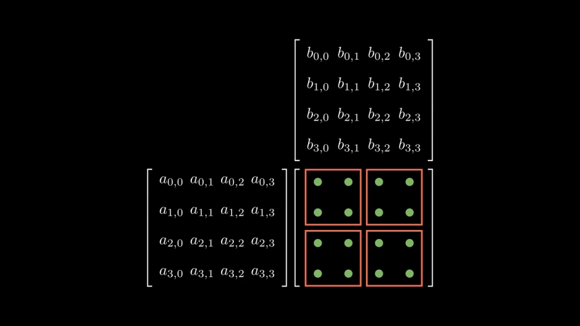

视频用 4×4 矩阵、2×2 的 grid 和 2×2 的 block 来放大这个问题[【跳转到 00:25】](https://www.youtube.com/watch?v=Q3GgbfGTnVc&t=25)。只看 `block[0,0]` 里的四个线程：

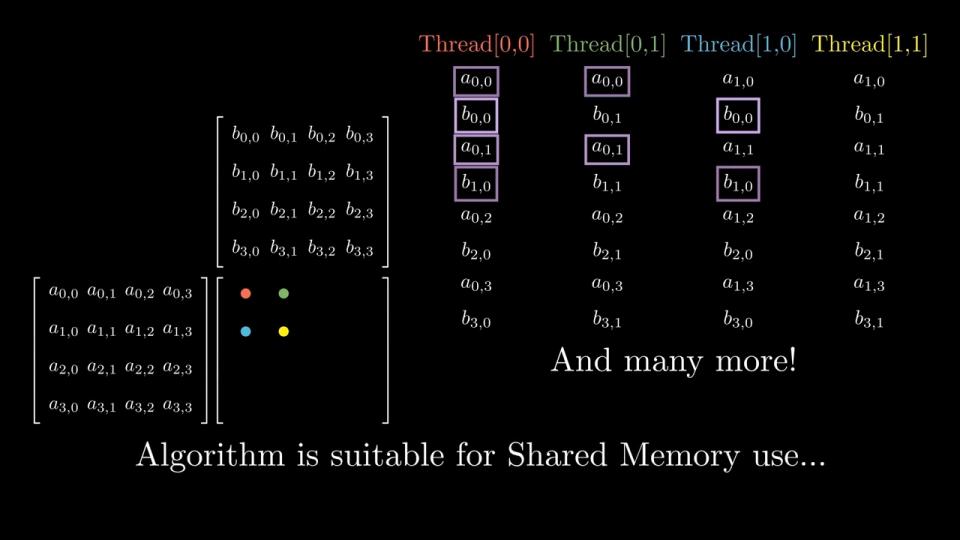

- `thread[0,0]` 和 `thread[0,1]` 都需要 $A_{0,0}$，却各自从全局内存读了一次；
- `thread[0,0]` 和 `thread[1,0]` 都需要 $B_{0,0}$，同样各读一次；
- 几乎每个元素都被这样重复读取。

这不是合并访存能救的问题：合并访存解决的是“同一次读能不能合并成更少的事务”，而这里是**同一份数据被不同线程重复请求**。要消除它，必须给这些线程一块可以共同访问的、比全局内存快得多的存储。[【跳转到 01:15】](https://www.youtube.com/watch?v=Q3GgbfGTnVc&t=75)

## 二、共享内存：block 私有的片上暂存区

视频对共享内存给了三条性质：

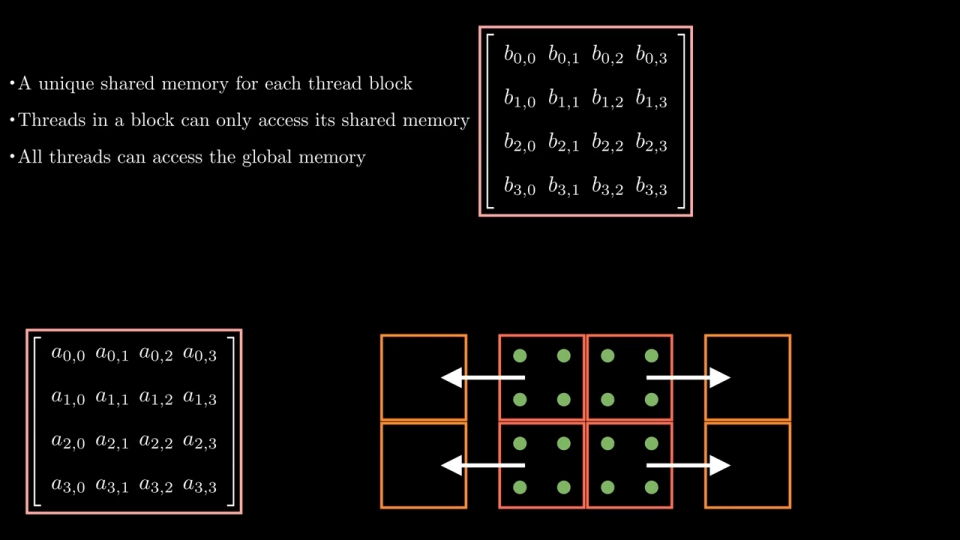

1. **每个 thread block 有自己独立的一块共享内存**；
2. **block 内的线程只能访问自己 block 的共享内存**；
3. **所有线程都可以访问全局内存**（共享内存则不行，跨 block 不可见）。

它和全局内存是一组典型的取舍：**全局内存大而慢，共享内存快而小**。所以策略不是“把整个矩阵搬进共享内存”，而是**把数据切成小块（tile），让每一块刚好放得下**——这就是 tiling[【跳转到 01:40】](https://www.youtube.com/watch?v=Q3GgbfGTnVc&t=100)。

> 这里也解释了本小节的主题：L2 是硬件自动管理的全局共享缓存，而共享内存是**由程序员显式管理**的片上 SRAM。要不要搬、搬哪一块、什么时候搬，全由你决定；代价是要自己写搬运代码和同步。

## 三、分块之后：一次搬运，多次复用

在 4×4、tile 大小为 2×2 的例子中，A 和 B 都被切成 2×2 的 tile，正好与 block 大小一致。

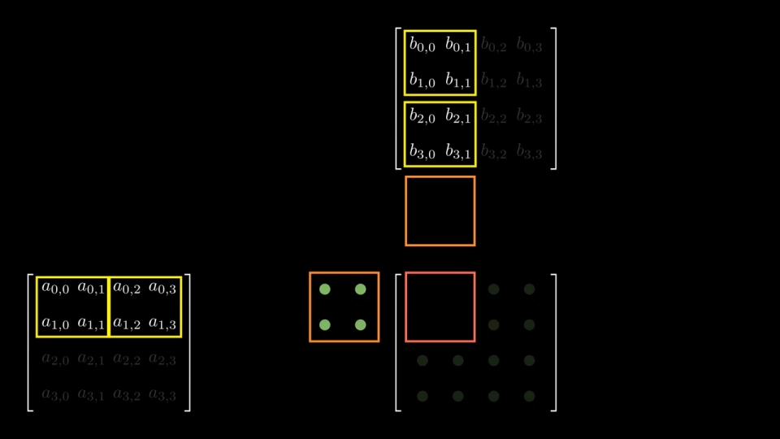

以 `block[0,0]` 为例，计算流程是：

1. 四个线程协作，把 A 的 tile 和 B 的 tile 各搬 4 个元素进共享内存（每个线程搬一个）；
2. 搬完后，block 内所有线程都能直接读这些元素，做**部分点积**；
3. 换下一组 tile，重复上述过程；所有 tile 走完，点积才完整。[【跳转到 02:30】](https://www.youtube.com/watch?v=Q3GgbfGTnVc&t=150)

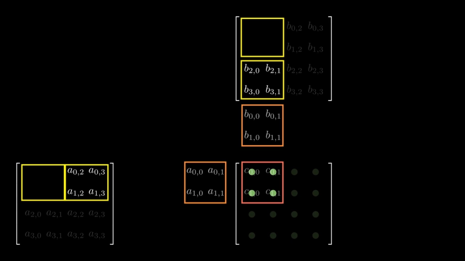

视频把两种写法的全局内存访问逐条列出来对比：

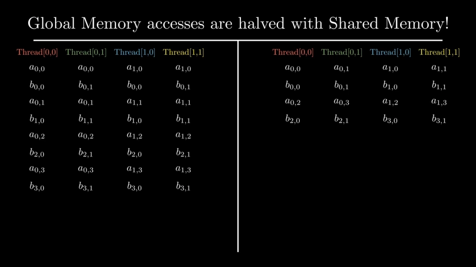

结论很直接：**共享内存版本把全局内存访问次数减半**。而且这一切成立的原因只有一个——**同一个 block 的线程能访问同一块共享内存**。[【跳转到 03:20】](https://www.youtube.com/watch?v=Q3GgbfGTnVc&t=200)

## 四、代码：三步走

视频把分块矩阵乘拆成三个步骤：

1. 把数据划分成 tile；
2. 把 tile 从全局内存搬到共享内存；
3. 在共享内存上做点积。

核函数骨架如下（`TILE_WIDTH` 为 tile 边长）：

```cuda
__global__ void tiled_sq_mat_mul_kernel(float* A, float* B, float* C, int N)
{
    // 本线程负责的 block 与 block 内坐标
    int by = blockIdx.y;
    int bx = blockIdx.x;
    int ty = threadIdx.y;
    int tx = threadIdx.x;

    // 本线程负责的 C 元素全局坐标
    int i = blockDim.y * by + ty;
    int j = blockDim.x * bx + tx;

    // 分配共享内存
    __shared__ float sh_A[TILE_WIDTH][TILE_WIDTH];
    __shared__ float sh_B[TILE_WIDTH][TILE_WIDTH];

    float value = 0;
    // 逐个 tile 推进
    for (int phase = 0; phase < N / TILE_WIDTH; phase++) {
        // 1) 把 tile 搬进共享内存
        sh_A[ty][tx] = A[i * N + phase * TILE_WIDTH + tx];
        sh_B[ty][tx] = B[(phase * TILE_WIDTH + ty) * N + j];
        __syncthreads();

        // 2) 在共享内存上做部分点积
        for (int k = 0; k < TILE_WIDTH; k++)
            value += sh_A[ty][k] * sh_B[k][tx];
        __syncthreads();
    }

    // 3) 写回结果
    C[i * N + j] = value;
}
```

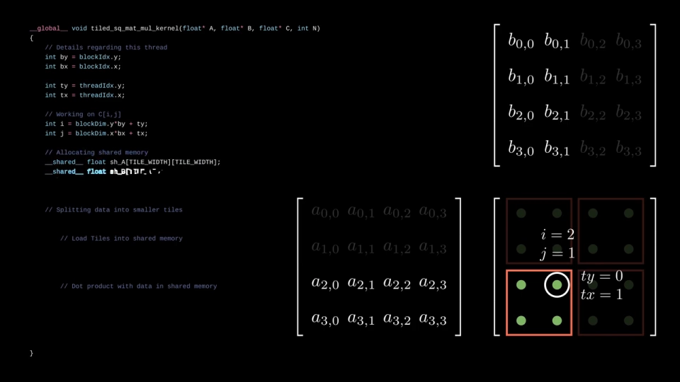

### 4.1 搬运时的下标怎么来的

这是全片最绕的一段[【跳转到 04:10】](https://www.youtube.com/watch?v=Q3GgbfGTnVc&t=250)。视频提醒：矩阵按**行主序（row-major）**存储，所以二维下标 $(r,c)$ 的线性地址是 $r \times N + c$。

对 A 的 tile：线程要搬的元素，**行号就是自己的全局行号 $i$**；列号由“第几个 tile”和 block 内的 $tx$ 决定：

$$
\text{col} = \text{phase} \times \text{TILE\_WIDTH} + tx
$$

- `phase = 0` 时，列号就是 $tx$；
- `phase = 1` 时，列号是 tile 宽度加上 $tx$。

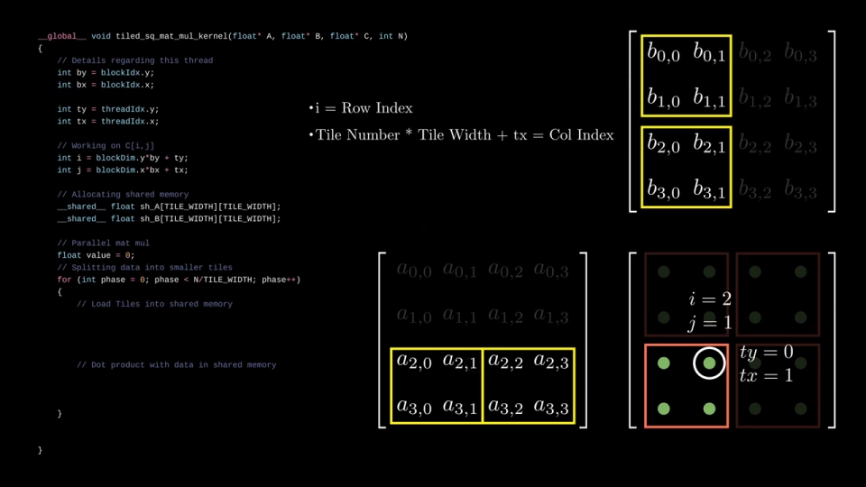

对 B 的 tile 则反过来：**列号就是全局列号 $j$**，行号由 tile 编号和 $ty$ 决定：

$$
\text{row} = \text{phase} \times \text{TILE\_WIDTH} + ty
$$

于是两行搬运代码写成：

```cuda
sh_A[ty][tx] = A[i * N + phase * TILE_WIDTH + tx];
sh_B[ty][tx] = B[(phase * TILE_WIDTH + ty) * N + j];
```

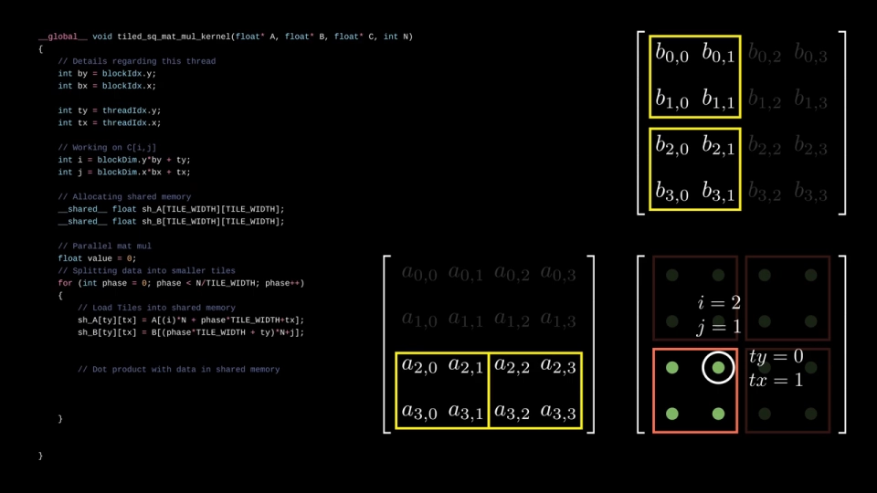

视频建议在这里暂停，自己把四个线程的地址都代进去验算一遍——这是整段代码最容易写错的地方。[【跳转到 04:35】](https://www.youtube.com/watch?v=Q3GgbfGTnVc&t=275)

### 4.2 为什么需要两次 __syncthreads()

线程是各自独立的，搬运完成的时刻并不一致。如果某个线程还没把数据写进共享内存，别的线程就开始读，读到的就是垃圾。所以**点积之前必须同步**：

```cuda
__syncthreads();
```

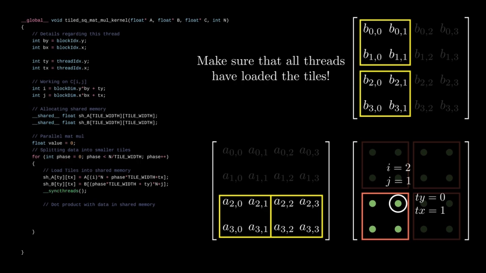

同样重要的是**点积之后、加载下一组 tile 之前再同步一次**：否则跑得快的线程会把下一块 tile 写进共享内存，而跑得慢的线程还在读上一块的数据。两次同步分别对应“写后读”和“读后写”两种竞争。[【跳转到 05:25】](https://www.youtube.com/watch?v=Q3GgbfGTnVc&t=325)

## 五、当矩阵不能被 tile 整除

前面的推导默认矩阵是方阵、且边长能被 tile 整除。视频接着放宽这个假设，用 3×3 矩阵、tile 仍为 2 来演示问题[【跳转到 05:50】](https://www.youtube.com/watch?v=Q3GgbfGTnVc&t=350)。

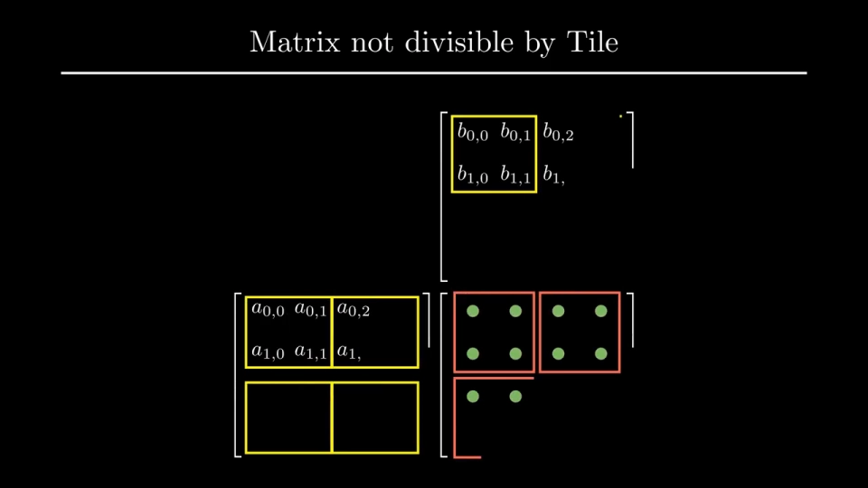

越界不只发生在最后一个 phase：计算 `block[0,0]` 的 phase 1 时，线程会尝试读 $A_{0,2}$、$A_{1,2}$、$B_{2,0}$、$B_{2,1}$；计算 `block[0,1]` 的 phase 0 时同样会越界。

视频还排除了两种“看起来聪明”的偷懒办法：

- **只处理最后一个 phase**：错，越界在 phase 0 也会出现；
- **把落在 C 边界外的线程直接排除**：也错，例如 `block[1,1]` 的 `thread[0,1]` 不负责任何 C 元素，但它在 phase 0 仍要搬运 $A_{0,1}$，排除它就会少搬数据。

唯一正确的做法是：**对 A、B 的每一次加载都单独检查下标**；如果越界，就把共享内存对应位置**填 0**，避免污染最终结果；写回 C 时再检查一次下标。[【跳转到 07:05】](https://www.youtube.com/watch?v=Q3GgbfGTnVc&t=425)

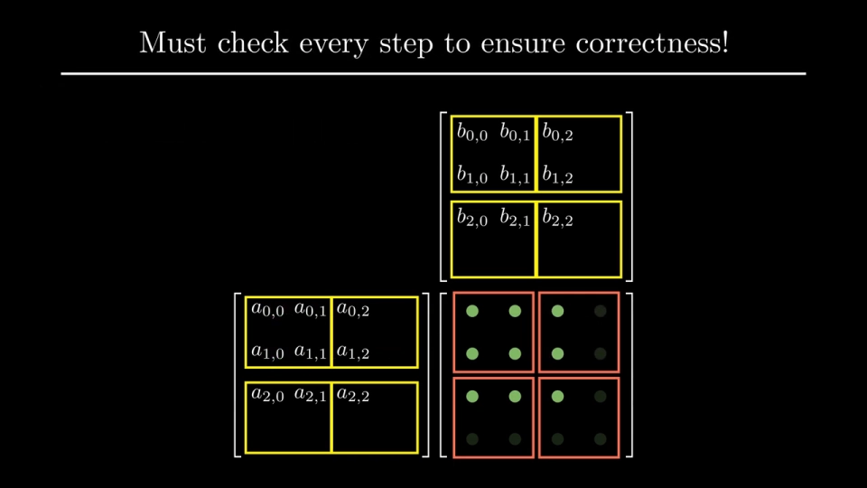

```cuda
// 加载 A 的 tile，越界填 0
if ((i < N) && ((phase * TILE_WIDTH + tx) < N))
    sh_A[ty][tx] = A[i * N + phase * TILE_WIDTH + tx];
else
    sh_A[ty][tx] = 0.0f;

// 加载 B 的 tile，越界填 0
if (((phase * TILE_WIDTH + ty) < N) && (j < N))
    sh_B[ty][tx] = B[(phase * TILE_WIDTH + ty) * N + j];
else
    sh_B[ty][tx] = 0.0f;
__syncthreads();
```

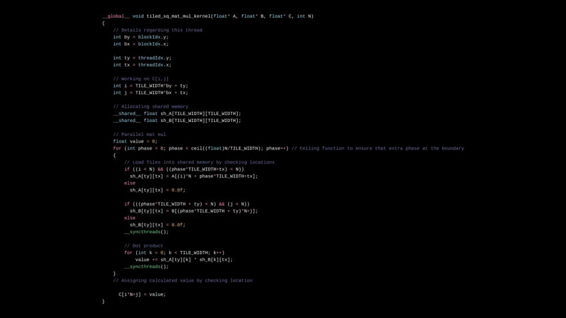

## 六、推广到矩形矩阵

最后一层推广是矩形矩阵。核函数改为接收三个维度 $N_1$、$N_2$、$N_3$，分别对应 $A$ 的行数、$A$ 的列数（也是 $B$ 的行数）、$B$ 的列数[【跳转到 07:30】](https://www.youtube.com/watch?v=Q3GgbfGTnVc&t=450)。

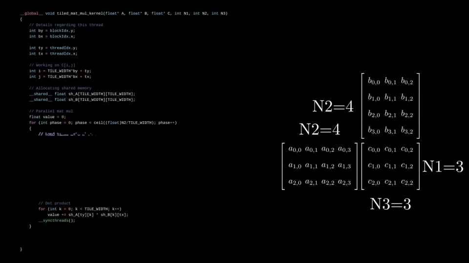

需要改的地方只有几处：

- tile 循环的上界从 $N / \text{TILE\_WIDTH}$ 改为 $\lceil N_2 / \text{TILE\_WIDTH} \rceil$，因为 $N_2$ 才是 A、B 的公共维度，也决定了要切多少个 tile；
- 加载 A 时检查 行 $< N_1$、列 $< N_2$；
- 加载 B 时检查 行 $< N_2$、列 $< N_3$；
- 写回 C 时检查 行 $< N_1$、列 $< N_3$。

视频最后指出：即使换成矩形矩阵，共享内存带来的加速依然相当可观；代码仓库链接放在视频简介里，可以自己跑一遍。

## 小结

- 朴素矩阵乘的瓶颈不是并行度不够，而是**同一份 A、B 数据被不同线程反复从全局内存读取**。
- 共享内存是**每个 block 私有、仅 block 内可见**的片上 SRAM，容量小但快，适合做 tile 的暂存区。
- tiling 的三步是：切块 → 协作搬运 → 在共享内存上做部分点积并累加；4×4 例子中全局访存次数减半。
- 搬运下标依赖行主序线性化：A 固定行 $i$、列随 tile 滑动；B 固定列 $j$、行随 tile 滑动。
- 两次 __syncthreads() 分别防止“写后读”和“读后写”竞争，缺一不可。
- 尺寸不能被 tile 整除时，必须对每次加载单独检查下标并**越界填 0**，写回 C 时再检查一次；排除边界外线程是错误做法。
- 推广到矩形矩阵只需引入 $N_1, N_2, N_3$，把循环上界改为 $\lceil N_2 / \text{TILE\_WIDTH} \rceil$ 并相应调整三处边界检查。

## 关键术语速查

| 术语 | 一句话解释 |
| --- | --- |
| Tiling（分块） | 把大矩阵切成能放进共享内存的小块，逐块计算并累加 |
| 共享内存（Shared Memory） | 每个 block 私有的片上 SRAM，需程序员显式搬运与同步 |
| 全局内存（Global Memory） | 所有线程可见的显存，容量大但延迟高 |
| 行主序（Row-major） | 二维元素按行连续存放，线性地址为 $r \times N + c$ |
| 部分点积（Partial Dot Product） | 只对一个 tile 内的元素求和，多个 tile 的结果累加才是完整点积 |
| __syncthreads() | block 内的栅栏同步，所有线程到达后才继续 |
| phase | 第几个 tile 的迭代编号，决定当前搬运哪一块数据 |