# 寄存器压力如何限制 occupancy：从 128 个寄存器到 50% 占用率

> 视频来源：[CUDA Occupancy and Launch Configuration in 8 Minutes](https://www.youtube.com/watch?v=wKo_oB-Tscs)（YouTube · Tom Jet / NVIDIA CUDA lab 第 10 集）｜时长约 8 分钟
> 导读：一支把「寄存器 → occupancy → 实测时间」这条因果链讲透的短片。本文按「预算表 → kernel 需求 → 相除取最小 → launch bounds → 实测扫描」的顺序重排内容；文中具体数字（32 warp、65,536 个寄存器等）都是视频里图灵卡（GTX 1650）的示例值，换卡会变，量级和算法不变。

## 本讲要解决的核心问题（SCQA）

**背景**：上一集刚把访存合并做到最好——地址连续、transaction 最少，按说该快了。

**冲突**：程序还是不够快。因为对一个 kernel 来说，访存模式只是众多影响因素之一；同一个 SM、同一段算术，仅仅换一下 block size 或者让 kernel 多用几十个寄存器，能同时驻留的 warp 数就会腰斩，速度也跟着掉。

**疑问**：寄存器这种「每个线程私有的最快存储」，到底是怎么把 occupancy 卡住的？能不能通过调参把它「买」回来？

**回答（中心思想）**：occupancy 是「实际驻留的 warp 数 ÷ 一个 SM 能容纳的 warp 数」，它由**线程数、block 槽位、每线程寄存器数、每 block 共享内存**四道上限共同决定，取其中最小者。寄存器文件是片上最快也最紧的一层存储，**每线程多用一份寄存器，SM 上就少驻留一批 warp**；而用 **launch_bounds** 限定符强行压低寄存器数会把值 spill 到慢速 local memory，occupancy 上去了、时间反而更长。所以寄存器压力要用「算 + 量」两步来处理，不能只看一个指标。

## 一、occupancy 的分母和分子：SM 的驻留预算

视频先把「驻留（resident）」这个词说清楚：一个 warp 之所以算驻留，是因为**它的线程拿到了寄存器、调度器也为它留了槽位**，于是别的 warp 因访存停顿的那一刻，它就能立刻顶上执行。[【跳转到 00:25】](https://www.youtube.com/watch?v=wKo_oB-Tscs&t=25)

于是：

$$
\text{occupancy} = \frac{\text{驻留 warp 数}}{\text{一个 SM 能容纳的 warp 数}}
$$

分子是「实际装进来的」，分母是「硬件上限」。注意 occupancy 不是一个 GPU 的固有属性，而是**某个 kernel 在某种 launch 配置下**的结果——换个 block size、改几行代码，它就会变。[【跳转到 00:39】](https://www.youtube.com/watch?v=wKo_oB-Tscs&t=39)

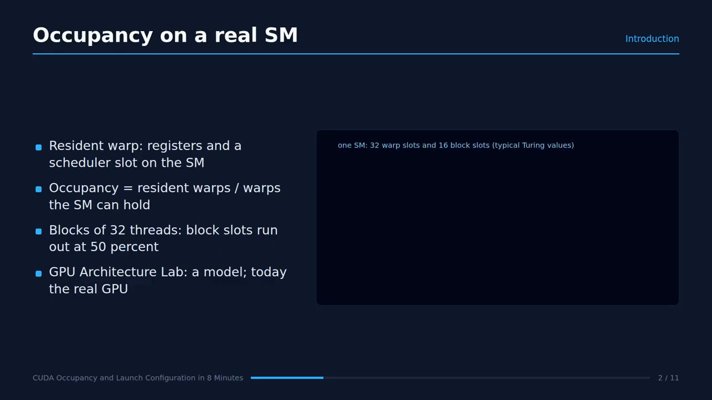

同样是一个 SM，三种 launch 会撞上三种不同的上限，这张图是全片的主线：

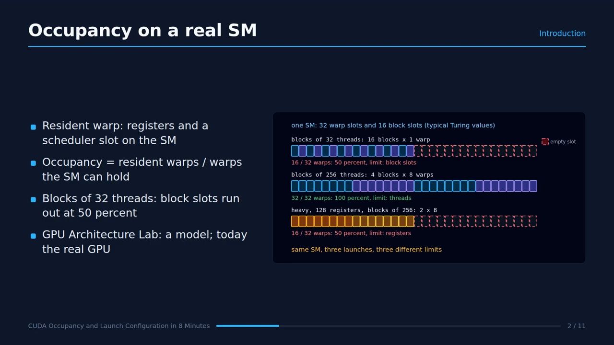

- **32 线程的 block**：每个 block 只有 1 个 warp，而 SM 只有 16 个 block 槽位，于是最多 16 个 warp，占 32 个 warp 容量的一半——**限制因素是 block 槽位**。
- **256 线程的 block**：8 个 warp 一个 block，4 个 block 就填满 32 个 warp——**100%，限制因素是线程数**。
- **每线程 128 个寄存器的重载 kernel**：同样 256 线程，却只放得下 2 个 block，又是 16 个 warp、50%——**限制因素是寄存器**。

## 二、四道天花板：SM 的预算表从哪来

预算表的每一项都能从 `cudaGetDeviceProperties` 里读出来，视频用一张代码截图把四个上限和它们的换算关系并列出来：[【跳转到 01:29】](https://www.youtube.com/watch?v=wKo_oB-Tscs&t=89)

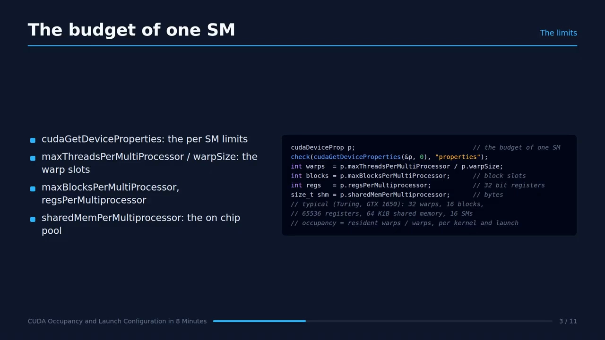

| 预算项 | 字段 | 怎么用 | 图灵卡典型值 |
| --- | --- | --- | --- |
| warp 槽位 | `maxThreadsPerMultiProcessor / warpSize` | 分母：SM 最多驻留多少 warp | 32 |
| block 槽位 | `maxBlocksPerMultiProcessor` | 一个 SM 最多同时放几个 block | 16 |
| 寄存器文件 | `regsPerMultiProcessor` | 按 **32 位寄存器**计数，全 SM 共享这一池 | 65,536 |
| 共享内存 | `sharedMemPerMultiProcessor` | 每个驻留 block 都要划走一份 | 64 KB |

新一代 GPU 会改动其中某些数字，所以视频的示例程序不写死，而是**打印你自己显卡上的数值**。这一点很重要：网上抄来的「65,536 个寄存器」在别的架构上未必成立。

## 三、另一边：kernel 到底要多少寄存器

设备侧的上限是固定的，kernel 侧的需求则由编译器决定。`cudaFuncGetAttributes` 会一次报出四件事：[【跳转到 02:19】](https://www.youtube.com/watch?v=wKo_oB-Tscs&t=139)

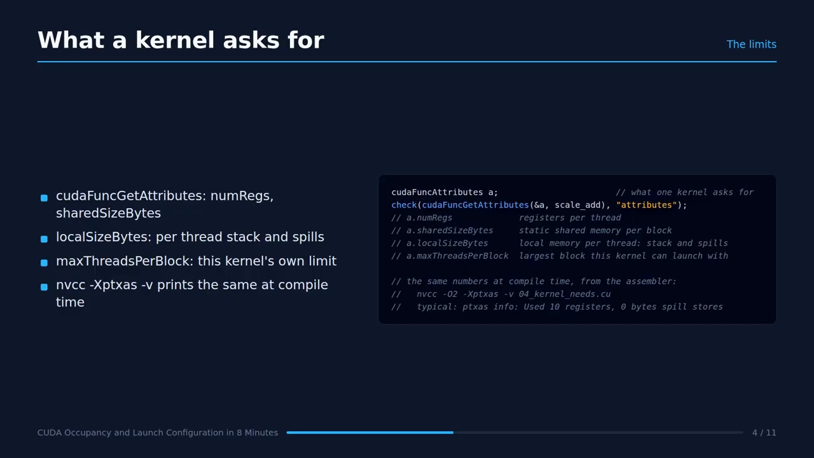

- `numRegs`：**每个线程**用多少个寄存器；
- `sharedSizeBytes`：每个 block 的静态共享内存；
- `localSizeBytes`：每个线程的 local memory——**栈和 spill 出来的寄存器就住在这里**，名字叫 local，物理上却在慢速的设备内存；
- `maxThreadsPerBlock`：这个 kernel 自己能启动的最大 block。

编译期也能看到同样的数字：给 nvcc 加 `-Xptxas -v`，汇编器会打印每个 kernel 的寄存器用量和 spill 次数。视频里那个小规模 scale-add kernel 大约用 **10 个寄存器**，而一个要同时保住很多活跃值的 kernel 可以用到 **100 以上**——这就是「寄存器压力（register pressure）」：同时活着的变量太多，寄存器不够放。

## 四、算一遍：128 个寄存器如何把 occupancy 砍半

有了两张表就能相除。视频没有手算，而是调用 CUDA 13 提供的 occupancy API：

```cuda
int per_sm = 0;
// kernel、block size、动态共享内存 → 一个 SM 上能放几个 block
cudaOccupancyMaxActiveBlocksPerMultiprocessor(&per_sm, heavy, 256, 0);
int warps     = per_sm * 256 / 32;                              // 驻留 warp
int max_warps = prop.maxThreadsPerMultiProcessor / 32;
float occ     = (float)warps / max_warps;                       // 0..1
```

它的做法很朴素：**把每一道上限都算一遍，取最小的那个**。对那个每线程 128 个寄存器的重载 kernel、block 取 256 线程：[【跳转到 03:09】](https://www.youtube.com/watch?v=wKo_oB-Tscs&t=189)

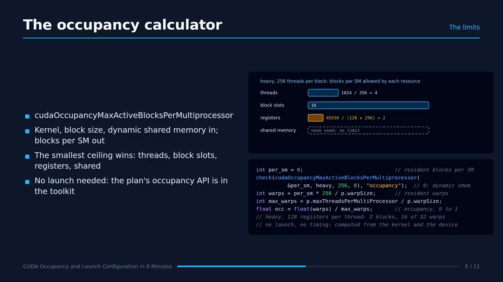

- 线程数上限：$1024 \div 256 = 4$ 个 block；
- block 槽位：16 个 block；
- 寄存器上限：$65536 \div (128 \times 256) = 2$ 个 block；
- 共享内存：本 kernel 没用，不构成限制。

取最小，答案是 **2 个 block = 16 个 warp = 50%**，限制因素写着 registers。注意此时**什么都还没启动**——这个结果纯粹来自 kernel 属性与设备表的相乘，是一次「纸上推演」。[【跳转到 03:34】](https://www.youtube.com/watch?v=wKo_oB-Tscs&t=214)

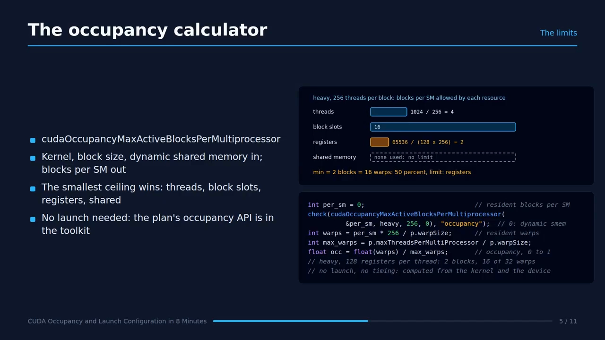

用公式写出来就是：

$$
\text{blocks}_{\text{regs}} = \left\lfloor \frac{\text{regsPerSM}}{\text{regsPerThread} \times \text{threadsPerBlock}} \right\rfloor
$$

再对四道上限取最小值：

$$
\text{blocksPerSM} = \min\left(\text{blocks}_{\text{threads}},\ \text{blocks}_{\text{slots}},\ \text{blocks}_{\text{regs}},\ \text{blocks}_{\text{smem}}\right)
$$

## 五、launch bounds：把 occupancy 买到 100%，然后更慢

既然寄存器是瓶颈，最直接的想法是「让编译器少用点寄存器」。**launch_bounds** 限定符（两个参数：最大 block 线程数、期望每 SM 驻留的 block 数） 正是干这个的：它告诉编译器「我最多用 256 个线程、希望每个 SM 驻留 4 个 block」，编译器就必须把每线程寄存器压到 $65536 \div (4 \times 256) = 64$ 个。[【跳转到 03:59】](https://www.youtube.com/watch?v=wKo_oB-Tscs&t=239)

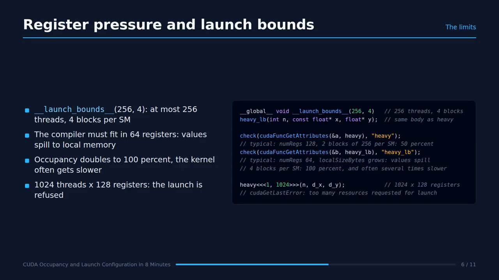

代价是：**装不下的值被 spill 到 local memory**，`localSizeBytes` 随之变大。计算器这时会说 occupancy 是 100%，可示例跑下来，被强制的版本在不少 GPU 上要慢好几倍——因为每一次 spill 都是额外的访存流量，而那恰恰是 occupancy 本来想掩盖的延迟。[【跳转到 04:24】](https://www.youtube.com/watch?v=wKo_oB-Tscs&t=264)

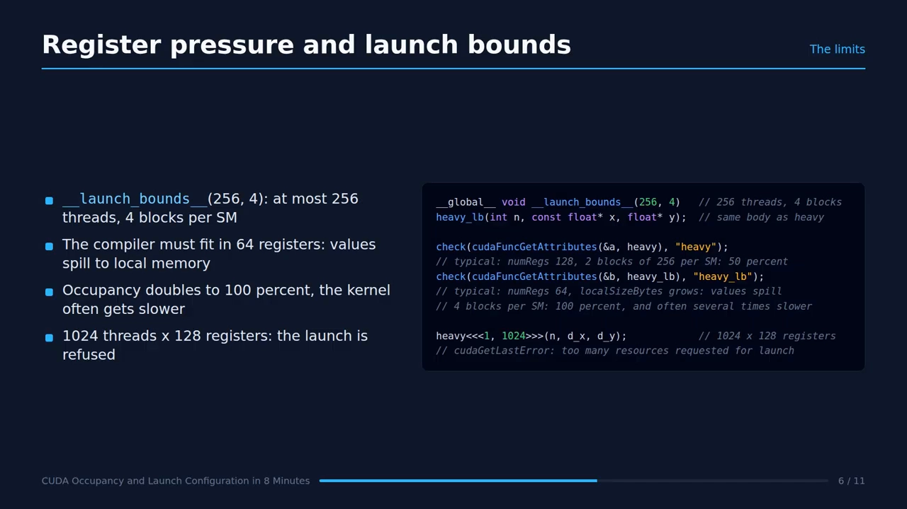

还有一个更硬的边界：**1,024 线程的 block、每线程 128 个寄存器**，需要的寄存器比整个寄存器文件还多，launch 直接被拒绝，`cudaGetLastError` 报 `too many resources requested for launch`。这说明寄存器不只是「性能旋钮」，还是「能不能启动」的硬约束。

## 六、另外两道天花板：线程数与共享内存

寄存器之外，视频还演示了两道上限，用来确认「取最小」这套逻辑是通用的。

**线程数上限**：一个 block 最多 1,024 线程，所以 block 越大，能放的 block 数越少——但总线程数有上限，超过就报错（见上一节）。

**共享内存上限**：这个 kernel 按块反转数组，每个 block 把 4,096 个 float（16 KB）装进共享内存，线程同步（syncthreads）汇合后反序写回，于是每个线程读的是另一个线程装进来的元素。[【跳转到 04:49】](https://www.youtube.com/watch?v=wKo_oB-Tscs&t=289)

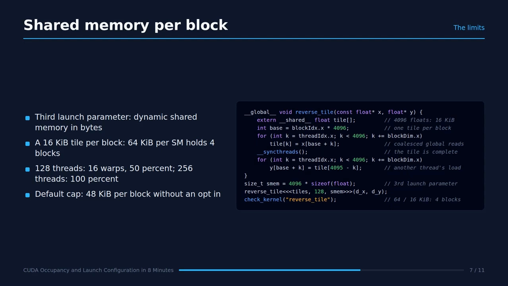

16 KB × 4 个 block 正好占满 64 KB，于是：128 线程时是 4 个 block × 4 个 warp = 16 个 warp、50%；换成 256 线程，同样 4 个 block 就是 32 个 warp、100%。**当共享内存是瓶颈时，加大 block 才是解药**——因为共享内存是按 block 划的，block 越大，同样的共享内存能换来更多 warp。另外，一个 block 默认最多用 48 KB 共享内存，要更多必须显式申请。

## 七、实测：block size 扫描与工具的建议

纸上算完，视频用一个对 400 万个 float 做 scale-add 的 kernel 做扫描：block size 从 32 到 1,024，每个尺寸都问一次「每 SM 几个 block」，打印 occupancy、限制资源和 CUDA event 计时（先热身、取多次中位数、只算设备时间）。[【跳转到 05:14】](https://www.youtube.com/watch?v=wKo_oB-Tscs&t=314)

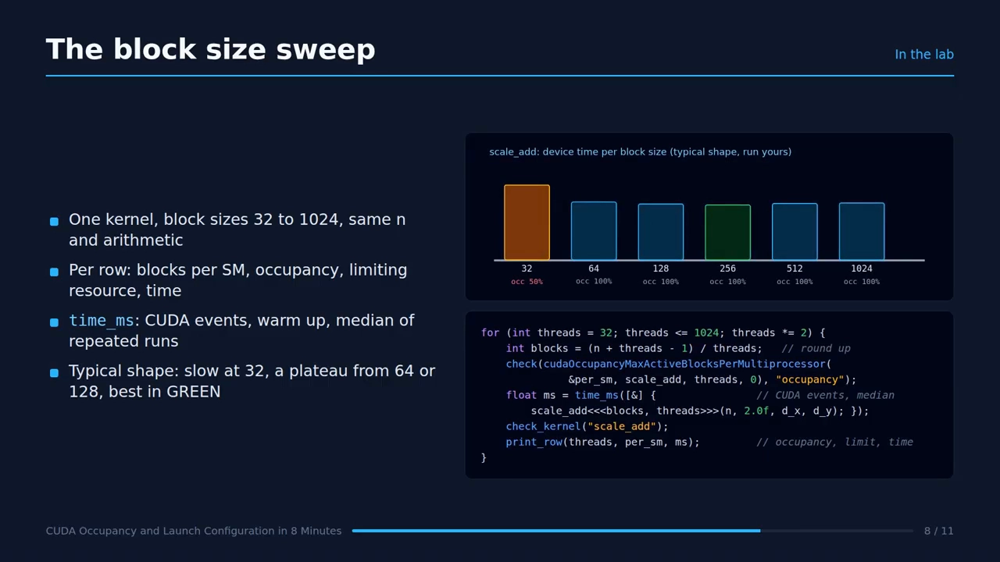

典型形状是：**32 线程/block 被 block 槽位卡在 50%，明显更慢；从 64 或 128 往上，表格进入一个相差几个百分点的平台期。** 示例会标出最快的一行，但在平台期上，「赢家」每次运行都可能换人——这本身就是个提醒：别把一次测量的冠军当成结论。[【跳转到 06:04】](https://www.youtube.com/watch?v=wKo_oB-Tscs&t=364)

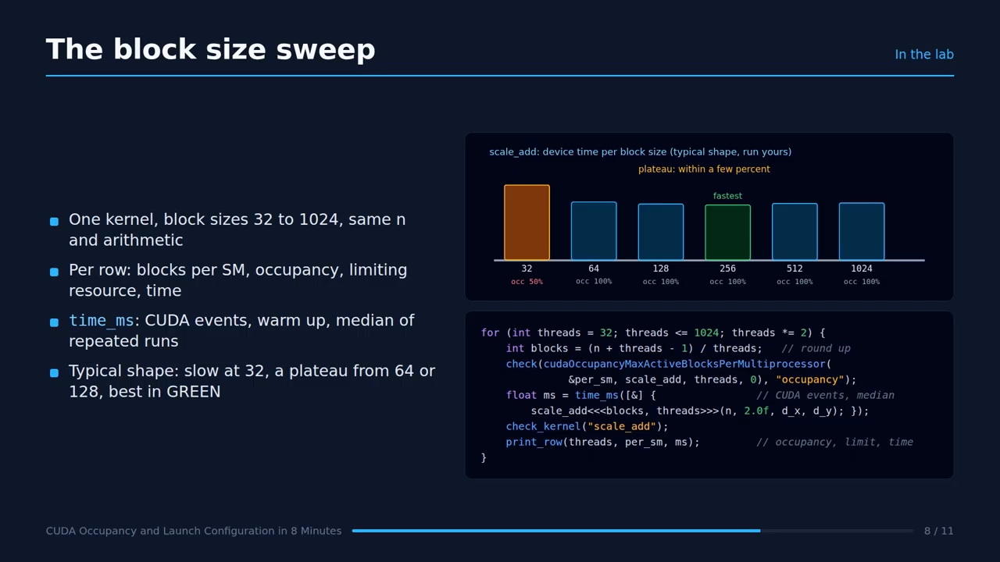

工具还提供另一个 API：`cudaOccupancyMaxPotentialBlockSize` 以 warp 为步长试遍 block size，返回 occupancy 最高、grid 最小的那个。对 scale-add 它通常建议 1,024。但视频特别提醒：**这只是「第一个要试的行」，不是答案**——它只懂资源表，对访存流量、spill、cache 行为一无所知。[【跳转到 06:29】](https://www.youtube.com/watch?v=wKo_oB-Tscs&t=389)

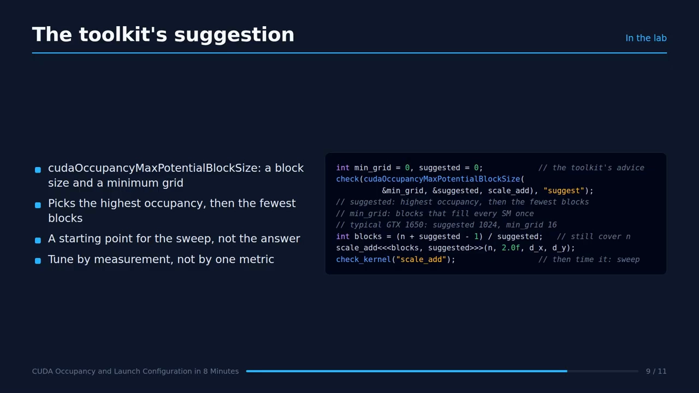

## 小结

- **occupancy 是比值**：驻留 warp 数 ÷ 一个 SM 能容纳的 warp 数；它属于「某个 kernel + 某种 launch 配置」，不是显卡的固有属性。
- **四道天花板取最小**：线程数、block 槽位、每线程寄存器数、每 block 共享内存。寄存器文件是最紧的一层，按 32 位寄存器计，全 SM 共用一个池。
- **寄存器压力直接换算成驻留 warp 数**：$65536 \div (128 \times 256) = 2$ 个 block，于是 50%；把每线程寄存器压到 64 个，就能放 4 个 block、打满 100%。
- **强行拉高 occupancy 可能更慢**：**launch_bounds** 限定符压低寄存器会让值 spill 到 local memory，每次 spill 都是额外访存。
- **寄存器也是硬约束**：1,024 线程 × 128 寄存器超过整个寄存器文件，launch 直接报 `too many resources requested`。
- **先算再量**：API 能算出上限、甚至建议 block size，但只有带计时的扫描能告诉你什么快；平台期上几个百分点的差别，跑一次未必复现。

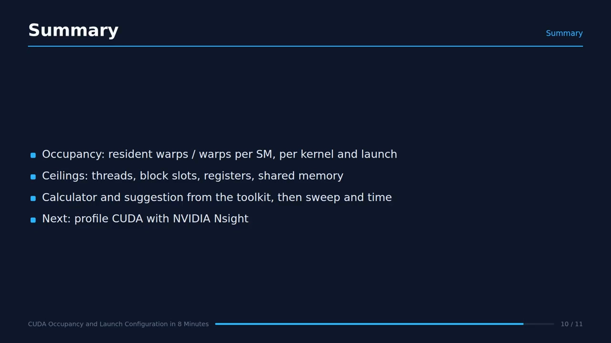

## 关键术语速查

| 术语 | 一句话解释 |
| --- | --- |
| 寄存器文件（register file） | SM 内最快的一层存储，按 32 位寄存器计数，由所有驻留线程分用；图灵卡为 65,536 个/SM |
| 驻留 warp（resident warp） | 已经拿到寄存器和调度器槽位、可以随时被调度的 warp |
| occupancy | 驻留 warp 数 ÷ SM 能容纳的 warp 数，衡量「有多少并行度真正装进来了」 |
| 寄存器压力（register pressure） | kernel 同时需要保活的变量太多、寄存器不够用的状态 |
| spill | 寄存器装不下的值被编译器写到 local memory，每次使用都要一次 store + 一次 load |
| local memory | 每线程私有的地址空间，放栈和 spill；名字叫 local，物理上在慢速设备内存 |
| block 槽位（block slot） | 一个 SM 最多能同时驻留的 block 数，图灵卡为 16 |
| **launch_bounds** 限定符 | 告诉编译器最大 block 与期望驻留 block 数，从而约束每线程寄存器用量 |
| `cudaOccupancyMaxActiveBlocksPerMultiprocessor` | 给定 kernel 与 block size，算出每 SM 能放几个 block（取四道上限的最小值） |
| `cudaOccupancyMaxPotentialBlockSize` | 以 warp 为步长搜索 occupancy 最高的 block size，只作扫描起点 |