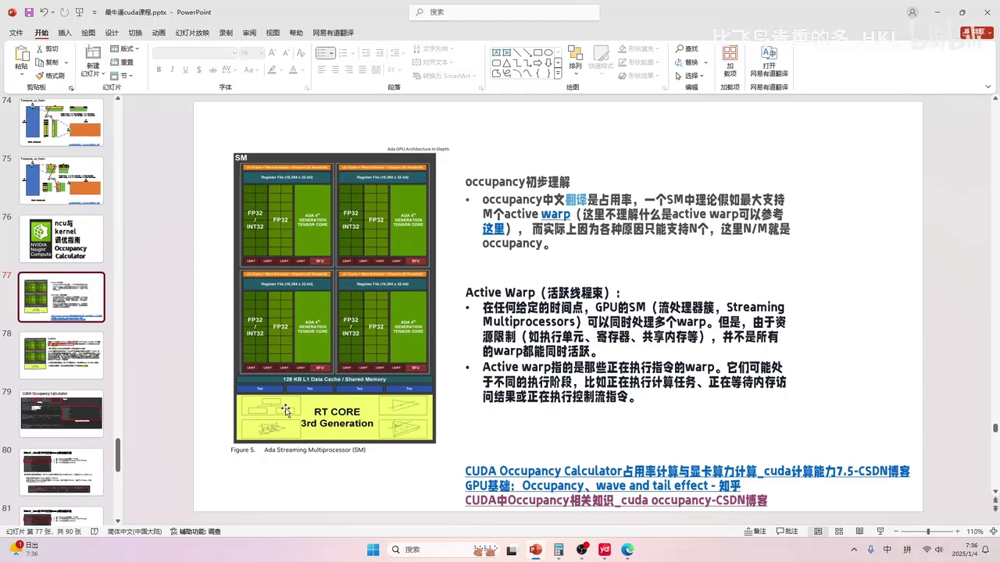
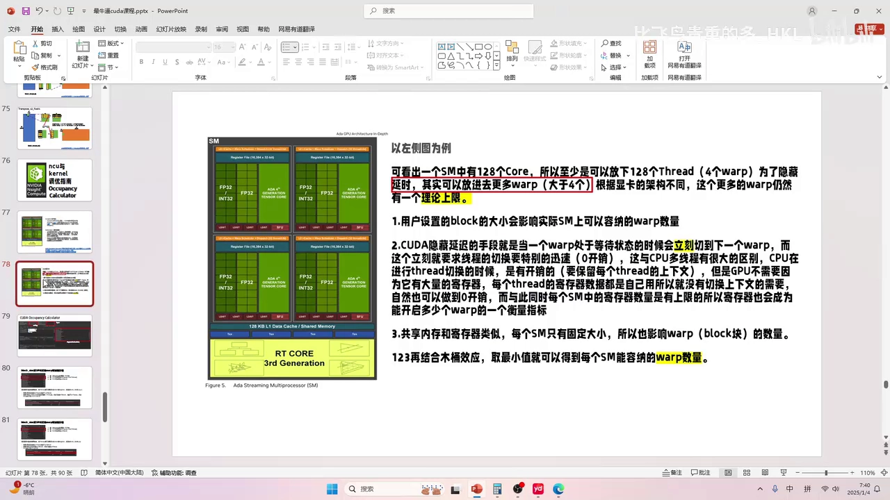
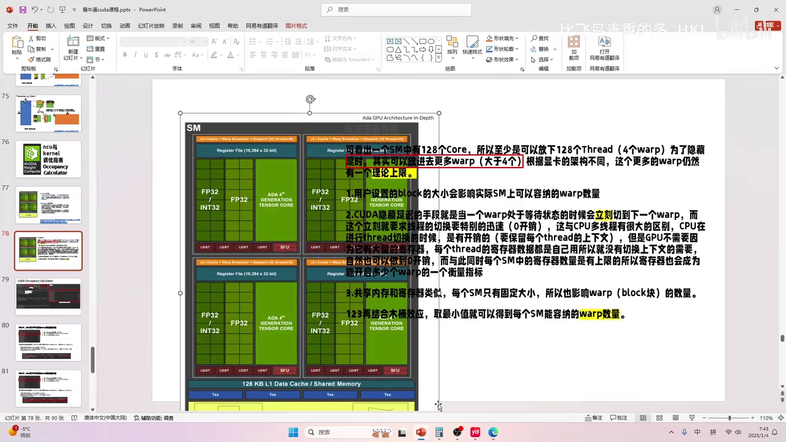
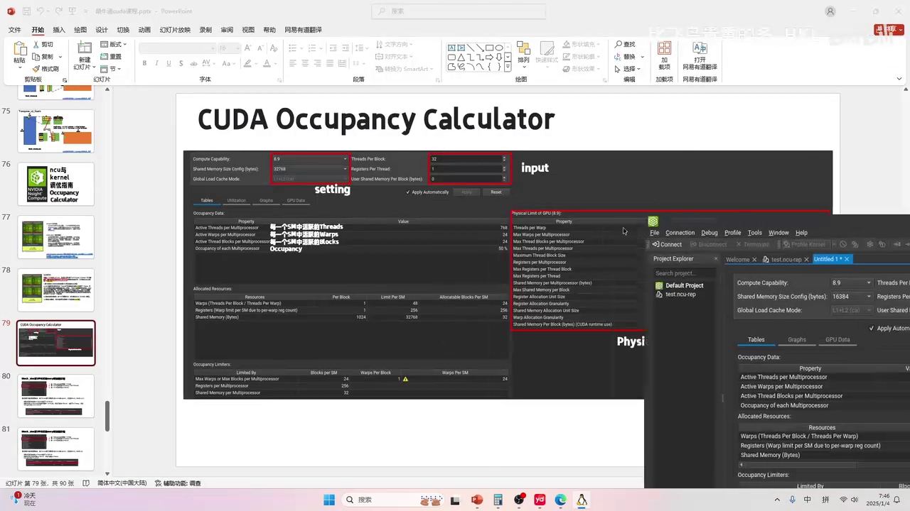
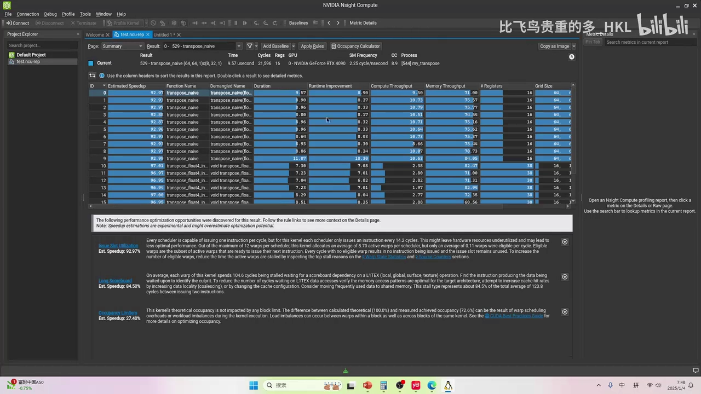
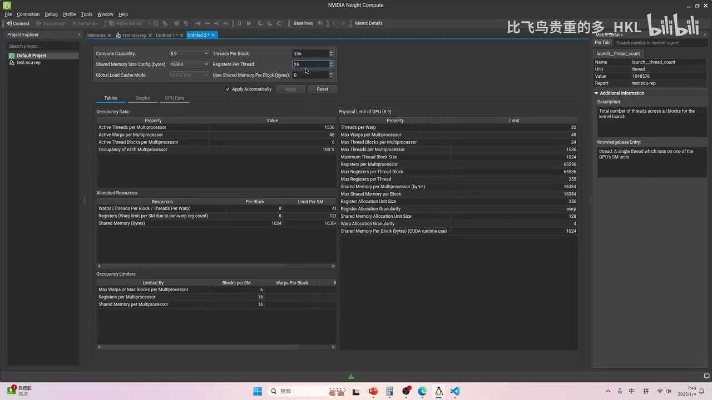
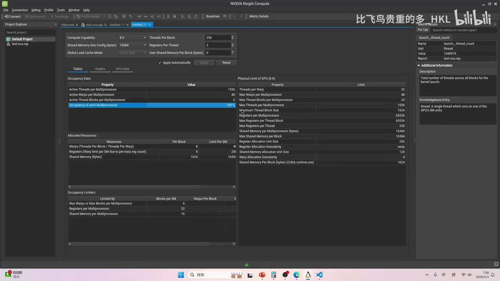

# 用 Occupancy Calculator 算清寄存器与 block 大小对占用率的影响

> 视频来源：[【CUDA调优指南】Occupancy Calculater p01](https://www.bilibili.com/video/BV1WNrHY5EeP/?p=1)（Bilibili · 比飞鸟贵重的多_HKL）｜时长约 17 分钟
> 导读：一支以 RTX 4090（Ada，算力 8.9）为例、手把手演示 Nsight Compute 里 Occupancy Calculator 的中文课。本文按「概念 → 为什么零开销切换 → 三个限制因素 → 工具怎么填 → 改 block size 看占用率变化」重排；视频只讲到 block size 对占用率影响的开头，后续推算留给下一集，本文如实覆盖到该处为止。

## 本讲要解决的核心问题（SCQA）

**背景**：前面几节课一直在和内存打交道，我们已经把合并访存调到了最好的状态——地址连续、transaction 最少。

**冲突**：可程序还是不够快。如果只从合并访存的角度想，这个 kernel 已经没什么可调的了；但对一个 kernel 来说，影响因素远不止访存模式一种。

**疑问**：还有哪个因素在拖后腿？它和「每个线程用多少寄存器」有什么关系？怎么把它算出来？

**回答（中心思想）**：这个因素是 **occupancy（占用率）**——一个 SM 上实际驻留的 warp 数除以它能容纳的 warp 数。它由三样东西共同决定：**block 大小、每线程寄存器数、每 block 共享内存**，按木桶效应取最小者。寄存器文件是片上最快也最贵的一层存储，每个线程多用一份寄存器，SM 上就少驻留一批 warp；用 Nsight Compute 的 Occupancy Calculator 把这三个数填进去，就能在**不启动 kernel** 的情况下算出占用率和「到底是谁卡住了它」。

## 一、occupancy 与 active warp：先把两个词说清楚

视频用一张 Ada（4090）SM 架构图开场，图里能直接看到四个处理块，每块都带自己的 `Register File (16,384 × 32-bit)`，底部是 `128 KB L1 Data Cache / Shared Memory`。[【跳转到 00:55】](https://www.bilibili.com/video/BV1WNrHY5EeP/?t=55)

**occupancy（占用率）**：一个 SM 理论上最多支持 $M$ 个 active warp，实际上因为各种原因只能支持 $N$ 个，那么

$$
\text{occupancy} = \frac{N}{M}
$$

举一个最直白的例子：一张 4090 本来可以跑 1000 个线程，实际只启动了 100 个，剩下 900 个线程没活干，占用率就是 $100 \div 1000 = 10\%$。占用率这么低，即使访存完全合并，效果也肯定达不到预期。[【跳转到 01:20】](https://www.bilibili.com/video/BV1WNrHY5EeP/?t=80)

**active warp（活跃 warp）**：CUDA 是以 warp 为单位工作的，所以「线程利用率」实际要换成「warp 利用率」。在任何给定时刻，SM 可以同时处理多个 warp，但由于执行单元、寄存器、共享内存等资源限制，并不是所有 warp 都能同时活跃；active warp 指的就是那些**已经发射到 SM 上、正在执行指令**的 warp，它们可能处于不同阶段——正在做计算、正在等访存结果、或者正在执行控制流指令。[【跳转到 02:35】](https://www.bilibili.com/video/BV1WNrHY5EeP/?t=155)

这里有个容易误解的细节：**正在等访存、被暂停的 warp 也算 active warp**，因为它已经被发射到 SM 上了，只是在那个时间点没有执行而已。至于 SM 怎么在这些 warp 之间挑下一个来跑，是下一集 warp scheduler 的内容。[【跳转到 04:15】](https://www.bilibili.com/video/BV1WNrHY5EeP/?t=255)

## 二、为什么 warp 切换可以零开销：寄存器文件够大

Ada 的一个 SM 有 **128 个 CUDA core**，所以至少能放下 128 个线程，也就是 4 个 warp。但如果一个核心只对应一个线程，那么一旦某个线程因为等访存停下来，这个核心就空转了——我们平时算的「满载算力」是所有核心都在计算时的算力，现实中必然要打折。[【跳转到 05:02】](https://www.bilibili.com/video/BV1WNrHY5EeP/?t=302)

所以硬件要放进**更多** warp，靠 warp 之间不断切换来隐藏延时。而 CUDA 的切换之所以能做到接近零开销，关键就在寄存器文件的大小：[【跳转到 08:10】](https://www.bilibili.com/video/BV1WNrHY5EeP/?t=490)

- 每个处理块有 $16384 \times 32$ bit 的寄存器文件，一个 SM 四个处理块，合计 **65,536 个 32 位寄存器**；
- 每个线程的寄存器都是**自己用**的，状态一直留在寄存器里，所以切换时**不需要保存/恢复上下文**；
- CPU 则相反：寄存器少，每次切线程都要把上下文重新加载进寄存器，切换是有开销的。

但寄存器文件再大也是**固定大小**，于是它自然成了「能同时开多少个 warp」的衡量指标：假设一个 warp 要消耗 1000 个寄存器，而寄存器文件是固定的，那就只能有固定数量的 warp；warp 再多，寄存器就不够分，也就保证不了「每次切换都零开销」——这是 GPU 不允许的。[【跳转到 08:44】](https://www.bilibili.com/video/BV1WNrHY5EeP/?t=524)

## 三、三个限制因素与木桶效应

视频把影响 SM 上可容纳 warp 数的因素归成三条：[【跳转到 06:42】](https://www.bilibili.com/video/BV1WNrHY5EeP/?t=402)

1. **block 大小**：写程序时我们都会设 block size 和 grid size，block size 会非常影响 SM 上实际能容纳的 warp 数。
2. **寄存器**：每个 SM 的寄存器文件大小固定，每线程用得多，能开的 warp 就少。
3. **共享内存**：和寄存器类似，每个 SM 只有固定大小，而共享内存是**一个 block 共享**的，所以它限制的是 block 数，进而限制 warp 数。

三者按**木桶效应**取最小值，就是每个 SM 实际能容纳的 warp 数：

$$
\text{warpsPerSM} = \min\left(\text{warps}_{\text{block size}},\ \text{warps}_{\text{registers}},\ \text{warps}_{\text{shared mem}}\right)
$$

Occupancy Calculator 算的就是这个数：把它算出来，再除以 SM 能容纳的最大 warp 数，就得到 occupancy。[【跳转到 09:34】](https://www.bilibili.com/video/BV1WNrHY5EeP/?t=574)

## 四、打开 Occupancy Calculator：三块区域怎么填

工具在 Nsight Compute 里：跑一个 kernel、进入详情页，找到 **Occupancy** 一栏，点旁边那个像计算器的图标就进来了。[【跳转到 10:36】](https://www.bilibili.com/video/BV1WNrHY5EeP/?t=636)

页面分三块：

**（1）setting：先选对显卡**

- **Compute Capability**：4090 是 **8.9**。选好之后，下面某些选项会被置灰，不允许再改——因为物理上限已经由架构定死。
- **Shared Memory Size Config**：L1 cache 和 shared memory 共享同一片区域（Ada 上是 128 KB），所以两者的大小可以来回切换，这里用 65536（64 KB）。这个值后续也能用程序调整。
- **Global Load Cache Mode**：缓存模式选项。

视频顺手提了一个细节：只有在算力 6.1 这类架构上，才允许通过编译选项去「禁用 L1 缓存」；到 8.9 这里就不给改了。[【跳转到 11:34】](https://www.bilibili.com/video/BV1WNrHY5EeP/?t=694)

**（2）input：填三个数**

- **Threads Per Block**：每个 block 的线程数。这里只接受一维，所以程序里写 4×32 就填 128。
- **Registers Per Thread**：每个线程用多少寄存器。
- **User Shared Memory Per Block**：每个 block 用户申请的共享内存（字节）。

后两个数都可以从 Nsight Compute 里读出来，读不到也能算：共享内存是「block 内线程数 × 每线程用量」。[【跳转到 12:54】](https://www.bilibili.com/video/BV1WNrHY5EeP/?t=774)

**（3）Physical Limits：不用填，但必须看懂**

右侧这张表是所选算力（8.9）的硬件上限，视频截图里能看到这些关键项：

| 物理上限（算力 8.9） | 值 |
| --- | --- |
| Threads per Warp | 32 |
| Max Warps per Multiprocessor | 48 |
| Max Thread Blocks per Multiprocessor | 24 |
| Max Threads per Multiprocessor | 1536 |
| Maximum Thread Block Size | 1024 |
| Registers per Multiprocessor | 65536 |
| Max Registers per Thread | 255 |
| Max Registers per Thread Block | 65536 |
| Shared Memory per Multiprocessor | 65536 |
| Register Allocation Unit Size | 256 |
| Warp Allocation Granularity | 4 |
| Shared Memory Allocation Unit Size | 128 |

注意 4090 的「每 SM 最大 warp 数」是 **48**（1536 个线程），而寄存器文件是 65,536 个 32 位寄存器——这两个数一除，就决定了「每线程最多能用多少个寄存器还不牺牲占用率」。

## 五、算一遍：256 线程、16 个寄存器 → 100%

视频用 transpose 这个 kernel 做演示。它的 `# Registers` 是 16，于是 input 填：block = 256、每线程寄存器 = 16、用户共享内存 = 0。结果三张表一起刷新：[【跳转到 14:36】](https://www.bilibili.com/video/BV1WNrHY5EeP/?t=876)

- **Occupancy Data**：Active Threads per Multiprocessor = 1536、Active Warps = 48、Active Thread Blocks = 6、**Occupancy = 100%**；
- **Allocated Resources**：每个 block 占 8 个 warp、8 个寄存器分配单位、1024 字节共享内存；
- **Occupancy Limiters**：三行分别是「Max Warps or Max Blocks」「Registers per Multiprocessor」「Shared Memory per Multiprocessor」，各给出「能放几个 block」——**最小的那个就是最终答案**。

这个例子里，寄存器允许 32 个 block、共享内存允许 16 个 block，而 warp/block 上限只允许 6 个 block（$48 \div 8 = 6$），所以最终是 6 个 block、48 个 warp，正好 100%。[【跳转到 15:01】](https://www.bilibili.com/video/BV1WNrHY5EeP/?t=901)

## 六、改 block size：为什么 160 线程只有 94%

接着视频只改一个变量——block size，看占用率怎么变：

- **32 线程**：仍然 100%；
- **96 线程（32×3）**：也还好，理论上仍是 100%；
- **160 线程（32×5）**：占用率掉到 **94%**。

原因很直观：160 个线程是 5 个 warp，一个 SM 最多 48 个 warp，$48 \div 5 = 9$ 个 block 余 3 个 warp——这 3 个槽位填不进第 10 个 block，于是只能空着。**只有 94% 的核心处于工作状态，剩下 6% 因为你的设置根本没用上**，效率自然是低的。[【跳转到 16:16】](https://www.bilibili.com/video/BV1WNrHY5EeP/?t=976)

这也解释了为什么 block size 常取 32 的整数倍、并且最好能整除 SM 的 warp 上限：**占用率的损失往往不是「不够快」，而是「有一块硬件永远闲着」**。视频到这里开始逐个拆解三个限制因素的计算过程，第一个讲的是 block size 对 SM 可启用 warp 数的影响，具体推导留到后续部分。[【跳转到 16:46】](https://www.bilibili.com/video/BV1WNrHY5EeP/?t=1006)

## 小结

- **occupancy = 实际驻留 warp ÷ SM 能容纳 warp**，衡量的是「有多少并行度真正装进了 SM」；占用率低，访存再合并也发挥不出来。
- **active warp 包括正在等访存的 warp**：它已被发射到 SM，只是暂时没执行；调度细节属于 warp scheduler 的话题。
- **零开销切换靠的是大寄存器文件**：Ada 每个处理块 16,384×32-bit，一个 SM 合计 65,536 个 32 位寄存器，每个线程的寄存器归自己用，切换不用保存上下文。
- **三个限制因素取最小**：block 大小、每线程寄存器数、每 block 共享内存，按木桶效应决定每 SM 的 warp 数。
- **Occupancy Calculator 分三块**：setting（算力、L1/共享内存切分）、input（block 线程数、每线程寄存器、每 block 共享内存）、physical limits（架构定死的上限表）。
- **寄存器数可以直接读**：Nsight Compute 的 kernel 列表里有 `# Registers` 一列，本文示例是 16 和 38。
- **block size 要能被 warp 上限整除**：256 线程 100%，160 线程只有 94%，差的 6% 就是填不进去的 warp 槽位。

## 关键术语速查

| 术语 | 一句话解释 |
| --- | --- |
| occupancy（占用率） | 一个 SM 上实际驻留 warp 数除以它能容纳的 warp 数 |
| active warp | 已发射到 SM 上、正在执行或正在等待（如等访存）的 warp |
| 寄存器文件（register file） | SM 内最快的一层存储；Ada 每个处理块 16,384×32-bit，一个 SM 合计 65,536 个 32 位寄存器 |
| 零开销切换 | 因为每个线程的寄存器归自己用、状态常驻，切换 warp 无需保存/恢复上下文 |
| block size | 每个 block 的线程数，决定一个 block 占几个 warp，是占用率的输入之一 |
| 木桶效应 | 三个限制因素各自算出能放几个 block，取最小值才是实际能驻留的数量 |
| Occupancy Calculator | Nsight Compute 里根据算力、block size、寄存器数、共享内存计算占用率的工具 |
| Compute Capability | NVIDIA 用两位数字标记架构能力，4090 是 8.9，决定工具里的物理上限表 |
| `Max Registers per Thread` | 单线程寄存器上限，Ada 为 255；超过这个数编译器只能 spill |
| Register Allocation Unit Size | 寄存器按 256 个为单位分配，实际占用量会被向上取整 |