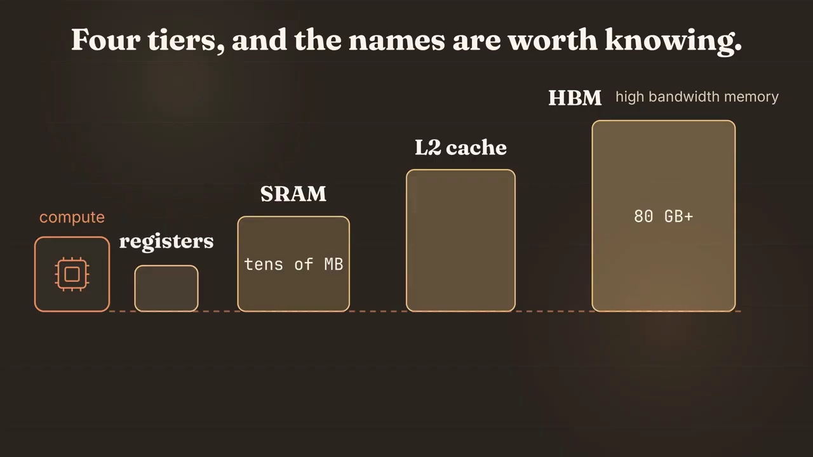
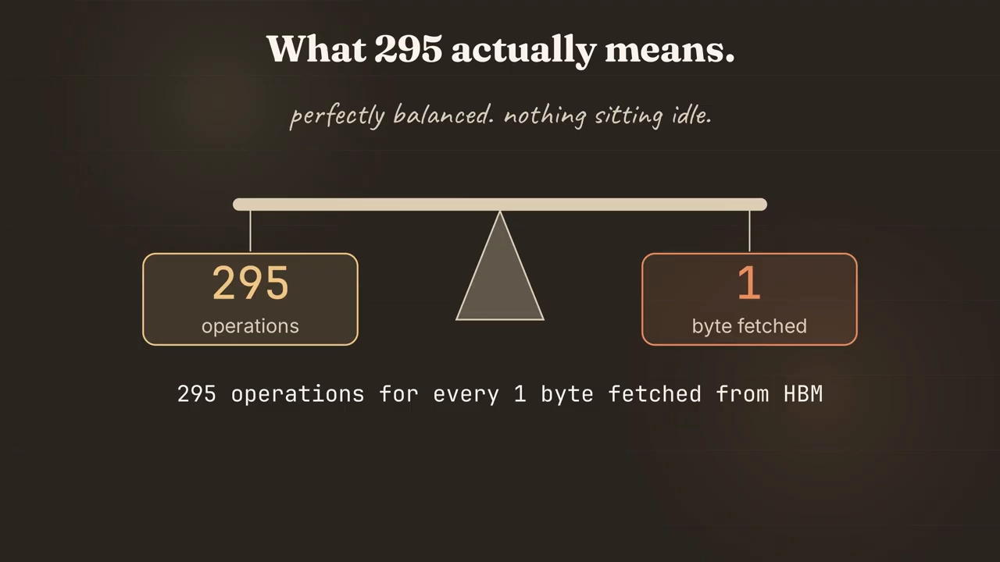
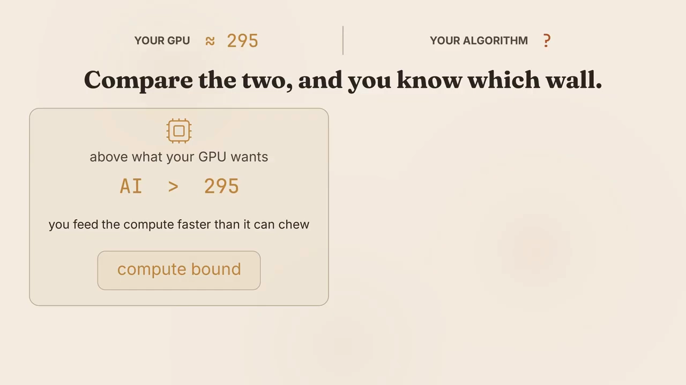
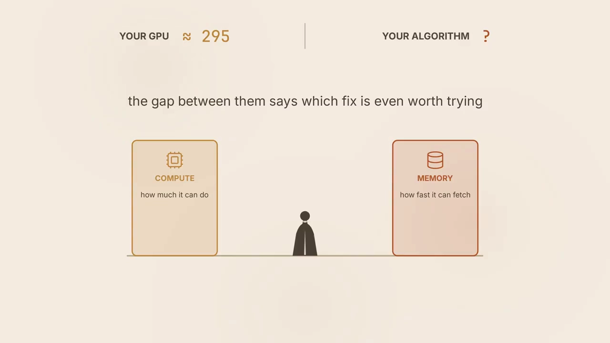
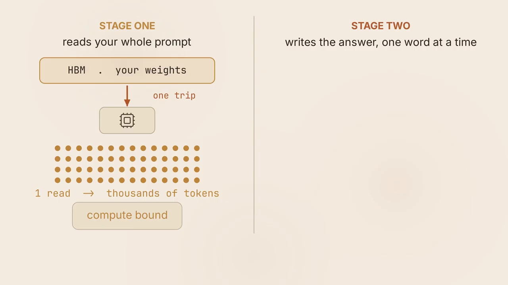
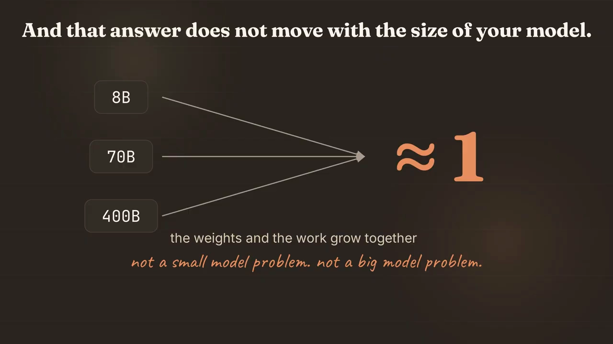
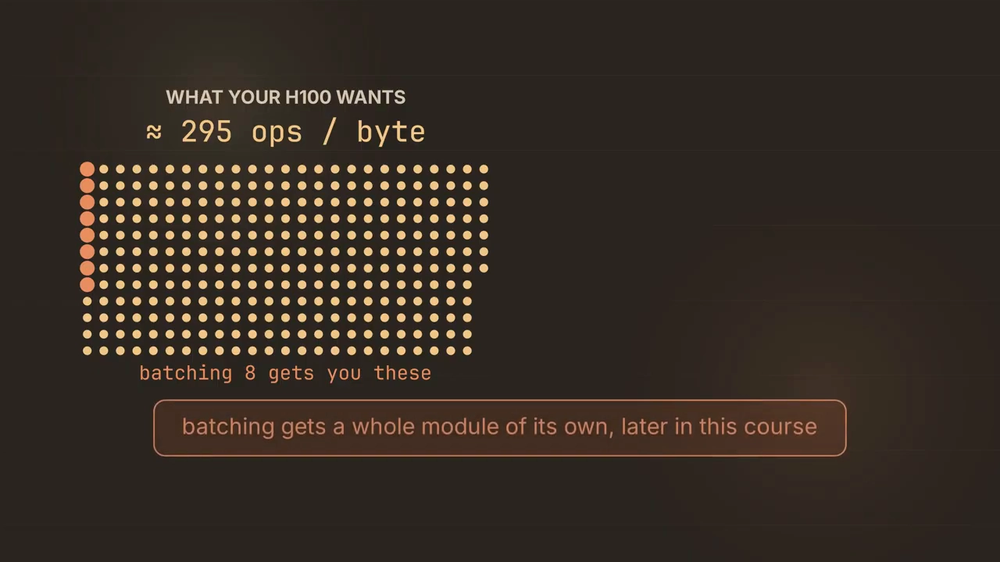
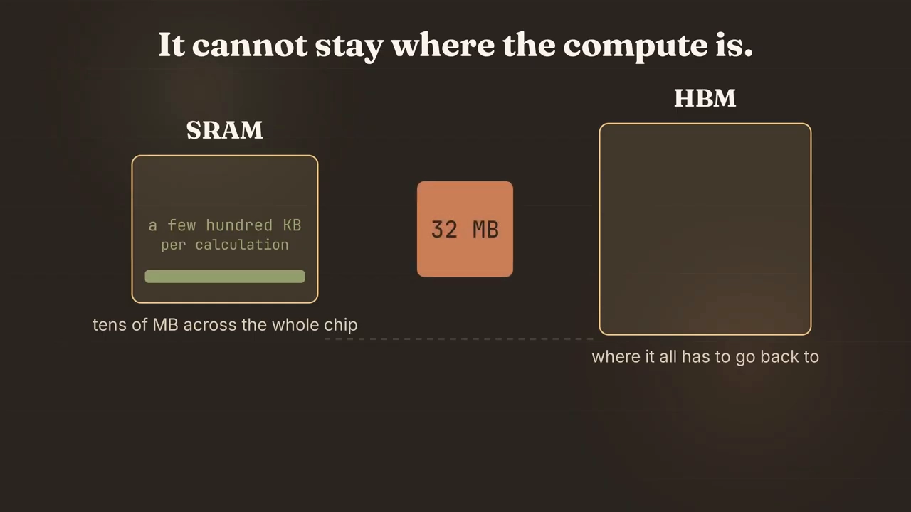
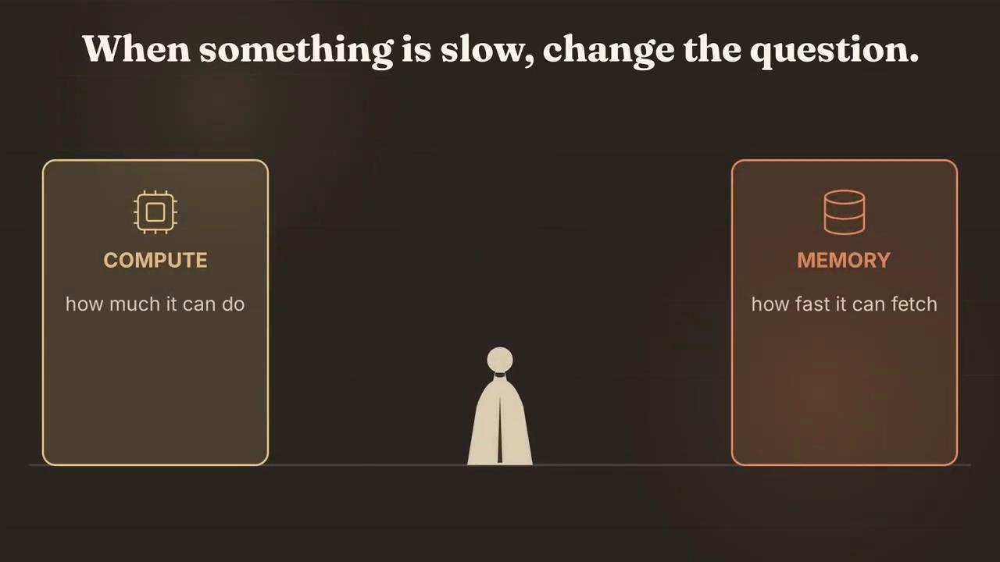

# 算术强度：一个数字告诉你撞上算力墙还是带宽墙

> 视频来源：[Compute-Bound or Memory-Bound? Arithmetic Intensity Explained](https://www.youtube.com/watch?v=jCUWDXVohTY)（YouTube · Mani Khanuja）｜时长约 8.6 分钟
> 导读：一支把“算力墙 / 带宽墙”讲到极简的短片。它只做一件事：给硬件算一个数、给你的算法算一个数，然后比较。本文按这条主线复述，并把 decode 为什么恒等于 1 的推导完整保留；屋顶线只在最后作为落点判据出现。

## 本讲要解决的核心问题（SCQA）

**背景**：benchmark 能告诉你服务变慢了，却不会告诉你为什么慢。

**冲突**：GPU 只会因为两件事变慢——算力不够，或者取数据不够快。这两种情况需要的修法完全相反：前者要更快的计算单元或更低的精度，后者要更少的字节。猜错方向，优化就白做。

**疑问**：有没有办法在动手之前就判断，一个算子正撞在哪堵墙上？

**回答（中心思想）**：有，而且只需要一个数。**算术强度 = 算子做的运算次数 ÷ 它为这些运算搬运的字节数**。把它和硬件自己的“算力 ÷ 带宽”（H100 约 **295 ops/byte**）相比：**低于 295 就撞在带宽墙上，高于 295 就撞在算力墙上。** 一个数字来自规格表，一个数字来自你的算法，两者的差距就决定了哪种修法值得试。

## 一、两堵墙，以及“字节”到底指哪一段路

GPU 的存储不是一块，而是一条阶梯。从外往里：**HBM**（高带宽显存，卡上那 80 GB 甚至更多，权重住在这里）→ **L2 cache** → **SRAM**（紧挨计算单元，全芯片几十 MB）→ **寄存器**（在核心里）。规律一路到底都一样：**离计算越近，取起来越快，你能用的容量越少**。[【跳转到 00:36】](https://www.youtube.com/watch?v=jCUWDXVohTY&t=36)

权重是 GB 级的，只能待在 HBM。所以 GPU 每做一点计算，都得先从 HBM 往里走一趟。视频在这里定下口径：

> 后面说的“搬运的字节”，指的就是**往 HBM 走的那一趟**。

这个口径把问题简化成了两个可数的量：做了多少次运算，跑了多少字节的路。

## 二、硬件的数字：295 ops/byte

规格表上有两个数字值得记：

| 指标 | H100 的值 | 含义 |
| --- | --- | --- |
| 算力 | 989 万亿次运算/秒 | 每秒能做多少浮点运算（FLOPs） |
| 带宽 | 3 TB/秒出头 | 每秒能从 HBM 取多少字节 |

把前者除以后者：

$$
\frac{989 \times 10^{12}\ \text{ops/s}}{3.35 \times 10^{12}\ \text{B/s}} \approx 295\ \text{ops/byte}
$$

295 的意思是：**要让这张卡刚好平衡、没有任何一方闲着，它每从 HBM 取 1 个字节，就得做 295 次运算。** 少于这个数，计算早早干完，坐在那儿等内存。这个数有两个名字：**ops to byte ratio**（运算字节比）和 **ridge point**（拐点），指的是同一件事。[【跳转到 02:21】](https://www.youtube.com/watch?v=jCUWDXVohTY&t=141)

## 三、算法的数字：work ÷ traffic

硬件有了数字，接下来给算法算一个，方法完全对称：

1. 数这个算法要做多少次运算；
2. 数它为了做这些运算要搬多少字节；
3. 前者除以后者。

这就是**算术强度（arithmetic intensity）**，说白了就是**工作量除以搬运量**。[【跳转到 02:43】](https://www.youtube.com/watch?v=jCUWDXVohTY&t=163)

两个数字量纲相同，直接比：

- **算术强度 > 295**：喂给计算单元的速度比它吃得下的还快，**算力受限（compute bound）**；
- **算术强度 < 295**：计算总是提前干完然后等数据，**访存受限（memory bound）**。

## 四、同一个模型，同时站在两堵墙前面

这是全片最值得慢下来的地方：**同一个模型、同一张卡，prefill 和 decode 的算术强度天差地别。**

一次请求分两个阶段：先读你整段 prompt，再一个词一个词写出答案。两者的行为完全不像。[【跳转到 03:33】](https://www.youtube.com/watch?v=jCUWDXVohTY&t=213)

### 4.1 读 prompt：一次搬运，几千个 token 的运算

读 prompt 时，模型把一块权重从 HBM 载入一次，然后**用同一块权重同时处理 prompt 里的每一个 token**——两千个也好，你发多少算多少。于是一次 HBM 往返，换来几千个 token 的运算量：**每个字节都摊到了大量工作，算术强度高，这一阶段是算力受限。**[【跳转到 03:58】](https://www.youtube.com/watch?v=jCUWDXVohTY&t=238)

### 4.2 写答案：同一块权重，只服务一个 token

写答案时，模型载入**同一块**权重，这次只用在一个 token 上，别的一个都没有。写下一个词，再完整载入一遍。

模型没变，GPU 没变，代码一行没改。**变的只是“每个字节顺带捎上多少 token”。**

## 五、decode 的算术强度恒等于 1

视频说这是全片最容易的一次算术。要写一个词，模型必须读遍它拥有的每一个权重。

取一个 8B 参数、16 位精度的模型：约 16 GB 权重，一张 H100 装得下还有余。也就是说，**为了产出一个词，要从 HBM 里拉出 16 GB**。[【跳转到 05:04】](https://www.youtube.com/watch?v=jCUWDXVohTY&t=304)

那这 16 GB 换来多少运算？每个权重大约 2 次运算（1 乘 1 加）；16 位精度下每个权重又正好占 2 字节。**运算和字节都挂在同一个参数上**：

$$
\text{AI}_{\text{decode}} = \frac{2\ \text{ops/weight}}{2\ \text{bytes/weight}} = 1\ \text{op/byte}
$$

H100 想要 295，你只有 1，**差了约 300 倍**。[【跳转到 05:25】](https://www.youtube.com/watch?v=jCUWDXVohTY&t=325)

最妙的一点是：**这个答案不随模型大小变化。** 70B 也是 1，400B 也是 1，因为权重和运算一起长大，比值不变。这不是小模型的问题，也不是大模型的问题，**这是“一次只写一个词”本身的代价**，换任何模型、任何卡都一样。[【跳转到 05:50】](https://www.youtube.com/watch?v=jCUWDXVohTY&t=350)

## 六、知道撞在带宽墙上之后：只有两条路

既然瓶颈是字节，修法就必须围绕字节，而不是去买更多算力。方向只有两个，而且都还是在动那个比值：

1. **少搬字节** —— 量化（16 位换 8 位，字节减半，理论上限翻倍）；
2. **让每个字节多产几个 token** —— 同时处理多个请求（batching）。

第 2 条怎么起作用？如果 8 个请求共享一次权重读取，那一次读取就产出 8 个 token 而不是 1 个，算术强度从约 1 变成约 8。**但看看离 295 还有多远**——这就是为什么 batching 值得单独开一个模块讲，而且需要的 batch 比大多数人想象的大得多。[【跳转到 06:40】](https://www.youtube.com/watch?v=jCUWDXVohTY&t=400)

## 七、第二类搬运：attention 的 N×N 中间矩阵

权重不是唯一在跑 HBM 的东西。attention 会自己造中间结果：prompt 有 4000 个 token 时，其中一个中间量是 $4000 \times 4000$ 的数字网格，约 **32 MB**。

它能待在 SRAM 里算完吗？不能——**任何一次计算只分到 SRAM 的一小片，几百 KB 而已**，不是整块芯片的容量。于是这 32 MB 被写回 HBM，再重新读进 SRAM。这是字节搬运的第二个来源，也是后面某一整块内容要消灭的对象。[【跳转到 07:05】](https://www.youtube.com/watch?v=jCUWDXVohTY&t=425)

## 八、一个诚实的提醒

你会真的在某个周二下午坐下来算算术强度吗？几乎不会。但**算过一次，会改变你伸手去拿什么工具**。这就是视频想让你看到它的全部理由。[【跳转到 07:48】](https://www.youtube.com/watch?v=jCUWDXVohTY&t=468)

所以真正要带走的是一句话：**东西慢的时候，别只问“怎么让它更快”，先问“我正站在哪堵墙前面”**——答案决定你该去优化计算，还是去优化字节。而通常是字节：那个一个词一个词写答案的阶段，几乎永远是字节。[【跳转到 08:01】](https://www.youtube.com/watch?v=jCUWDXVohTY&t=481)

## 小结

- GPU 只有两堵墙：**算力**和**取数带宽**。所有提速手段都是在走向其中一堵。
- 硬件的数字 = 算力 ÷ 带宽：H100 约 **295 ops/byte**，也叫 ops to byte ratio 或拐点。
- 算法的数字 = 运算次数 ÷ 搬运字节数，即**算术强度**，本质是“工作量 ÷ 搬运量”。
- 判据：**AI < 295 → 访存受限；AI > 295 → 算力受限。**
- 字节的口径统一为**往 HBM 的那一趟**，L2/SRAM 内部搬运不计。
- 同一模型的两个阶段落点相反：**prefill 是算力受限，decode 是访存受限**。
- decode 的算术强度**恒为 1**（2 ops / 2 bytes），与模型规模无关，比 H100 的 295 低约 300 倍。
- 撞在带宽墙上的两条路：**量化（少搬字节）** 与 **batching（每字节多产 token）**；batch 8 只到 8，离 295 仍很远。
- 第二个字节来源是 attention 的 $N \times N$ 中间矩阵，装不进 SRAM 就得写回 HBM。

## 关键术语速查

| 术语 | 一句话解释 |
| --- | --- |
| 算力墙 | 计算单元跑满，瓶颈在 FLOPs |
| 带宽墙 | 计算单元等数据，瓶颈在 HBM 字节数 |
| 算术强度 | 运算次数除以搬运字节数，单位 ops/byte |
| ops to byte ratio / 拐点 | 硬件算力除以带宽，H100 约 295 |
| prefill | 读整段 prompt 的阶段，一次权重读取服务多个 token，算力受限 |
| decode | 逐 token 生成的阶段，一次权重读取只服务一个 token，访存受限 |
| batching | 多个请求共享一次权重读取，算术强度约等于 batch size |
| 量化 | 用更少的位表示权重，直接减少搬运字节 |