# 算术强度：用 FLOPs 每字节判断算子卡在算力还是带宽

> 视频来源：[How long does it take to train an LLM? Memory, compute and arithmetic intensity with examples](https://www.youtube.com/watch?v=YPSJSJtLe8s)（YouTube）｜时长约 17.7 分钟
> 导读：这支视频从“训练一个 100B 模型要多久”这个估算题出发，把 FLOPs、字节数、算术强度、MFU 一路串起来。本文按“先数字节、再数 FLOPs、最后相除”的顺序重排内容，五个算子的算术强度逐步推给你看；结尾的屋顶线只作为落点判据点到为止，屋顶线怎么画、拐点怎么算留给 1.3.2。

## 本讲要解决的核心问题（SCQA）

**背景**：我们都知道 H100 的规格表上写着“每秒近千万亿次浮点运算”，也都知道它跑大模型时远达不到这个数字。

**冲突**：同一张卡，跑大矩阵乘能接近峰值，跑一个向量加法却只能用上峰值的万分之六；更奇怪的是，连一个看起来“计算量很大”的线性层，也可能有三分之二的时间在等内存。

**疑问**：有没有一个数字，能提前判断一个算子到底是在“算不动”还是“等数据”？这个数字怎么算？

**回答（中心思想）**：这个数字叫**算术强度（arithmetic intensity）**，定义是“算子做一次完整计算所搬运的字节数，平均每个字节换来多少次浮点运算”，单位 FLOPs/Byte。把它和硬件自己的“算力÷带宽”（H100 约 295 FLOPs/Byte）一比：**低于硬件这个数就是访存受限（memory-bound），高于它就是算力受限（compute-bound）**。算它只需要两步——数 FLOPs、数字节——但这两步必须数对：FLOPs 只算乘加，字节只算真正跨过 HBM 与计算单元之间的那部分。

## 一、先搞清楚“搬运的字节”指什么

要数字节，先要知道字节住在哪儿。视频把 GPU 的存储按“离计算多远”排成一列：最外层是 HBM（高带宽显存），几十 GB，权重就住在这里；往里是 L2 cache；再往里是紧挨着计算单元的 SRAM，全芯片加起来几十 MB；最里面是核内的寄存器。[【跳转到 03:28】](https://www.youtube.com/watch?v=YPSJSJtLe8s&t=208)

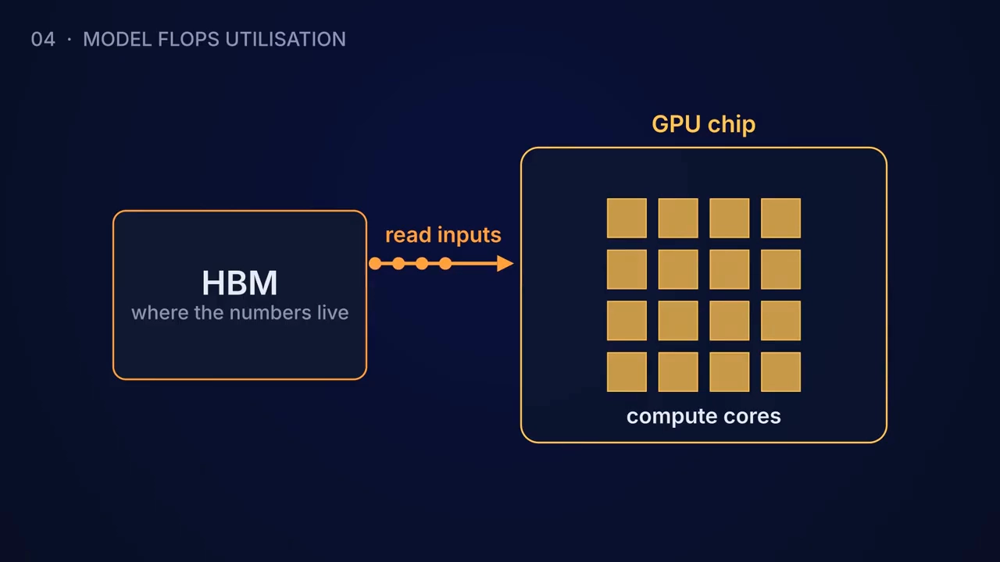

这条链上有一条永远不变的规律：**越靠近计算越快，但你能用的容量越少**。所以权重这种 GB 级的东西只能待在 HBM，而 GPU 每做一次计算，都必须先把数据从 HBM 搬进来。视频给了一个明确的约定：

> 后面说“搬运了多少字节”，一律指**数据从 HBM 到计算核心的这趟往返**，不把 L2、SRAM 内部的搬运算进去。

这个约定很重要，因为它决定了算术强度的分母。也正因为如此，一个算子如果能把数据留在片上反复用，它的“有效字节数”就会下降，算术强度随之上升——这正是后面所有优化手段的共同原理。

### 1.1 训练时显存里到底装了什么

视频先花了几分钟算“训练要多少显存”，因为它直接决定了每次要搬多少字节。除了训练数据和参数，显存里还有三样东西：

- **梯度**：反向传播给每个参数算一个梯度，所以梯度和参数一样大。
- **激活值**：反向要用前向的中间结果，必须留到反向传播用完为止。
- **优化器状态**：SGD 不存额外数字；SGD + momentum 存 1 份；Adam 存 2 份（一阶、二阶矩）。

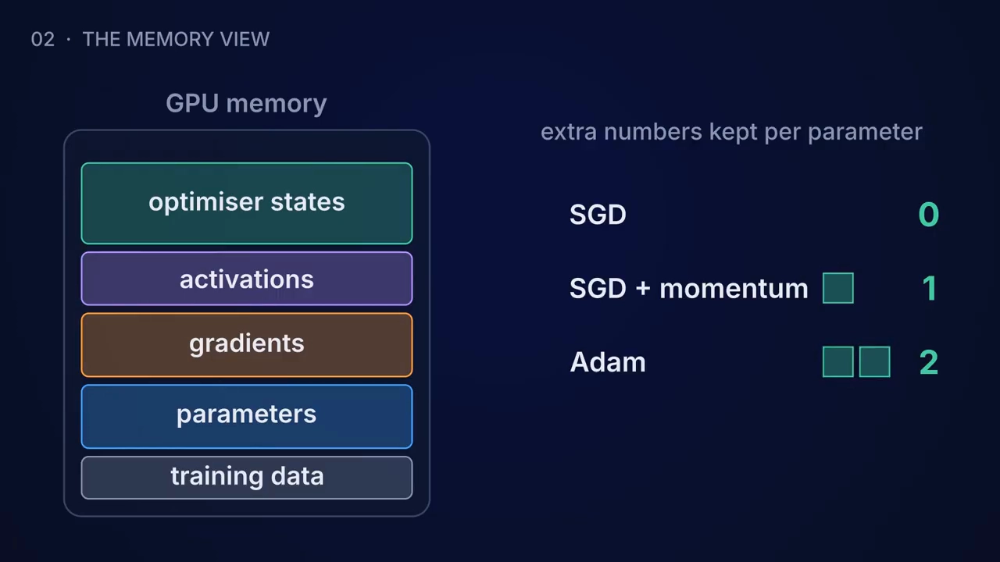

用 32 位浮点算，每个参数要 4 字节权重 + 4 字节梯度 + 8 字节 Adam 状态 = **16 字节/参数**（混合精度训练算下来差不多）。一个 7B 模型就是 112 GB，而一张 H100 只有 80 GB——连“比较小”的模型都放不下。[【跳转到 01:54】](https://www.youtube.com/watch?v=YPSJSJtLe8s&t=114)

数据从磁盘到 CPU 内存，再经 PCIe 拷到 HBM，PCIe 双向各约 64 GB/s；而 HBM 自己是 3.35 TB/s，快了约 50 倍。训练代码靠“算这一批的同时预取下一批”把这段慢拷贝藏起来，但**字节搬运在每一层都很贵**，这是贯穿全片的主线。[【跳转到 02:58】](https://www.youtube.com/watch?v=YPSJSJtLe8s&t=178)

## 二、第一步：数 FLOPs，别和 FLOP/s 混了

**FLOPs 是工作量，FLOP/s 是速度**，两者差一个“每秒”。视频专门把这两个词并排放在一起提醒：

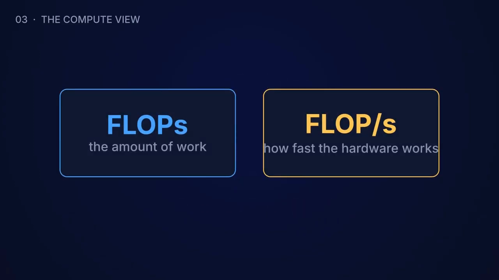

一个加法和一个乘法各算 1 个 FLOP。作为量级参照：训练 GPT-3 大约花了 $3.14 \times 10^{23}$ FLOPs；H100 标称峰值 1,979 teraFLOP/s，但这个数字**假设了稀疏性**（矩阵里每 4 个数有 2 个是 0，GPU 可以跳过），对普通稠密模型真实峰值只有一半，约 **989 teraFLOP/s**。即便按峰值算，一张 H100 跑完 GPT-3 的训练量也要十年左右。[【跳转到 03:53】](https://www.youtube.com/watch?v=YPSJSJtLe8s&t=233)

### 2.1 矩阵乘的 FLOPs 公式

拿一个具体线性层：1024 个输入、每个 512 维特征，映射到 128 个输出。这就是一个 $1024 \times 512$ 乘 $512 \times 128$ 的矩阵乘。

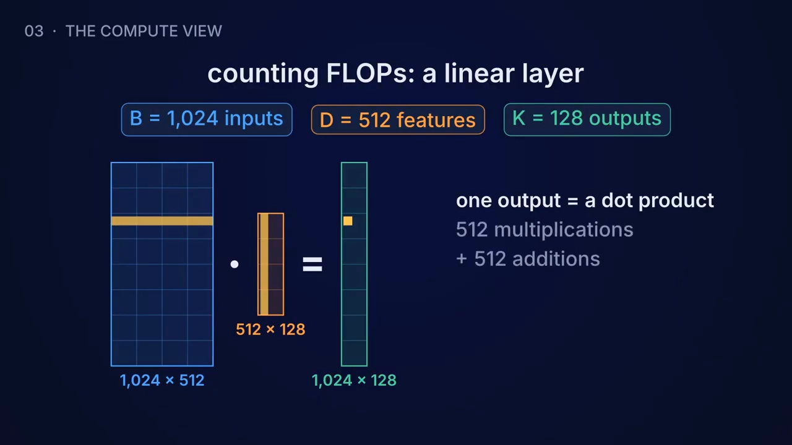

盯住输出矩阵里的一个数：它是输入行与权重列的**点积**，要做 512 次乘法，再加 512 次加法把它们加起来，也就是 2 FLOPs / 每个乘加对。输出一共有 $1024 \times 128$ 个元素，于是：

$$
\text{FLOPs}_{\text{matmul}} = 2 \times B \times D \times K
$$

代入 $B=1024$、$D=512$、$K=128$，得到约 **1.34 亿 FLOPs**。这条公式值得背下来：**矩阵乘的 FLOPs = 2 × 三个维度的乘积**。[【跳转到 05:08】](https://www.youtube.com/watch?v=YPSJSJtLe8s&t=308)

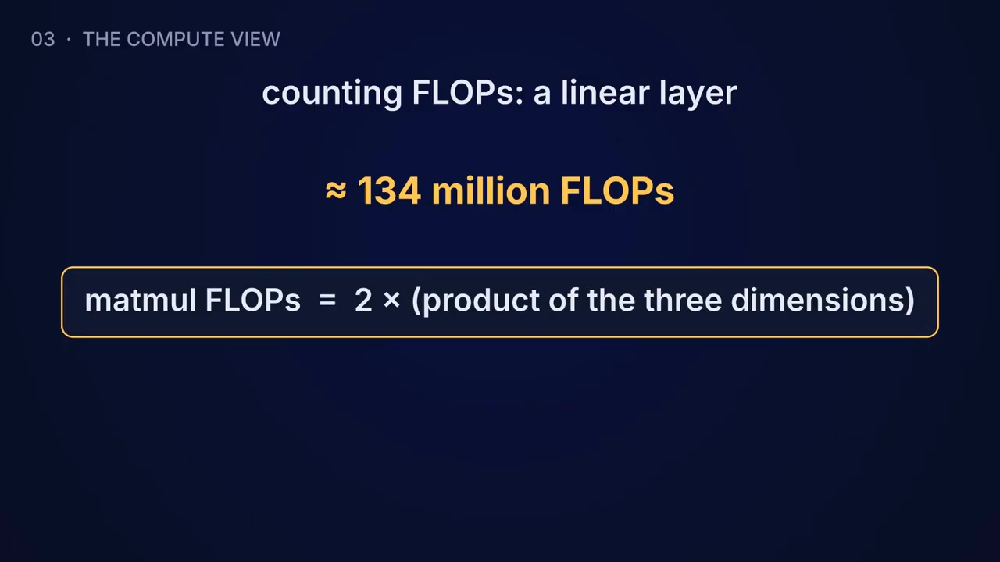

在 H100 峰值上，这 1.34 亿 FLOPs 只需 **0.14 微秒**。记住这个数，下一节要拿它和“搬数据要多久”对比。

## 三、第二步：数字节，只数真正跨过 HBM 的那部分

同一个线性层，要搬多少字节？16 位精度下每个数 2 字节：

| 张量 | 形状 | 元素数 | 说明 |
| --- | --- | --- | --- |
| 输入 | 1024 × 512 | 约 52.4 万 | 每个 batch 元素一行 |
| 权重 | 512 × 128 | 约 6.5 万 | 只读一次 |
| 输出 | 1024 × 128 | 约 13.1 万 | 写回 HBM |

合计约 72.1 万个数字、**1.44 MB**。[【跳转到 09:07】](https://www.youtube.com/watch?v=YPSJSJtLe8s&t=547)

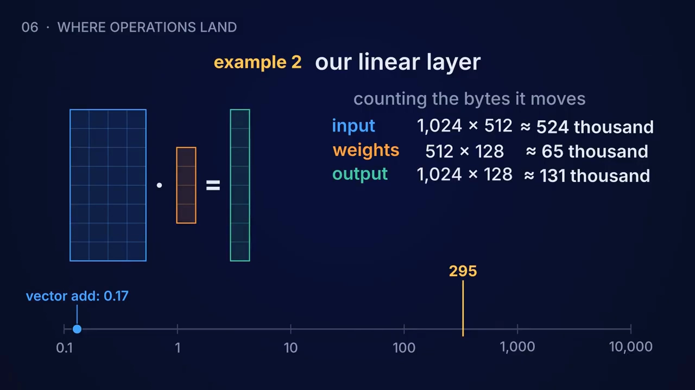

这里有个容易踩的坑：**权重只算一次，输入和输出按 batch 规模放大**。所以 batch 越大，权重那 6.5 万个数被摊得越薄，算术强度就越高——这就是后面 batching 能救 decode 的根本原因。

## 四、相除：算术强度的定义与硬件的对应数字

把两步的结果一除，就得到算术强度：

$$
\text{算术强度} = \frac{\text{FLOPs}}{\text{搬运的字节数}} \quad [\text{FLOPs/Byte}]
$$

对这个线性层：$1.34 \times 10^8 / 1.44 \times 10^6 \approx$ **93 FLOPs/Byte**。[【跳转到 09:32】](https://www.youtube.com/watch?v=YPSJSJtLe8s&t=572)

硬件这边也有一个同量纲的数字：**峰值算力 ÷ 峰值带宽**。

$$
\frac{989\ \text{teraFLOP/s}}{3.35\ \text{TB/s}} \approx 295\ \text{FLOPs/Byte}
$$

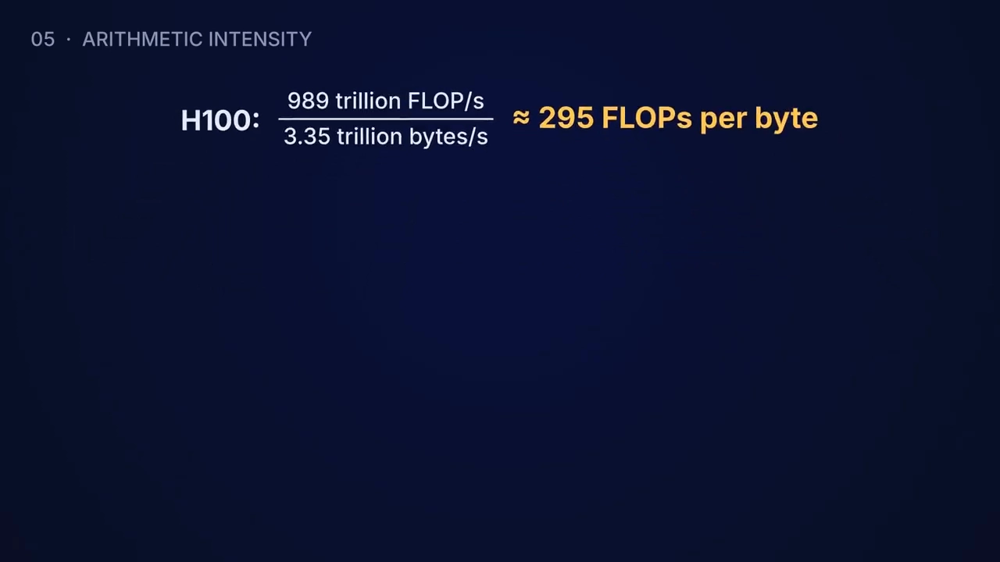

它的物理含义是：**在搬来 1 个字节的这段时间里，H100 最多能做约 295 次运算**。所以要让算力和带宽同时被吃满、没有一方闲着，算子的算术强度就必须正好是 295。这个数在文献里叫**拐点（ridge point）**或**机器平衡点（machine balance）**。

于是判据只有一句话：

- 算术强度 **低于 295** → 计算核心早早干完，坐着等数据，**访存受限**，耗时由字节数决定；
- 算术强度 **高于 295** → 带宽供得上，瓶颈在运算，**算力受限**，耗时由 FLOPs 决定。

老一代 A100 的拐点约 **153**。GPU 算力的增长速度一直快于带宽，所以**每一代新卡都需要更高的算术强度才能喂饱**——同一份代码在新卡上“相对变慢”，往往就是这个原因。[【跳转到 07:52】](https://www.youtube.com/watch?v=YPSJSJtLe8s&t=472)

## 五、五个真实算子的落点

视频用 16 位精度（每数 2 字节）把五个典型算子依次算了一遍。这套推导是本文最值得动手复现的部分。

### 5.1 向量加法：0.17 FLOPs/Byte

残差连接就是两个向量相加。N 个数做 N 次加法，但要读 2N 个数、写 N 个数，共 **6N 字节**：

$$
\text{AI} = \frac{N}{6N} \approx 0.17\ \text{FLOPs/Byte}
$$

离 295 差三个数量级。乘上 3.35 TB/s，这个算子最高只能跑到约 **0.5 teraFLOP/s，也就是峰值的 0.06%**。激活函数、dropout、归一化都属于这一类：**无论输入多大，它们永远是访存受限**。[【跳转到 08:17】](https://www.youtube.com/watch?v=YPSJSJtLe8s&t=497)

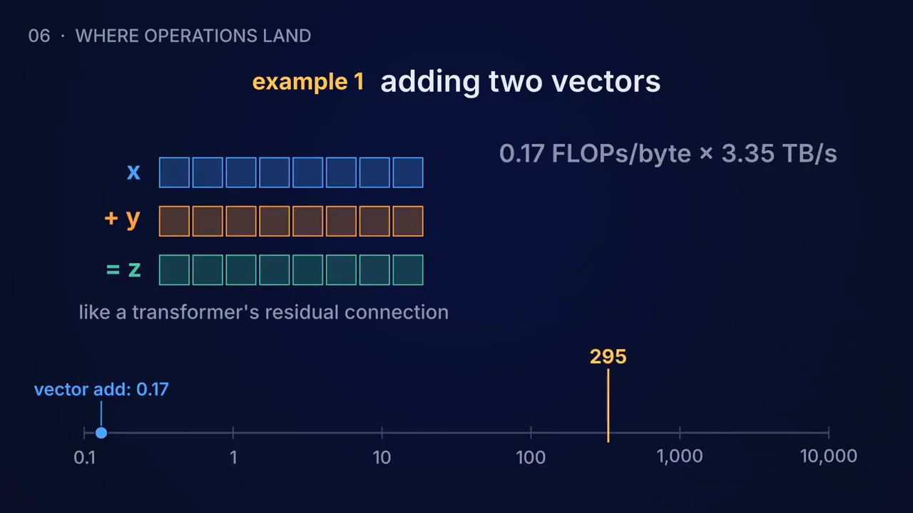

### 5.2 线性层：93 FLOPs/Byte，矩阵乘也可能访存受限

上一节算过的线性层是 93，**低于 295**。把它换算成时间更直观：

- 搬 1.44 MB：$1.44\ \text{MB} / 3.35\ \text{TB/s} \approx 0.43$ 微秒；
- 算 1.34 亿 FLOPs：$1.34\times10^8 / 989\ \text{teraFLOP/s} \approx 0.14$ 微秒。

**计算核心有约三分之二的时间是闲着的。** 这是很多人第一次算算术强度时最反直觉的结论：矩阵乘并不天然是算力受限。[【跳转到 09:57】](https://www.youtube.com/watch?v=YPSJSJtLe8s&t=597)

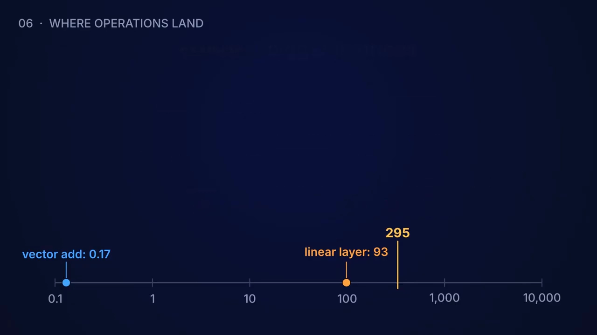

### 5.3 N×N 矩阵乘：算术强度 = N/3

两个 $N \times N$ 矩阵相乘：FLOPs 是 $2N^3$，字节数是 $6N^2$（读两个、写一个），相除得：

$$
\text{AI} = \frac{2N^3}{6N^2} = \frac{N}{3}
$$

| N | 算术强度 | 落点 |
| --- | --- | --- |
| 512 | 171 | 访存受限（< 295） |
| 1024 | 341 | 刚过拐点，算力受限 |
| 4096 | 1365 | 深度算力受限 |

**算术强度随矩阵规模线性增长**，这就是“大矩阵乘能贴着峰值跑、小矩阵乘不行”的全部原因。[【跳转到 10:22】](https://www.youtube.com/watch?v=YPSJSJtLe8s&t=622)

### 5.4 逐 token 生成：1 FLOPs/Byte，最极端的访存受限

语言模型一次只吐一个 token，每个新 token 都要完整过一遍模型。盯住其中一个权重：它被用且只用一次（1 次乘法 + 1 次加法 = 2 FLOPs），但在用之前必须先从 HBM 读出来（16 位 = 2 字节）。于是：

$$
\text{AI} = \frac{2\ \text{FLOPs}}{2\ \text{Bytes}} = 1\ \text{FLOPs/Byte}
$$

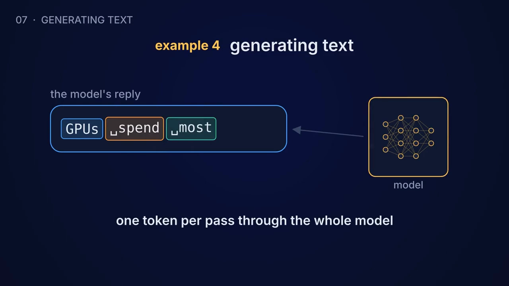

放大到 7B 模型：14 GB 权重，每个 token 都要全读一遍。H100 片上缓存只有约 50 MB，装不下，只能每次重新流进来：

- 搬 14 GB：$14\ \text{GB} / 3.35\ \text{TB/s} \approx 4.2$ 毫秒 → 单用户上限约 **240 token/s**；
- 算 140 亿 FLOPs：约 **14 微秒**。

**超过 99% 的时间 GPU 在等内存。**[【跳转到 12:13】](https://www.youtube.com/watch?v=YPSJSJtLe8s&t=733)

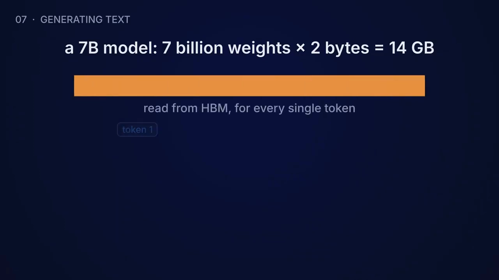

### 5.5 批处理：算术强度约等于 batch size

如果 512 个用户的 token 一起过，每个权重读一次、用 512 次：FLOPs 随 batch 线性涨，字节几乎不变，**算术强度约等于 batch size**。

| 并发数 | 算术强度 | 落点 |
| --- | --- | --- |
| 1 | 1 | 极端访存受限 |
| 64 | 约 62 | 仍远低于 295 |
| 512 | 约 410 | 算力受限 |

这解释了为什么推理服务要拼命攒 batch，也解释了为什么 chatbot“读 prompt 快、写回复慢”——prompt 的所有 token 是一次性过模型的，而回复只能一个一个来。[【跳转到 12:38】](https://www.youtube.com/watch?v=YPSJSJtLe8s&t=758)

## 六、把五个点画到一张图上：屋顶线的雏形

横轴算术强度、纵轴 H100 实际能跑到的速度，双对数：

- 拐点左侧，速度被带宽卡住，是一条斜率 1 的**斜线**；
- 拐点（295）右侧，速度被峰值算力卡住，是一条**水平屋顶**。

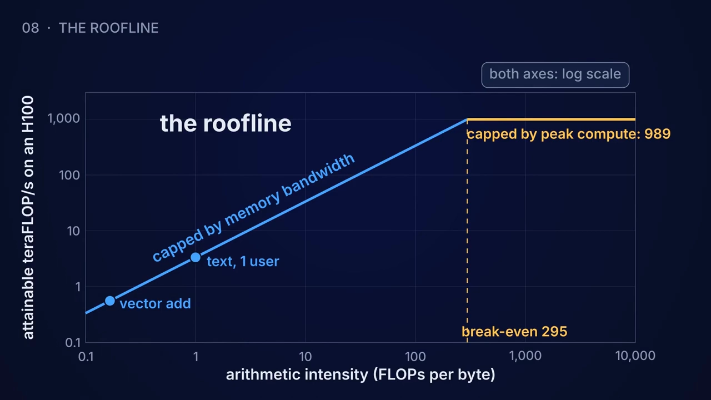

向量加法在斜线最左下，单用户生成略高一点，线性层还在斜线上，512 的 batch 和大矩阵乘才爬上屋顶。**想往上走，唯一的路是往右移：让每个字节干更多活。** 屋顶线的画法与拐点的严格计算属于 1.3.2，这里只需要记住：**算术强度是横轴坐标，拐点是分界线**。[【跳转到 13:28】](https://www.youtube.com/watch?v=YPSJSJtLe8s&t=808)

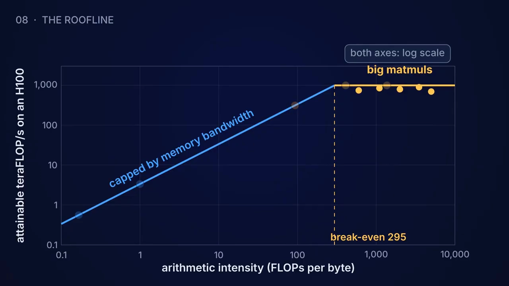

## 七、MFU 为什么上不去：算术强度给出的解释

**MFU（Model FLOPs Utilisation）= 模型实际达到的 FLOP/s ÷ 硬件峰值**，只统计模型数学上必需的 FLOPs，通信、等待、各种开销全部算作损耗。MFU 0.5 已经算很好，PaLM 论文报告约 46%。[【跳转到 06:14】](https://www.youtube.com/watch?v=YPSJSJtLe8s&t=374)

算术强度解释了另一半去哪了：Transformer 里的大矩阵乘是算力受限、贴着屋顶跑，但中间还夹着大量逐元素算子、softmax、归一化——它们几乎不贡献 FLOPs，却要读写整个张量，全在斜线下方，把平均 MFU 拖下来。

所以所有优化手段本质上都在**提高算术强度**：

1. **算子融合**：让几个步骤在数据还在片上时一次做完。视频给的例子是 scale → softmax → dropout，不融合要 6 次访存，融合后只要 2 次。`torch.compile` 自动做这件事，FlashAttention 对 attention 做的也是这件事。
2. **增大 batch**：让每个权重被复用更多次。
3. **用更大的矩阵**：让每个字节承担更多运算。

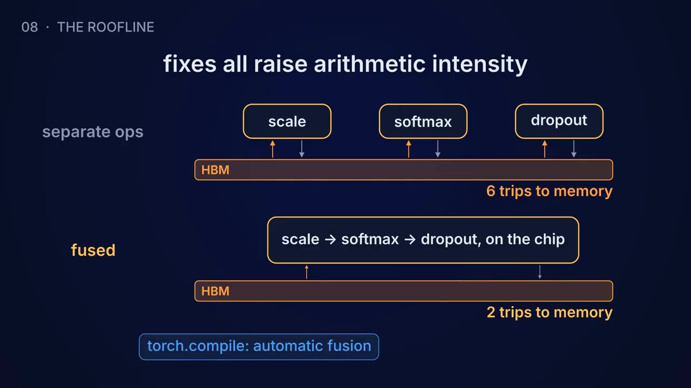

## 八、回到开头：用算术强度估算训练时间

100B 参数、20T token、1024 张 H100。先算工作量：

- 前向：每个参数、每个 token 约 2 FLOPs（就是矩阵乘的 2 FLOPs/乘加）；
- 反向：约两倍，因为每层要算两个梯度（对权重、对传回去的激活），再加 4 FLOPs；
- 合计：**训练 FLOPs ≈ 6 × 参数量 × token 数**。

$$
6 \times 10^{11} \times 2 \times 10^{13} = 1.2 \times 10^{25}\ \text{FLOPs}
$$

再算速度：1024 张 H100 × 989 teraFLOP/s × 现实 MFU 0.5 ≈ $5 \times 10^{17}$ FLOP/s。相除得约 $2.4 \times 10^7$ 秒，即 **274 天，约九个月**。MFU 从 0.5 提到 0.6，就能省下约 45 天——这就是算术强度/MFU 这套语言的实际价值。[【跳转到 15:58】](https://www.youtube.com/watch?v=YPSJSJtLe8s&t=958)

顺带还有显存账：16 字节/参数 × 100B = 1.6 TB，光权重、梯度、优化器状态就要 20 张 H100，还没算激活值。所以模型必须切到多卡上，又引入通信开销。

## 小结

- **算术强度 = FLOPs ÷ 搬运字节数**，单位 FLOPs/Byte；分母只算 HBM 与计算核心之间的往返。
- **硬件的对应数字 = 峰值算力 ÷ 峰值带宽**：H100 约 295，A100 约 153，这个数叫拐点或机器平衡点。
- **判据**：低于拐点 → 访存受限，时间由字节决定；高于拐点 → 算力受限，时间由 FLOPs 决定。
- **数 FLOPs 的捷径**：矩阵乘 = 2 × 三个维度之积；训练 ≈ 6 × 参数 × token。
- **数字节的捷径**：读几个张量、写几个张量，乘上元素数与每元素字节数；权重只算一次，激活随 batch 放大。
- **五个落点**：向量加 0.17、线性层 93、N×N 矩阵乘 N/3、单用户 decode 1、batch 512 约 410。
- **优化 = 提高算术强度**：算子融合、增大 batch、增大矩阵，三条路都指向同一个比值。
- 屋顶线只是把“算术强度”与“可达速度”画在一张图上，画法与拐点计算见 1.3.2。

## 关键术语速查

| 术语 | 一句话解释 |
| --- | --- |
| FLOPs | 浮点运算次数，衡量“干了多少活”，不是速度 |
| FLOP/s | 每秒浮点运算次数，衡量“干得多快” |
| 算术强度 | 每搬运 1 字节能换来的 FLOPs，单位 FLOPs/Byte |
| 拐点 / 机器平衡点 | 硬件峰值算力除以峰值带宽，H100 约 295 FLOPs/Byte |
| 访存受限 | 算术强度低于拐点，计算核心等数据 |
| 算力受限 | 算术强度高于拐点，带宽供得上、运算排满 |
| MFU | 实际 FLOP/s 与峰值的比值，只计模型必需的 FLOPs |
| 算子融合 | 多个步骤在片上一次做完，减少 HBM 往返以提高算术强度 |