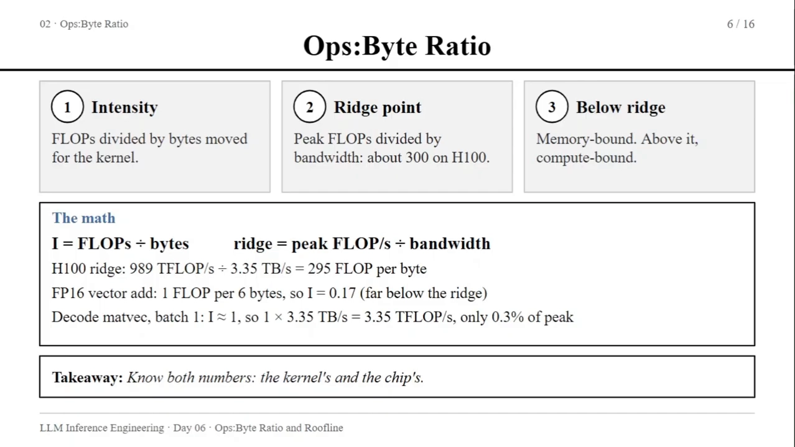
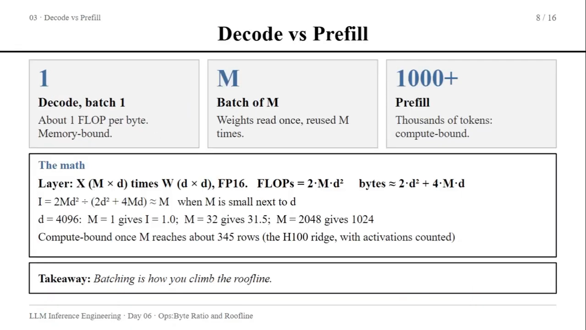
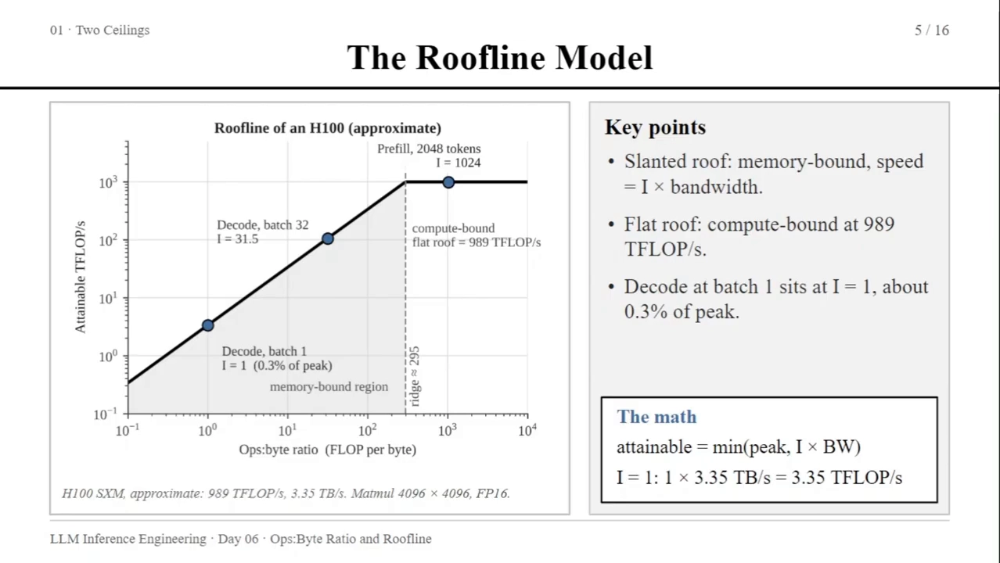
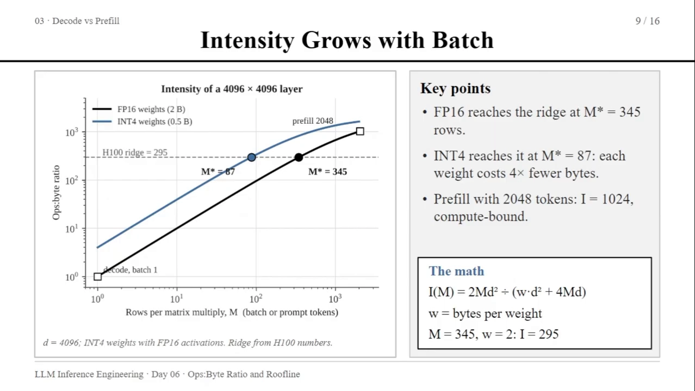
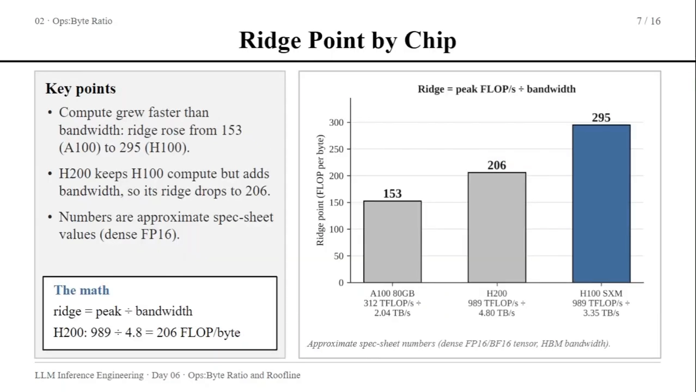
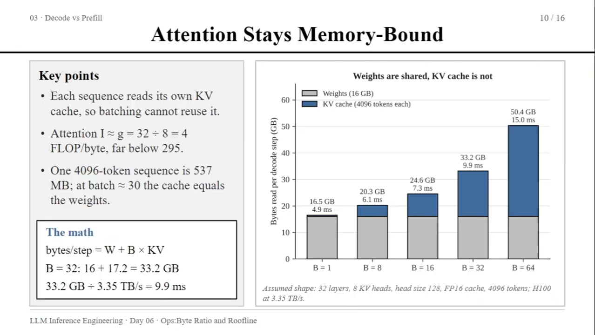
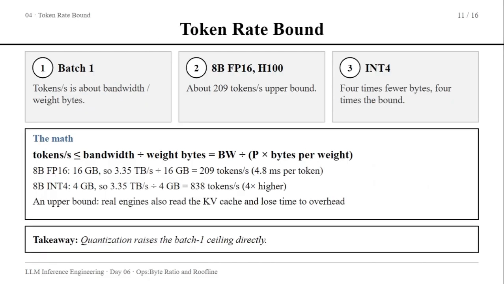
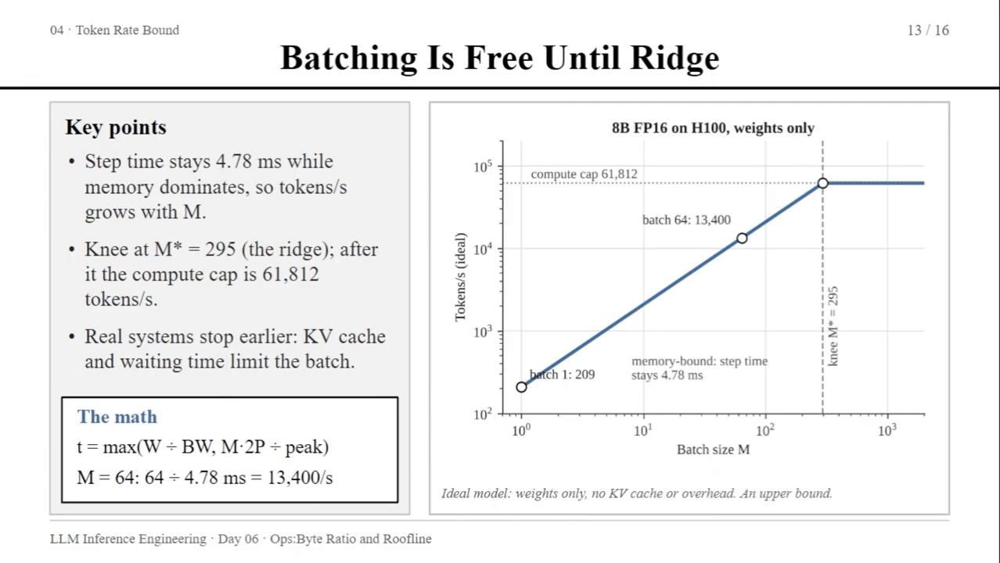

# Linear 与 Attention 的屋顶线落点：为什么 decode 永远在斜坡上

> 视频来源：[Day 06 | Why Is LLM Decoding Memory-Bound? | Roofline Model & Operations-to-Byte Ratio](https://www.youtube.com/watch?v=GtyN14RPSH8)（YouTube · ThiruPhdAIResearch）｜时长约 67 分钟
> 导读：这支课把「算子投到屋顶线上」这件事拆成两步：先给 Linear 层写出算术强度公式，看它随 batch / prompt 长度怎么移动；再给 Attention 层算 KV cache，看它为什么无论 batch 多大都钉在斜坡上。本文只讲落点推导，屋顶线怎么画、拐点怎么算留给 1.3.2；视频后半段（约 21:45 之后）的 Python/CPU 实操另有一篇《动手算一遍屋顶线》。

## 本讲要解决的核心问题（SCQA）

**背景**：屋顶线告诉我们，一个算子落在拐点左边就是访存受限、右边就是算力受限；拐点等于峰值算力除以带宽，H100 约 295。

**冲突**：可同样是 Transformer 里的一层，prefill 能把 GPU 吃到接近峰值，decode 却只用掉 0.3% 的算力。更奇怪的是，把 decode 的 batch 从 1 加到 64，吞吐涨了 64 倍；而把 attention 的 batch 从 1 加到 64，它**仍然**在斜坡上。

**疑问**：Linear 和 Attention 的横坐标（算术强度）到底由什么决定？为什么一个能随 batch 往上爬，另一个爬不动？

**回答（中心思想）**：**Linear 层的算术强度约等于"共享同一次权重读取的行数" $M$**——decode 时 $M$ 是 batch，prefill 时 $M$ 是 prompt token 数，所以它能随 batch 或序列长度线性往上爬。**Attention 层的算术强度约等于 GQA 的分组比 $g = n_q / n_{kv}$**，与 batch、与序列长度都无关，所以它被钉死在斜坡上。这一条差别，就是 Prefill（算力受限）与 Decode（访存受限）的全部来源。

## 一、两块天花板，一条规则

视频先用餐厅打比方：芯片是那位非常快的厨师（算力），内存是来回搬食材的帮手（带宽）。**厨师做菜不可能快过帮手送食材的速度。** 每块芯片都有两块天花板：[【跳转到 03:05】](https://www.youtube.com/watch?v=GtyN14RPSH8&t=185)

- **算力**：每秒峰值浮点运算数。一个 FLOP 就是一次乘法或一次加法，H100 约 989 TFLOPS；
- **带宽**：每秒能从内存搬多少字节，H100 约 3.35 TB/s。

于是执行时间至少是两者中更大的那个：

$$
t \ge \max\left(\frac{\text{FLOPs}}{\text{峰值算力}},\ \frac{\text{字节数}}{\text{带宽}}\right)
$$

拿一个 80 亿参数的模型在 FP16 下生成一个 token 试一下：160 亿次 FLOPs，权重 16 GB。计算只需要 **16 微秒**，而把 16 GB 搬进来需要 **4.8 毫秒**——内存慢了 295 倍。所以是内存决定了你先撞上哪块天花板。[【跳转到 03:55】](https://www.youtube.com/watch?v=GtyN14RPSH8&t=235)

拐点 295 的物理含义值得多说一句：**在搬来 1 个字节的这段时间里，H100 最多能做约 295 次运算。** 所以一个算子如果每字节只做 1 次运算，它就只用掉了这段时间的 1/295，剩下的时间计算单元都在等数据。

这个"每字节做多少次运算"就是算术强度，芯片侧的对应数字就是拐点。视频用一张卡片把三件事写在一起：算术强度是 FLOPs 除以字节数，拐点是峰值除以带宽（H100 约 300），低于拐点访存受限、高于拐点算力受限。[【跳转到 06:25】](https://www.youtube.com/watch?v=GtyN14RPSH8&t=385)

## 二、Linear 层：落点就是"共享一次权重读取的行数"

现在把镜头对准一层 Linear。输入是 $M$ 行、每行 $d$ 维，权重矩阵是 $d \times d$，FP16。

$$
\text{FLOPs} = 2 \cdot M \cdot d^2, \qquad
\text{字节数} \approx w \cdot d^2 + 4Md
$$

其中 $w$ 是每个权重的字节数（FP16 为 2）。字节数分两块：**权重只读一次**（$w d^2$），而**输入和输出随 $M$ 放大**（$4Md$，读入 2 字节、写出 2 字节）。

两者相除就是算术强度：

$$
I(M) = \frac{2Md^2}{w\,d^2 + 4Md}
$$

当 $M$ 相对 $d$ 很小时，分母里的 $4Md$ 可以忽略，$d^2$ 约掉，于是得到一个极其干净的结论：

$$
I(M) \approx \frac{2M}{w} \quad\Longrightarrow\quad \text{FP16 下 } I \approx M
$$

**Linear 层的算术强度，约等于共享同一次权重读取的行数。** 这个"行数"在不同阶段有不同含义：

- **decode**：$M$ 是 batch 里同时处理的请求数；
- **prefill**：$M$ 是被一起处理的 prompt token 数。

取 $d = 4096$，代入具体数字：

| $M$（行数） | 算术强度 $I$ | 落点 |
| --- | --- | --- |
| 1（decode，batch 1） | 1.0 | 深度访存受限 |
| 32（decode，batch 32） | 31.5 | 仍在斜坡上 |
| 512 | 409.6 | 刚过拐点 |
| 2048（prefill 2048 token） | 1024 | 算力受限 |

这里可以顺手验算一下 batch 32：$I = 31.5$，可达速度 $= 31.5 \times 3.35\ \text{TB/s} \approx 105.6\ \text{TFLOPS}$，也就是峰值的 10.7%——比 batch 1 的 0.3% 好得多，但离平屋顶还很远。视频用行李箱打比方：权重就是那只行李箱，batch 1 的 decode 是专门为一个人搬一整只箱子，batching 则是一次搬给很多人用。**batching 就是你爬上屋顶线的方式。**

把它画到屋顶线上，就是三个点：batch 1 的 decode 在最左下（$I=1$，只有峰值的 0.3%），batch 32 的 decode 在斜坡中段（$I=31.5$），2048 token 的 prefill 已经爬上平屋顶（$I=1024$）。[【跳转到 05:46】](https://www.youtube.com/watch?v=GtyN14RPSH8&t=346)

### 2.1 拐点落在第 345 行

把 $I(M) = 295$ 反解出来，就得到"要多少行才能喂饱 H100"：[【跳转到 07:22】](https://www.youtube.com/watch?v=GtyN14RPSH8&t=442)

- FP16 权重（每权重 2 字节）：$M^{*} = 345$ 行；
- INT4 权重（每权重 0.5 字节）：$M^{*} = 87$ 行。

这解释了两件事：**decode 的 batch 要堆到几百才能让 Linear 变成算力受限**；而**量化会把整条曲线往左推**，因为每个权重占的字节少了，同样一次权重读取能换来更多运算。注意这是理想化计算，真实的 INT4 还有量化元数据、打包和解包开销。

拐点本身也随芯片变化：A100 是 153、H200 是 206、H100 是 295。从 A100 到 H100，算力涨得比带宽快，所以拐点被抬高——同一份代码在新卡上"相对变慢"，往往就是这个原因。[【跳转到 08:16】](https://www.youtube.com/watch?v=GtyN14RPSH8&t=496)

### 2.2 三个落点各自的"浪费"在哪里

把这三个点换算成"用掉了峰值的百分之几"，会更容易记住：

| 落点 | 算术强度 | 可达速度 | 占峰值 | 瓶颈 |
| --- | --- | --- | --- | --- |
| decode, batch 1 | 1 | 3.35 TFLOPS | 0.3% | 带宽 |
| decode, batch 32 | 31.5 | 105.6 TFLOPS | 10.7% | 带宽 |
| prefill, 2048 token | 1024 | 989 TFLOPS | 100% | 算力 |

batch 1 的 decode 把 99.7% 的算力闲置了；batch 32 仍然闲置近 90%；只有 prefill 才真正把芯片喂饱。这也解释了为什么推理服务的成本几乎全在 decode 上——**它不是算得慢，是等得久。**

## 三、Attention：落点被 GQA 比例钉死

Linear 的落点会动，Attention 的落点却几乎不动。原因在 KV cache：**模型权重是所有请求共享的，KV cache 不是。**

先算 KV cache 有多大。视频用一个 Llama-3 8B 的形状做假设：32 层、32 个 query head、8 个 KV head、每个 head 128 维、上下文 4096 个 token、FP16 存储。[【跳转到 09:37】](https://www.youtube.com/watch?v=GtyN14RPSH8&t=577)

$$
\text{KV per token} = 2 \times n_{\text{layers}} \times n_{kv} \times d_{\text{head}} \times 2\ \text{Bytes}
$$

最前面的 2 是 key 和 value 两份，最后的 2 是 FP16 的字节数。代入得：

$$
2 \times 32 \times 8 \times 128 \times 2 = 131{,}072\ \text{B} \approx 128\ \text{KB/token}
$$

一条 4096 token 的序列就是 $128\ \text{KB} \times 4096 \approx 537$ MB（十进制，约 512 MiB）。[【跳转到 08:37】](https://www.youtube.com/watch?v=GtyN14RPSH8&t=517)

然后是关键的一步：Attention 的算术强度约等于 **query head 数除以 KV head 数**：

$$
I_{\text{attn}} \approx \frac{n_q}{n_{kv}} = \frac{32}{8} = 4
$$

为什么是这个比值？因为每个 KV head 被 $n_q / n_{kv}$ 个 query head 共享（这就是 **GQA，grouped query attention** 的含义），一次 KV 读取最多被这么多个 query 复用。4 远低于 295，所以：

> **无论 batch 多大、序列多长，Attention 都停在斜坡上。**

[【跳转到 10:19】](https://www.youtube.com/watch?v=GtyN14RPSH8&t=619)

### 3.1 batch 对两者的作用完全不同

把权重和 KV cache 一起算，每步要读的字节是：

$$
\text{bytes/step} = W + B \times \text{KV}_{\text{seq}}
$$

$W$ 是 16 GB 权重，$\text{KV}_{\text{seq}}$ 是每条序列 537 MB。于是：

| batch $B$ | 每步读取 | 每步耗时（3.35 TB/s） |
| --- | --- | --- |
| 1 | 16.5 GB | 4.9 ms |
| 8 | 20.3 GB | 6.1 ms |
| 16 | 24.6 GB | 7.3 ms |
| 32 | 33.2 GB | 9.9 ms |
| 64 | 50.4 GB | 15.0 ms |

[【跳转到 10:44】](https://www.youtube.com/watch?v=GtyN14RPSH8&t=644)

大约在 **batch 30 附近，KV cache 就和权重一样大**；再往上加 batch，每步耗时开始明显变长。这就是为什么"batching 能救 decode"这句话只对了一半：**batching 复用的是权重，不是 KV cache。** 生产系统因此需要 paged attention、KV cache 量化、GQA、continuous batching 和高效的显存分配。

## 四、token 速率上限：batch 1 的天花板

既然 batch 1 的 decode 每次都要把权重完整读一遍，那么每秒最多能吐多少 token？

$$
\text{tokens/s} \le \frac{\text{带宽}}{\text{权重字节数}} = \frac{BW}{P \times \text{每权重字节}}
$$

一个 80 亿参数模型，FP16 下 16 GB：

$$
3.35\ \text{TB/s} \div 16\ \text{GB} \approx 209\ \text{tokens/s}
$$

也就是每个 token 4.8 毫秒。换成 INT4（4 GB），上限变成 **838 tokens/s**——字节少四倍，天花板高四倍。[【跳转到 15:03】](https://www.youtube.com/watch?v=GtyN14RPSH8&t=903)

这是个上界，真实系统还要读 KV cache、有 kernel 开销和调度开销，所以实际会更低。但它把"量化为什么能直接抬高单用户生成速度"讲清楚了：**它减少的是每次生成必须搬运的字节数。**

## 五、batching：免费，直到拐点

把 batch 加大的收益也可以用同一个模型算。每步耗时取两者中更大的：

$$
t_{\text{step}} = \max\left(\frac{W}{BW},\ \frac{M \cdot 2P}{\text{峰值算力}}\right),
\qquad
\text{吞吐} = \frac{M}{t_{\text{step}}}
$$

在内存占主导时，$t_{\text{step}}$ 停在 4.78 毫秒不动，而吞吐随 $M$ 线性上涨：

| batch | 每步耗时 | 吞吐 |
| --- | --- | --- |
| 1 | 4.78 ms | 209 tokens/s |
| 64 | 4.78 ms | 13,400 tokens/s |
| 512 | 8.28 ms（已过拐点） | 约 61,812 tokens/s（封顶） |

拐点在 $M \approx 295$，过了它算力成为限制，吞吐就平了。这就是"batching 免费，直到拐点"。[【跳转到 18:22】](https://www.youtube.com/watch?v=GtyN14RPSH8&t=1102)

真实系统会更早停下：KV cache 容量、每步耗时带来的延迟、用户等待时间都会限制 batch。视频把它比作火车——坐得越满人均越便宜，但乘客等得越久。

## 六、把两个算子并排放在屋顶线上

| 维度 | Linear 层 | Attention 层 |
| --- | --- | --- |
| 算术强度 | $I \approx M$（共享一次权重读取的行数） | $I \approx n_q / n_{kv}$（GQA 分组比） |
| decode 时 | $M$ = batch，可随 batch 上升 | 恒为 4，与 batch 无关 |
| prefill 时 | $M$ = prompt token 数，可达上千 | 仍为 4，与序列长度无关 |
| 能否爬上平屋顶 | 能，batch 约 345（FP16）或 87（INT4） | 不能，永远在斜坡上 |
| 优化方向 | 增大 batch、降低权重位宽 | 减少 KV 读取：GQA、KV 量化、paged attention |

这张表可以直接回答"该优化什么"：如果瓶颈在 Linear，就去堆 batch、降位宽；如果瓶颈在 Attention，堆 batch 没用（KV cache 不会被复用），只能减少 KV 读取——GQA 减少 head 数、KV 量化减少每元素字节、paged attention 减少浪费的显存块。

一句话总结：**Linear 是"可爬坡"的算子，Attention 是"钉死"的算子。** decode 之所以是访存受限，是因为它的主体工作（每层 Linear 的 matvec）落在 $I \approx$ batch 的位置，而 batch 通常远小于拐点；prefill 之所以是算力受限，是因为同一个 Linear 的 $M$ 变成了上千个 prompt token。Attention 则在两个阶段都拖着 KV cache，永远贴着斜坡。

## 小结

- 执行时间的下界是 $\max(\text{FLOPs}/\text{峰值},\ \text{字节}/\text{带宽})$，更大的那一项就是瓶颈。
- Linear 层：$\text{FLOPs} = 2Md^2$，字节 $\approx w d^2 + 4Md$，所以 $I \approx 2M/w$，FP16 下就是 $M$。
- $d = 4096$ 时，$M=1$ 得 $I=1$，$M=32$ 得 31.5，$M=2048$ 得 1024；拐点在 $M^{*}=345$（FP16）或 87（INT4）。
- Attention 层：KV cache 每 token 约 128 KB，4096 token 约 537 MB；$I \approx n_q/n_{kv} = 4$，与 batch、序列长度都无关。
- batching 复用权重、不复用 KV cache；batch 约 30 时 KV cache 就和权重一样大。
- batch 1 的 token 速率上界是 带宽 ÷ 权重字节：8B FP16 约 209 tokens/s，INT4 约 838 tokens/s。
- batching 免费到拐点（$M \approx 295$），之后吞吐封顶在约 61,812 tokens/s。

## 关键术语速查

| 术语 | 一句话解释 |
| --- | --- |
| 屋顶线 | 横轴算术强度、纵轴可达速度，斜线受带宽限制、平顶受算力限制 |
| 拐点 / ridge point | 峰值算力除以带宽，H100 约 295，是访存受限与算力受限的分界 |
| 算术强度 | 每搬运 1 字节做了多少次运算，单位 FLOPs/Byte |
| $M$（行数） | 一次矩阵乘里共享同一次权重读取的行数：decode 时是 batch，prefill 时是 token 数 |
| KV cache | 为历史 token 保存的 key/value，每条序列私有，不能跨请求复用 |
| GQA | grouped query attention，多个 query head 共享一个 KV head，分组比 $n_q/n_{kv}$ 就是 attention 的算术强度 |
| 权重复用 | 同一份权重在一次读取后被 batch 里所有请求共用，是 batching 提速的来源 |
| 量化 | 降低每个权重占的字节数，把算术强度曲线整体往左推，直接抬高 token 速率上限 |