# Prefill 与 Decode：为什么模型读 prompt 比写回答快 150 倍

> 视频来源：[Prefill and Decode: Why an LLM reads your prompt 150 times faster than it writes (Part 1)](https://www.youtube.com/watch?v=AdnGIEeCqhc)（YouTube · The Blue Kernel）｜时长约 18 分钟
> 导读：这支视频不画抽象公式，而是拿一块真实的 NVIDIA L4 和一个小模型 Qwen2.5-0.5B，把「读 prompt」和「写回答」两个阶段各自的算术强度算给你看，再放到同一张屋顶线上。本文按「先看现象、再拆算子、最后算落点」的顺序重排；屋顶线怎么画、拐点怎么算属于 1.3.2，这里只把它当作落点判据。

## 本讲要解决的核心问题（SCQA）

**背景**：把一份几十页的合同粘进聊天框，模型几乎瞬间就"读完"了；然后它开始回答，一个字一个字往外蹦，你要盯着屏幕等。

**冲突**：同一个模型、同一块 GPU、同一份权重，读的速度却是写的约 150 倍。更奇怪的是，写的时候 GPU 的算力单元大部分是闲着的——它并不是"算不过来"。

**疑问**：这两个阶段到底在做什么不同的数学？能不能在跑之前，只用一支笔就把两个速度都估出来？

**回答（中心思想）**：一次请求被分成两个半场：**prefill** 把整段 prompt 当成一个矩阵块一起算，**decode** 一次只算一个 token。同一份权重，在 prefill 里被成百上千个 token 共用一次读取，在 decode 里只服务一个 token。于是两者的**算术强度**（每搬运 1 字节做多少次运算）差了上百倍：decode 约 1 FLOPs/Byte，长 prefill 可以到几百。芯片自己的拐点（H100 约 300、L4 约 403）就是分界线——decode 落在斜坡最左下角，长 prefill 爬上平屋顶。**读得快、写得慢，本质是"一次权重读取被几个 token 分摊"的差别。**

## 一、一次请求的两个半场

视频先给了一个具体的请求：有人问"我的 Kubernetes pod 为什么重启了？日志说 OOMKilled"。应用在问题前后补了一些格式文本，凑成 **43 个 token** 的 prompt；模型将要写出的答案是 "the pod restarted because it ran out of memory"。[【跳转到 01:07】](https://www.youtube.com/watch?v=AdnGIEeCqhc&t=67)

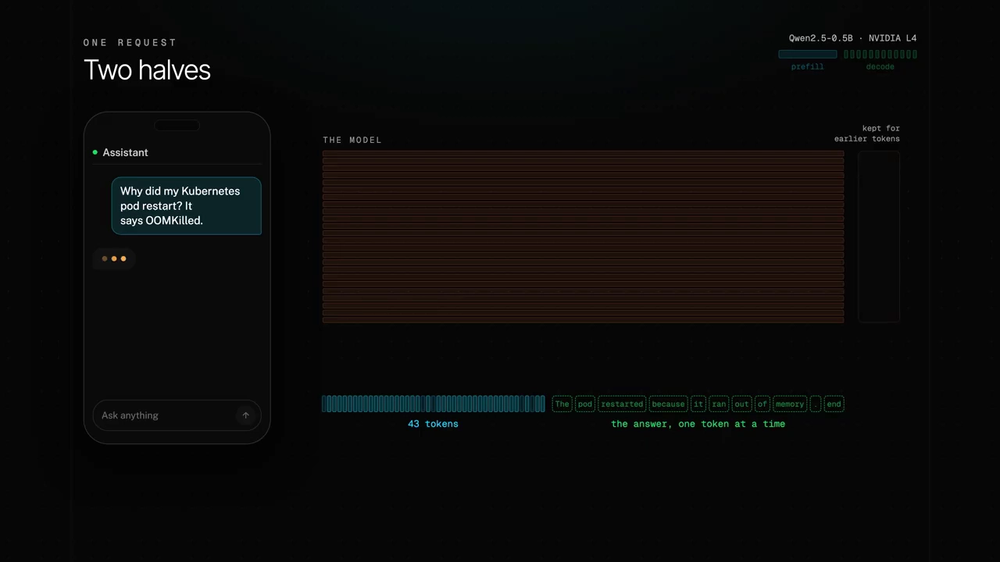

模型是 24 层堆叠。**prefill** 是第一次 pass：43 个 token 并排往上爬，每一层只读一次自己的权重，就供这 43 个 token 共用；到了顶层，只有最后一个 token 的输出有用，它是模型对答案第一个 token 的猜测。[【跳转到 01:32】](https://www.youtube.com/watch?v=AdnGIEeCqhc&t=92)

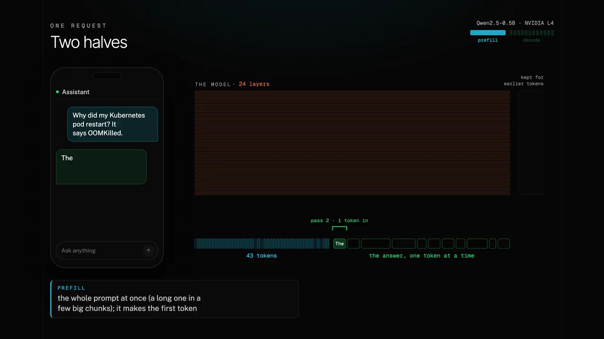

然后是 **decode**：把刚猜出的 "The" 再喂回去，跑一次只有 1 个 token 的 pass，得到 "pod"；再把 "pod" 喂回去，得到 "restarted"……每次 pass 输入一个 token、输出一个 token，直到答案结束。注意：**prompt 从此不会再过一遍模型**，因为 prefill 期间模型已经把每个 prompt token 的 key/value 存了下来，这就是 **KV cache**；每次 decode 只往里面追加一个新 token 的记录。

这两个半场在很多工具里都有现成的名字：Ollama 的 verbose 模式打印 `prompt eval rate`（prefill）和 `eval rate`（decode）；llama.cpp 的 benchmark 叫 `prompt processing` 和 `text generation`。视频作者在自己那块 L4 上测到：**prefill 约每秒 32,000 个 token，decode 只有每秒 212 个**。[【跳转到 03:12】](https://www.youtube.com/watch?v=AdnGIEeCqhc&t=192)

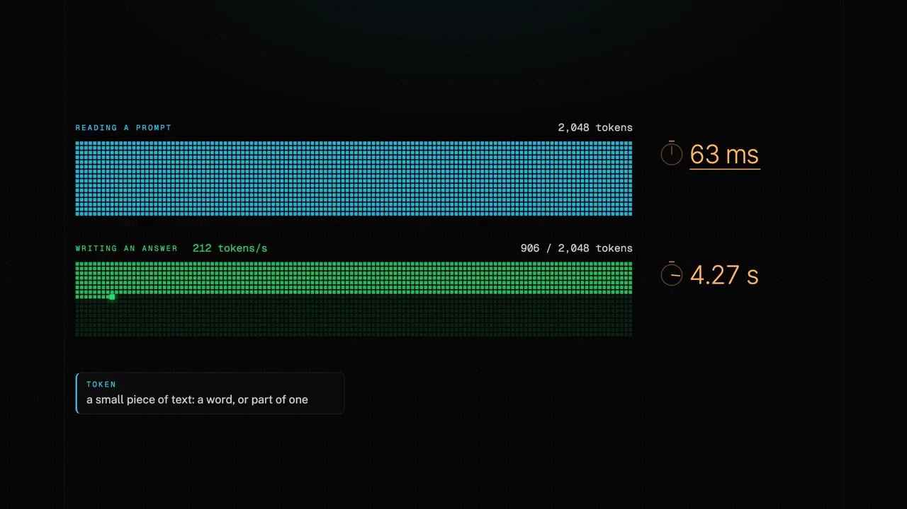

## 二、为什么 prompt 能一次进，答案不能

一个自然的疑问：既然 decode 一次一个 token 也能算对，为什么不把 prompt 也一个 token 一个 pass 地喂？能算对，但太慢。L4 上哪怕只有一个 token 的 pass 也要约 5 毫秒，2000 个 token 就是 2000 次 pass、约 10 秒——而且这 10 秒发生在第一个字出现之前。prefill 处理同样的 prompt 只用 63 毫秒。[【跳转到 03:37】](https://www.youtube.com/watch?v=AdnGIEeCqhc&t=217)

原因不在硬件，而在依赖关系：

- **prompt 的 token 已经全部存在**，随请求一起到达，所以可以一次全放进去；
- **答案的 token 还不存在**。第二个答案 token "pod" 来自输入为 "The" 的那次 pass，所以它必须等那次 pass 结束。每个答案 token 依赖前一个，构成一条链；再大的芯片也打不断这条链，只能让每一次 pass 更快。

那 prompt 一次全进去，前面的 token 会不会"偷看"后面的 token，导致结果和逐个算不一样？不会。模型内部有 **causal mask（因果掩码）**：每个 token 只能看自己和之前的 token，永远不往后看。所以 "Kubernetes" 在两种方式下看到的信息完全相同，prefill 只是把活并行地干完，而不是排队干。[【跳转到 04:52】](https://www.youtube.com/watch?v=AdnGIEeCqhc&t=292)

顺带一提，这个"整段一起算"的能力是 Transformer 带来的。更早的循环神经网络要把一份工作状态从一个词传到下一个词，连 prompt 都只能一个词一个词地进；2017 年的《Attention Is All You Need》把这条逐词链去掉了，论文称之为"更可并行"。训练也是同样的道理：训练时整段文本已经存在，所以可以一次处理所有 token；只有写新文本才必须一个一个来。[【跳转到 06:12】](https://www.youtube.com/watch?v=AdnGIEeCqhc&t=372)

## 三、打开一层：一行，还是一个块

差别最终落在每一层的矩阵乘上。视频拿 Qwen2.5-0.5B 某一层的一个门控权重矩阵举例：形状是 $896 \times 4864$，共 436 万个权重，FP16 下 8.7 MB。

**decode 时**，进来一个 token，也就是一行 896 个数字。这一行乘上权重矩阵，得到一个 4864 维的新行。盯住其中一个权重：GPU 把它从内存取出来，在一个乘加里用它一次（一次乘法、一次加法），然后这个权重就用完了。行 × 矩阵，叫**矩阵向量乘（matvec，`gemv`）**。

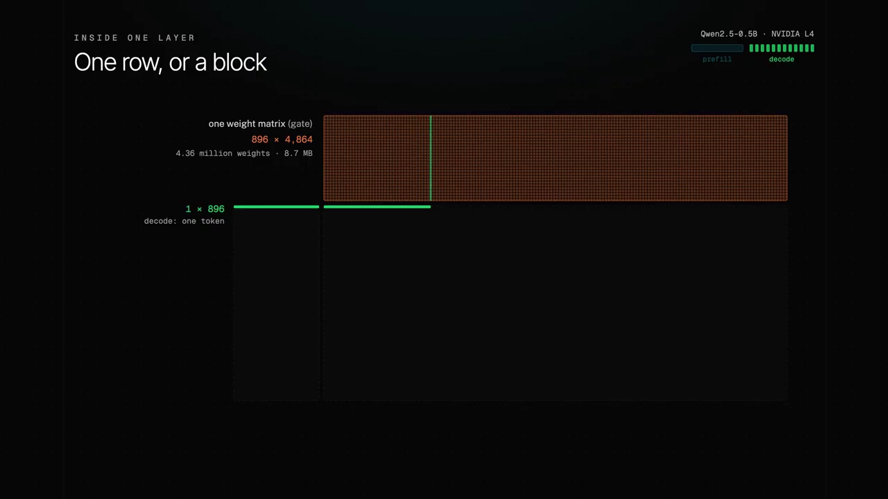

**prefill 时**，整段 prompt 一起进来，是一个"行块"，一个 token 一行。假设你又在问题下面粘了一大段日志，这个块就有 2048 行。再盯住同一个权重：每一行都要乘同一个矩阵，所以每一行都需要它；GPU 只取一次，2048 行都用它。块 × 矩阵，叫**矩阵矩阵乘（matmul，`gemm`）**。

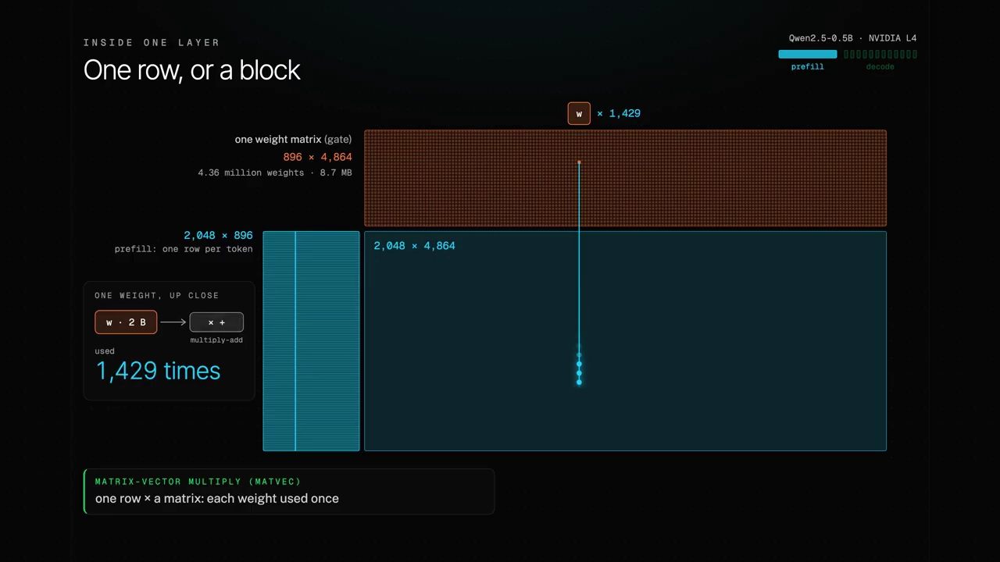

这不是比喻。作者在 L4 上 profile 了 Qwen 的这些矩阵：单 token 时 kernel 名字里带 `gemv`，43 个 token 一起时带 `gemm`。这两个名字有几十年历史（general matrix-vector / general matrix-matrix），LAPACK 指南很久以前就警告过：在有 cache 的机器上，**矩阵向量乘受限于数据在不同层内存之间移动的速度**。[【跳转到 08:17】](https://www.youtube.com/watch?v=AdnGIEeCqhc&t=497)

## 四、把差别变成一个数字：算术强度

现在数一数。FP16 下每个权重 2 字节：

- **decode**：2 字节的权重，做一次乘加 = 2 次运算。于是 $2\ \text{FLOPs} / 2\ \text{Bytes} = 1$ FLOPs/Byte。
- **prefill**：同样这 2 字节，为每个 token 各做一次乘加。43 个 token 时，这个矩阵大约每字节做 **41** 次运算；512 个 token 时是 **305**；2048 个 token 时是 **552**。

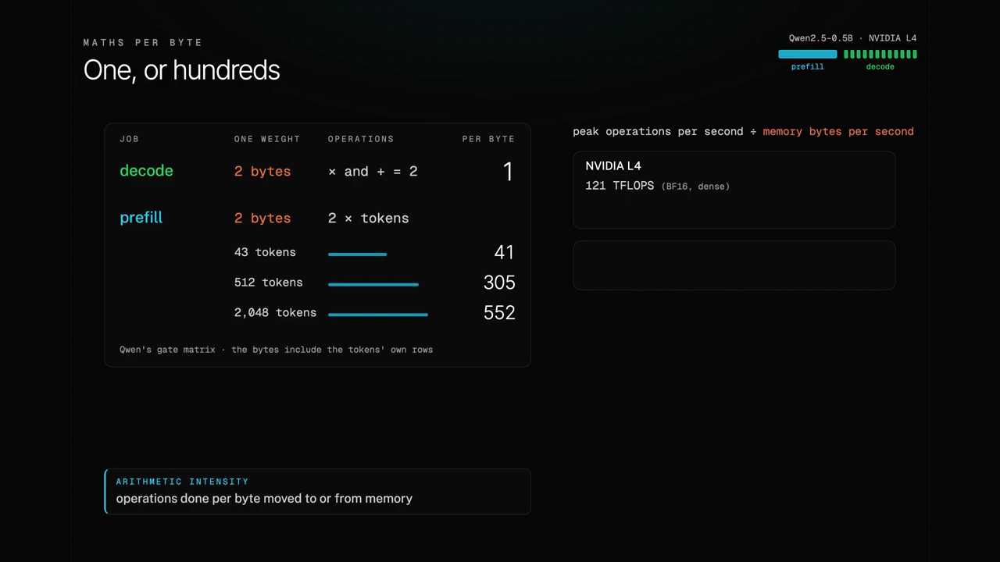

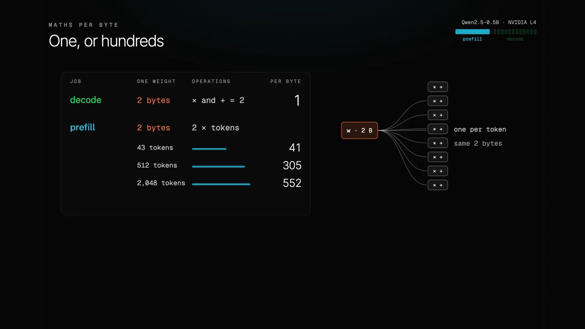

这个"每字节运算数"就是**算术强度（arithmetic intensity）**：

$$
\text{AI} = \frac{\text{FLOPs}}{\text{搬运的字节数}} \quad [\text{FLOPs/Byte}]
$$

注意视频的计数里包含了 token 自己那些行的读写（输入和输出也要进出内存），所以 43 个 token 得到的是 41 而不是 43。

芯片也有一个同量纲的数字：**峰值运算速度 ÷ 内存带宽**。视频作者的 L4 是 121 TFLOPS（BF16 稠密）和 300 GB/s，相除得到 **403 FLOPs/Byte**；H100 约为 **300**。它的含义是：在 1 个字节到达的这段时间里，芯片有足够时间做大约 400 次运算。

于是判据只有一句话：

- 工作的算术强度**低于**芯片这个数字 → 数学早早做完，然后等字节，**访存受限（memory-bound）**；
- **高于**它 → 字节到得比数学用得还快，**算力受限（compute-bound）**。

decode 是 1，比 403 低四百倍，所以单条对话的 decode 永远是访存受限。长 prompt 每字节做几百次运算，接近甚至超过 403，prefill 才是 GPU 数学单元真正忙起来的地方。[【跳转到 10:22】](https://www.youtube.com/watch?v=AdnGIEeCqhc&t=622)

这里要澄清一个容易混的名字：**memory-bound 不是"内存不够用"**。视频里那个 pod 是内存耗尽（OOMKilled），一点空间都不剩；而 decode 有大把空闲内存，它只是在**等字节到达**。

## 五、两个点放到同一张屋顶线上

横轴算术强度，纵轴可达的运算速度，双对数坐标：

- 左边是一条斜率 1 的斜线，受限于带宽：$\text{速度} = \text{AI} \times \text{带宽}$；
- 右边是一条平屋顶，受限于峰值算力；
- 两条线的交点就是拐点，L4 上是 403。

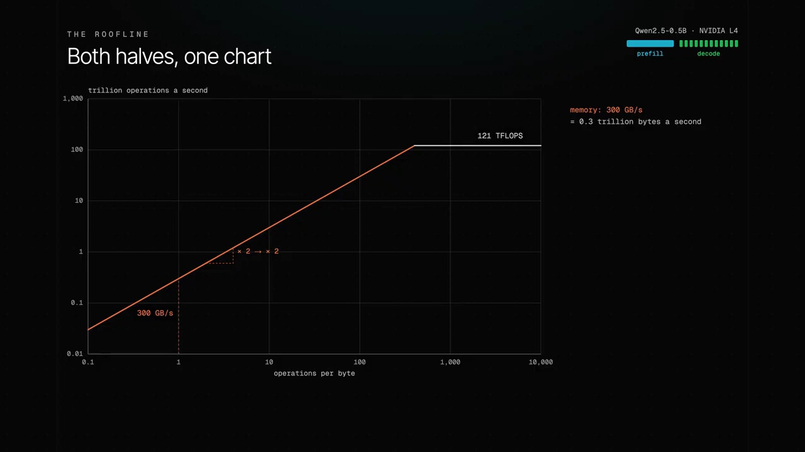

现在把两个半场放上去：

- **decode** 坐在每字节 1 次运算的位置，在斜坡的最左下角。答案写得再长也几乎不移动这个点——因为每次 decode pass 仍然只处理一个 token。
- **prefill** 的点取决于 prompt 长度。43 个 token 落在斜坡中段，仍然是访存受限；粘进两千个 token 的长日志，这个点就越过拐角爬上平屋顶，变成算力受限。

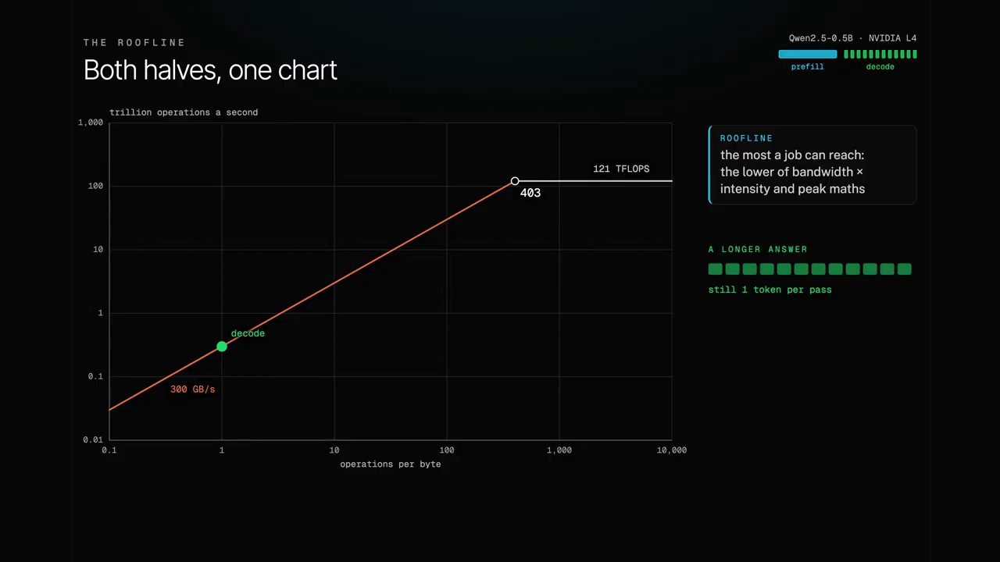

实践中很多引擎会把长 prompt 切块，比如 llama.cpp 一次取 512 个 token。每个块仍然共享一次权重读取，所以切块不会把 prefill 打回访存受限——512 个 token 的算术强度是 305，仍然在拐点附近。

## 六、实测：prefill 的时间曲线在哪里拐弯

作者在 L4 上测了不同 prompt 长度的 prefill 时间：

| prompt 长度 | prefill 耗时 |
| --- | --- |
| 1 token | 5.09 ms |
| 43 tokens | 6.80 ms |
| 512 tokens | 15.15 ms |
| 2048 tokens | 63.33 ms |

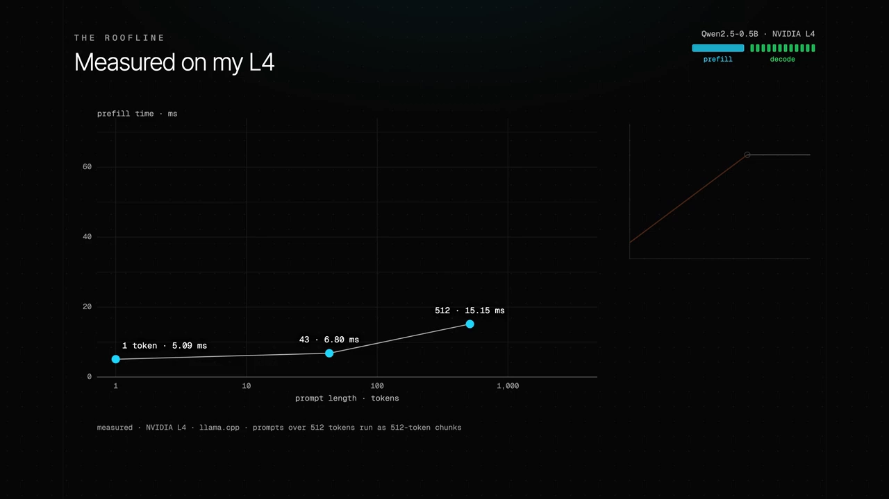

这张图的信息量很大：

1. **短 prompt 时时间几乎不涨**。43 倍的 token 只多花了约三分之一的时间，因为这段时间主要花在"把权重取进来"上，每多一个 token 都共享同一次取数。
2. **然后曲线开始上翘**。从 500 到 2000 个 token，每多一个 token 大约多花 31 微秒的数学时间——这就是 compute-bound 段的斜率。
3. **转折点远早于理论拐角**。图上的拐角假设 L4 跑满 121 TFLOPS，但跑整个模型时它只达到不到四分之一（约 27 TFLOPS）。真实的平屋顶更低，于是与斜屋顶更早、更靠左地相交。

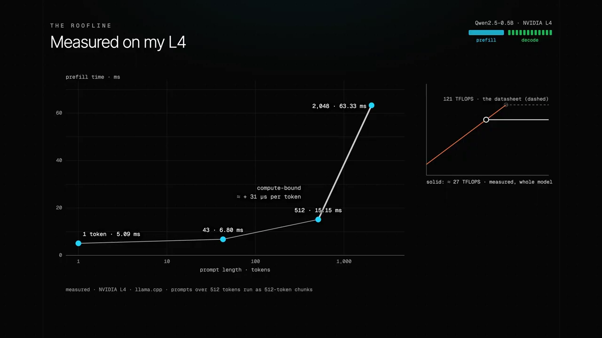

这也解释了为什么"用规格表算出来的拐点"和"实测的拐点"总对不上：规格表给的是峰值，而真实 kernel 达不到峰值，平屋顶被压低了。

## 七、150 倍是怎么来的

现在可以解开头那个谜题了：

- **写一个 token**：完整读一遍权重，加上一些固定开销，在 L4 上总共接近 **5 毫秒**；
- **读一个 prompt token**：只承担它在数学里摊到的那一份，约 **31 微秒**。

两者相除，就是那个 **150 倍**。它不是"读比写聪明"，而是"读的时候一次权重读取被很多 token 分摊，写的时候只被一个 token 分摊"。

## 八、这套语言是 Google 在 2022 年定下来的

视频最后把镜头拉回源头。2022 年 4 月 Google 发布 PaLM：5400 亿参数，用 6144 块 TPU v4 训练。PaLM 的作者还提出了 **MFU（Model FLOPs Utilisation）**——芯片最高速度中有多大比例真正用在模型的实际数学上；训练 PaLM 的 MFU 是 46%。[【跳转到 14:32】](https://www.youtube.com/watch?v=AdnGIEeCqhc&t=872)

训练是一个问题，**用 PaLM 快速回答用户**是另一个问题。一个十人团队研究如何在 64 块 TPU v4 上服务它，PaLM 三位主要作者中有两位在这个团队里。论文把每次请求的时间拆成两部分并命名："输入部分，就是我们所说的 **prefill**；输出部分，就是我们所说的 **decode**。"[【跳转到 15:22】](https://www.youtube.com/watch?v=AdnGIEeCqhc&t=922)

他们在同样的 64 块芯片上测了两个半场：

| 场景 | prefill 的算力利用率 | decode 的算力利用率 |
| --- | --- | --- |
| 64 用户同时在线 | 43% | 14% |
| 512 用户同时在线 | 76% | 33% |

decode 的利用率始终不到 prefill 的一半——这正是"decode 在等内存"的直接证据。论文还给了量化的证据：把权重从 16 位换成 8 位，要读的字节减半，64 用户 decode 的每 token 时间从约 37 毫秒降到 28.5 毫秒；但 512 用户时收益小得多，因为一次权重读取已经服务了 512 个用户，瓶颈从内存转到了数学（而数学仍跑在 16 位下）。[【跳转到 16:12】](https://www.youtube.com/watch?v=AdnGIEeCqhc&t=972)

这篇论文 2022 年 11 月贴出，第二年拿到 MLSys 的 Outstanding Paper Award。今天 vLLM 和 SGLang 用的就是这两个词；其它软件用别的名字——NVIDIA TensorRT-LLM 叫 context / generation，微软的一篇论文叫 prompt / token，但半场永远是那两个。

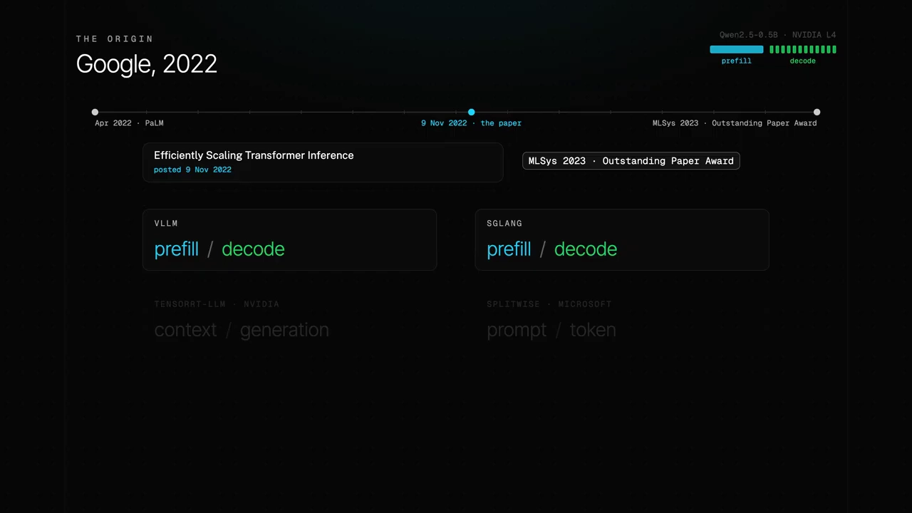

## 小结

- 一次请求分两个半场：**prefill** 一次处理整段 prompt（matmul），**decode** 一次处理一个 token（matvec）。
- 同一份权重，prefill 里被成百上千个 token 共用一次读取，decode 里只服务一个 token——这就是全部差别的来源。
- **算术强度 = FLOPs ÷ 搬运字节**：decode 约 1，43 token 的 prefill 约 41，512 token 约 305，2048 token 约 552。
- 芯片的拐点 = 峰值算力 ÷ 带宽：L4 约 403，H100 约 300。低于它访存受限，高于它算力受限。
- 屋顶线上，decode 钉在斜坡最左下角；prefill 随 prompt 变长往上爬，长 prompt 爬上平屋顶。
- L4 实测：写一个 token 约 5 ms，读一个 prompt token 约 31 µs，比值约 150。
- 真实 kernel 达不到规格表峰值（L4 实测约 27 TFLOPS），所以实测拐点比理论拐点更靠左。
- 这套 prefill/decode 的语言与利用率数字来自 2022 年 Google 的 PaLM 推理论文，今天已是 vLLM、SGLang 等引擎的通用词汇。

## 关键术语速查

| 术语 | 一句话解释 |
| --- | --- |
| prefill | 把整段 prompt 当成一个矩阵块一次算完，产出第一个 token，并填好 KV cache |
| decode | 一次只处理一个新 token 的自回归循环，每次都要重读全部权重 |
| KV cache | prefill 时为每个 prompt token 存下的 key/value，让 decode 不必重算历史 |
| matvec / `gemv` | 一行乘一个矩阵，每个权重只用一次，算术强度约 1 |
| matmul / `gemm` | 一个行块乘一个矩阵，每个权重被所有行复用 |
| 算术强度 | 每搬运 1 字节做了多少次运算，单位 FLOPs/Byte |
| 拐点（ridge point） | 芯片峰值算力除以带宽，L4 约 403、H100 约 300 |
| 访存受限 | 算术强度低于拐点，数学单元在等数据；decode 属于这一类 |
| 算力受限 | 算术强度高于拐点，带宽供得上、数学单元排满；长 prefill 属于这一类 |
| MFU | 实际 FLOP/s 与峰值的比值，只统计模型数学上必需的运算 |