# 动手算一遍屋顶线：从 H100 规格表到本地 CPU 实测

> 视频来源：[Day 06 | Why Is LLM Decoding Memory-Bound? | Roofline Model & Operations-to-Byte Ratio](https://www.youtube.com/watch?v=GtyN14RPSH8)（YouTube · ThiruPhdAIResearch）｜时长约 67 分钟
> 导读：这是同一支课的后半段（约 21:45 之后）的实操部分：用 numpy 和 matplotlib 把屋顶线从公式变成能跑的代码——先建芯片规格表、再写算术强度函数、然后把六个算子画到图上，最后在自己电脑的 CPU 上测出同一条曲线。理论推导见《Linear 与 Attention 的屋顶线落点》一篇；本文只讲"怎么算、怎么画、怎么验证"。

## 本讲要解决的核心问题（SCQA）

**背景**：屋顶线的公式只有两条——算术强度等于 FLOPs 除以字节数，拐点等于峰值算力除以带宽。看一遍就懂。

**冲突**：但真拿到一个算子，你还是不知道该填哪几个数；算出来的点该画在哪、离拐点多远，也没有手感。更麻烦的是，大多数人手上没有 H100，没法验证。

**疑问**：能不能用一台普通笔记本，把"判断一个 kernel 是算力受限还是访存受限"这件事完整跑一遍？

**回答（中心思想）**：可以。整件事只需要三样东西：**一张芯片规格表**（峰值算力、带宽）、**一个算术强度函数**（数 FLOPs、数字节）、**一张双对数图**（斜线加平顶）。把这三样写成几十行 Python，就能给任意算子定位；再把同一套代码里的"芯片"换成 CPU，你会看到形状完全相同的曲线——**屋顶线描述的是物理，不是某种硬件。**

## 一、先建一张芯片规格表

写代码之前先明确两个硬件指标：[【跳转到 26:38】](https://www.youtube.com/watch?v=GtyN14RPSH8&t=1598)

- **峰值 FLOPs**：处理器每秒能做多少次浮点运算；
- **内存带宽**：数据从内存搬到处理单元有多快，单位字节/秒。

它们的关系就是拐点：

$$
\text{ridge} = \frac{\text{峰值 FLOPs}}{\text{带宽}}
$$

notebook 里把三块卡的公开规格写成字典（稠密 FP16/BF16 张量吞吐 + HBM 带宽）：

```python
chips = {
    "A100 80GB": {"peak": 312e12, "bw": 2.039e12},
    "H100 SXM":  {"peak": 989e12, "bw": 3.35e12},
    "H200":      {"peak": 989e12, "bw": 4.8e12},
}
for name, c in chips.items():
    c["ridge"] = c["peak"] / c["bw"]
```

跑出来是：

| 芯片 | 峰值 TFLOPS | 带宽 TB/s | 拐点 FLOP/byte |
| --- | --- | --- | --- |
| A100 80GB | 312 | 2.04 | 153 |
| H100 SXM | 989 | 3.35 | 295 |
| H200 | 989 | 4.80 | 206 |

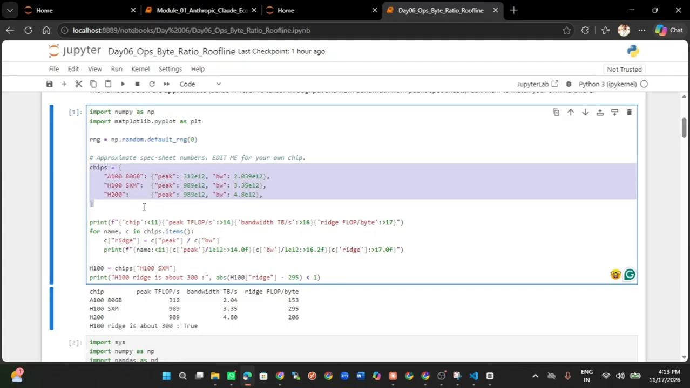

跑出来 H100 的拐点约 295，和手算一致。[【跳转到 27:53】](https://www.youtube.com/watch?v=GtyN14RPSH8&t=1673)

注意 H200 的拐点比 H100 **低**：算力一样，但带宽更高，所以它相对自己的算力能搬更多数据，也就更容易被喂饱。视频还点出一个趋势：从 A100 到 H100，算力的增长速度远快于带宽，所以拐点从 153 抬到 295——**芯片越来越难被喂饱**。[【跳转到 08:16】](https://www.youtube.com/watch?v=GtyN14RPSH8&t=496)

## 二、一个函数判断"哪种受限"

接下来是最核心的几行。先写算术强度函数：输入 $M$ 行、维度 $d$、每权重字节数 $w$、每激活字节数 $a$，返回 FLOPs 除以字节数。

```python
def matmul_intensity(M, d=4096, w_bytes=2.0, a_bytes=2.0):
    flops  = 2 * M * d * d
    nbytes = w_bytes * d * d + a_bytes * 2 * M * d   # 权重 + 输入 + 输出
    return flops / nbytes

def attainable(I, chip):
    return min(chip["peak"], I * chip["bw"])          # 两块天花板取小
```

`attainable` 就是屋顶线的数学形式：[【跳转到 34:48】](https://www.youtube.com/watch?v=GtyN14RPSH8&t=2088)**可达速度 = min(峰值算力, 算术强度 × 带宽)**。拐点左边由带宽决定，右边由算力决定。

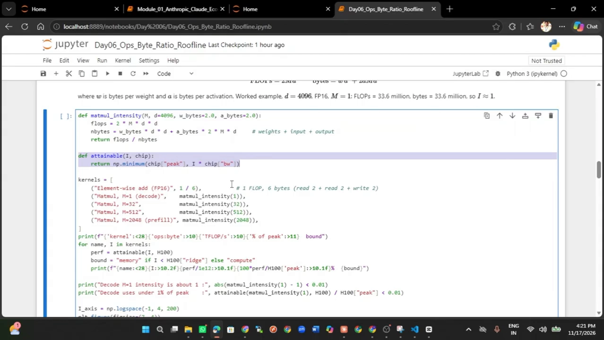

把六个典型算子代进去，得到这张表：

| kernel | 每字节运算数 | 可达 TFLOPS | 占峰值 | 判定 |
| --- | --- | --- | --- | --- |
| 逐元素加法（FP16） | 0.17 | 0.6 | 0.1% | memory |
| Matmul, M=1（decode） | 1.00 | 3.3 | 0.3% | memory |
| Matmul, M=32 | 31.51 | 105.6 | 10.7% | memory |
| Matmul, M=512 | 409.60 | 989.0 | 100.0% | compute |
| Matmul, M=2048（prefill） | 1024.00 | 989.0 | 100.0% | compute |

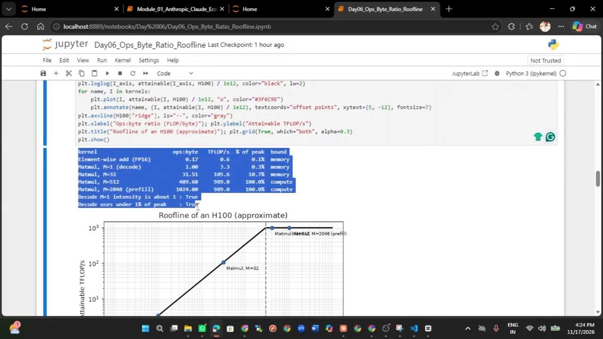

这张表把前面几篇的结论一次性钉死了：[【跳转到 37:28】](https://www.youtube.com/watch?v=GtyN14RPSH8&t=2248)

- **逐元素加法**永远在斜坡最左下角，它只做 1 次加法却要读写 6 字节；
- **batch 1 的 decode** 是 $I=1$，只能跑到峰值的 0.3%；
- **batch 32 的 decode** 是 $I=31.5$，仍然在斜坡上；
- **batch 512 与 2048 token 的 prefill** 已经贴上平屋顶，算力受限。

## 三、把点画到屋顶线上

有了 `attainable`，画图就是三行：

```python
I_axis = np.logspace(-1, 4, 200)
plt.loglog(I_axis, attainable(I_axis, H100) / 1e12)   # 屋顶线本身
plt.axvline(H100["ridge"], ls="--")                   # 拐点竖线
plt.scatter(I_list, perf_list)                        # 各个算子
```

横轴算术强度、纵轴可达 TFLOPS，两个轴都取对数，于是：

- 斜线段的斜率是 1（速度正比于算术强度）；
- 平屋顶是一条水平线（峰值算力）；
- 竖直虚线是拐点。

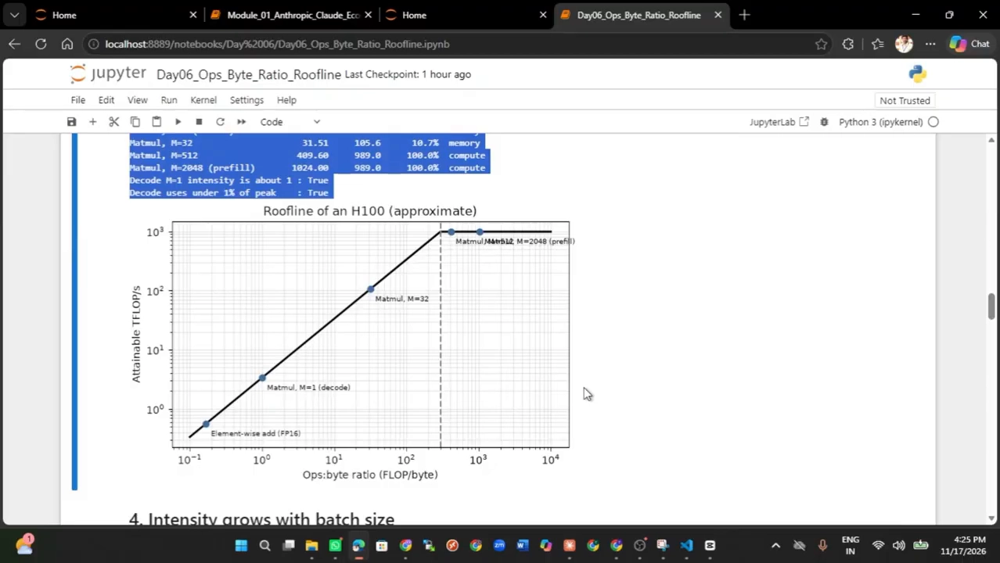

这张图的价值不在好看，而在于它把"优化方向"变成了一句可执行的话：[【跳转到 38:48】](https://www.youtube.com/watch?v=GtyN14RPSH8&t=2328)**点在斜坡上，就去减少数据搬运或提高复用；点在平顶上，就去提升计算效率。** 盲目调 kernel 之前先定位，能省掉大量试错。

## 四、让算术强度随 batch"长出来"

为什么 batch 能提高算术强度？[【跳转到 40:26】](https://www.youtube.com/watch?v=GtyN14RPSH8&t=2426)因为**权重只读一次，却被 $M$ 个请求共用**。公式是：

$$
I(M) = \frac{2Md^2}{w\,d^2 + 4Md} \approx \frac{2M}{w}
$$

FP16 下 $w=2$，所以 $I \approx M$；INT4 下 $w=0.5$，所以 $I \approx 4M$——**同样的 batch，INT4 的算术强度是 FP16 的四倍**，于是它用更小的 batch 就能越过拐点。

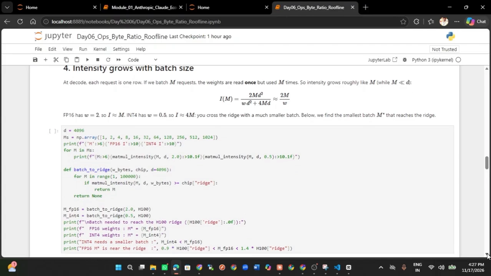

跑出来的结果：

| $M$ | FP16 算术强度 | INT4 算术强度 |
| --- | --- | --- |
| 1 | 1.0 | 4.0 |
| 8 | 8.0 | 31.5 |
| 32 | 31.5 | 120.5 |
| 128 | 120.5 | 409.6 |
| 512 | 409.6 | 1024.0 |
| 1024 | 682.7 | 1365.3 |

达到 H100 拐点（295）所需的最小 batch：**FP16 是 345，INT4 是 87**。[【跳转到 42:31】](https://www.youtube.com/watch?v=GtyN14RPSH8&t=2551)这就是"量化能把拐点往左推"的定量版本。

但要记住这是一个理想化计算：真实的 INT4 还有量化元数据、打包与解包开销，这些工程细节会把收益打折扣。

## 五、同一层，prefill 与 decode 只是 $M$ 不同

这是全篇最省力的一个洞察：[【跳转到 43:21】](https://www.youtube.com/watch?v=GtyN14RPSH8&t=2601)**prefill 和 decode 用的是同一个公式，只是 $M$ 的含义不同。**

- **decode**：$M$ = batch 里同时处理的请求数（通常几十）；
- **prefill**：$M$ = 一起处理的 prompt token 数（通常上千）。

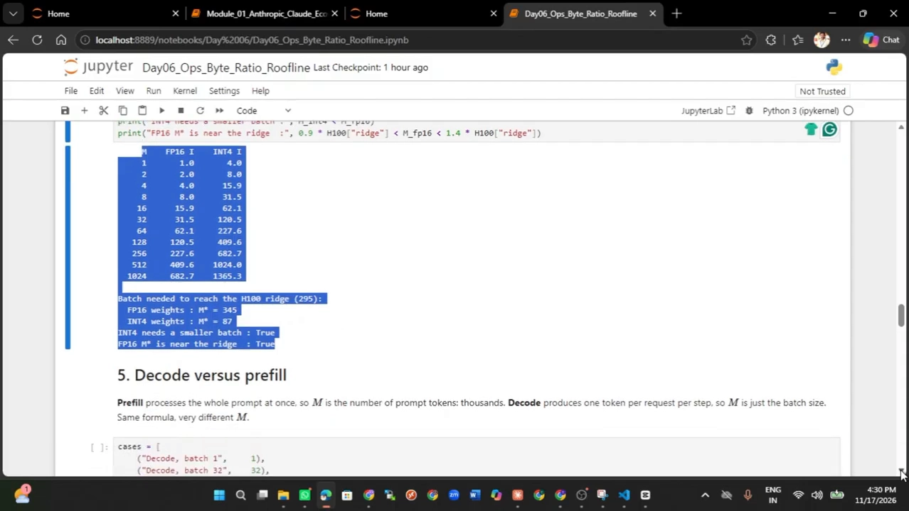

代入具体值：

| 场景 | $M$ | 算术强度 | 判定 |
| --- | --- | --- | --- |
| decode, batch 1 | 1 | 1.0 | 访存受限 |
| decode, batch 32 | 32 | 31.5 | 访存受限 |
| decode, batch 256 | 256 | 227.6 | 仍低于 295 |
| prefill, 512 token | 512 | 409.6 | 算力受限 |

所以"prefill 是算力受限、decode 是访存受限"这句话，在代码里就是同一个函数换了 $M$。[【跳转到 45:01】](https://www.youtube.com/watch?v=GtyN14RPSH8&t=2701)视频也提醒：这个矩阵乘模型并不能模拟每一次传输，真实的 prefill/decode 还取决于 attention 的序列长度、kernel 实现和硬件。

## 六、KV cache：batching 帮不到 attention

到了 attention，故事变了。KV cache 是**每条序列私有**的，batch 不能复用。notebook 用 Llama-3 8B 的形状算：

```python
n_layers, n_q, n_kv, d_head = 32, 32, 8, 128
L = 4096
kv_per_token = 2 * n_layers * n_kv * d_head * 2      # K 和 V，FP16
kv_per_seq   = kv_per_token * L
attn_flops   = 4 * n_layers * n_q * d_head * L
```

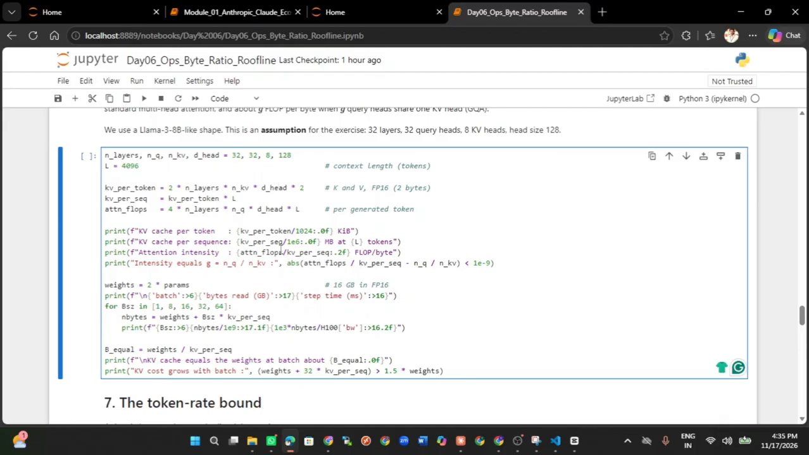

输出是：**每 token 约 128 KB，4096 token 的序列约 537 MB**。[【跳转到 50:37】](https://www.youtube.com/watch?v=GtyN14RPSH8&t=3037)

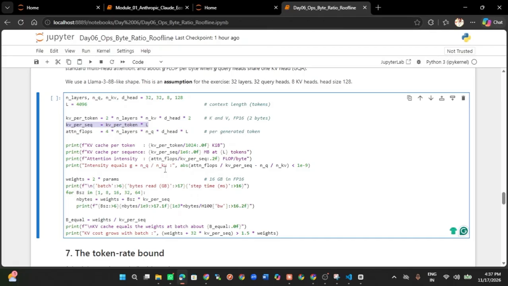而 attention 的算术强度是

$$
I_{\text{attn}} = \frac{\text{attn\_flops}}{\text{kv\_per\_seq}} = \frac{n_q}{n_{kv}} = \frac{32}{8} = 4
$$

4 远低于 295，所以**attention 在任何 batch 下都是访存受限**。把权重和 KV cache 加起来算每步读取量：batch 1 是 16.5 GB，batch 64 是 50.4 GB——大约 batch 30 时，KV cache 就和 16 GB 权重一样大了。[【跳转到 10:27】](https://www.youtube.com/watch?v=GtyN14RPSH8&t=627)

## 七、token 速率上限与量化

batch 1 的 decode 每生成一个 token 都要完整读一遍权重，所以：

$$
\text{tokens/s} \le \frac{\text{带宽}}{\text{权重字节数}} = \frac{BW}{P \times \text{每权重字节}}
$$

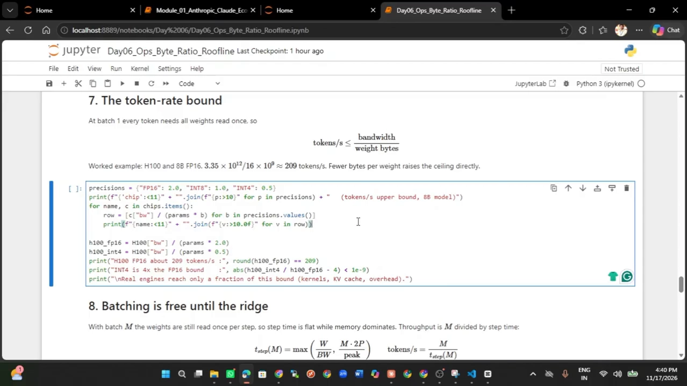

notebook 用同一个公式扫了三种精度：[【跳转到 53:07】](https://www.youtube.com/watch?v=GtyN14RPSH8&t=3187)

| 精度 | 每权重字节 | 8B 模型权重大小 | 上限 tokens/s |
| --- | --- | --- | --- |
| FP16 | 2.0 | 16 GB | 209 |
| INT8 | 1.0 | 8 GB | 419 |
| INT4 | 0.5 | 4 GB | 838 |

这是理论上界，真实引擎还要读 KV cache、有 kernel 与调度开销，所以只能达到其中一部分。但它解释了量化最直接的作用：**减少每次生成必须搬运的字节数，直接把单用户速度的天花板抬高。**

## 八、batching 的收益在哪里封顶

把 batch 加大，每步耗时取两者中更大的：

$$
t_{\text{step}}(M) = \max\left(\frac{W}{BW},\ \frac{M \cdot 2P}{\text{峰值}}\right),
\qquad
\text{tokens/s} = \frac{M}{t_{\text{step}}(M)}
$$

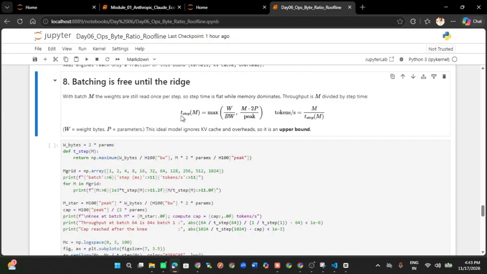

结果：[【跳转到 57:42】](https://www.youtube.com/watch?v=GtyN14RPSH8&t=3462)

| batch | 每步耗时 | 吞吐 tokens/s |
| --- | --- | --- |
| 1 | 4.78 ms | 209 |
| 64 | 4.78 ms | 13,400 |
| 512 | 8.28 ms | 约 61,812（封顶） |

拐点在 $M \approx 295$。视频把这个模型称为"理想上界"：它忽略了 KV cache 流量和时间开销，真实系统还要考虑首 token 时间（TTFT）、token 间延迟（ITL）、并发数、显存容量和用户等待。

## 九、换到 CPU 上，同一条曲线

最后一步最有说服力：把"芯片"换成自己的 CPU。[【跳转到 61:02】](https://www.youtube.com/watch?v=GtyN14RPSH8&t=3662)notebook 用 numpy 做一个 $4096 \times 4096$ 的 FP32 矩阵乘，乘以 $M$ 行输入，测时间、算 GFLOP/s。

```python
def best_time(fn, reps=5):
    times = []
    for _ in range(reps):
        t0 = time.perf_counter(); fn()
        times.append(time.perf_counter() - t0)
    return min(times)          # 取多次运行里最快的一次
```

为什么要跑五次取最快？[【跳转到 61:52】](https://www.youtube.com/watch?v=GtyN14RPSH8&t=3712)因为执行时间会受后台进程、CPU 调度影响；测量前还要先做一次预热，减少首次执行的开销。FP32 下每个权重 4 字节，所以算术强度约为 $M/2$。

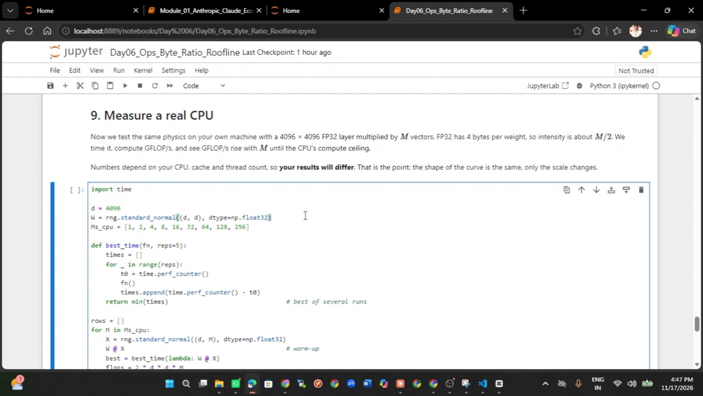

视频作者在自己 CPU 上的输出：

| $M$ | 时间 ms | GFLOP/s | ops/byte |
| --- | --- | --- | --- |
| 1 | 4.03 | 8.3 | 0.50 |
| 4 | 9.76 | 13.8 | 2.00 |
| 16 | 12.38 | 43.4 | 7.94 |
| 64 | 18.82 | 114.1 | 31.03 |
| 128 | 30.50 | 140.8 | 60.24 |
| 256 | 60.43 | 142.1 | 113.78 |

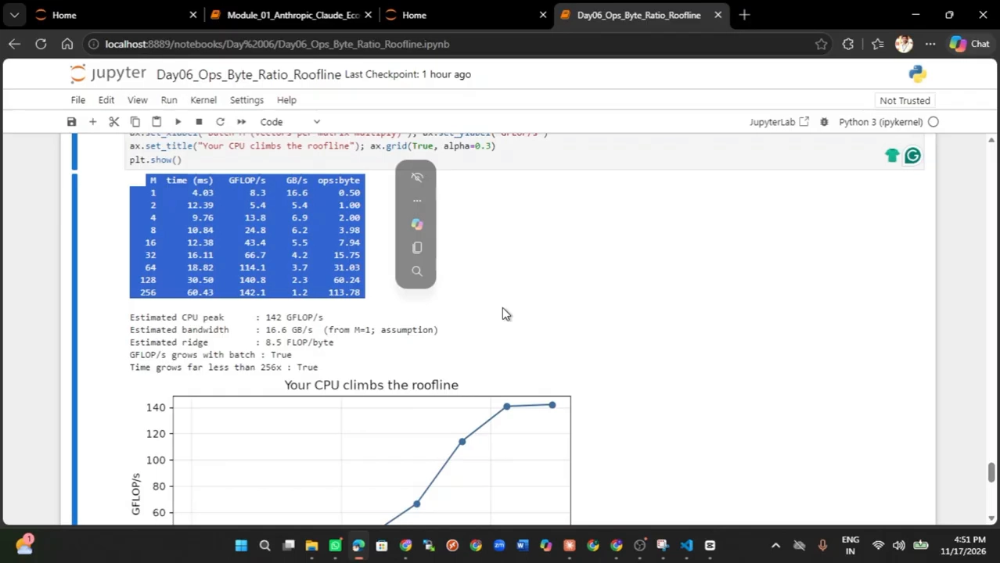

（视频前面幻灯片里给的是另一次运行的数字：$M=1$ 时 9.66 GFLOP/s、拐点约 7.5 FLOP/byte。同一条曲线，具体数值会随机器和当次运行波动。）

从这张表能读出三件事：[【跳转到 64:47】](https://www.youtube.com/watch?v=GtyN14RPSH8&t=3887)

1. **形状和 GPU 一样**：先是斜坡（$M$ 小的时候时间几乎不涨），然后贴上平屋顶（约 142 GFLOP/s）。
2. **CPU 的拐点极小**：用 $M=1$ 时的数据估出带宽约 16.6 GB/s，拐点约 **8.5 FLOP/byte**。相比 H100 的 295，CPU 只要几行就能"喂饱"——所以 GPU 需要上百行才忙起来。
3. **数字会因机器而异**：CPU 型号、cache、内存带宽、线程数、numpy 版本、BLAS 实现、后台程序都会影响结果。视频作者强调：**不要照抄别人的 benchmark，要看的是曲线的形状。**

这也是整节课想留下的东西：屋顶线不是某块 GPU 的说明书，而是"算力与数据搬运的竞争关系"的一张通用地图。换硬件，坐标轴的刻度变了，形状不变。

## 小结

- 判断一个算子只需要三样：芯片规格（峰值、带宽）、算术强度函数、一张双对数图。
- **可达速度 = min(峰值算力, 算术强度 × 带宽)**，这就是屋顶线的数学形式。
- H100 上六个算子的落点：逐元素加 0.17、decode 1.0、batch 32 是 31.5、batch 512 是 409.6、prefill 2048 是 1024。
- 算术强度 $I(M) \approx 2M/w$：FP16 约等于 $M$，INT4 约等于 $4M$，所以量化把拐点从 345 行推到 87 行。
- prefill 与 decode 用同一个公式，只是 $M$ 的含义不同（prompt token 数 vs batch）。
- attention 的算术强度约等于 GQA 分组比 $n_q/n_{kv}=4$，与 batch 无关，永远访存受限。
- token 速率上限 = 带宽 ÷ 权重字节：8B 模型 FP16 约 209、INT8 约 419、INT4 约 838 tokens/s。
- batching 在拐点（$M \approx 295$）前几乎免费，之后吞吐封顶。
- 同一套代码换到 CPU 上，曲线形状不变，只是拐点从 295 变成约 8.5 FLOP/byte。

## 关键术语速查

| 术语 | 一句话解释 |
| --- | --- |
| 拐点 / ridge | 峰值算力除以带宽，是访存受限与算力受限的分界 |
| 算术强度 | FLOPs 除以搬运字节数，屋顶线的横坐标 |
| 可达性能 | min(峰值算力, 算术强度 × 带宽)，屋顶线的纵坐标 |
| $M$ | 矩阵乘的行数：decode 时是 batch，prefill 时是 prompt token 数 |
| `batch_to_ridge` | 找出让算术强度刚好达到拐点的最小 batch |
| KV cache | 每条序列私有的 key/value 缓存，attention 访存受限的根源 |
| GQA | 多个 query head 共享一个 KV head，分组比决定 attention 的算术强度 |
| 预热（warm-up） | 测量前先跑一次，避免首次执行的额外开销污染结果 |
| ops/byte | 即算术强度，notebook 表格里的列名 |