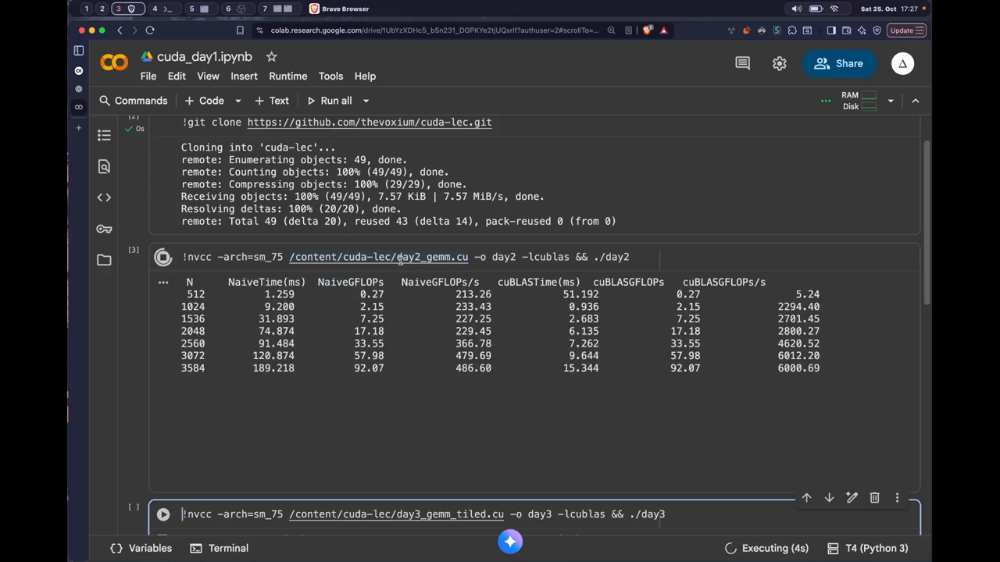
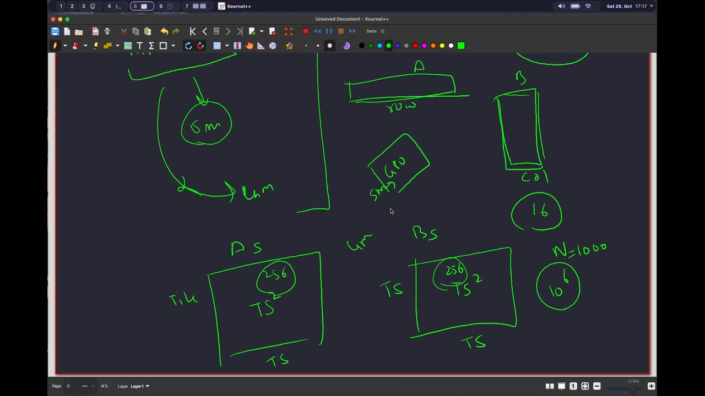
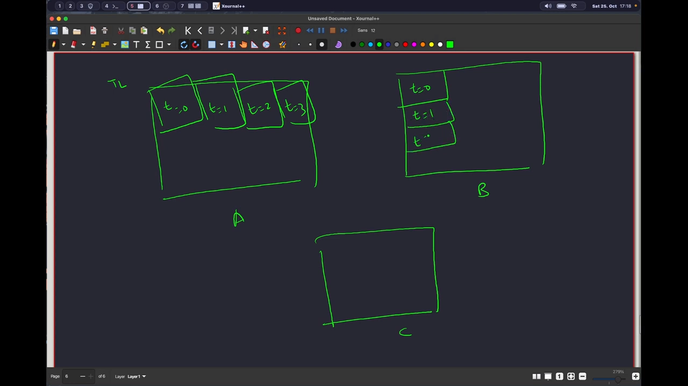
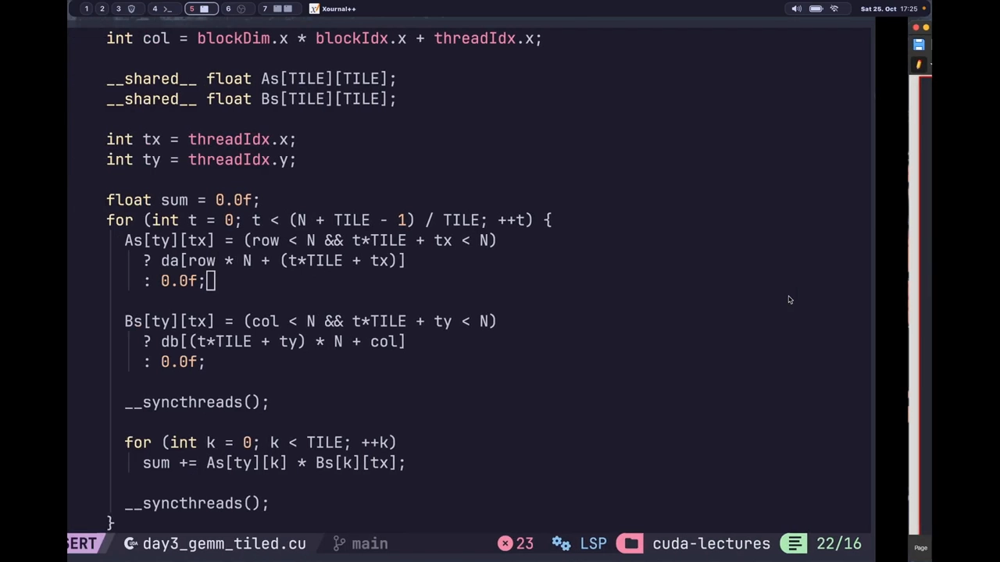
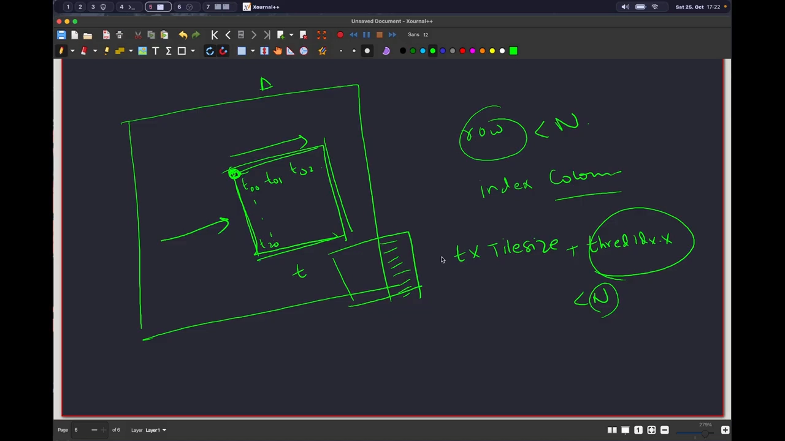
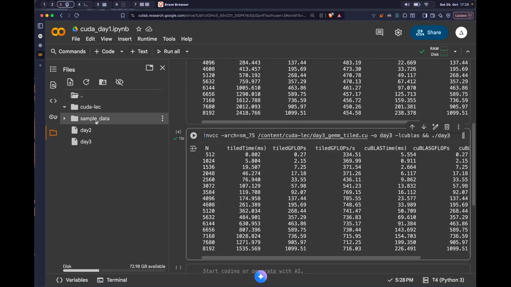
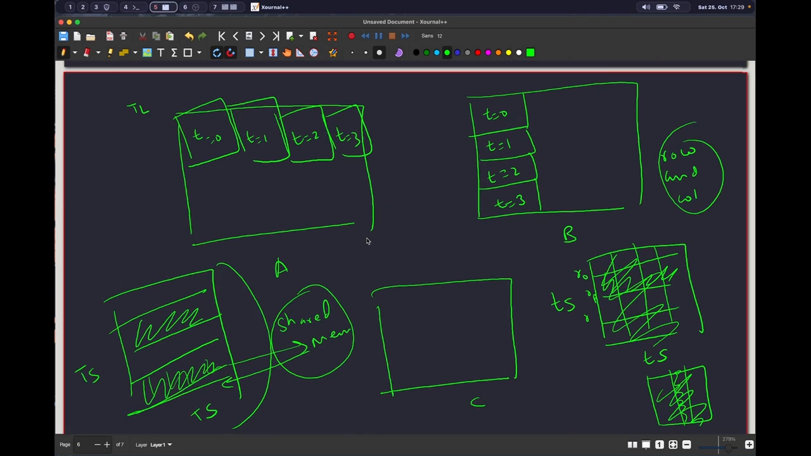

# 用 shared memory 分块把 GEMM 提速：从 454 到 716 GFLOP/s 的 Tiled Matmul 实战

> 视频来源：[CUDA Programming Part 3 - Tiled Matrix Multiplication & Shared Memory Basics](https://www.youtube.com/watch?v=mnSzkRI-xWg)（YouTube · Sloppy Code）｜时长约 30.3 分钟
> 导读：这是「CUDA 编程系列」第三天的一集，接着前一天的朴素矩阵乘法往下做。讲者全程只用纸笔加一个 Colab 代码窗口，把 `__shared__` 分块 kernel 的每个下标、每次边界检查、两个 `__syncthreads()` 都拆开讲了一遍，最后用一张实测表对比朴素版、分块版和 cuBLAS。本文按「先算清朴素版为什么慢 → 再用 shared memory 分块 → 再逐行读代码 → 最后看实测」的顺序复述，并把讲者口述的数字与画面里的表格对齐。

## 本讲要解决的核心问题（SCQA）

**背景**：矩阵乘法 $C = A \times B$ 是最好并行的算子之一——$C$ 的每个元素都独立，一个线程算一个元素，$N \times N$ 的矩阵开 $N^2$ 个线程就完事了。这样写出来的 kernel 能跑，而且「看起来」已经把 GPU 喂满了。

**冲突**：可它比 cuBLAS 慢大约 10 倍。原因不在算力，而在访存：算一个 $C$ 元素要读 $A$ 的一整行和 $B$ 的一整列，这些元素全在 global memory 里，而同一个 $A$ 元素会被同一行的所有线程反复读、同一个 $B$ 元素会被同一列的所有线程反复读。$N^2$ 个线程一共要发 $2N^3$ 次 global 读请求，而真正需要的数据只有 $2N^2$ 个。

**疑问**：能不能让「同一批数据」只从 global memory 读一次，之后大家从片上取？

**回答（中心思想）**：能——用 `__shared__` 把 $A$、$B$ 各切出一块 $TILE \times TILE$ 的小块搬进 shared memory，一个 block 的所有线程共用这一小块，算完再滑到下一块。这样 global 读次数从 $2N^3$ 降到 $2N^3 / TILE$；代价是每次换块要一次 `__syncthreads()` 保证「搬完了再算」。实测 $N=8192$、$TILE=16$ 时吞吐从 454 涨到 716 GFLOP/s，$TILE=32$ 时约为朴素版的两倍。

## 一、朴素 kernel 的瓶颈：内层循环在反复敲 global memory

### 1.1 一个线程算一个 C 元素

先把朴素版的映射关系复习清楚，因为后面所有优化都建立在它上面。用二维 grid + 二维 block 启动：

```cuda
__global__ void gemmNaive(float* da, float* db, float* dc, int N) {
    int row = blockDim.y * blockIdx.y + threadIdx.y;   // 算 C 的哪一行
    int col = blockDim.x * blockIdx.x + threadIdx.x;   // 算 C 的哪一列
    float sum = 0.0f;
    for (int k = 0; k < N; ++k) {
        sum += da[row * N + k] * db[k * N + col];
    }
    dc[row * N + col] = sum;
}
```

`row` 和 `col` 这两个值干了两件事：既指出「这个线程负责 $C[row][col]$」，也顺带指出「要用 $A$ 的第 `row` 行」和「$B$ 的第 `col` 列」。讲者用 2×2 的 grid、2×2 的 block 手算过一遍：block 01 里的线程 t00 算出 `row=0`、`col=2`，于是它负责 $C[0][2]$；t11 算出 `row=1`、`col=3`，负责 $C[1][3]$。[【跳转到 03:50】](https://www.youtube.com/watch?v=mnSzkRI-xWg&t=230)

### 1.2 读放大：$N^2$ 个线程发出 $2N^3$ 次 global 读

内层循环 `k` 从 0 走到 $N$，每一轮读两个元素：`da[row*N+k]` 和 `db[k*N+col]`。所以

$$
\text{朴素版 global 读次数} = N^2 \times 2N = 2N^3
$$

而 $A$、$B$ 加起来只有 $2N^2$ 个元素。也就是说每个元素平均被从 global memory 读了 $N$ 次——$N=1000$ 时就是读了 1000 遍。讲者强调的就是这一点：这些元素「被非常非常频繁地访问」，而 global memory 的特点是**容量大但读写慢**。[【跳转到 06:40】](https://www.youtube.com/watch?v=mnSzkRI-xWg&t=400)

### 1.3 实测差距：454 对约 4000 GFLOP/s

讲者前一天已经跑过一组基准，画面里的表格（$N$ 从 512 到 8192）显示：$N=8192$ 时朴素版耗时 2418.766 ms、454.58 GFLOP/s；cuBLAS 耗时 226.491 ms，按同一张表的总运算量 1099.51 GFLOP 折算约 4.8 TFLOP/s（讲者口述为「约 4000 GFLOP/s」，量级一致）。**大约 10 倍差距**，这就是本讲要缩小的目标。[【跳转到 08:20】](https://www.youtube.com/watch?v=mnSzkRI-xWg&t=500)



顺带说明一下表里两列容易看混的指标：`GFLOPs` 这一列是**总共做了多少浮点运算**（$2N^3$，$N=8192$ 时恒为 1099.51），`GFLOPs/s` 才是**吞吐**。同一张表里两个数都出现，是因为前者由问题规模决定、不随实现变化，后者才反映实现好坏。

## 二、shared memory：块内共享的片上暂存区

### 2.1 每个 block 一块，块内所有线程都能访问

shared memory 是**按 block 分配**的：每个 block 有自己的（逻辑上独立的）一块 shared memory，这个 block 里的 $TILE^2$ 个线程都能读写它，别的 block 看不到。这一点是分块能成立的前提——正因为「同一个 block 的线程共享」，我们才有资格把一份数据搬进来给全块复用。[【跳转到 09:10】](https://www.youtube.com/watch?v=mnSzkRI-xWg&t=550)

### 2.2 小，但快 10 到 100 倍

讲者的原话是：shared memory 的带宽很低、能存的元素比 global memory 少得多，但**读它的时间极短**，视 kernel 结构和 GPU 型号，大约快 10 到 100 倍；他特别说明「很多资料写 100 倍，我自己没验证过」，所以这里保守理解成「快一到两个数量级」。

原因和 CPU 的 cache 层级一样：离计算单元越近，访问越快。global memory 在片外（DRAM），shared memory 在 SM 上，和 L1、寄存器是同一个方向的东西。[【跳转到 10:00】](https://www.youtube.com/watch?v=mnSzkRI-xWg&t=600)

### 2.3 容量对比：256 个元素对 $10^6$ 个元素

讲者在纸上画了这张对比图：$N=1000$ 时 global memory 里躺着 $10^6$ 个元素，而一个 block 的 shared memory 里只放两个 $TILE \times TILE$ 的数组，$TILE=16$ 时每个 256 个元素。**用极小的容量换取极低的延迟**，这就是全部的交易。



## 三、分块：把 global 读次数除以 TILE

### 3.1 把 C 切成 tile，一个 block 负责一个 tile

tiling（分块）的思路很直白：**不再让一个线程单干一个 C 元素、各自去 global 里捞数据，而是让一个 block 负责 C 的一小块 $TILE \times TILE$，先把这块计算需要的 A、B 数据整体搬进 shared memory，再让块内线程从 shared 里取。**

讲者强调一个工程约定：**把 tile 大小设成和 block 大小相同**（block 是 $TILE \times TILE$ 个线程），这样「哪个线程搬哪个元素」的映射最好想、也最好写。[【跳转到 11:15】](https://www.youtube.com/watch?v=mnSzkRI-xWg&t=675)

### 3.2 滑动：A 横着滑，B 竖着滑

计算 $C$ 的一个 tile 需要 $A$ 的一整条「横带」和 $B$ 的一整条「竖带」。所以外层循环变量 $t$ 从 0 走到 $\lceil N / TILE \rceil - 1$，每一轮：

- 从 $A$ 取出第 $t$ 个横向 tile（列区间 $[t \cdot TILE,\ t \cdot TILE + TILE)$，行区间就是本 block 负责的那几行）；
- 从 $B$ 取出第 $t$ 个纵向 tile（行区间 $[t \cdot TILE,\ t \cdot TILE + TILE)$，列区间是本 block 负责的那几列）。

也就是说 **$A$ 的 tile 从左往右滑，$B$ 的 tile 从上往下滑**，两者同步推进，第 $t$ 轮的 $A$ 块和第 $t$ 轮的 $B$ 块正好能对上 $k$ 的那一段。[【跳转到 18:09】](https://www.youtube.com/watch?v=mnSzkRI-xWg&t=1089)



### 3.3 一个 tile 被 TILE 个线程复用

为什么值得搬？因为**搬一次，全块都用**。讲者的说法是：某个线程可能只用到这个 tile 的某一行，但同一个 block 里另一个线程要用这个 tile 的最后一行；既然这些元素已经在 shared memory 里了，后面所有线程都不用再回 global memory 取，直接读 shared 就行。[【跳转到 19:24】](https://www.youtube.com/watch?v=mnSzkRI-xWg&t=1164)

### 3.4 把账算清楚

设矩阵是 $N \times N$，tile 边长 $TILE$，则 grid 是 $\lceil N/TILE \rceil \times \lceil N/TILE \rceil$ 个 block（忽略向上取整的零头）：

- 每个 block 每轮搬 $2 \cdot TILE^2$ 个元素，共 $\lceil N/TILE \rceil$ 轮，所以每个 block 的 global 读次数约 $2N \cdot TILE$；
- 全网格共 $(N/TILE)^2$ 个 block，于是

$$
\text{分块版 global 读次数} \approx \left(\frac{N}{TILE}\right)^2 \times 2N \cdot TILE = \frac{2N^3}{TILE}
$$

对比朴素版的 $2N^3$，**global 读次数整整除以 $TILE$**。$TILE=16$ 就是少读 16 倍，$TILE=32$ 就是少读 32 倍。省下来的这些读，全部转移到了 shared memory 上——而 shared 快一到两个数量级，所以净赚。

这里也能看出 tile 大小的取舍：$TILE$ 越大省得越多，但 shared memory 占用是 $2 \cdot TILE^2$ 个 float，$TILE$ 翻倍占用翻四倍，会挤占同一个 SM 上能同时驻留的 block 数（occupancy）。这就是后面实测里 $TILE$ 从 16 调到 32 有收益、但也不是越大越好的原因。

## 四、逐行读 tiled kernel

完整 kernel 长这样（画面里的版本，`TILE` 是宏）：



### 4.1 用 `__shared__` 声明两个 tile 大小的数组

```cuda
__shared__ float As[TILE][TILE];
__shared__ float Bs[TILE][TILE];
int tx = threadIdx.x;
int ty = threadIdx.y;
```

`__shared__` 是 CUDA 的关键字，声明出来的数组位于 shared memory，生命周期跟随 block。这里声明了两个 $TILE \times TILE$ 的数组，正好对应「本 block 负责的 C tile 需要的那一条 A 横带的一小块」和「那一条 B 竖带的一小块」。紧接着把 `threadIdx.x/y` 存进 `tx/ty`，纯粹是为了后面少打几个字。[【跳转到 15:40】](https://www.youtube.com/watch?v=mnSzkRI-xWg&t=940)

### 4.2 外层 `t` 循环与两个边界检查

```cuda
for (int t = 0; t < (N + TILE - 1) / TILE; ++t) {
    As[ty][tx] = (row < N && t*TILE + tx < N)
               ? da[row * N + (t*TILE + tx)]
               : 0.0f;
    Bs[ty][tx] = (col < N && t*TILE + ty < N)
               ? db[(t*TILE + ty) * N + col]
               : 0.0f;
    ...
}
```

循环上界 `(N + TILE - 1) / TILE` 就是向上取整的 $\lceil N/TILE \rceil$。讲者举了个例子：$N=100$、$TILE=8$ 时是 $(100+8-1)/8 = 13$ 个 tile，最后一个 tile 会**越过矩阵边界**，所以必须做边界检查。[【跳转到 20:18】](https://www.youtube.com/watch?v=mnSzkRI-xWg&t=1218)

两个检查分别管什么：

- `row < N`：本 block 负责的那一行是否真的存在（网格按 tile 向上取整，最右/最下一批 block 可能整行越界）；
- `t*TILE + tx < N`：这一轮要取的列是否越界——因为 tile 是从左往右滑的，第 $t$ 个 tile 的第一列是 $t \cdot TILE$，第 `tx` 个线程负责其中第 $t \cdot TILE + tx$ 列。

越界时**写 0 而不是跳过**，这样内层乘加时越界部分的贡献自然是 0，不必再在循环里加判断。讲者专门提醒「很多人会在这里困惑 `t*TILE + tx` 是哪来的」，就是上面这条滑动逻辑。[【跳转到 21:18】](https://www.youtube.com/watch?v=mnSzkRI-xWg&t=1278)

注意 `As` 用的是 `tx` 找列、`Bs` 用的是 `ty` 找行：因为 `As` 装的是 A 的一个 tile（行由 block 决定、列由 tile 决定），`Bs` 装的是 B 的一个 tile（行由 tile 决定、列由 block 决定）。写进 shared 的下标统一是 `[ty][tx]`——**shared 数组的排布和线程的排布对齐**，这样每个线程写自己那一格，天然是合并访存。



### 4.3 第一次 `__syncthreads()`：搬完了再算

```cuda
    __syncthreads();
```

这一句是**正确性**的关键，不是性能优化。讲者的解释：如果不等，某个线程可能去读一个「别的线程还没写进去」的格子，读到的是脏数据，结果就错了。`__syncthreads()` 的语义是「本 block 的所有线程都执行到这里才继续」，所以它保证了「所有线程都把这一轮的 tile 搬进 shared」之后，才开始算。[【跳转到 25:29】](https://www.youtube.com/watch?v=mnSzkRI-xWg&t=1529)

### 4.4 内层 `k` 循环：从 shared 取数

```cuda
    for (int k = 0; k < TILE; ++k)
        sum += As[ty][k] * Bs[k][tx];
```

和朴素版几乎一样，只有两点不同：循环只走 `TILE` 步（这一段 $k$ 由本轮 tile 覆盖），数据源从 `da/db` 换成了 `As/Bs`。$A$ 的元素取 `As[ty][k]`（本线程的行、tile 内的第 k 列），$B$ 的元素取 `Bs[k][tx]`（tile 内的第 k 行、本线程的列）——**下标正好是朴素版 `da[row*N+k]`、`db[k*N+col]` 去掉跨行跨列的偏移后的局部版本**。[【跳转到 26:06】](https://www.youtube.com/watch?v=mnSzkRI-xWg&t=1566)

### 4.5 第二次 `__syncthreads()`：算完了再覆盖

```cuda
    __syncthreads();
}   // 回到外层 t 循环
dc[row * N + col] = sum;
```

这一句管的是**下一轮**：外层循环马上要把新的 tile 覆盖写进 `As/Bs`，如果还有线程在从 shared 里读上一轮的数据，就会读到被覆盖的值。所以「算完」也要同步一次。两个 `__syncthreads()` 一前一后把「搬」和「算」两个阶段隔开，是这类分块 kernel 的标准骨架。[【跳转到 26:31】](https://www.youtube.com/watch?v=mnSzkRI-xWg&t=1591)

### 4.6 启动配置：block 是 $TILE \times TILE$，grid 是 $\lceil N/TILE \rceil$ 见方

```cuda
dim3 threadsPerBlock(TILE, TILE);
dim3 blocksPerGrid((N + TILE - 1) / TILE, (N + TILE - 1) / TILE);
gemmTiled<<<blocksPerGrid, threadsPerBlock>>>(da, db, dc, N);
```

其余代码和朴素版完全相同，只有这两行跟着 tile 改。讲者说这也是把 tile 大小设成 block 大小的好处：**一个 block 的线程数正好等于一个 tile 的元素数，一个线程负责搬一格**。[【跳转到 27:19】](https://www.youtube.com/watch?v=mnSzkRI-xWg&t=1639)

## 五、实测：$TILE=16$ 到 716 GFLOP/s，$TILE=32$ 约两倍于朴素版

讲者在 Colab 上跑同一套 $N$ 从 512 到 8192 的基准，`TILE=16` 的结果是：$N=8192$ 时耗时 1535.569 ms、716.03 GFLOP/s。和朴素版的 2418.766 ms 相比**快了约 1.57 倍**，讲者口述为「几乎 1.5 倍提升」。[【跳转到 28:08】](https://www.youtube.com/watch?v=mnSzkRI-xWg&t=1688)



把 `TILE` 改成 32 再跑，讲者的评价是「相比朴素版有显著提升，**大约快两倍**」，此时距离 cuBLAS 还差约 5 倍（朴素版差 10 倍）。这个结果说明分块确实吃到了大部分收益，剩下的差距来自更细的寄存器级优化、向量化访存等汇编层面的工作——讲者也明确说了「我们不能承诺像 cuBLAS 那样高度优化到汇编指令级别，但可以把这个差距缩小」。[【跳转到 28:33】](https://www.youtube.com/watch?v=mnSzkRI-xWg&t=1713)



## 六、为什么还差 cuBLAS 五倍，以及这五倍在哪

讲者没有展开 cuBLAS 内部实现，只给了一个诚实的判断：差距来自「汇编指令级别」的优化，也就是编译器/库作者手工安排的寄存器复用、指令调度这些东西，不是靠换个 tile 大小就能追平的。他给学习者的建议也很实际——**拿笔和纸把下标算一遍**：哪个线程算 $C$ 的哪个元素、第 $t$ 轮哪个线程往 shared 的哪一格写、内层循环里 `As[ty][k]` 和 `Bs[k][tx]` 分别对应原矩阵的哪个位置。这些算通了，分块就不再是「抄一段代码」，而是可以自己推出来的东西。[【跳转到 29:45】](https://www.youtube.com/watch?v=mnSzkRI-xWg&t=1785)

## 小结

- 朴素 GEMM 慢在**读放大**：$N^2$ 个线程各读 $2N$ 个元素，总共 $2N^3$ 次 global 读，而数据只有 $2N^2$ 个。
- shared memory 是**按 block 分配、块内共享**的片上暂存区：容量小（一个 tile 几百个元素），但比 global 快一到两个数量级。
- tiling 的做法是让**一个 block 负责 C 的一个 $TILE \times TILE$ 小块**，每轮把 A 的横带、B 的竖带各搬一块进 shared，滑完 $\lceil N/TILE \rceil$ 轮。
- 收益可以算出来：global 读次数从 $2N^3$ 降到 $2N^3/TILE$；$TILE$ 越大省得越多，但 shared 占用按 $TILE^2$ 增长，会压低 occupancy。
- 两个 `__syncthreads()` 是正确性要求：**搬完才能算，算完才能覆盖**。
- 边界检查用「越界写 0」而不是跳过，让内层乘加不用再判断。
- 实测：$N=8192$、$TILE=16$ 时 716 GFLOP/s（朴素版 454，约 1.5 倍）；$TILE=32$ 约两倍于朴素版，仍比 cuBLAS 慢约 5 倍。

## 关键术语速查

| 术语 | 一句话解释 |
| --- | --- |
| global memory | 片外 DRAM，容量大、延迟高，所有线程都能访问 |
| shared memory | SM 上的片上暂存区，按 block 分配、块内线程共享，容量小但快一到两个数量级 |
| `__shared__` | CUDA 关键字，声明一个位于 shared memory 的变量/数组 |
| tiling（分块） | 把输出矩阵切成 $TILE \times TILE$ 的小块，一个 block 负责一块，数据先搬进 shared 再算 |
| `__syncthreads()` | block 级栅栏，所有线程都到达后才继续；用来隔开「搬数据」和「算数据」两个阶段 |
| 读放大 | 同一份数据被多个线程反复从 global memory 读取造成的冗余流量 |
| GFLOPs 与 GFLOPs/s | 前者是总运算量（$2N^3$），后者是吞吐；看性能要比后者 |
| occupancy | 一个 SM 上同时驻留的活跃 warp 数占上限的比例，受 shared memory 和寄存器用量约束 |