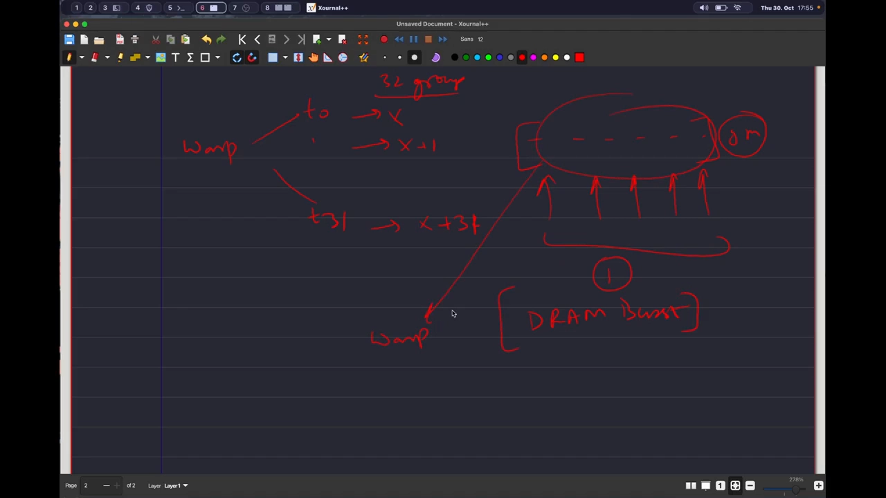
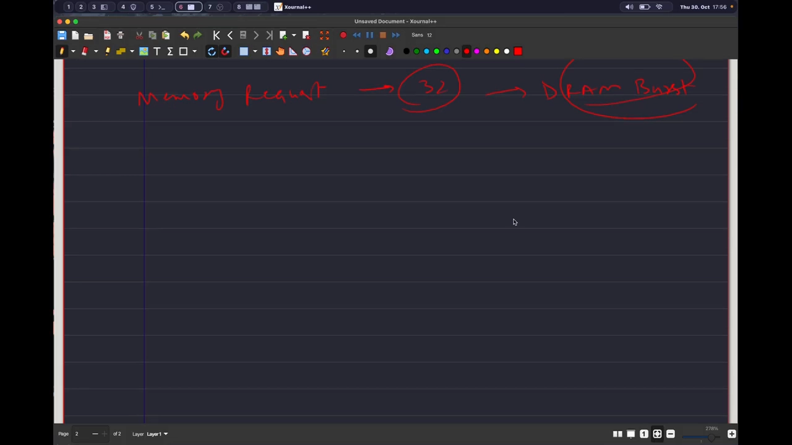
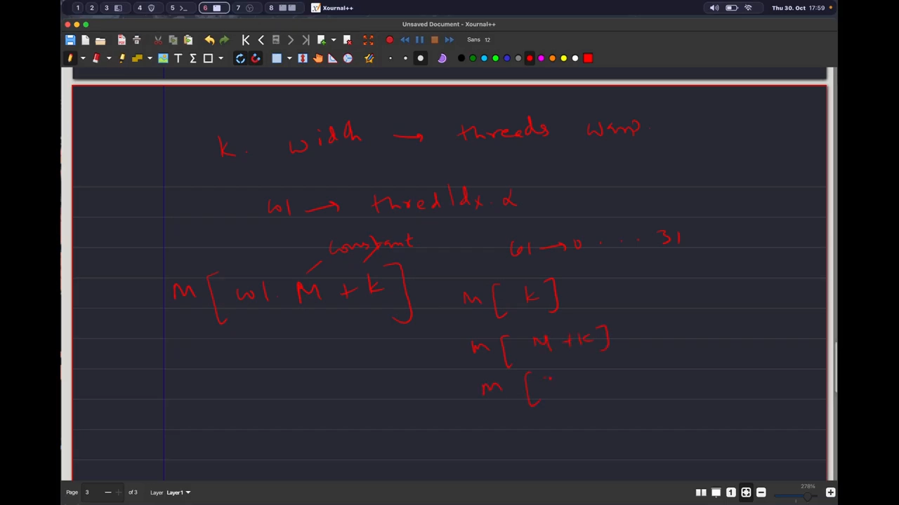
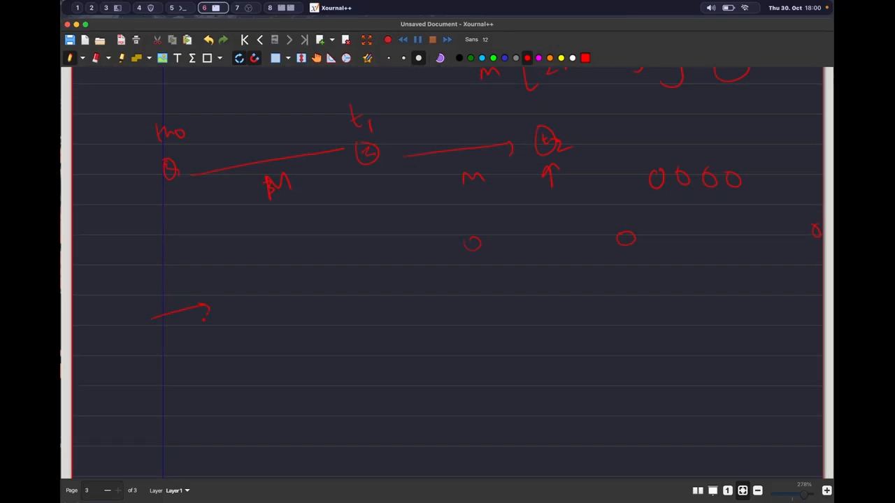
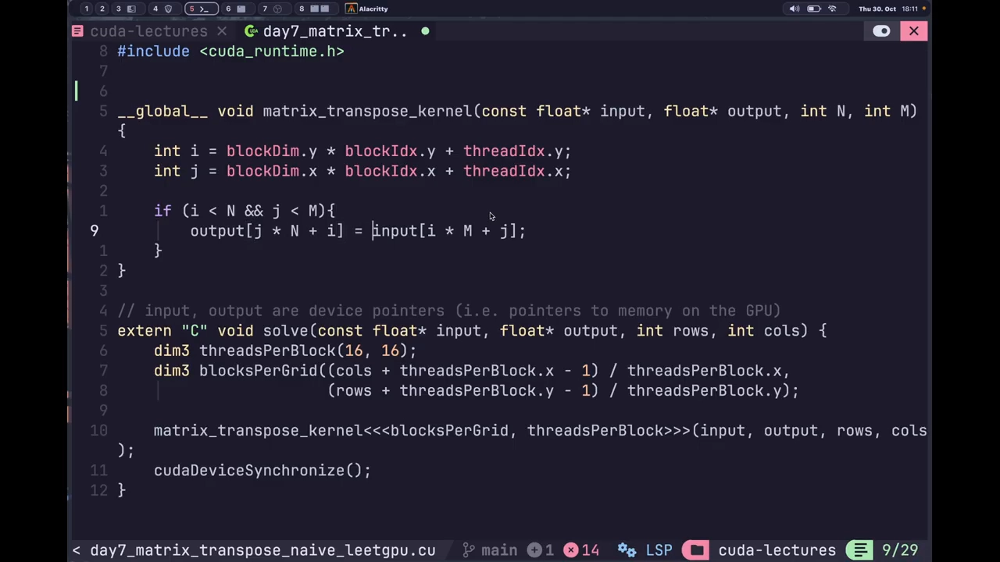
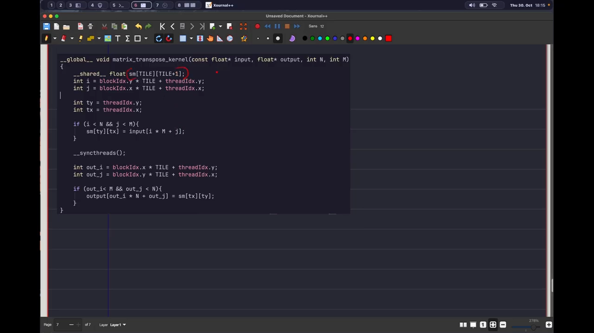

# 矩阵转置的合并访存改造：用 shared memory 做 corner turning

> 视频来源：[CUDA Programming Part 7 - Memory Coalescing, DRAM Burst, & Matrix Transpose Kernel](https://www.youtube.com/watch?v=sOvVkY7581w)（YouTube · Sloppy Code）｜时长约 28.6 分钟
> 导读：这是同一系列第七集，主题只有一个——**让 global memory 的访问变成合并的**。前半段用纸笔讲清 DRAM 为什么慢、burst 为什么能救它、以及怎么从下标表达式判断一次访存是否合并；后半段拿 LeetGPU 的矩阵转置题做实战，先写朴素版、指出「读合并但写不合并」，再用 shared memory 分块把写也变成合并。本文按「原理 → 判据 → 实战改造」复述。

## 本讲要解决的核心问题（SCQA）

**背景**：GPU 有几千个核，算力看着用不完；写 kernel 时我们习惯性地认为「线程开够多就能跑满」。

**冲突**：可 DRAM 的访问延迟是纳秒级，而核心的运算周期在亚纳秒级——差了一个数量级。几千个核一起去敲 DRAM，通道数却是有限的，于是核越多、等得越久。更糟的是，**同样的数据量，下标写法不同，DRAM 的响应速度能差出好几倍**：连续地址能被合并成一次突发传输，跨步地址只能一个一个来。

**疑问**：怎么判断自己写的访存是不是「合并」的？如果某个访问模式天然不合并（比如按列访问行主序矩阵），还有救吗？

**回答（中心思想）**：判断标准只有一条——**看同一个 warp 里 32 个线程的地址是否连续**，而地址是否连续完全由下标表达式决定。如果天然不合并，就用 shared memory 做 **corner turning（转角）**：从 global memory 到 shared memory 这一段走**合并**路径，从 shared memory 到寄存器这一段允许**不合并**，因为 shared 快一到两个数量级，把代价吃掉。矩阵转置就是这个套路的标准案例。

## 一、DRAM 为什么慢，又靠什么变快

### 1.1 存储层次的共同规律：越远越慢

讲者先摆了一个所有处理单元都成立的事实：CPU 有寄存器、L1/L2/L3 cache、RAM、磁盘，越往外越慢；GPU 一样，global memory（DRAM）就是最外层的那个。GPU 的几千个核都要从这里取数，而**通往 DRAM 的通道数是有限的**。核在等数据的时候，算力就白扔了——不管你把并行度堆多高，只要访存不高效，整体就是慢的。[【跳转到 01:15】](https://www.youtube.com/watch?v=sOvVkY7581w&t=75)

### 1.2 DRAM 的物理：电容充电要纳秒级

DRAM 的每个存储单元可以想成一个**电容**，靠有没有电荷表示 0/1；读出时要靠传感器判断电荷是否超过阈值。给一根线上的电容充放电、再由传感器判定，大约要**一个纳秒**；而 GPU 核心的周期在**亚纳秒**。哪怕按 0.1 纳秒算，也是 10 倍以上的速度差。[【跳转到 02:30】](https://www.youtube.com/watch?v=sOvVkY7581w&t=150)

### 1.3 DRAM burst：把 32 个请求合成一次

DRAM 的设计补偿方式是：**读一大段连续数据时效率最高**。所以硬件做了一个优化——如果一个 warp 的 32 个线程访问的是**连续地址**，硬件会识别出这个模式，把 32 个小请求合并成**一次突发传输（DRAM burst）**，一次性把数据送回来，而不是做 32 次独立访问。

讲者用的类比是去图书馆借书：与其跑 32 趟每次拿一本，不如一趟抱 32 本回来。[【跳转到 04:10】](https://www.youtube.com/watch?v=sOvVkY7581w&t=250)





## 二、合并访存：一条下标规则就能判断

### 2.1 定义

**memory coalescing（合并访存）** 指 GPU 硬件把**同一个 warp 内多个线程的访存请求**合并成一次大事务的能力，前提是这些线程访问的地址连续。讲者的总结是：合并的本质是「高效利用 DRAM 的 burst 能力，别把内存总线压垮」。[【跳转到 05:00】](https://www.youtube.com/watch?v=sOvVkY7581w&t=300)

### 2.2 判据：warp 内谁在变、地址跟着怎么变

C 里的二维数组按**行主序**存放：第 0 行全部元素先连续排完，再排第 1 行……所以 `M[i][j]` 的线性地址是

$$
\text{addr}(i, j) = i \cdot W + j
$$

其中 $W$ 是行宽（列数）。关键事实是：**一个 warp 里 `threadIdx.y` 恒定，只有 `threadIdx.x` 在变**（0 到 31）。于是：

- 如果下标写成 `k * W + col`，而 `col = blockIdx.x * blockDim.x + threadIdx.x`，那么 $k$、$W$ 在整个 warp 内都是常数，只有 `col` 递增 → 地址连续 → **合并**；
- 如果下标写成 `col * W + k`，那么 $k$、$W$ 仍是常数，但 `col` 每加 1，地址就跳 $W$ → 32 个线程的地址**间隔 $W$** → **不合并**。



### 2.3 不合并的代价：从一次突发变成 32 次独立访问

地址间隔 $W$ 之后，硬件看到的是「这 32 个请求不连续」，于是**不会触发 burst**，只能一个个发。讲者的形容是这会在访问 global memory 时造成「交通堵塞（traffic jam）」。而且这不是「稍微慢一点」——一次合并访问能拿回 32 个元素，不合并就要 32 次往返，差距和访存延迟是同一个量级。[【跳转到 09:10】](https://www.youtube.com/watch?v=sOvVkY7581w&t=550)



## 三、corner turning：让 shared memory 当转角

### 3.1 思路：合并地进，非合并地出

有些访问模式**天生不合并**，最典型的就是「行主序矩阵里按列访问」。这时改下标也没用——数据本身的布局就是那样。讲者给的解法叫 **corner turning（转角）**：先把数据**合并地**从 global memory 搬进 shared memory，再从 shared memory **非合并地**读出来用。相当于在内存和寄存器之间加了一个「转角」，把不合并的那一段挪到快的存储上。[【跳转到 10:00】](https://www.youtube.com/watch?v=sOvVkY7581w&t=600)

### 3.2 为什么允许在 shared 上不合并

因为价格不一样。global memory 的一次不合并访问要付 DRAM 的纳秒级延迟；shared memory 的访问快 10 到 100 倍，即使退化成多次 bank 访问，代价也远小于在 DRAM 上乱跳。**用便宜存储上的低效，换掉昂贵存储上的低效**，这笔账就是 corner turning 的全部理由。[【跳转到 11:15】](https://www.youtube.com/watch?v=sOvVkY7581w&t=675)

## 四、实战：把矩阵转置写成合并访存

### 4.1 朴素版：读是合并的，写不是

题目来自 LeetGPU：输入 $N \times M$ 的矩阵，输出 $M \times N$ 的转置，要求 $out[j][i] = in[i][j]$。朴素 kernel：

```cuda
__global__ void matrix_transpose_kernel(const float* input, float* output, int N, int M) {
    int i = blockDim.y * blockIdx.y + threadIdx.y;   // 行
    int j = blockDim.x * blockIdx.x + threadIdx.x;   // 列
    if (i < N && j < M) {
        output[j * N + i] = input[i * M + j];
    }
}
```

启动配置是 `threadsPerBlock(16, 16)`、`blocksPerGrid` 按 $M$、$N$ 各自向上取整。[【跳转到 20:09】](https://www.youtube.com/watch?v=sOvVkY7581w&t=1209)



### 4.2 用一个 warp 走一遍，问题立刻现形

设当前 warp 内 `i` 恒定、`threadIdx.x` 从 0 变到 31（于是 `j` 从 0 变到 31）：

**读 `input[i*M + j]`**：$i \cdot M$ 是常数，`j` 递增 → 地址是 $iM,\ iM+1,\ \dots,\ iM+31$，**连续，合并**。

**写 `output[j*N + i]`**：$i$ 是常数，`j` 递增 → 地址是 $i,\ N+i,\ 2N+i,\ \dots,\ 31N+i$，**间隔 $N$，不合并**。

所以朴素版是「读得漂亮、写得难看」：一半的流量走了 burst，另一半退化成 32 次独立写。[【跳转到 22:09】](https://www.youtube.com/watch?v=sOvVkY7581w&t=1329)

### 4.3 分块版：先合并搬进 shared，再转置读出

```cuda
__global__ void matrix_transpose_kernel(const float* input, float* output, int N, int M) {
    __shared__ float sm[TILE][TILE + 1];      // +1 是为了避免 bank conflict
    int i = blockIdx.y * TILE + threadIdx.y;
    int j = blockIdx.x * TILE + threadIdx.x;

    int ty = threadIdx.y;
    int tx = threadIdx.x;

    if (i < N && j < M) {
        sm[ty][tx] = input[i * M + j];        // 合并地写进 shared
    }
    __syncthreads();

    int out_i = blockIdx.x * TILE + threadIdx.y;   // 注意：block 索引交换了
    int out_j = blockIdx.y * TILE + threadIdx.x;

    if (out_i < M && out_j < N) {
        output[out_i * N + out_j] = sm[tx][ty];    // 注意：读 shared 时下标也交换了
    }
}
```



### 4.4 三个关键改动

**第一，搬入这一步是合并的。** `sm[ty][tx] = input[i*M + j]` 里的 `i*M + j` 和朴素版的读完全一样：warp 内 `i` 恒定、`j` 递增，地址连续，走 burst。这一步没损失。[【跳转到 26:26】](https://www.youtube.com/watch?v=sOvVkY7581w&t=1586)

**第二，`__syncthreads()` 保证「搬完再读」。** 这个 tile 的 shared 数组是由整个 block 的线程一起填的，某个线程要读的 `sm[tx][ty]` 可能是别的线程写进去的，不同步就会读到未初始化数据。

**第三，输出下标用「交换过的 block 索引」，而线程索引不交换。** 这是全片最容易绕晕的地方，讲者的解释是：转置把整个矩阵沿对角线翻了一下，所以**第 `(bx, by)` 个 block 的数据会跑到第 `(by, bx)` 个 block 的位置**；但一个 block 内部，哪个线程处理哪一格，仍然由它自己的 `threadIdx` 决定，不需要动。所以 out_i 用 blockIdx.x 配 threadIdx.y、out_j 用 blockIdx.y 配 threadIdx.x——blockIdx 的 x/y 换了，threadIdx 的 x/y 没换。[【跳转到 26:01】](https://www.youtube.com/watch?v=sOvVkY7581w&t=1561)

### 4.5 `sm[tx][ty]`：在 shared 上做那个「不合并」的读

写回时读的是 `sm[tx][ty]`，而搬入时写的是 `sm[ty][tx]`——**下标对调**，这就是转置本身。此时 warp 内 `ty` 恒定、`tx` 递增，`sm[tx][ty]` 的地址是「列固定、行变化」，在 shared memory 上是跨步的、不合并的访问。但正如第三节说的，这一步发生在 shared 上，代价可以接受；而输出地址 out_i 乘 N 加 out_j 中，out_j 随 threadIdx.x 递增，**写回 global 的动作重新变成合并的**。[【跳转到 28:06】](https://www.youtube.com/watch?v=sOvVkY7581w&t=1686)

一句话总结这次改造：**把「写不合并」换成了「在 shared 上读不合并」，而后者便宜得多。**

### 4.6 `TILE + 1`：顺手躲开 bank conflict

数组声明成 `sm[TILE][TILE + 1]` 而不是 `sm[TILE][TILE]`，讲者只说了一句「加一是为了避免 bank conflict」，没展开。原理可以这样理解：shared memory 的 bank 是按地址对 32 取模分的，行宽恰好是 32 的倍数时，同一列的元素会全部落在同一个 bank 上，一个 warp 的 32 个线程就要排队；行宽加 1 之后每行的起点错开一格，同一列的 32 个元素被摊到 32 个不同的 bank 上，一次就能取完。多花的这点空间（$TILE$ 个 float）换来的是「不合并读」那一步不再额外排队。

## 五、顺带讲到的两个性能概念

### 5.1 occupancy：靠「换班」掩盖访存延迟

**occupancy（占用率）** 的定义是：一个 SM 上活跃的 warp 数，除以它最多能容纳的 warp 数。为什么关心它？因为一次 load 要几百个周期，如果 SM 只能驻留一个 warp，那就只能干等。实际上每个 SM 有一个 **warp scheduler**：warp A 在等 DRAM 时，调度器会切到已经就绪的 warp B、warp C 去算，等 A 的数据回来再切回去。**活跃 warp 越多，能掩盖的延迟越长**，这就是高 occupancy 的意义。[【跳转到 14:10】](https://www.youtube.com/watch?v=sOvVkY7581w&t=850)

### 5.2 thread coarsening：一个线程干几格，不一定划算

**thread coarsening（线程粗化）** 指让一个线程处理输出里的多个元素（2 个、4 个）。好处是数据复用、每个元素的指令开销摊薄；坏处有两个：

- **并行度下降**：线程数变少，可能凑不满 GPU。像向量加法这种轻计算量的 kernel，粗化就是「过度设计」，反而降低并行度；
- **寄存器压力上升**：一个线程从 1 个寄存器变成 5 个，就得看 SM 的寄存器文件能不能撑住同样多的活跃线程，撑不住就掉 occupancy——而我们的目标恰恰是把 occupancy 拉高。

所以讲者的建议是：粗化之后**一定要 profile**，确认它没把性能搞坏，坏了就从 kernel 里去掉。[【跳转到 15:50】](https://www.youtube.com/watch?v=sOvVkY7581w&t=950)

### 5.3 一份可执行的检查清单

讲者引了 PMPP 教材里的性能清单，浓缩成他自己的版本：[【跳转到 18:20】](https://www.youtube.com/watch?v=sOvVkY7581w&t=1100)

1. 把 occupancy 尽量拉高，用来隐藏延迟；
2. 检查 global memory 访问是否合并；
3. 减少 warp 内的控制分歧（divergence）；
4. 数据复用多的时候，用 tiling + shared memory；
5. 计算密集、寄存器够用时，才考虑 thread coarsening，并且要 profile 验证。

判断瓶颈的方法也很朴素：**看算术单元是不是接近 100% 忙**。如果它们经常空转、在等数据，那方向就是 tiling、coalescing、提 occupancy；如果它们一直很忙，那说明瓶颈在算力，该换算法或换硬件单元了。[【跳转到 19:35】](https://www.youtube.com/watch?v=sOvVkY7581w&t=1175)

## 小结

- DRAM 慢在物理：电容充放电加传感器判定是纳秒级，而核心周期是亚纳秒级；通道数有限，核越多等得越久。
- DRAM 的补偿机制是 **burst**：连续地址的多个请求被合并成一次传输。
- 判断是否合并只需看一件事：**同一 warp 内 32 个线程的地址是否连续**；而地址是否连续由下标表达式决定（`k*W + col` 合并，`col*W + k` 跨步）。
- 行主序矩阵按列访问天生不合并，解法是 **corner turning**：合并地搬进 shared memory，再在 shared 上做不合并的读。
- 矩阵转置的朴素版「读合并、写不合并」；分块版把写不合并换成 shared 上的读不合并，输出重新变合并。
- 分块版两个易错点：`__syncthreads()` 不能省；输出下标要交换 `blockIdx` 但不交换 `threadIdx`。
- `sm[TILE][TILE + 1]` 的加一是为了错开 bank，避免转置读时的 bank conflict。
- occupancy 用来掩盖延迟；thread coarsening 是取舍，必须 profile 验证。

## 关键术语速查

| 术语 | 一句话解释 |
| --- | --- |
| DRAM burst | 硬件把连续地址的多个访存请求合并成一次突发传输 |
| memory coalescing | 同一 warp 内 32 个线程的访存被合并成一次事务，前提是地址连续 |
| corner turning | 用 shared memory 做中转：合并地进、非合并地出，把不合并的代价挪到快的存储上 |
| 行主序（row-major） | 二维数组按行连续存放，`M[i][j]` 的地址是 $i \cdot W + j$ |
| 跨步访问（strided） | warp 内线程地址间隔固定（如间隔 $W$），无法合并 |
| `__syncthreads()` | block 级栅栏，保证 tile 全部搬入 shared 后线程才开始读 |
| bank conflict | shared memory 上多个线程访问同一 bank 的不同地址，需要串行，靠填充行宽错开 |
| occupancy | SM 上活跃 warp 数占上限的比例，用来掩盖访存延迟 |
| thread coarsening | 一个线程处理多个输出元素，摊薄开销但可能降低并行度与 occupancy |
| warp scheduler | SM 内负责在多个 warp 之间切换、用就绪 warp 填补访存等待的调度器 |