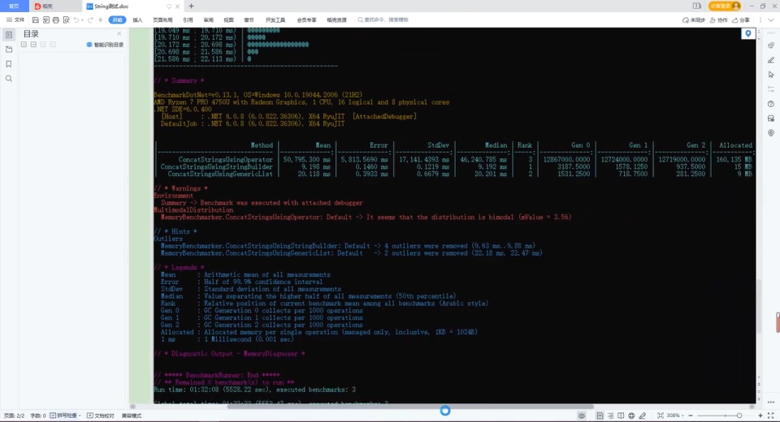
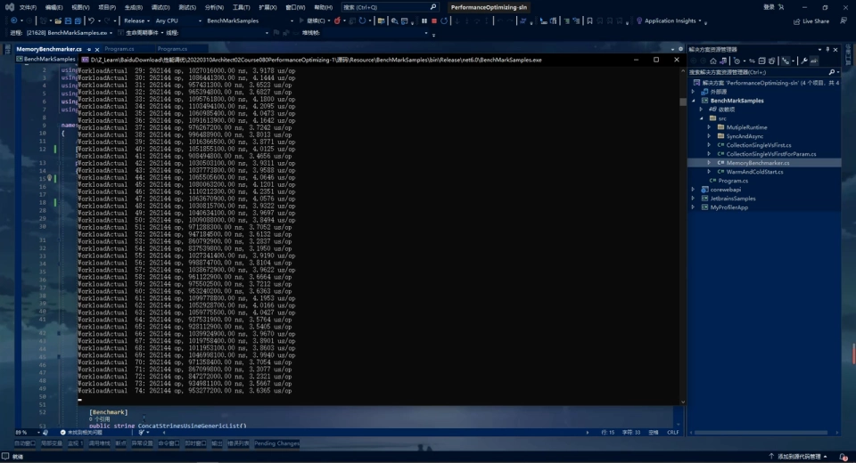
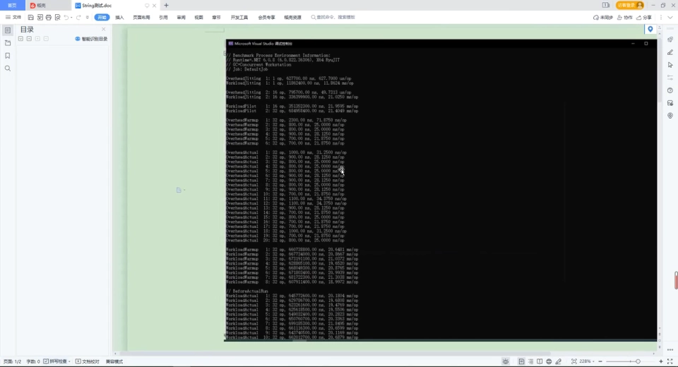

# 基准测试怎么跑才可信：预热、重复次数与数据规模

> 视频来源：[【05】基准测试之内存分析](https://www.bilibili.com/video/BV1Vg411p7ds/)（Bilibili · 王月半子w）｜时长约 15 分钟
> 导读：这支视频用 C# 的三种字符串拼接做例子，完整跑了一遍 Google Benchmark：先讲清 Release 模式、预热、每轮 20 次这些前置条件，再逐列拆解报告里的 Mean / Error / StdDev / Median / 内存分配，最后用"1000 个元素"和"100 个元素"两次运行证明**同一组代码的排名会随规模翻转**。例子是 CPU 上的，但方法学与 GPU 算子基准完全一致，所以放在本节作为"怎么测才可信"的入门案例。

## 本讲要解决的核心问题（SCQA）

**背景**：想知道"哪种写法更快"，最直觉的做法是跑一次、看秒表。很多人也确实这么干。

**冲突**：单次运行的读数极不可靠。同一次测试里，最快的实现可能因为一次垃圾回收、一次调度抖动就变成最慢的；换个数据规模，排名甚至会整体翻转。UP 主第一次跑 10 万次迭代，机器跑了 **1 小时 32 分**；在 1000 个元素的正式表格里，最慢的 `+` 拼接是 50.8 ms、最快的 `StringBuilder` 是 0.14 ms，差了约 **360 倍**——这种量级的差距，靠"我觉得它更快"是站不住的。

**疑问**：一次可信的基准测试，到底要满足哪些条件？报告里那么多列，哪些该看、哪些容易误读？

**回答（中心思想）**：**可信的基准 = 正确的构建模式 + 预热 + 足够多的重复 + 看分布而不只看均值 + 声明数据规模。** 这五件事缺一件，结论就可能反过来。

---

## 一、被测对象：三种字符串拼接

视频延续上一集的话题，比较三种拼 1000 个 `"Hello World!"` 的写法：

- `ConcatStringsUsingOperator`：直接用 `+` 拼接
- `ConcatStringsUsingStringBuilder`：用 `StringBuilder`
- `ConcatStringsUsingGenericList`：先塞进 `List<string>` 再合并

代码用 `[Benchmark]` 特性标注，`NumberOfItems = 1000`，由 BenchmarkRunner 自动发现并执行。

![被测代码：三个 [Benchmark] 方法，NumberOfItems = 1000，右侧是逐次迭代的耗时输出](assets/基准测试怎么跑才可信：预热、重复次数与数据规模/00200.webp)

[【跳转到 03:20】](https://www.bilibili.com/video/BV1Vg411p7ds/?t=200)

这个例子的好处是"差距足够大"，适合用来观察方法学本身；坏处也在这里——差距太大时，测量误差不容易暴露。所以后面要专门看方差和离群点。

---

## 二、跑之前必须定下的三件事

### 2.1 构建模式：基准测试必须在 Release 下跑

UP 主一开始就踩了这个坑：

> "如果你在 Debug 模式下跑，会给你报错……因为基准测试一定要在 Release 模式下跑。"

框架的提示大意是 `probably debug configuration, please build in Release`。原因很直白：Debug 版本里编译器几乎不做优化，测出来的耗时反映的是"未优化的代码"，而不是"你的算法"。

[【跳转到 00:25】](https://www.bilibili.com/video/BV1Vg411p7ds/?t=25)

### 2.2 预热（warmup）

框架会先做一次预热，再进入正式测量：

> "它会有一次预热（warmup），预热之后每轮跑 20 次，然后才结束。"

预热的作用是把"第一次运行才有的开销"排除在统计之外：JIT 编译、缓存冷启动、内存池首次分配、CPU 频率爬升——这些都会让第一次运行明显偏慢。如果不预热，这些一次性成本会被摊进均值里，把结果拉偏。

### 2.3 重复次数：一轮 20 次，一次跑很多轮

"每轮跑 20 次"意味着报告里的每个数字都不是单次采样，而是一组采样的统计量。这也是为什么报告里会同时给出 Mean、StdDev、Median——**单次采样没有分布，只有一组采样才有分布**。

[【跳转到 02:14】](https://www.bilibili.com/video/BV1Vg411p7ds/?t=134)

---

## 三、报告怎么读：九个列各有各的用处

跑完之后输出一张表，UP 主逐列解释了一遍：

[【跳转到 05:08】](https://www.bilibili.com/video/BV1Vg411p7ds/?t=308)

| 列 | 含义 | 怎么用 |
| :--- | :--- | :--- |
| Method | 被测方法名 | 对应到哪个实现 |
| Mean | 算术平均值 | 最常用，但最容易被离群点拉偏 |
| Error | 99.9% 置信区间的半宽 | 判断均值稳不稳；误差大说明采样波动大 |
| StdDev | 标准差 | 波动幅度，配合 Mean 看相对离散程度 |
| Median | 中位数（50 百分位） | 抗离群点，和 Mean 差得多说明分布偏斜 |
| Rank | 同一组基准内部的相对排名 | 快速看谁快谁慢 |
| Gen 0 / Gen 1 / Gen 2 | 每 1000 次操作中第 N 代垃圾回收的次数 | 判断耗时里有多少是 GC 造成的 |
| Allocated | 单次操作分配的内存（含托管内存） | 内存视角的代价，和耗时一样重要 |

UP 主特别纠正了自己一开始的误读：

> "我一直以为是错误率……后来查了查，发现它是误差，这个是标准差、标准偏差。兄弟们不要搞混了。"

这一点值得强调：**Error 不是"算错了多少"，而是"这个均值有多不确定"。** 一个 Mean 是 20 ms、Error 是 0.5 ms 的结果，比 Mean 是 20 ms、Error 是 15 ms 的结果可信得多。

[【跳转到 05:33】](https://www.bilibili.com/video/BV1Vg411p7ds/?t=333)

### 3.1 内存列：耗时之外的第二把尺子

表里最扎眼的是内存：

- `StringBuilder` 分配约 **15 MB**
- `List` 方案只分配了 **9 KB** 量级
- `Operator` 方案累计分配达到 **160 GB** 量级（`Allocated` 列）

UP 主的反应很直接："这个也比较恐怖了……160 多个 G 吗？好吧，它赢了。"

[【跳转到 05:58】](https://www.bilibili.com/video/BV1Vg411p7ds/?t=358)

只看耗时，你会知道 `+` 拼接慢；看内存，你才知道它慢的原因是**每次拼接都产生新字符串**，于是分配量随迭代次数线性膨胀。**性能结论要带因果解释，否则下次遇到同类问题你还是判断不出来。**

[【跳转到 06:53】](https://www.bilibili.com/video/BV1Vg411p7ds/?t=413)

### 3.2 报告自己会提示异常

截图里还有几行很容易被忽略的信息：

- `Warning: Benchmark was executed with attached debugger`——这次测量是在挂着调试器的情况下跑的，结果可能受影响
- `Hint: ... 4 outliers were removed (9.63 ms, 9.88 ms)`——框架自动剔除了 4 个离群点，并给出具体数值
- `It seems that the distribution is bimodal (mValue = 3.56)`——分布疑似双峰
- `Run time: 01:32:08 (5528.22 sec), executed benchmarks: 3`——整轮跑了 1 小时 32 分

这几条提示合起来说明一件事：**框架不仅给你数字，还告诉你这个数字可不可信。** 双峰分布通常意味着测量期间发生了两种不同的执行状态（比如 GC 触发前后），这时候的均值意义有限，看中位数更稳。

[【跳转到 07:34】](https://www.bilibili.com/video/BV1Vg411p7ds/?t=454)

---

## 四、规模依赖：换个数据量，排名就翻了

UP 主先跑了 1000 个元素，再改成 100 个元素重跑，观察排名变化：

[【跳转到 13:37】](https://www.bilibili.com/video/BV1Vg411p7ds/?t=817)

结论是：

- **1000 个元素**：`StringBuilder` 明显最快（0.14 ms），`List` 次之（20.1 ms），`+` 拼接最慢（50.8 ms），比最快的慢约 360 倍。
- **100 个元素**：`List` 反超成为最快，两者"其实差不了太多"。

UP 主的总结是："在数据量大的话，用 StringBuilder 还是比较好的，因为它里面做了一些单独的优化。"

这条结论的价值远超字符串拼接本身：**基准结论必须绑定输入规模。** 任何一句"X 比 Y 快"，如果不说明在什么规模下、什么形状下，就是一句无法复核的话。在 GPU 上这一点更明显——同一个 kernel 在小 shape 上被 launch 开销主导、在大 shape 上被带宽主导，排名翻转是常态。

---

## 五、代价：可信度是拿时间换的

视频里最真实的一幕是等待：

> "只有 1000 次我们都跑了这么长时间……10 万次跑了一个半小时。我的天，我早餐都吃完了，洗把脸回来，溜达玩了一圈，发现它还在跑。"

100 次迭代的那一轮也跑了四分多钟。UP 主对此的态度很务实：

[【跳转到 03:34】](https://www.bilibili.com/video/BV1Vg411p7ds/?t=214)

> "如果说是对你的代码有自信，你可以不跑；但是没有自信的话，或者甲方需要跑的话，那就跑——就是拿时间去磨。"

这句话其实点出了基准测试的工程取舍：**测量精度和测量成本是一对矛盾**。想减少方差就要多跑，多跑就要等。可行的做法是分层：

- 日常开发：小规模、少轮次，只用来发现"明显退化"
- 提交前：中等规模，覆盖关键形状
- 版本发布：大规模、多轮次，出正式报告

---

## 六、把这套方法迁移到 GPU 算子基准（本文的对照建议）

视频的例子跑在 CPU 上，但它要求的五个条件在 GPU 上一条都不能少。下面这张对照表是本文根据视频方法整理的迁移建议，**不是视频原文**：

| 视频里的做法 | GPU 算子基准里的对应做法 |
| :--- | :--- |
| 必须 Release 构建 | 用优化构建，关闭调试器与逐层校验；确认没有 `-G` 之类的调试编译选项 |
| 先预热一次 | 先跑若干次，让时钟频率、L2 缓存、内存池进入稳定状态 |
| 每轮 20 次、多轮统计 | 固定迭代次数 + 多次重复，报告里给中位数而不只是均值 |
| 看 StdDev / Error | 波动超过阈值就重测，别把噪声当优化 |
| 剔除离群点并记录 | 记录被剔除的点数，别悄悄删掉不利数据 |
| 声明数据规模 | 声明 shape、dtype、batch size，结论绑定形状 |
| 单机单环境 | 同一台机器、同一驱动、同一版本对比，跨机器数字不可比 |

---

## 小结

- **构建模式先对**：Debug 下跑基准等于测未优化代码，框架会直接提示你改 Release。
- **预热不是可选项**：它把 JIT、缓存、内存池的一次性成本挡在统计之外。
- **单次运行没有意义**：每轮 20 次、多轮统计，才有 Mean / StdDev / Median 可看。
- **Error 不是错误率**：它衡量的是均值的不确定度；Mean 与 Median 差得多说明分布偏斜。
- **内存是第二把尺子**：160 GB 对 9 KB 的差距，解释了"为什么慢"。
- **规模会翻转排名**：1000 个元素时 StringBuilder 最快，100 个元素时 List 最快。
- **可信度要用时间换**：10 万次迭代跑了 1 小时 32 分，分层测试是现实解法。

## 关键术语速查

| 术语 | 一句话解释 |
| :--- | :--- |
| benchmark | 基准测试，用固定输入和固定流程反复测量，得到可比较的耗时 |
| Release 模式 | 开启编译器优化的构建配置，基准测试必须用它 |
| warmup（预热） | 正式测量前的若干次试跑，用来排除一次性开销 |
| 迭代（iteration） | 一次完整的被测操作；一轮通常包含多次迭代 |
| Mean | 算术平均值，容易被离群点拉偏 |
| Median | 中位数，把样本排序后取中间值，抗离群点 |
| StdDev | 标准差，衡量样本的离散程度 |
| Error | 均值的置信区间半宽，衡量"这个均值有多不确定" |
| 离群点（outlier） | 明显偏离主体的样本，通常由 GC、调度抖动等外部因素造成 |
| 双峰分布 | 样本分成两簇，说明测量期间存在两种不同的执行状态 |
| GC（垃圾回收） | 托管运行时自动回收内存；Gen 0/1/2 是三代回收的计数 |
| Allocated | 单次操作分配的内存总量，反映内存代价 |