# 算子基准与回归框架：先把计时口径对齐，再谈快慢

> 视频来源：[高性能算子测试框架搭建](https://www.bilibili.com/video/BV1ukmbY9EK4/)（Bilibili · 关一新本新）｜时长约 42 分钟
> 导读：UP 主把自己写的一套「算子测试框架」从零拆开讲：为什么要手写算子、PyTorch 的 softmax 到底调了什么、pybind11 怎么把 kernel 暴露给 Python、以及最关键的——**为什么第一次测出来的 0.1 秒是假数据，换成 device 端 tensor 之后变成 5 毫秒**。本文按"先测什么 → 怎么测才公平 → 怎么变成可重复的回归"重排，代码细节按视频顺序保留。

## 本讲要解决的核心问题（SCQA）

**背景**：手写 CUDA 算子的人越来越多。写完一个 softmax 或 flash attention，下一步几乎必然是"和 PyTorch 比一比，快了多少"。

**冲突**：这个"比一比"极容易出错。UP 主第一次跑自己的测试脚本，得到的结果是自写算子 0.1 秒、PyTorch 0.006 秒——看起来慢了一两百倍。但真实原因是：**Python 端传进去的是 CPU 上的 numpy 数组，计时里混进了 `cudaMalloc`、H2D 拷贝和 `cudaFree`**；而 PyTorch 那边传进去的本来就是 device 端 tensor。两边量的根本不是同一件事。

**疑问**：那到底该怎么测，才能让"我的算子比 PyTorch 快/慢"这句话站得住脚？测出来之后，又怎么让它变成每次改代码都能重跑的回归？

**回答（中心思想）**：**基准测试的第一件事不是计时，而是对齐计时口径。** 只有输入在同一设备、同一 dtype、同一形状，且计时区间里只包含 kernel 本身，数字才有意义；在此之上，把「多形状 × 多 dtype × 多设备」的用例固化成一套可重复执行的测试框架，单次对比才升级成性能回归。

---

## 一、为什么需要一套算子测试框架

### 1.1 手写算子有两个现实理由

视频开篇先回答了一个常被跳过的问题：PyTorch 已经把 softmax、LayerNorm、matmul 甚至 flash attention 都封装好了，为什么还要自己写？

UP 主给出的两个理由，一个偏性能、一个偏生态：

- **性能**：PyTorch 算子的特点是"普适性强"——复杂场景、简单场景它都能覆盖。但普适性的代价是，在某些具体形状上它并不快。UP 主展示的对比里，他手写的 softmax 在很多形状上都能比 PyTorch 快，也就是说手写算子在一定程度上确实可以加速推理。
- **生态**：国产芯片（寒武纪、华为昇腾、摩尔、天数等）起步时间不长，很多芯片没有封装好类似的库函数；即使封装了，用起来也比较复杂。更要命的是软件生态——上网搜"寒武纪编程"或"摩尔编程"，能搜到的多是厂商官网资料，很少看到有人分享自己写的算子。

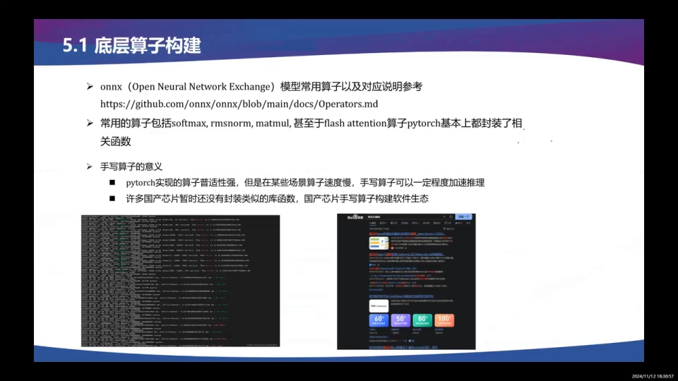

[【跳转到 01:41】](https://www.bilibili.com/video/BV1ukmbY9EK4/?t=101)

### 1.2 写了算子，就必须回答"它对不对、它快不快"

手写算子带来两个新问题：**性能怎么样**、**精度怎么样**。UP 主的原话是："会不会出现说我们写的那些算子其实是错的？这个是完全有可能的。"

于是测试框架的目标被拆成两条腿，缺一不可：

| 维度 | 要回答的问题 | 判定方式 |
| :--- | :--- | :--- |
| 精度 | 结果和参考实现一致吗 | 与 PyTorch 输出逐元素比较，看绝对误差 |
| 性能 | 比参考实现快还是慢 | 同一形状下比较耗时，算加速比 |

后面所有工程细节（pybind11、CMake、跨平台开关）都是为了把这两条腿自动化。**只测性能不测精度，等于在优化一个可能算错的 kernel；只测精度不测性能，则无法判断这次改动是优化还是退化。**

---

## 二、先搞清楚 PyTorch 那边到底跑了什么

要比较，先得知道对手是谁。UP 主把 `torch.softmax` 的调用链拆成三段：

1. **用户层**：调用 `torch.softmax`，传一个 tensor 进去。
2. **中间层**：PyTorch 内部有一个"转换器"（dispatcher），负责识别这个命令、找到对应的实现。
3. **底层**：最终落到某个 `.cu` 文件里的 kernel，例如 `SoftMax.cu` 里的核函数。

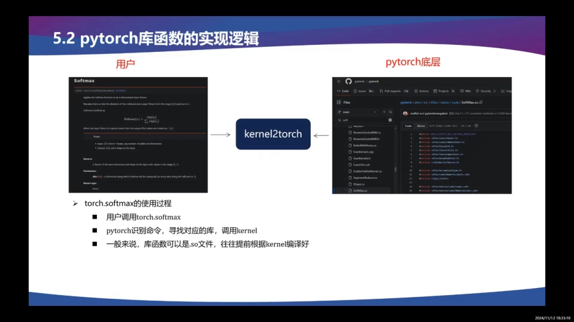

[【跳转到 03:56】](https://www.bilibili.com/video/BV1ukmbY9EK4/?t=236)

这里有一个对基准测试很关键的结论：**PyTorch 调用的库函数一般是提前编译好的 `.so`，本质上你调用的还是一个 kernel**。也就是说，"PyTorch 的耗时"和"你手写算子的耗时"在理想情况下都应该是"一次 kernel launch + kernel 执行"的时间，两者是可比的。

反过来说，只要你的计时里混进了别的动作（分配显存、拷贝数据、类型转换），比较就立刻失效——这正是下一节要讲的坑。

---

## 三、第一个陷阱：计时口径不同，结论差 20 倍

### 3.1 第一版：numpy 进、CUDA 跑

第一版框架用 pybind11 把 `attention.cu` 编译成 Python 扩展。参数传递是这样的：Python 端传进来的是 **numpy 数组，而且在 CPU 上**；C++ 侧通过 `buffer_info` 拿到指针，转成 `float*`，然后在 device 端 `cudaMalloc` 开辟显存、把数据拷过去、调 kernel、最后 `cudaFree` 释放。

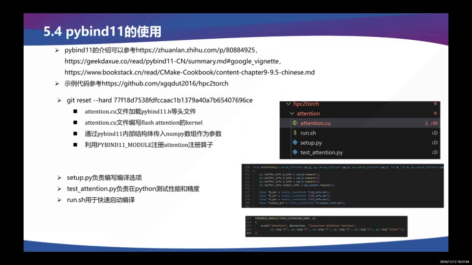

[【跳转到 08:32】](https://www.bilibili.com/video/BV1ukmbY9EK4/?t=512)

跑出来的结果：PyTorch 0.006 秒，自写算子 0.1 秒。UP 主的描述是"比它慢得特别多，得有一两百倍了"。

### 3.2 为什么这个数字是假的

UP 主在视频里直接点破了问题：

> "我们看 Python 端它传的参数是 numpy，但调用的库函数接收的是 tensor，这样对比性能它公平吗？它是不公平的。"

具体差在哪？PyTorch 那一侧的 Q、K、V 都是 `device` 上的 tensor；而自写算子这一侧拿到的是 CPU 端的 numpy 数组。于是那 0.1 秒里包含了：

- `cudaMalloc` 开辟显存
- H2D（host→device）数据拷贝
- kernel 执行
- `cudaFree` 释放显存

**kernel 只是这四件事里的一件，而且往往是最短的一件。** 这就是"单 kernel 微基准"和"端到端调用"的差别：同一份代码，量的口径不同，结论可以从"慢 200 倍"变成"快 1.5 倍"。

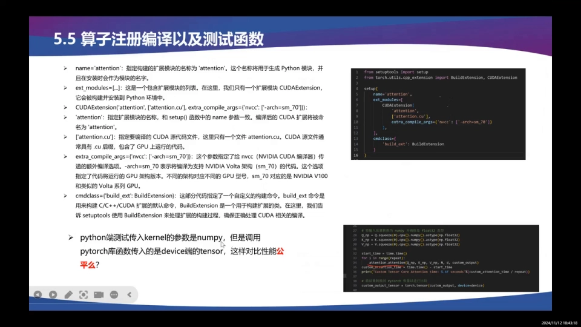

[【跳转到 14:10】](https://www.bilibili.com/video/BV1ukmbY9EK4/?t=850)

### 3.3 修法：让参数从 device 上来

改法很直接：C++ 侧不再接 numpy，而是接 `torch::Tensor`，头文件从 `numpy.h` 换成 `torch/torch.h`，直接拿 tensor 的 device 指针。这样数据已经在显存里，计时区间里就只剩 kernel。

改完之后，同一次测试的数字从 **0.1 秒（100 ms）变成约 5 ms**。UP 主的评价是："这个才是它真正的 kernel 时间。"

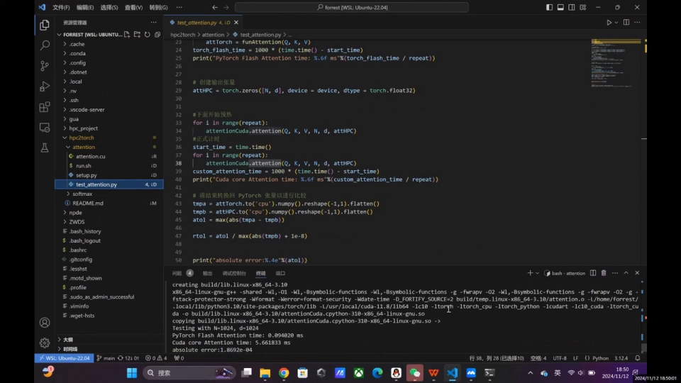

[【跳转到 20:57】](https://www.bilibili.com/video/BV1ukmbY9EK4/?t=1257)

> **给初学者的检查清单**：在相信任何一个"快 N 倍"之前，先问四件事——
> 1. 两边的输入是否都在同一设备（CPU / GPU）上？
> 2. dtype 是否一致（fp32 / fp16 / bf16）？
> 3. 计时区间里有没有混进分配、拷贝、类型转换？
> 4. 有没有把第一次运行的初始化开销算进去？

---

## 四、把框架搭起来：从一个算子一个 .so 到统一注册

### 4.1 最初的目录结构：一个算子一个"独立王国"

最早的仓库只测 flash attention，结构简单：`attention.cu` 放 kernel，`run.sh` 快速启动编译，`setup.py` 负责编译，`test_attention.py` 做测试。

后来加了 softmax，就又多了一个平行的文件夹（`attention.cu` / `softmax.cu` / 各自的 `run.sh`、`setup.py`、`test_attention.py`、`test_softmax.py` 这类测试脚本）。UP 主的评价是："一个文件夹就是一个独立王国，它自己在编译自己的算子，自己在做测试。"

问题在于规模：ONNX 常用算子有 30 多个，按这个写法就要 30 多个目录、30 多个 `.so`；如果再加上 CPU 和国产芯片的版本，`.so` 的数量会"相当惊人"。

### 4.2 改成统一动态库 + 注册表

第二版把结构改成：

- `src/attention/attention.cu`、`src/softmax/softmax.cu`：**只放 kernel**
- `src/` 下一个专门的 `.cpp` 文件：**统一注册**所有算子（声明 + 绑定）
- `test/performance.py`、`test/test_attention.py`、`test/test_softmax.py`：测试脚本集中放
- 编译产物只有一个 `.so`，模块名例如 `my_cuda_ops`

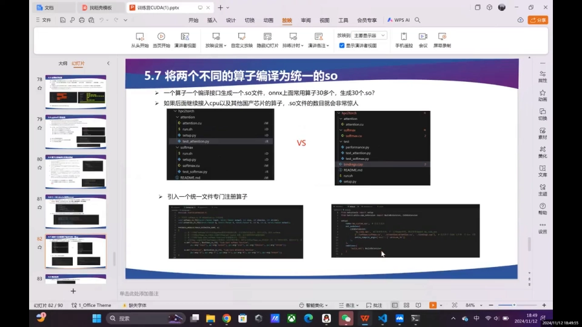

[【跳转到 20:52】](https://www.bilibili.com/video/BV1ukmbY9EK4/?t=1252)

UP 主特别提醒了一个编译期的坑：不能在 `attention.cu` 和 `softmax.cu` 里**同时**定义 `PYBIND11_MODULE` 宏，否则会重复定义、产生冲突。正确做法是把模块定义收敛到唯一一个注册文件里。

这个改动的意义不只是"文件少了"：**统一入口意味着可以统一遍历用例**——后面做多形状、多设备回归时，测试脚本只需要 import 一个模块。

---

## 五、跨平台：同一套测试跑 CUDA / CPU / MLU

### 5.1 编译系统的选择

当算子数量变多、平台变多之后，`setup.py` 里手写文件列表就不行了。UP 主的做法是换 CMake，理由有两条：

- **通配符**：CMake 支持 `file(GLOB ... "src/**/*.cu")` 这种写法，自动收集目录下的源文件，新增算子不用改编译脚本；Python 侧没有等价能力。
- **跨平台**：如果写的是 CUDA 算子，`import` 的是 CUDA extension；如果写的是寒武纪的算子，import 的东西完全不一样。这类差异交给 CMake 的编译选项处理最自然。

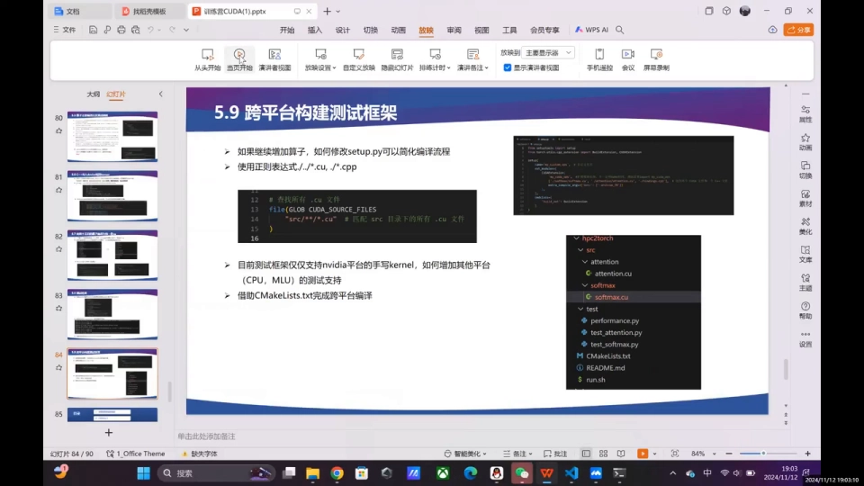

[【跳转到 34:15】](https://www.bilibili.com/video/BV1ukmbY9EK4/?t=2055)

### 5.2 用开关控制编译哪个后端

CMake 里加了三个开关，默认全关：

- `USE_CUDA`：编译 CUDA 实现
- `USE_MLU`：编译寒武纪 MLU 实现
- `USE_CPU`：编译 CPU 串行实现

UP 主还写了一个 CPU 版的 softmax 作为对照：逻辑和 CUDA 版几乎一样，只是把并行改成串行。这一步很值得学——**有一个"绝对正确但慢"的参考实现，是排查精度问题的最短路径**。

寒武纪那套编译选项"非常复杂"，是他查官方资料和 GitHub、反复试错才凑出来的。他也很坦率地展示了开关用错的后果：

- 只编了 CPU 版，却去调 CUDA 的函数 → 直接报错"没有这个函数"，因为 `softmax.cu` 根本没编译。
- 在没有寒武纪工具链的机器上打开 `USE_MLU` → 编译期报找不到路径。

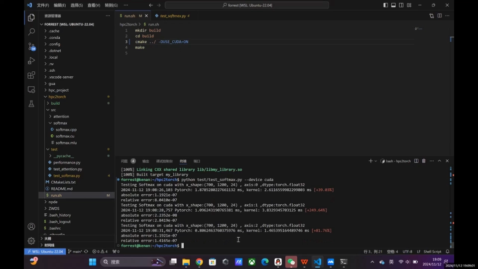

[【跳转到 40:10】](https://www.bilibili.com/video/BV1ukmbY9EK4/?t=2410)

### 5.3 测试脚本：把"用例"写成数据

统一之后，测试脚本的样子就变成了"数据驱动"：把形状、axis、dtype、device 写成一个列表，循环跑。

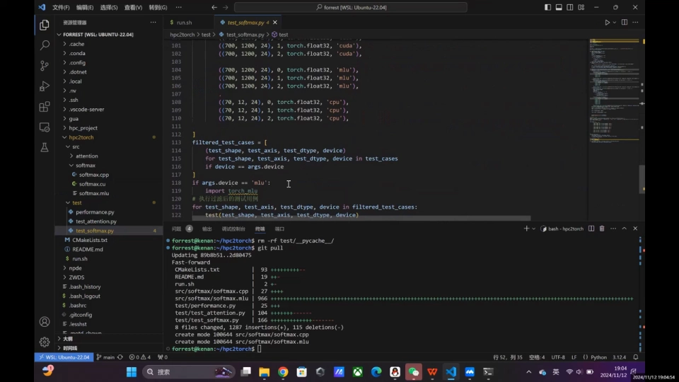

[【跳转到 36:00】](https://www.bilibili.com/video/BV1ukmbY9EK4/?t=2160)

这正是**端到端基准**该有的形态：不是"跑一次看个数"，而是"跑一组固定用例，得到一张可比较的表"。用例列表一旦固定下来，每次改 kernel 重跑，就能看出哪一类形状退化了。

用 CMake 编译出来的 `.so` 没有 Python 包装层，测试脚本改用 `ctypes` 直接加载它。这一步有两个必须写对的地方：

- **函数声明要加 `extern "C"`**：`ctypes` 里的 `c_int`、`c_float` 这些类型只认 C 语言的符号，不加 `extern "C"` 会链接不到。
- **`argtypes` 要与 C 侧签名一致**：指针参数用 `ctypes.POINTER` 包一层 `ctypes.c_float`，整型写 `ctypes.c_int`，否则参数会被错误解释。

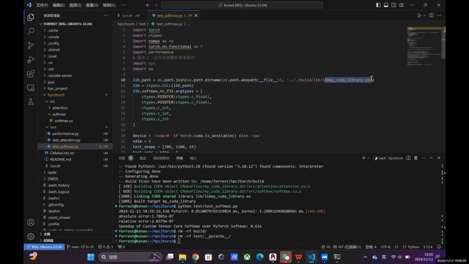

[【跳转到 31:33】](https://www.bilibili.com/video/BV1ukmbY9EK4/?t=1893)

---

## 六、结果怎么读：加速比与绝对误差要一起看

框架跑完会打印两类信息：耗时对比（含加速比）和绝对误差。UP 主展示的测试结果长这样：

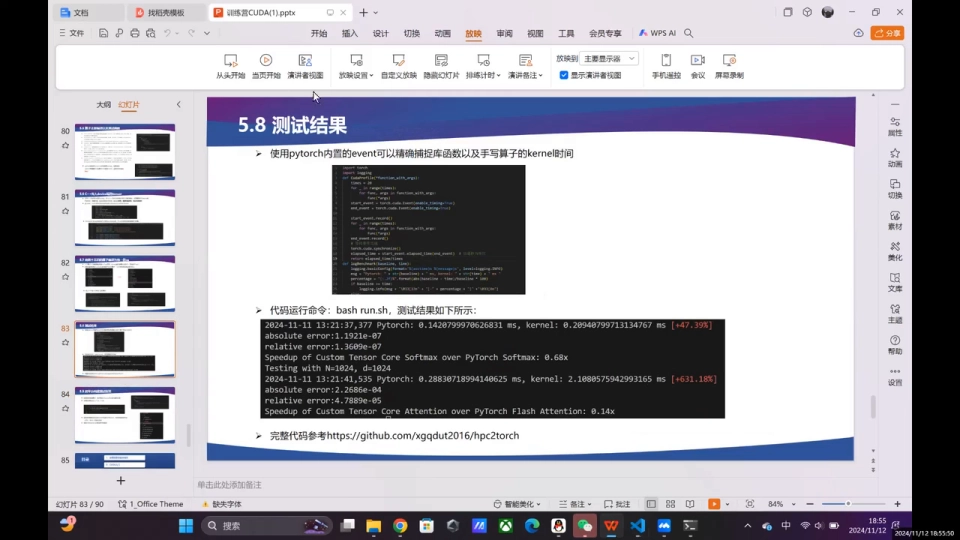

[【跳转到 26:45】](https://www.bilibili.com/video/BV1ukmbY9EK4/?t=1605)

加速比的定义很直白：

$$
\text{speedup} = \frac{t_{\text{baseline}}}{t_{\text{custom}}}
$$

其中 $t_{\text{baseline}}$ 是 PyTorch 的耗时，$t_{\text{custom}}$ 是自写算子的耗时。$0.68\times$ 意味着比 PyTorch 慢（耗时约为 1.5 倍），$0.14\times$ 意味着慢约 7 倍。UP 主的口头总结是"softmax 慢大概一倍、flash attention 慢快十倍"，与表里的数字方向一致。

两个必须同时看的量：

- **加速比**：只说明快慢，不说明对不对。
- **绝对误差**：`absolute error` 在 1e-04 量级时，说明结果和 PyTorch 基本一致；如果误差突然变大，加速比再好看也不能要。

另一个容易被忽略的现象是：**同一个算子，换一个 axis 或形状，排名会变**。在 `[700, 1200, 24]` 这个形状上，softmax 沿 axis 0/1/2 三个方向，自写算子分别比 PyTorch 慢 139%、250%、482%（报告里用负百分比表示落后）——三个都慢，但慢的程度差了 3 倍多。

[【跳转到 40:10】](https://www.bilibili.com/video/BV1ukmbY9EK4/?t=2410)

这就是"只看单次运行会误导"的具体形态：如果只挑 axis 0 测一次，你会得出"慢一倍多"；只挑 axis 2，会得出"慢近五倍"。**结论必须绑定形状。**

UP 主也很诚实地说明了结果的不稳定性：同一套代码，他在公司机器上跑，自写算子"还能快一点"，在自己机器上却体现不出来，他推测和自己的显卡有关。这恰好说明**跨机器比较是不可靠的**——性能回归必须在同一台机器、同一环境下做。

---

## 七、从一次性对比到性能回归

把视频里的做法整理成一套可执行的流程：

1. **固定输入**：把形状、axis、dtype、device 写成用例表（视频里的 `test_cases`），不要临时改。
2. **固定参考实现**：baseline 永远是同一个版本的 PyTorch / 同一个 CPU 串行实现。
3. **对齐计时口径**：两边输入都在 device 上，计时区间只含 kernel；一旦要测端到端，就明确写上"含 H2D 拷贝"。
4. **同时记录精度**：绝对误差和相对误差一起打印，精度不过关的加速比直接作废。
5. **记录环境**：GPU 型号、驱动、CUDA 版本、PyTorch 版本。视频里 UP 主专门强调 NVCC 要和 PyTorch 匹配（他用的组合是 PyTorch 与 NVCC 都对应 11.1.8），版本不匹配时"不使用任何选项可能装成 11.5，这样编译会报错"。
6. **每次改动重跑全表**：新增算子就往 `src/` 加一个目录、在注册文件里加一行，测试脚本自动覆盖。

这套东西跑顺之后，"我的算子比 PyTorch 快"才从一句口号变成一个可以复核的表格。

---

## 小结

- **手写算子的两个理由**：PyTorch 普适但某些形状慢；国产芯片缺库函数、缺软件生态。
- **测试框架要同时管两件事**：精度（和参考实现比误差）与性能（同形状比耗时）。
- **最大的坑是计时口径**：numpy 进、CUDA 跑，0.1 秒里混了分配 + H2D + kernel + 释放；换成 device tensor 后只剩 5 毫秒。
- **结构上要收敛**：一个算子一个 `.so` 会爆炸，改成统一动态库 + 一个注册文件，测试脚本才能统一遍历用例。
- **跨平台靠编译开关**：`USE_CUDA` / `USE_MLU` / `USE_CPU`，配一个 CPU 串行实现当"绝对正确"的参考。
- **结论要绑定形状**：同一算子沿不同 axis 的加速比可以是 0.39x 和 0.48x，只测一个点就会得出片面结论。
- **跨机器不可比**：同一份代码在不同显卡上结论会翻转，回归必须在固定环境里做。

## 关键术语速查

| 术语 | 一句话解释 |
| :--- | :--- |
| 算子（operator） | 神经网络里的一个基本计算单元，如 softmax、matmul、LayerNorm |
| kernel | 真正跑在 GPU 上的那个函数，一次 launch 执行一批线程 |
| pybind11 | 把 C++/CUDA 函数包装成 Python 可调用模块的轻量库 |
| dispatcher | PyTorch 内部把 `torch.softmax` 这类调用分派到具体 kernel 实现的机制 |
| device tensor | 数据已经在显存里的 tensor，计时时不需要再做 H2D 拷贝 |
| H2D 拷贝 | host to device，把内存里的数据复制到显存，通常比 kernel 本身还慢 |
| 加速比（speedup） | baseline 耗时除以自写算子耗时，大于 1 才叫更快 |
| 绝对误差 | 自写算子输出与参考实现输出的最大差值，用来判断结果是否正确 |
| CMake 通配符 | `file(GLOB ...)` 自动收集源文件，新增算子不用改编译脚本 |