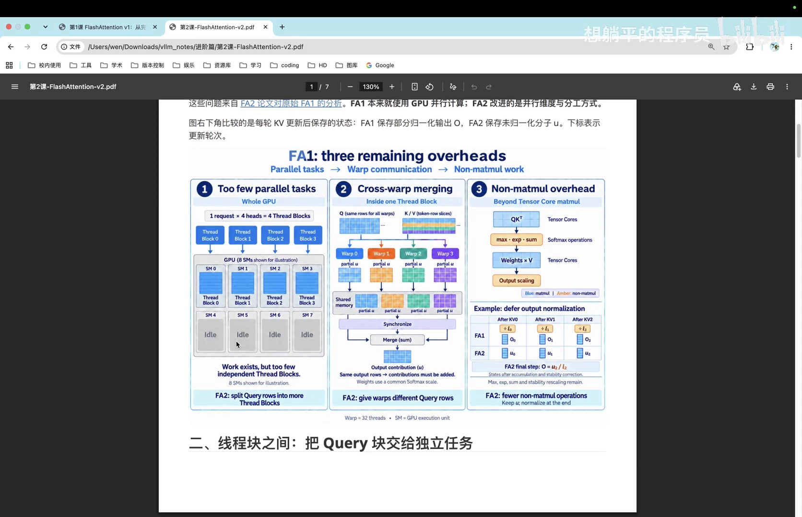
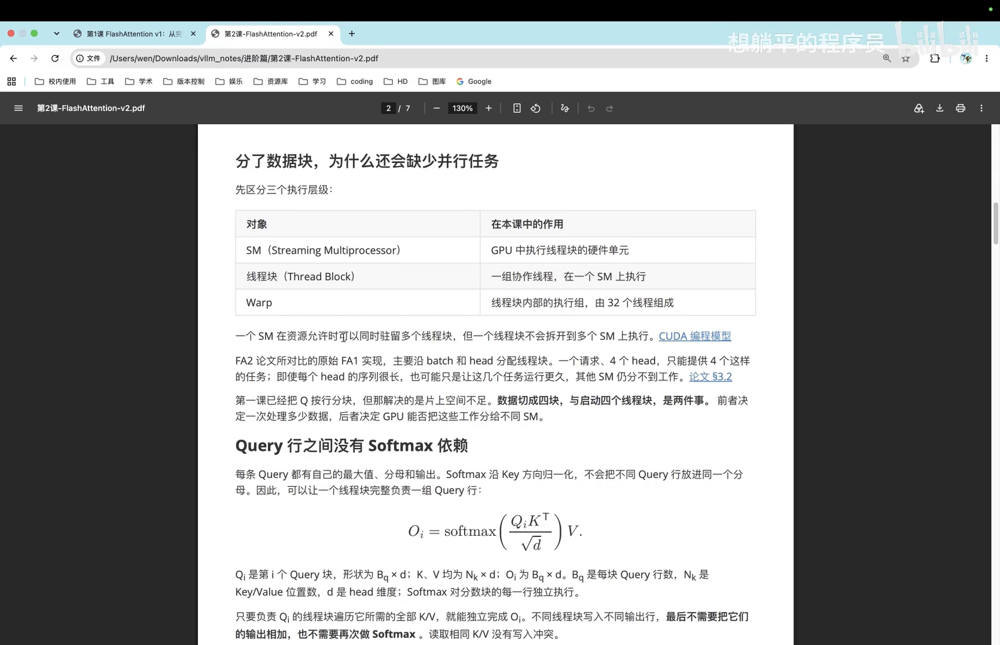
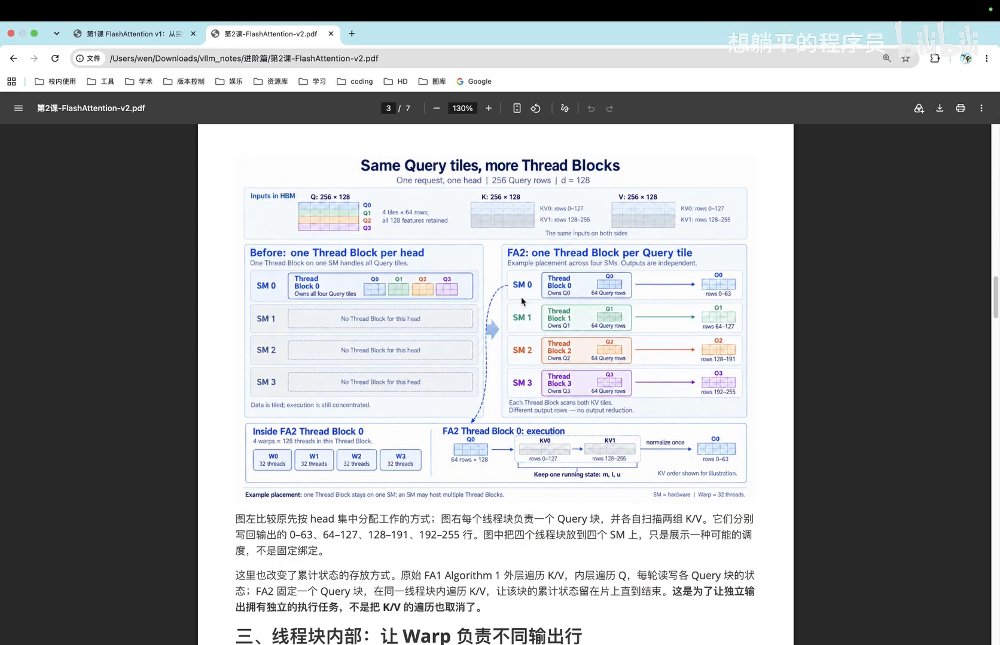
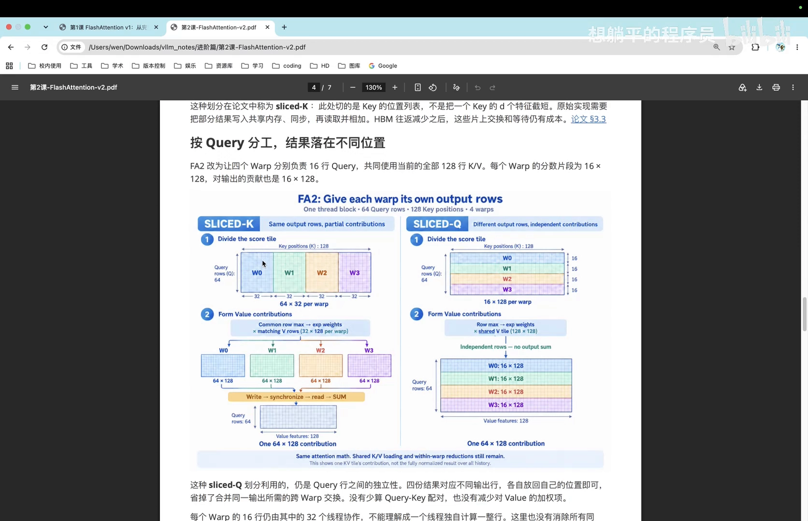
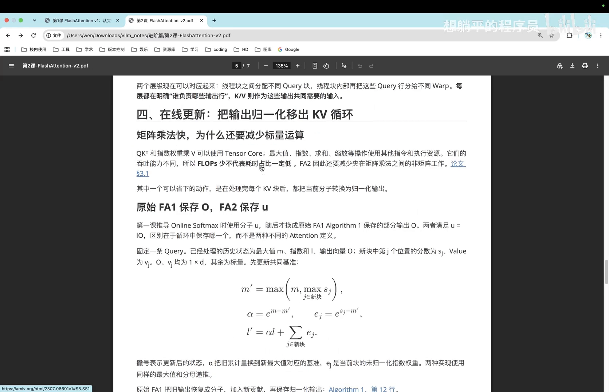
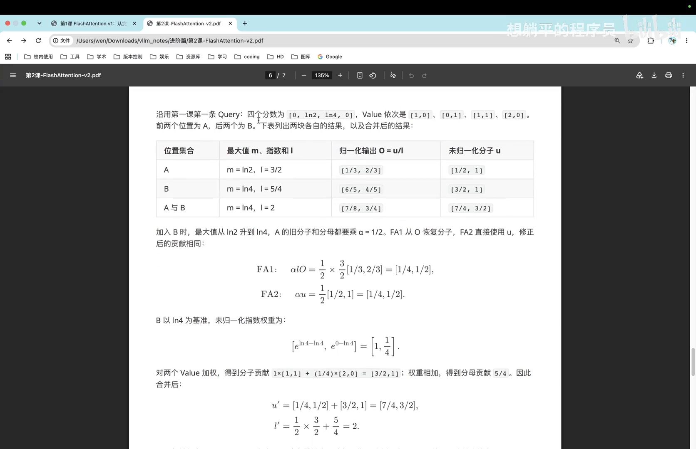
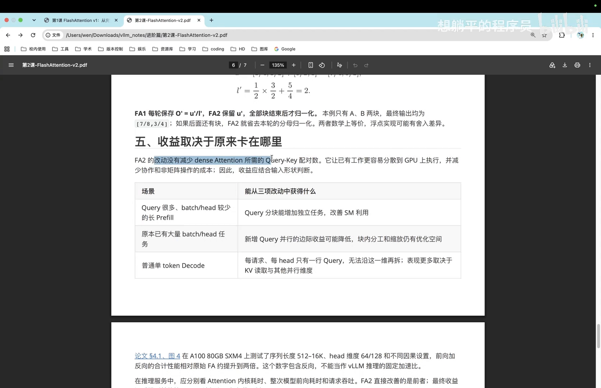

# FlashAttention-2 的三项改动：沿 Query 切分、消除跨 warp 合并、把归一化移出 KV 循环

> 视频来源：[第2课 FlashAttention v2：并行划分与非矩阵运算优化](https://www.bilibili.com/video/BV1yxaZ6pEBu/)（B 站 UP 主「想躺平的程序员」）｜时长约 27 分钟
> 导读：本讲只讲 FA2 相对 FA1 的**增量**，不重推 online softmax。按「任务数量 → 任务内分工 → 额外计算」三条线，把 FA2 论文里的三项改动逐个落到 GPU 的执行层次上，并用一组具体数字验证「结果不变、只是更省」。

## 本讲要解决的核心问题（SCQA）

**背景**：FlashAttention-1 已经把分数计算、softmax、value 加权融合在一起，不再把完整的分数矩阵和概率矩阵写回 HBM，IO 开销大幅下降。这一步在本系列前面的小节里已经推导过。

**冲突**：但 IO 省下来之后，GPU 仍然可能跑不满。原因有三类：任务数量太少（一个请求 4 个头就只能开 4 个线程块，剩下 4 个 SM 闲着）、warp 之间要交换中间结果（算完还得同步、合并）、输出要反复缩放（每处理一个 KV 块就把分子除一次分母）。

**疑问**：既然 attention 的数学结果不能改，那还能从哪里挤出性能？FA2 到底改了哪三件事，每一件对应的是 GPU 的哪一层资源？

**回答（中心思想）**：FA2 的三项改动分别对准 GPU 的三个层次——**线程块层级沿 Query 切分**（让独立任务变多，填满 SM）、**warp 层级也沿 Query 切分**（让每个 warp 写自己的输出行，省掉跨 warp 的同步合并）、**把输出的归一化移出 KV 循环**（循环里只存未归一化的分子 $u$，最后一次除法）。三者共同的依据是同一条数学事实：**Query 行之间没有 softmax 依赖**。

---

## 一、FA1 剩下的三类开销，正好对应 GPU 的三个层次

FA1 省掉的是 HBM 往返，但「省 IO」并不等于「算得快」。视频把 FA1 剩下的开销归成三类，并且强调这三类问题**来自 FA2 论文对原始 FA1 的分析**——FA1 本来就已经在用 GPU 并行，FA2 改进的是**并行的维度和分工方式**。[【跳转到 00:00】](https://www.bilibili.com/video/BV1yxaZ6pEBu/?t=0)

三栏分别是：

1. **Too few parallel tasks（并行任务太少）**：一个请求 × 4 个头 = 4 个线程块，8 个 SM 里 4 个空转。
2. **Cross-warp merging（跨 warp 合并）**：线程块内部按 Key 切开，四个 warp 各算一部分注意力，结果写回同一个输出块，必须 `Synchronize` 之后 `Merge (sum)`。
3. **Non-matmul overhead（非矩阵运算开销）**：`QKᵀ` 和 `Weights × V` 走 Tensor Core，但中间的求最大值、取指数、求和（`max`、`exp`、`sum`）以及 `Output scaling` 走的是其他指令和资源。

这三栏恰好对应 GPU 的三个执行层次，也是本讲后面三章的顺序。视频在这里给了一句很重要的定位：**FA1 已经用 GPU 做并行计算，FA2 做的是优化并行的维度和分工的方式；而 FA3 更多是在系统层面做改进。**[【跳转到 02:30】](https://www.bilibili.com/video/BV1yxaZ6pEBu/?t=150)

先把三个执行层次的术语钉死，后面才不会混：

| 对象 | 在本讲中的作用 |
| :--- | :--- |
| SM（Streaming Multiprocessor） | GPU 中执行线程块的硬件单元 |
| 线程块（Thread Block） | 一组协作的线程，在一个 SM 上执行 |
| Warp | 线程块内部的执行组，由 32 个线程组成 |

一个 SM 在资源允许时可以同时驻留多个线程块，但**一个线程块不会被拆到多个 SM 上执行**——这条约束是「任务太少」问题的物理根源。

---

## 二、线程块层级：把 Query 行切成独立任务

### 2.1 为什么「分了数据块」还会缺并行任务

初学者常有一个误解：FA1 不是已经把 Q 按行分块了吗，为什么还说并行任务不够？视频专门澄清这一点：**数据切成四块，和启动四个线程块，是两件事。前者决定一次处理多少数据，后者决定 GPU 能不能把这些工作分给不同 SM。**[【跳转到 08:20】](https://www.bilibili.com/video/BV1yxaZ6pEBu/?t=500)

FA1 的原始实现主要沿 **batch 和 head** 分配线程块。一个请求、4 个 head，就只能提供 4 个这样的任务；即使每个 head 的序列很长，也只是让这 4 个任务跑得更久，其他 SM 仍然分不到工作。

### 2.2 切分的依据：Query 行之间没有 softmax 依赖

FA2 敢沿 Query 切分，靠的是一条数学性质：**每条 Query 都有自己的最大值、分母和输出；softmax 沿 Key 方向归一化，不会把不同 Query 行放进同一个分母。** 所以可以让一个线程块完整负责一组 Query 行：

$$
O_i = \operatorname{softmax}\!\left(\frac{Q_i K^{\mathsf{T}}}{\sqrt{d}}\right) V
$$

其中 $Q_i$ 是第 $i$ 个 Query 块，形状为 $B_q \times d$；$K$、$V$ 均为 $N_k \times d$；$O_i$ 为 $B_q \times d$。$B_q$ 是每块 Query 行数，$N_k$ 是 Key/Value 位置数，$d$ 是 head 维度。

只要负责 $Q_i$ 的线程块遍历它所需的全部 KV，就能独立完成 $O_i$。**不同线程块写入不同输出行，最后不需要把它们的输出相加，也不需要再做一次 softmax；读取相同 KV 也没有写入冲突。**[【跳转到 09:35】](https://www.bilibili.com/video/BV1yxaZ6pEBu/?t=575)

这一点值得和 FA1 对照记忆：FA1 的 online softmax 里也有「跨 KV 块合并」，但那是**同一个 Query 行沿 Key 方向的递推**；FA2 这里是**不同 Query 行之间的独立**。两件事方向正交，不要混。

### 2.3 用同一组矩阵看任务怎么变化

视频固定了一个请求、一个 head 的例子：$Q$、$K$、$V$ 均为 $256 \times 128$，Q 每 64 行分一块，K/V 每 128 行配对分一块。

| 对象 | 每块形状 | 块数或对应关系 |
| :--- | :--- | :--- |
| $Q_i$ | $64 \times 128$ | 四块，各含 64 条 Query |
| $K_j$、$V_j$ | $128 \times 128$ | 两组，每组对应相同的 128 个位置 |
| 当前分数 $S_{ij}$ | $64 \times 128$ | 行是 Query，列是 Key |
| 输出 $O_i$ | $64 \times 128$ | 对应 $Q_i$ 的 64 行输出 |

注意「分块沿 token 行进行，每个向量的 128 个特征都保留」——一个分数仍然来自完整的 128 维点积，切的是**位置**，不是特征。

图上左右对比很直观：左边 FA1「一个 head 一个线程块」，SM 1、SM 2、SM 3 全是 `No Thread Block for this head`；右边 FA2「一个 Query 块一个线程块」，四个线程块分别写回 rows 0–63、64–127、128–191、192–255，`Different output rows — no output reduction`。

**这里还顺带改掉了累计状态的存放方式**：FA1 的 Algorithm 1 是外层遍历 KV、内层遍历 Q，每轮读写各 Query 块的状态；FA2 固定一个 Query 块，在同一线程块内遍历 KV，让该块的累计状态（$m$、$l$、$u$）留在片上直到结束。这是「让独立输出拥有独立的执行任务」，不是「把 KV 的遍历取消掉」。[【跳转到 11:15】](https://www.bilibili.com/video/BV1yxaZ6pEBu/?t=675)

> 这一条就是本小节标题里说的「**循环顺序**」：外层从 KV 换成 Q。外层换掉之后，同一个线程块负责的是一组固定的输出行，$m$、$l$、$u$ 这些状态量不必每轮往 HBM 写回再读回，跨 warp 的归约也被消掉了。

---

## 三、Warp 层级：沿 Query 切分，而不是沿 Key

线程块之间分完了，线程块内部还要再分给 warp。视频说这里有**两种不同的分工方式**，差别决定了要不要付同步的代价。[【跳转到 12:30】](https://www.bilibili.com/video/BV1yxaZ6pEBu/?t=750)

### 3.1 沿 Key 切分（sliced-K）：结果落在同一位置，必须合并

如果每个 warp 处理 32 个 Key/Value，它们都要使用相同的 64 行 Query：

| 每个 Warp 的工作 | 形状 |
| :--- | :--- |
| 当前分数片段 | 64 行 Query × 32 列 Key |
| 对应的 Value 片段 | 32 × 128 |
| 两者加权相乘后的部分贡献 | 64 × 128 |

四份结果**都指向同一个 $64 \times 128$ 输出块**。虽然每个 warp 处理不同 Key，但它们只算完了同一个求和的不同项，必须合并才能得到完整贡献。设 $E_0 \dots E_3$ 是按 Key 列切开的指数权重片段，$V_0 \dots V_3$ 是相应的 Value 行片段，则当前 KV 块的贡献为

$$
U = E_0 V_0 + E_1 V_1 + E_2 V_2 + E_3 V_3
$$

注意这里**不是**把四份局部 softmax 输出相加：只有指数基准一致，未归一化贡献才能直接相加。

这种划分在论文里称为 **sliced-K**（切的是 Key 的位置列表，不是把一个 Key 的 $d$ 个特征截短）。原始实现需要把部分结果写入共享内存、同步、再读取并相加。**HBM 往返减少之后，这些片上交换和等待仍然有成本。**[【跳转到 13:45】](https://www.bilibili.com/video/BV1yxaZ6pEBu/?t=825)

### 3.2 沿 Query 切分（sliced-Q）：结果落在不同位置，各写各的

FA2 改为让四个 warp 分别负责 16 行 Query，共同使用当前的全部 128 行 K/V。每个 warp 的分数片段为 $16 \times 128$，对输出的贡献也是 $16 \times 128$。

左半边 sliced-K 的流程是：切分数块 → 各自算 Value 贡献 → `Write → synchronize → read → SUM` → 一个 $64 \times 128$ 的完整贡献。右半边 sliced-Q 的流程是：按 Query 行切 → 各自算 Value 贡献 → `Independent rows — no output sum` → 四块 $16 \times 128$ 拼成 $64 \times 128$。

sliced-Q 利用的仍然是 Query 行之间的独立性：四份结果对应不同输出行，各自放回自己的位置即可，**省掉了合并同一输出所需的跨 warp 交换**。但它没有少算 Query-Key 配对，也没有减少对 Value 的加权项——图上那行小字说得很清楚：`Same attention math. Shared K/V loading and within-warp reductions still remain.`

视频还专门纠正了一个容易过头理解的说法：**每个 warp 的 16 行仍由其中的 32 个线程协作，不能理解成一个线程独立计算一整行。** 同一行的最大值、分母仍可能需要 warp 内归约；K/V 装载仍需协作。[【跳转到 15:50】](https://www.bilibili.com/video/BV1yxaZ6pEBu/?t=950)

---

## 四、把输出归一化移出 KV 循环

第三个改动看上去最小，但它直接减少了夹在两次矩阵乘法之间的标量运算。

### 4.1 矩阵乘法快，为什么还要减少标量运算

$QK^{\mathsf{T}}$ 和「指数权重 × V」可以用 Tensor Core；最大值、指数、求和、缩放这些操作使用其他指令和执行资源。**它们的吞吐能力不同，所以 FLOPs 少不代表耗时占比一定低。** FA2 因此还要减少夹在矩阵乘法之间的非矩阵工作。[【跳转到 17:05】](https://www.bilibili.com/video/BV1yxaZ6pEBu/?t=1025)

### 4.2 FA1 存 O，FA2 存 u

固定一条 Query。已经处理的历史状态为最大值 $m$、指数和 $l$、输出向量 $O$；新块中第 $j$ 个位置的分数为 $s_j$、Value 为 $v_j$。$O$、$v_j$ 均为 $1 \times d$，其余为标量。先更新共同基准：

$$
m' = \max\left(m,\ \max_{j \in \text{新块}} s_j\right), \qquad
\alpha = e^{m - m'}, \qquad e_j = e^{s_j - m'}
$$

$$
l' = \alpha l + \sum_{j \in \text{新块}} e_j
$$

撇号表示更新后的状态，$\alpha$ 把旧累计量换到新最大值对应的基准，$e_j$ 是当前块的未归一化指数权重。**两种实现使用同样的最大值和分母递推**，区别只在循环里保存哪一个。

原始 FA1 把旧输出恢复成分子、加入新贡献、再保存归一化输出：

$$
O' = \frac{\alpha l O + \sum_{j \in \text{新块}} e_j v_j}{l'}
$$

FA2 则直接维护未归一化分子 $u = l O$：

$$
u' = \alpha u + \sum_{j \in \text{新块}} e_j v_j, \qquad O = \frac{u'}{l'}
$$

**省掉的是中间轮次的分母归一化。** 但要注意，最大值变化时按 $\alpha$ 做重缩放这一步并没有消失——$u$ 和 $l$ 还是要乘这个系数。[【跳转到 19:24】](https://www.bilibili.com/video/BV1yxaZ6pEBu/?t=1164)

### 4.3 一组数字看清差别

视频沿用前面小节那条 Query 的例子：四个分数为 $[0,\ \ln 2,\ \ln 4,\ 0]$，Value 依次是 $[1,0]$、$[0,1]$、$[1,1]$、$[2,0]$。前两个位置为块 A，后两个为块 B。

| 位置集合 | 最大值 $m$、指数和 $l$ | 归一化输出 $O = u/l$ | 未归一化分子 $u$ |
| :--- | :--- | :--- | :--- |
| A | $m = \ln 2$，$l = 3/2$ | $[1/3,\ 2/3]$ | $[1/2,\ 1]$ |
| B | $m = \ln 4$，$l = 5/4$ | $[6/5,\ 4/5]$ | $[3/2,\ 1]$ |
| A 与 B | $m = \ln 4$，$l = 2$ | $[7/8,\ 3/4]$ | $[7/4,\ 3/2]$ |

加入 B 时，最大值从 $\ln 2$ 升到 $\ln 4$，A 的旧分子和分母都要乘 $\alpha = 1/2$。两种写法修正后的贡献相同：

$$
\text{FA1:}\quad \alpha l O = \frac{1}{2} \times \frac{3}{2}\left[\frac{1}{3},\ \frac{2}{3}\right] = \left[\frac{1}{4},\ \frac{1}{2}\right]
$$

$$
\text{FA2:}\quad \alpha u = \frac{1}{2}\left[\frac{1}{2},\ 1\right] = \left[\frac{1}{4},\ \frac{1}{2}\right]
$$

差别在于 FA1 每次都要先乘 $l$ 把 $O$ 还原成分子、修正完再除回去；FA2 存的本来就是分子，直接乘 $\alpha$ 即可。B 以 $\ln 4$ 为基准的未归一化指数权重为

$$
\left[e^{\ln 4 - \ln 4},\ e^{0 - \ln 4}\right] = \left[1,\ \frac{1}{4}\right]
$$

对两个 Value 加权得到分子贡献 $1 \times [1,1] + (1/4) \times [2,0] = [3/2,\ 1]$，权重相加得到分母贡献 $5/4$。合并后

$$
u' = \left[\frac{1}{4},\ \frac{1}{2}\right] + \left[\frac{3}{2},\ 1\right] = \left[\frac{7}{4},\ \frac{3}{2}\right], \qquad
l' = \frac{1}{2} \times \frac{3}{2} + \frac{5}{4} = 2
$$

最终输出 $[7/8,\ 3/4]$，与 FA1 完全一致。**两者数学上等价，浮点实现可能有舍入差异。** 如果后面还有块，FA2 就省去本轮的除法，一直到最后一次做除法。[【跳转到 24:24】](https://www.bilibili.com/video/BV1yxaZ6pEBu/?t=1464)

---

## 五、收益取决于原来卡在哪里

FA2 的改动**没有减少 dense attention 所需的 Query-Key 配对数**。它做的是让已有工作更容易分散到 GPU 上执行，并减少协作和非矩阵操作的成本；因此收益必须结合输入形状判断。[【跳转到 24:49】](https://www.bilibili.com/video/BV1yxaZ6pEBu/?t=1489)

| 场景 | 能从三项改动中获得什么 |
| :--- | :--- |
| Query 很多、batch/head 较少的长 Prefill | Query 分块能增加独立任务，改善 SM 利用 |
| 原本已有大量 batch/head 任务 | 新增 Query 并行的边际收益可能降低，块内分工和缩放仍有优化空间 |
| 普通单 token Decode | 每请求、每 head 只有一行 Query，无法沿这一维再拆；表现更多取决于 KV 读取与其他并行维度 |

最后一行尤其重要：**FA2 的「沿 Query 切分」在 decode 阶段几乎失效**，因为一条 Query 就是一行，切无可切。decode 需要的是别的并行维度（这正是本系列后面 decode 专用内核那一节要处理的问题）。

视频还提醒了一个常见的数字误读：论文在 A100 80GB SXM4 上测试了序列长度 512–16K、head 维度 64/128 和不同因果设置，**前向加反向的合计性能**相对原始 FA 约提升到两倍。这个数字包含反向，不能当作 vLLM 推理的固定加速比；在推理服务里应当分别看 attention 内核耗时、整次模型前向耗时和请求吞吐——**FA2 直接改善的是前者**，最终收益还受模型其他算子、KV 访问和服务负载限制。

---

## 小结

- FA1 省掉的是 HBM 往返；FA2 处理的是「IO 省完之后，剩下的工作怎么摊到 GPU 上」，两者是接力关系而非替代关系。
- **线程块层级沿 Query 切分**：外层循环从 KV 换成 Q，一个 Query 块一个线程块，独立任务变多，SM 不再空转；$m$、$l$、$u$ 留在片上直到结束。
- **warp 层级也沿 Query 切分（sliced-Q）**：每个 warp 负责自己的 16 行输出，写回不同位置，省掉 `Write → synchronize → read → SUM`；但 Query-Key 配对、K/V 装载、warp 内归约都还在。
- **把归一化移出 KV 循环**：循环里只维护未归一化分子 $u$ 和分母 $l$，最后一次除法得到 $O$；最大值变化时的 $\alpha$ 重缩放无法省掉。
- 三项改动的共同依据是「**Query 行之间没有 softmax 依赖**」，这也是 sliced-Q 与 sliced-K 的分水岭。
- 收益取决于瓶颈：长 Prefill 收益最大，batch/head 已经很多的场景边际收益下降，单 token Decode 基本用不上 Query 维度的切分。

## 关键术语速查

| 术语 | 一句话解释 |
| :--- | :--- |
| SM | GPU 中执行线程块的硬件单元，一个线程块不会被拆到多个 SM 上 |
| 线程块（Thread Block） | 一组协作线程，运行在单个 SM 上 |
| Warp | 线程块内的执行组，32 个线程 |
| sliced-K | 沿 Key 位置切分给不同 warp，四份结果落在同一输出块，必须归约合并 |
| sliced-Q | 沿 Query 行切分给不同 warp，四份结果落在不同输出行，无需输出求和 |
| $u$（未归一化分子） | $u = lO$，FA2 在 KV 循环里保存的量，最后再除以 $l$ |
| $\alpha$ | 最大值从 $m$ 升到 $m'$ 时的重缩放因子 $e^{m-m'}$ |
| 非矩阵运算开销 | max、exp、sum、缩放等不走 Tensor Core 的操作，吞吐远低于矩阵乘 |