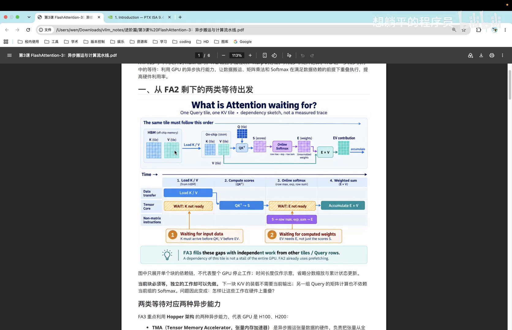
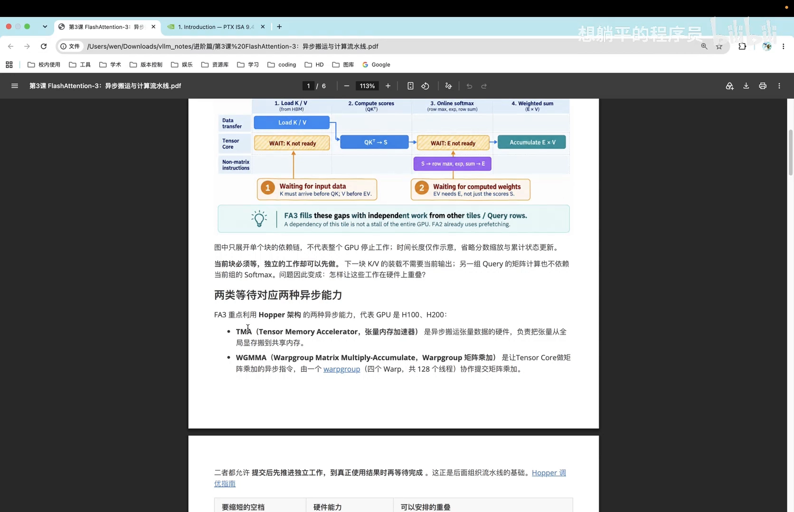
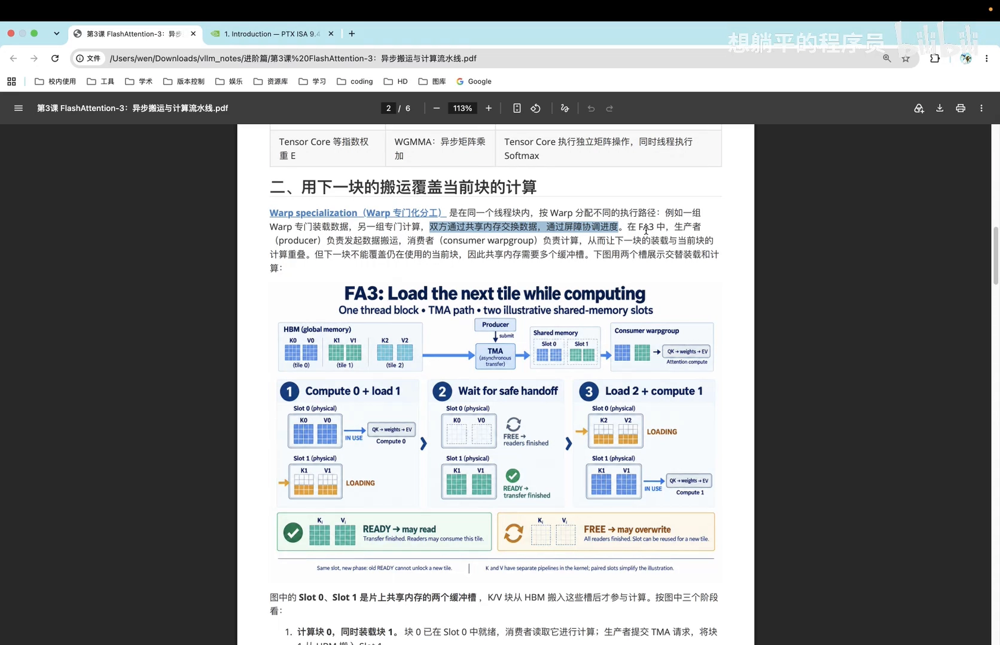
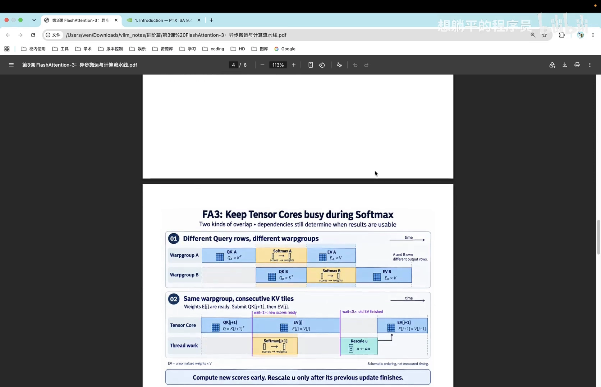
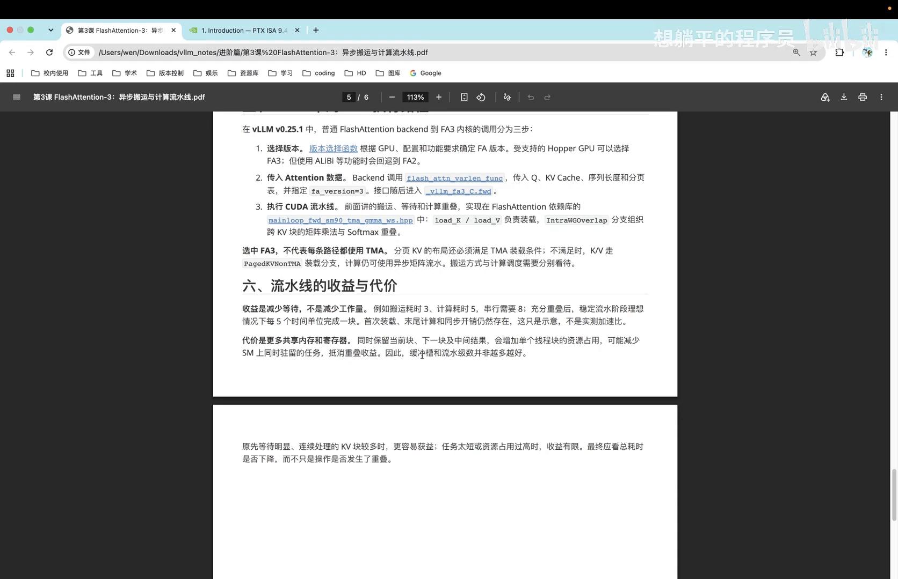

# FlashAttention-3 的流水线：用 TMA 与 WGMMA 把等待藏起来

> 视频来源：[第3课 FlashAttention-3：异步搬运与计算流水线](https://www.bilibili.com/video/BV1VBYA6SEAv/)（B 站 UP 主「想躺平的程序员」）｜时长约 24 分钟
> 导读：本讲不重讲 FA1/FA2，直接从「FA2 还剩下哪些等待」出发，把 FA3 的两条流水线拆成可执行的时序：搬运与计算重叠、矩阵乘与 softmax 重叠，并给出 warp specialization、双缓冲槽、wait<1>/wait<0> 的具体含义。

## 本讲要解决的核心问题（SCQA）

**背景**：FA1 减少了中间矩阵在 HBM 上的读写（优化 IO），FA2 改善了线程块与 warp 的分工并减少了非矩阵运算（优化并行）。到这里，单个 tile 的计算流程已经相当紧凑。

**冲突**：但 attention 的每一步都落在**不同的硬件**上——搬运走数据通路，矩阵乘走 Tensor Core，softmax 走非矩阵单元。既然硬件不同，就存在大量「等数据」「等结果」的空档：算 S 要等 K 到位，算 E×V 要等 softmax 出 E。

**疑问**：这些空档能不能填掉？Hopper 提供了哪些异步能力，FA3 又是怎么把它们组织成流水线的？

**回答（中心思想）**：FA3 用 Hopper 的两种异步能力——**TMA**（异步批量搬运）和 **WGMMA**（warpgroup 级异步矩阵乘加）——把两类等待分别用两条流水线填掉：**用下一块的搬运覆盖当前块的计算**（warp specialization + 双缓冲槽），以及**让矩阵乘与 softmax 交错执行**（不同 warpgroup 之间乒乓、同一 warpgroup 内两阶段）。它减少的是等待，不是工作量。

---

## 一、FA3 面对的是两类"等待"

先把标准 attention 的数据流转摆出来：从 HBM 把 K、V 加载到片上内存 → 算 $QK^{\mathsf{T}}$ 得到 $S$ → 算 softmax 得到 $E$ → $E \times V$ 得到输出 $O$。这三步在**不同的硬件**上执行，于是天然存在两个依赖等待。[【跳转到 00:50】](https://www.bilibili.com/video/BV1VBYA6SEAv/?t=50)

图里三条轨道分别是 `Data transfer`、`Tensor Core`、`Non-matrix instructions`，可以清楚看到 Tensor Core 有两段 `WAIT`：

1. **Waiting for input data**：K 必须先到，才能算 $QK^{\mathsf{T}}$；V 必须先到，才能算 $E \times V$。
2. **Waiting for computed weights**：$E \times V$ 需要的是 $E$，不是分数 $S$，所以必须等非矩阵单元把 $S \to \text{row max, exp, sum} \to E$ 算完。

**关键判断**：图中只展开单个块的依赖链，不代表整个 GPU 停止工作。当前块必须等，**独立的工作却可以先做**——下一块 K/V 的装载不需要当前输出；另一组 Query 的矩阵计算也不依赖当前组的 softmax。问题因此变成：**怎样让这些工作在硬件上重叠？**[【跳转到 02:05】](https://www.bilibili.com/video/BV1VBYA6SEAv/?t=125)

---

## 二、两种异步能力：TMA 与 WGMMA

Hopper 架构（代表 GPU 是 H100、H200）提供了两种正好对得上这两类等待的异步能力。[【跳转到 04:10】](https://www.bilibili.com/video/BV1VBYA6SEAv/?t=250)

| 能力 | 全称 | 是什么 | 对应哪类等待 |
| :--- | :--- | :--- | :--- |
| TMA | Tensor Memory Accelerator（张量内存加速器） | 异步搬运张量数据的硬件，负责把张量从全局显存搬到共享内存 | 等输入数据 |
| WGMMA | Warpgroup Matrix Multiply-Accumulate | 让 Tensor Core 做矩阵乘加的异步指令，由一个 warpgroup（四个 warp，共 128 个线程）协作提交 | 等指数权重 E |

两者共同的性质是：**提交之后先去推进独立的工作，到真正使用结果时再等待完成。** 这一点是后面所有流水线组织的语法基础。

初学者容易把 WGMMA 理解成「更快的一条 mma 指令」，其实它的关键差别在**粒度与异步性**：粒度从 warp 提升到 warpgroup（128 线程协作提交一次），并且提交后不阻塞，可以继续提交下一个、或去做 softmax。

---

## 三、第一条流水线：用下一块的搬运覆盖当前块的计算

### 3.1 warp specialization：把 warp 分成生产者和消费者

要在同一个线程块里同时「搬」和「算」，最直接的办法是让不同的 warp 走不同的执行路径，这就是 **warp specialization（warp 专门化分工）**：同一个线程块内按 warp 分配不同路径，一组专门装载数据，另一组专门计算，双方通过共享内存交换数据、通过屏障协调进度。[【跳转到 07:05】](https://www.bilibili.com/video/BV1VBYA6SEAv/?t=425)

在 FA3 里，**生产者（producer）负责发起数据搬运，消费者（consumer warpgroup）负责计算**，从而让下一块的装载与当前块的计算重叠。

### 3.2 为什么需要两个缓冲槽

但下一块不能覆盖仍在使用的当前块，因此共享内存需要**多个缓冲槽**。视频用两个槽展示交替装载和计算的过程。[【跳转到 08:20】](https://www.bilibili.com/video/BV1VBYA6SEAv/?t=500)

按图中三个阶段看：

1. **Compute 0 + load 1**：块 0 已在 Slot 0 就绪，消费者读它进行计算；生产者提交 TMA 请求，把块 1 从 HBM 搬入 Slot 1（`LOADING`）。
2. **Wait for safe handoff**：块 1 搬完后，Slot 1 发出 `READY`（表示传输完成、读者可以消费）；所有消费者用完块 0 后，Slot 0 才能标记 `FREE`（表示可以覆盖）。**这两个条件不要求同时满足，也不是整个线程块统一停下来等待。**
3. **Load 2 + compute 1**：复用 Slot 0 装载块 2，同时消费者在 Slot 1 上计算块 1。

于是就形成一种交错效果：**Slot 0 装载时 Slot 1 做计算，Slot 1 装载时 Slot 0 做计算**，通过交替不断把计算和装载重叠起来。实现上通过类似锁的机制完成不同线程之间的同步。[【跳转到 10:25】](https://www.bilibili.com/video/BV1VBYA6SEAv/?t=625)

图下方还有一条容易忽略的注记：`Same slot, new phase: old READY cannot unlock a new tile`——同一个槽进入新阶段后，旧的 READY 不能解锁新块，所以**阶段（phase）本身也要参与同步**，不能只用一个布尔量表示「这个槽空了」。

---

## 四、第二条流水线：让 Tensor Core 在 softmax 期间不闲着

矩阵乘法和 softmax 也是在 GPU 的不同硬件上执行的，所以同样可以重叠。视频把这种重叠分成**两个层级**。[【跳转到 11:15】](https://www.bilibili.com/video/BV1VBYA6SEAv/?t=675)

### 4.1 层级一：不同 warpgroup 之间（乒乓调度）

假如一个线程块里有两个消费者 warpgroup，A 和 B，A 负责一部分 Query 行，B 负责另一部分。那么 A 在算 softmax 的时候，B 就可以用 Tensor Core 算自己的 $QK$；B 之前算 softmax 的时候，A 就往后推进到算 value 加权。

**为什么可以这样安排？因为 A 和 B 处理的是不同的 Query，它们之间没有依赖关系**，不需要等 A 的 softmax 做完。没有数学依赖的时候就可以交错执行。这就是论文里的**乒乓调度（pingpong scheduling）**：一个 warpgroup 做 softmax 时，另一个 warpgroup 做矩阵乘。[【跳转到 12:30】](https://www.bilibili.com/video/BV1VBYA6SEAv/?t=750)

### 4.2 层级二：同一 warpgroup 内部（两阶段）

同一个 warpgroup 内部也能重叠。这里的 Q 是同一个，但 KV 块是连续的，于是可以**提前算下一块的分数**：

1. **先提交 QK[j+1] 和 EV[j]**：给 Tensor Core 同时提交两个任务。下一块的 QK 只依赖 Q 和下一块的 K，不必等当前块的输出，所以可以提前计算。
2. **到第一条紫线 `wait<1>`**：`wait<1>` 表示「允许有一个已提交的操作尚未完成」，即下一块分数已经可读。线程开始 `Softmax[j+1]`，与此同时 Tensor Core 上的 `EV[j]` 可以继续执行——图上上下对齐的这段就是矩阵乘与 softmax 的重叠区间。
3. **到第二条紫线 `wait<0>`**：`wait<0>` 要求这些任务全部完成，确认旧的 `EV[j]` 已完成。即使下一块 softmax 已经算完，也不能在旧 EV 仍写入累计输出 $u$ 时缩放 $u$，所以 `Rescale u` 必须放在这条线之后。
4. **进入 EV[j+1]**：累计输出调整到新的 softmax 基准后，才能加入下一块的贡献。

![同一 warpgroup 内的关键时序：先提交 QK[j+1] 与 EV[j]，wait<1> 后开始 Softmax[j+1]，wait<0> 后才 Rescale u](assets/FlashAttention-3的流水线：用TMA与WGMMA把等待藏起来/00900.webp)

这里有一句总结得很准：**提前的是下一块的分数计算，重叠的是当前块的 EV 与下一块的 softmax。** 它可以和上半部分不同 warpgroup 的交错调度组合使用。[【跳转到 16:40】](https://www.bilibili.com/video/BV1VBYA6SEAv/?t=1000)

### 4.3 流水线不能破坏的两条依赖

虽然把执行流水线化了，但**输出累加的顺序不能破坏**。视频强调两条必须保留的依赖：[【跳转到 19:35】](https://www.bilibili.com/video/BV1VBYA6SEAv/?t=1175)

- 下一块分数就绪之后，才可以更新最大值、指数和，并算出缩放系数；
- 当前块完成之后，才可以用这个系数去缩放 $u$，再去累加下一块的贡献。

对应到 online softmax 的递推上，就是「$m'$、$\alpha$、$l'$ 的更新」和「$u' = \alpha u + \sum e_j v_j$ 的更新」这两步的先后不能被重排掉。

---

## 五、落到 vLLM 与收益评估

### 5.1 vLLM 里怎么选到 FA3

在 vLLM 里也支持了 FA3。它会根据配置选择 FA 的版本，然后传入对应的数据，调用通用的 attention 函数；具体的执行依赖由所调用的 FlashAttention 依赖库实现，原理与前面讲的一致。[【跳转到 20:50】](https://www.bilibili.com/video/BV1VBYA6SEAv/?t=1250)

值得注意的是「选中 FA3 不等于每条路径都用 TMA」：分页 KV 的布局必须满足 TMA 装载条件，不满足时 K/V 走非 TMA 的装载分支，但计算仍可使用异步矩阵流水——**搬运方式与计算调度要分别看待**。

### 5.2 收益是减少等待，不是减少工作量

视频用一个极简的模型算账：搬运耗时 3、计算耗时 5，串行执行需要 8；重叠之后，稳定流水阶段理想情况下每 5 个时间单位就能完成一块。[【跳转到 22:55】](https://www.bilibili.com/video/BV1VBYA6SEAv/?t=1375)

代价是**更多的共享内存和寄存器**：要同时保留当前块、下一块以及一些中间结果，单个线程块的资源占用上升；资源占用多了，SM 上能驻留的任务数量可能减少，收益可能被抵消。**所以并不是流水线越多越好**——首次装载、末尾计算和同步开销仍然存在，最终应该看总耗时是否下降，而不是只看「操作是否发生了重叠」。

---

## 小结

- FA1 优化 IO，FA2 优化并行与分工，**FA3 优化的是「等待」**：用流水线把不同硬件上的工作重叠起来。
- 两类等待对应两种异步能力：**TMA** 填「等输入数据」，**WGMMA** 填「等指数权重 E」；两者的共同点是提交后先推进独立工作，用结果时再等。
- 第一条流水线靠 **warp specialization + 双缓冲槽**：生产者提交 TMA，消费者在就绪槽上计算，`READY` 与 `FREE` 两个条件各自独立，不需要整块停等。
- 第二条流水线有两个层级：**不同 warpgroup 之间乒乓调度**（不同 Query 行无依赖），**同一 warpgroup 内两阶段**（提前算 QK[j+1]，用 `wait<1>` 放行 softmax、`wait<0>` 后才 Rescale u）。
- 流水线不能破坏累加顺序：先更新最大值与缩放系数，再缩放 $u$、累加下一块贡献。
- 收益是减少等待而非减少工作量，代价是共享内存与寄存器占用；`wait<1>`/`wait<0>` 这类「允许未完成」的语义是整条流水线正确性的关键。

## 关键术语速查

| 术语 | 一句话解释 |
| :--- | :--- |
| TMA | Hopper 的张量内存加速器，异步把张量从全局显存搬到共享内存 |
| WGMMA | warpgroup 级异步矩阵乘加指令，由 128 个线程（4 个 warp）协作提交 |
| warpgroup | 4 个 warp 组成的执行单元，共 128 个线程 |
| warp specialization | 同一线程块内按 warp 分配不同执行路径，生产者搬、消费者算 |
| 双缓冲（slot） | 共享内存里两个交替使用的缓冲槽，一个在装载时另一个在计算 |
| pingpong 调度 | 两个 warpgroup 交替做矩阵乘与 softmax，互相填补对方的空档 |
| `wait<1>` | 允许一个已提交操作尚未完成的等待语义，用于「下一块分数可读即放行」 |
| `wait<0>` | 要求已提交操作全部完成的等待语义，用于「旧 EV 写完才能缩放 u」 |