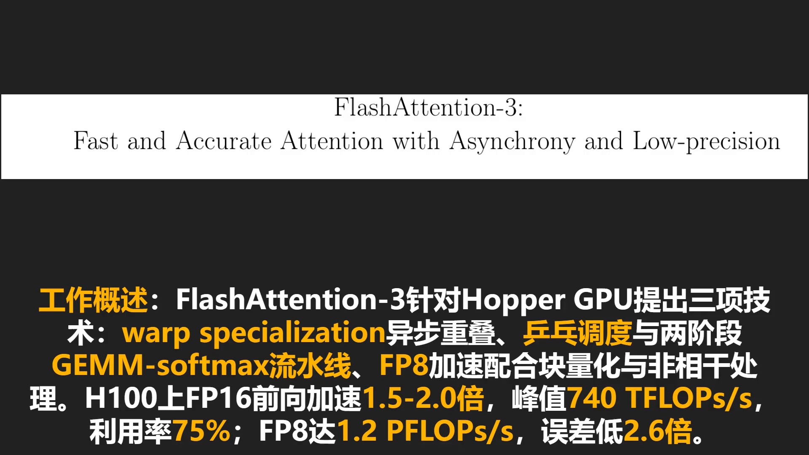
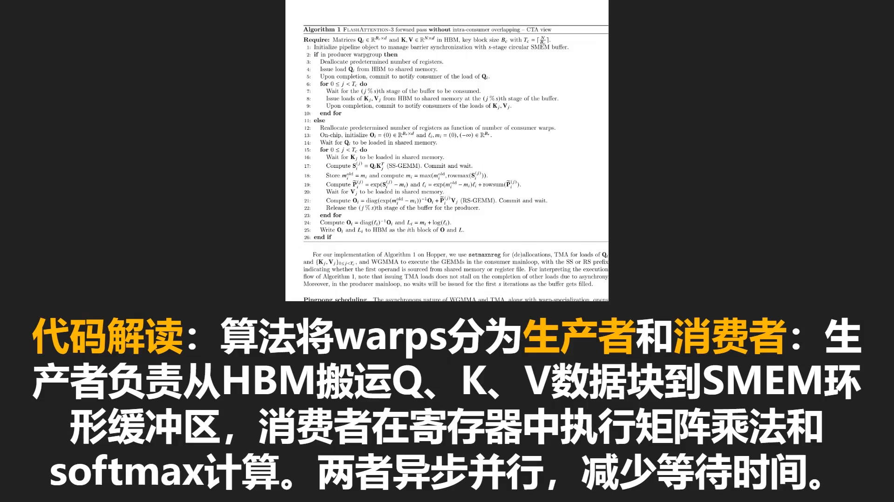
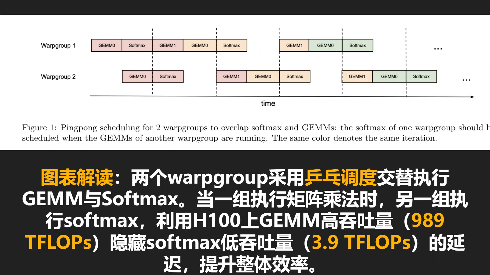
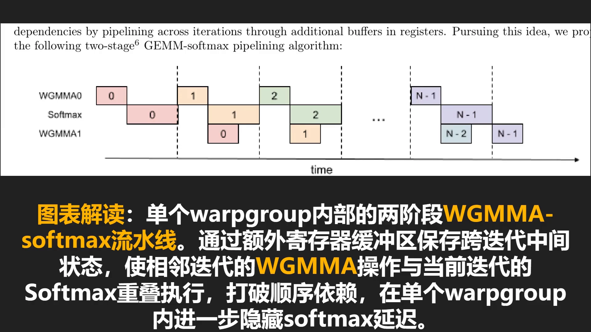
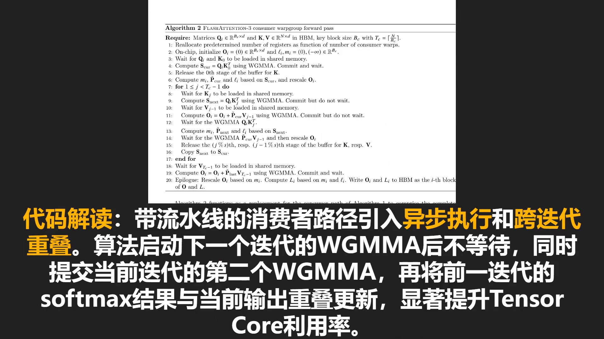
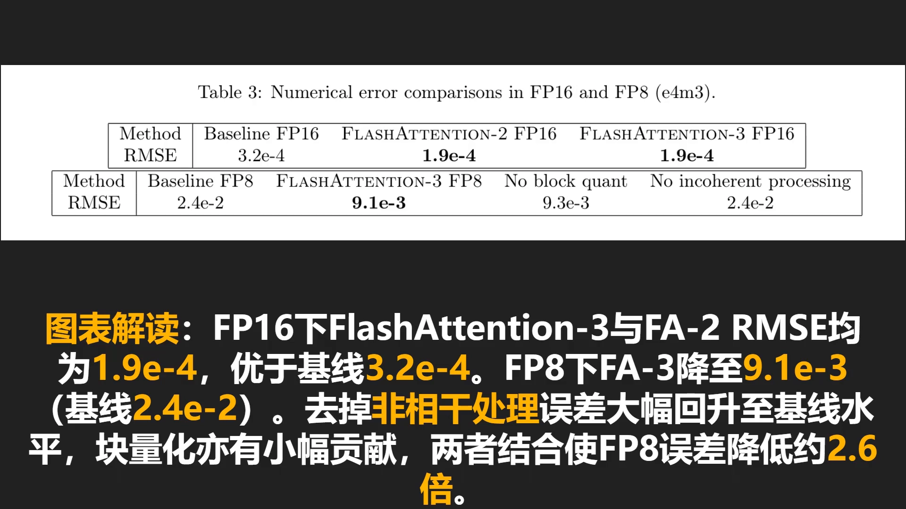
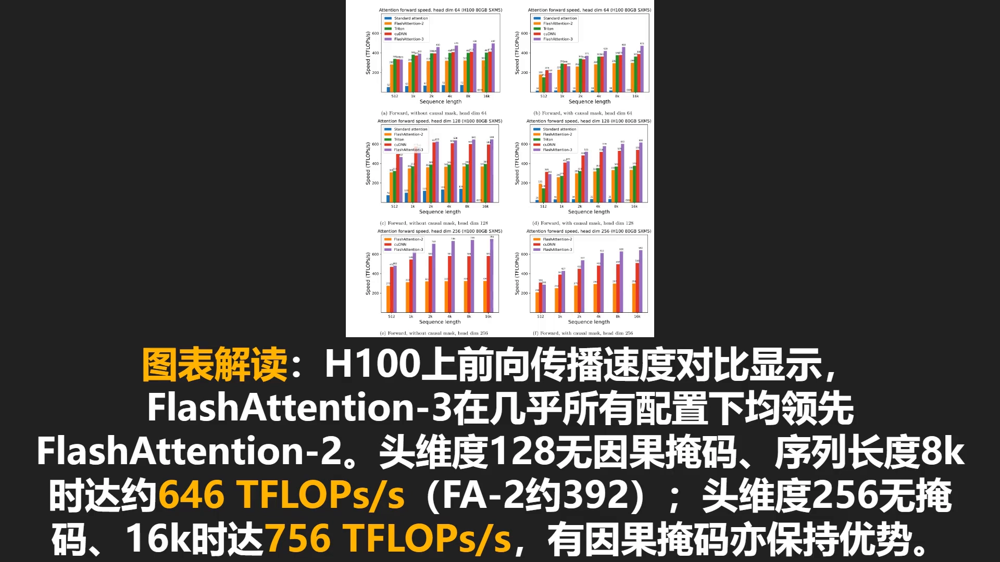
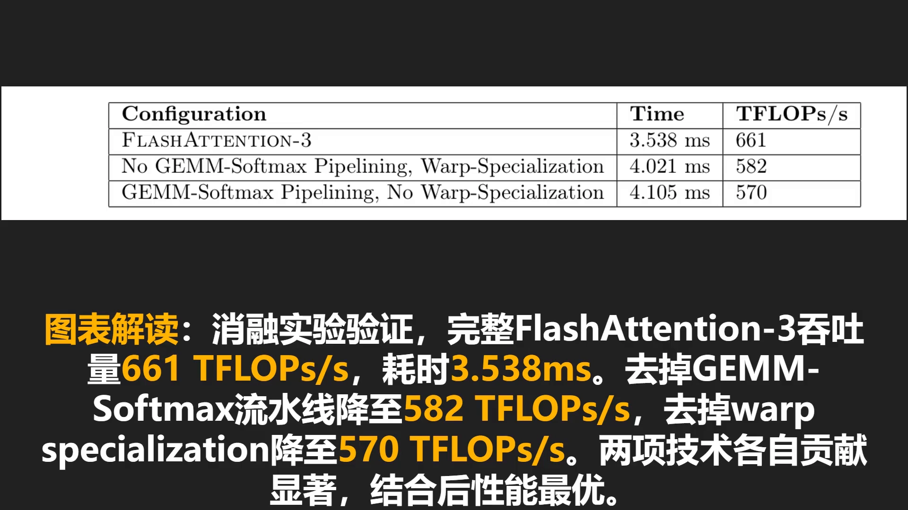

# FlashAttention-3 论文精读：WGMMA、乒乓调度与 FP8 三件套

> 视频来源：[[23] flash-attention-v3：论文解读【每天一个宝藏论文】](https://www.bilibili.com/video/BV1yZd6BcE3b/)（B 站 UP 主「海安雨」）｜时长约 11 分钟
> 导读：这是一篇按论文结构走的速读：先看 H100 上「只跑到 35% 利用率」这个动机，再逐条过三项技术（warp specialization、乒乓调度与两阶段流水线、FP8 块量化与非相干处理），最后用论文的加速比、消融表和 RMSE 表收尾。适合已经知道 FlashAttention 分块与 online softmax 基础、想快速抓住 FA3 论文骨架的读者。

## 本讲要解决的核心问题（SCQA）

**背景**：注意力机制是 Transformer 的核心，也是大语言模型与长上下文应用的主要计算瓶颈。FlashAttention 通过减少内存读写来加速 GPU 上的注意力计算，FlashAttention-2 已经把这一思路做到比较充分。

**冲突**：但 FlashAttention-2 在英伟达 H100 上只能达到约 **35% 的硬件利用率**——IO 已经不是唯一瓶颈了，新硬件（Hopper）提供的异步能力没有被用起来。

**疑问**：Hopper 上到底有哪些能力没用上？论文用哪三项技术把它们吃干净？精度还能不能进一步压到 FP8？

**回答（中心思想）**：论文发表于 2024 年 7 月，标题直译是「利用异步性和低精度实现快速且精确的注意力计算」。三项技术是：**用 warp specialization 实现生产者-消费者异步，把数据搬运与计算重叠**；**在两组 warpgroup 之间做乒乓调度，并在单个 warpgroup 内做两阶段 GEMM-softmax 流水线**；**用 FP8 低精度 Tensor Core 加速矩阵乘，同时用块量化与非相干处理控制精度损失**。结果是 H100 上 FP16 前向比 FA2 快 1.5–2.0 倍、峰值 740 TFLOPS/s（75% 利用率），FP8 接近 1.2 PFLOPS/s，且 FP8 数值误差比标准 FP8 实现低 2.6 倍。

---

## 一、动机：IO 优化到头之后，剩下 65% 的算力

论文摘要的论证链条很短，但每一句都值得记住：[【跳转到 01:28】](https://www.bilibili.com/video/BV1yZd6BcE3b/?t=88)

- 注意力是 Transformer 的核心层，是大模型与长上下文的瓶颈；
- FlashAttention 通过减少内存读写来加速它；
- **然而它尚未充分利用新硬件的能力**——FA2 在 H100 上仅达到 35% 利用率；
- 因此论文开发三种技术来加速 Hopper GPU 上的注意力：利用 Tensor Core 与 TMA 的异步性、交错块级矩阵乘与 softmax、块量化与非相干处理。

这张图把全文结论浓缩成三行：**warp specialization 异步重叠**、**乒乓调度与两阶段 GEMM-softmax 流水线**、**FP8 加速配合块量化与非相干处理**；H100 上 FP16 前向加速 1.5–2.0 倍、峰值 740 TFLOPS/s、利用率 75%，FP8 达 1.2 PFLOPS/s、误差低 2.6 倍。

先把标准 attention 的公式摆出来，后面所有优化都不改变它：

$$
S = \alpha \, Q K^{\mathsf{T}}, \qquad P = \operatorname{softmax}(S), \qquad O = P V
$$

其中 $\alpha$ 是缩放因子，$S$ 是 $N \times N$ 的分数矩阵，$P$ 是按行 softmax 得到的注意力权重。**FA3 的目标是在保持这个计算结果完全正确的前提下，用更少的内存访问和更高的硬件利用率来加速它。**[【跳转到 02:32】](https://www.bilibili.com/video/BV1yZd6BcE3b/?t=152)

---

## 二、算法骨架：把 warp 分成生产者和消费者

论文的 Algorithm 1 是「不含消费者内部流水线重叠」的基础版本，它的核心思想只有一句：**把一个线程块内的 warp 分成两类角色**。[【跳转到 03:11】](https://www.bilibili.com/video/BV1yZd6BcE3b/?t=191)

- **生产者（producer warpgroup）**：从 HBM 全局内存把 Q、K、V 的块搬运到共享内存（SMEM）；用 `setmaxnreg` 释放/重分配寄存器，用 TMA 发起 K/V 的加载，完成后 `commit` 通知消费者。
- **消费者（consumer warpgroup）**：负责在寄存器里做实际的矩阵乘法和 softmax 计算；等待数据就绪后，先用 **SS-GEMM** 计算分数矩阵 $S$，再更新行最大值、指数和，接着用 **RS-GEMM** 把加权后的值累加到输出 $O$。
- 每一轮迭代结束后**释放对应的缓冲区阶段**，让生产者可以继续加载下一轮数据。

伪代码里几个细节值得单独点出：

- 缓冲区是**多阶段的环形 SMEM buffer**（$s$-stage circular buffer），生产者写第 $(j \bmod s)$ 个阶段，消费者读同一个阶段；
- 消费者的 `Compute S = QKᵀ (SS-GEMM). Commit and wait.` 与 `Compute O += ... (RS-GEMM). Commit and wait.` 都带 `commit`，这就是 WGMMA 的异步提交语义；
- 论文脚注说明：Hopper 上的实现用 `setmaxnreg` 做寄存器的分配与回收，用 TMA 装载 Q 与 K/V，用 WGMMA 执行消费者主循环里的 GEMM，`SS` 与 `RS` 前缀表示第一个操作数来自共享内存还是寄存器文件。

**这种分工让数据搬运和计算可以并行进行，减少了等待时间**——这是后面两条流水线的地基。

---

## 三、乒乓调度：用高吞吐的 GEMM 掩盖低吞吐的 softmax

Algorithm 1 只解决了「搬」与「算」的重叠，softmax 仍然串在两次 GEMM 之间。论文的第一个关键观察是：**在 H100 上，softmax 涉及的指数运算等特殊函数吞吐量很低，只有约 3.9 TFLOPS，而 FP16 矩阵乘可以达到 989 TFLOPS。** 两者相差两个数量级。[【跳转到 04:40】](https://www.bilibili.com/video/BV1yZd6BcE3b/?t=280)

于是有了**乒乓调度（pingpong scheduling）**：两个 warpgroup 交替执行，一个做 softmax 时另一个做矩阵乘。

图中每一行是一个 warpgroup 的时间线，矩形块是正在执行的操作：`GEMM0` 表示第一个矩阵乘 $Q K^{\mathsf{T}}$，`GEMM1` 表示第二个矩阵乘 $P V$，`Softmax` 表示 softmax 计算。可以看到当 Warpgroup 1 在执行 GEMM0 或 GEMM1 时，Warpgroup 2 正在执行 softmax，反之亦然。**图中相同颜色代表同一次迭代。**

之所以能这样排，是因为两个 warpgroup 处理的是**不同的输出行**（图注里的 `A and B own different output rows`），彼此没有数据依赖。通过乒乓调度，把低吞吐量的 softmax 隐藏在高吞吐量的 GEMM 执行期间，从而提升整体效率。

---

## 四、两阶段流水线：在单个 warpgroup 内部再叠一层

乒乓调度的前提是「有两个 warpgroup 可以交替」。如果只有一个 warpgroup 在跑，softmax 的延迟还是会暴露出来。论文的第二个技术就是在**单个 warpgroup 内部**做重叠。[【跳转到 05:16】](https://www.bilibili.com/video/BV1yZd6BcE3b/?t=316)

图中有三条时间线：`WGMMA0`、`Softmax`、`WGMMA1`。在迭代 0 中，WGMMA0 先执行；当 softmax 在处理迭代 0 的中间结果时，WGMMA1 开始执行迭代 0 的第二个矩阵乘；与此同时 WGMMA0 已经开始执行迭代 1 的第一个矩阵乘。也就是说，**相邻迭代之间的 WGMMA 与当前迭代的 softmax 被重叠在一起**，靠的是**额外的寄存器缓冲区保存跨迭代的中间状态**。算法因此打破了原本的顺序依赖，让硬件可以同时执行多个操作。

这种流水线在伪代码里长这样：

Algorithm 2 替换了 Algorithm 1 中的消费者路径，关键区别是**主循环里引入了异步执行与跨迭代重叠**：[【跳转到 06:19】](https://www.bilibili.com/video/BV1yZd6BcE3b/?t=379)

1. 先启动下一个迭代的 WGMMA 计算 $Q \times K^{\mathsf{T}}$，即 $S_{\text{next}}$，**提交后不等待**；
2. 等待前一个值块 $V$ 加载到共享内存，然后启动当前迭代的第二个 WGMMA 计算 $P \times V$，**同样提交后不等待**；
3. 等到前一个 WGMMA 的 $Q \times K^{\mathsf{T}}$ 完成，再基于 $S_{\text{next}}$ 做 softmax 更新；
4. 等底层 $V$ 的 WGMMA 完成，对输出 $O$ 做缩放；
5. 循环末尾把 $S_{\text{next}}$ 复制到 $S_{\text{curr}}$，为下一轮做准备。

这样，**迭代 $j$ 的第二个 WGMMA 与迭代 $j+1$ 的 softmax 被重叠执行**，显著提升了 Tensor Core 的利用率。

---

## 五、FP8：块量化与非相干处理各管一半误差

第三项技术是把矩阵乘压到 FP8。FP8 的难点不在速度而在精度，论文用两个手段控制误差。[【跳转到 00:50】](https://www.bilibili.com/video/BV1yZd6BcE3b/?t=50)

- **块量化（block quantization）**：不整张矩阵共用一个缩放因子，而是按块量化，减少离群值对整张矩阵动态范围的影响；
- **非相干处理（incoherent processing）**：论文用随机正交变换之类的技巧把离群值「打散」，让量化误差更均匀。

效果由论文的 Table 3 给出：

| 方法 | RMSE |
| :--- | :--- |
| Baseline FP16 | 3.2e-4 |
| FlashAttention-2 FP16 | 1.9e-4 |
| FlashAttention-3 FP16 | 1.9e-4 |
| Baseline FP8 | 2.4e-2 |
| FlashAttention-3 FP8 | 9.1e-3 |
| 去掉块量化 | 9.3e-3 |
| 去掉非相干处理 | 2.4e-2 |

读法很清楚：[【跳转到 09:40】](https://www.bilibili.com/video/BV1yZd6BcE3b/?t=580)

- **FP16 下 FA3 与 FA2 的 RMSE 都是 1.9e-4，优于基线 3.2e-4**——异步与流水线没有牺牲精度；
- **FP8 下 FA3 降到 9.1e-3**，约为基线 FP8（2.4e-2）的 38%；
- **去掉块量化**误差略升到 9.3e-3，说明块量化有贡献但幅度不大；
- **去掉非相干处理**误差大幅回升到 2.4e-2，和基线差不多——**非相干处理才是控制 FP8 误差的关键**，两者结合使 FP8 误差比基线低约 2.6 倍。

---

## 六、实验：速度、消融与「各项技术各自值多少」

### 6.1 前向速度：几乎所有配置都领先 FA2

图中共 6 个子图，分别对应头维度 64、128、256 以及有无因果掩码的情况；横轴是序列长度（512 到 16K），纵轴是速度（TFLOPS/s）。紫色柱子是 FA3，橙色是 FA2，绿色是 Triton 实现，红色是 cuDNN，蓝色是标准注意力。[【跳转到 07:50】](https://www.bilibili.com/video/BV1yZd6BcE3b/?t=470)

几个可引用的点：

- 头维度 128、无因果掩码，序列长度 8K 时，**FA3 约 646 TFLOPS/s，FA2 约 392**；
- 头维度 256、无因果掩码，序列长度 16K 时，**FA3 达到 756 TFLOPS/s**；
- 即使在有因果掩码的情况下，FA3 也保持领先优势。

### 6.2 消融：两项技术各自贡献显著

实验配置固定为 batch 4、序列长度 8448、16 个头、头维度 128：[【跳转到 08:45】](https://www.bilibili.com/video/BV1yZd6BcE3b/?t=525)

| 配置 | 耗时 | 吞吐 |
| :--- | :--- | :--- |
| FlashAttention-3（完整） | 3.538 ms | 661 TFLOPS/s |
| 去掉 GEMM-Softmax 流水线，保留 warp specialization | 4.021 ms | 582 TFLOPS/s |
| 保留 GEMM-Softmax 流水线，去掉 warp specialization | 4.105 ms | 570 TFLOPS/s |

**warp specialization 和 GEMM-Softmax 流水线各自都能带来明显的加速，两者结合后吞吐达到最高值**，这验证了论文中异步与流水线设计对性能的实际贡献。

---

## 小结

- 论文的出发点不是「IO 还能再省」，而是「**H100 上 FA2 只跑到 35% 利用率**」——新硬件的异步能力没被用起来。
- 三项技术分别对应三层问题：**warp specialization** 解决搬运与计算的重叠，**乒乓调度 + 两阶段流水线** 解决 softmax 与 GEMM 的重叠，**FP8 + 块量化 + 非相干处理** 解决低精度下的误差。
- Algorithm 1 是骨架：生产者 warpgroup 用 TMA 把 Q/K/V 搬进多阶段环形 SMEM，消费者 warpgroup 用 SS-GEMM 算 $S$、用 RS-GEMM 累加 $O$，每轮结束释放缓冲阶段。
- 乒乓调度的依据是「两个 warpgroup 负责不同输出行、互不依赖」；两阶段流水线的依据是「下一块的 $QK^{\mathsf{T}}$ 不依赖当前块的输出」，靠额外寄存器缓冲跨迭代状态。
- FP8 的误差控制主要靠**非相干处理**（去掉它误差回到基线水平），块量化是次要贡献；两者结合使 FP8 误差比基线低约 2.6 倍。
- 数字层面：FP16 前向 1.5–2.0 倍加速、740 TFLOPS/s、75% 利用率；FP8 接近 1.2 PFLOPS/s；消融显示两项流水线技术各自值 70–90 TFLOPS/s。

## 关键术语速查

| 术语 | 一句话解释 |
| :--- | :--- |
| warp specialization | 把线程块内的 warp 分成生产者（搬数据）与消费者（算 GEMM/softmax）两类角色 |
| WGMMA | Hopper 上 warpgroup 级异步矩阵乘加指令，提交后不阻塞 |
| TMA | 张量内存加速器，异步把张量从 HBM 搬到共享内存 |
| 环形 SMEM 缓冲 | 多阶段循环使用的共享内存缓冲区，生产者写第 $j \bmod s$ 阶段 |
| pingpong 调度 | 两个 warpgroup 交替做 GEMM 与 softmax，用高吞吐 GEMM 掩盖低吞吐 softmax |
| 两阶段 GEMM-softmax 流水线 | 单个 warpgroup 内用额外寄存器缓冲，把相邻迭代的 WGMMA 与当前 softmax 重叠 |
| SS-GEMM / RS-GEMM | 第一个操作数分别来自共享内存（Shared）与寄存器文件（Register）的 GEMM |
| 块量化 | 按块而非整矩阵计算缩放因子，降低离群值对量化精度的影响 |
| 非相干处理 | 用变换把离群值「打散」，使 FP8 量化误差更均匀，是 FP8 精度的关键手段 |