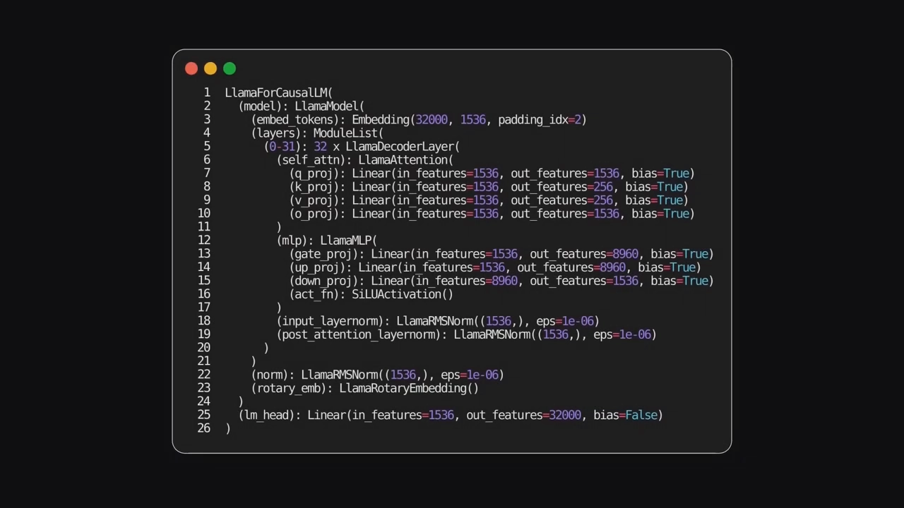
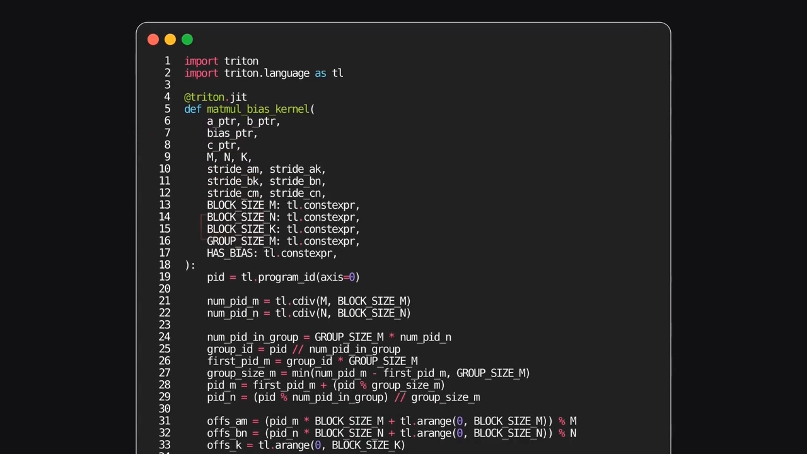
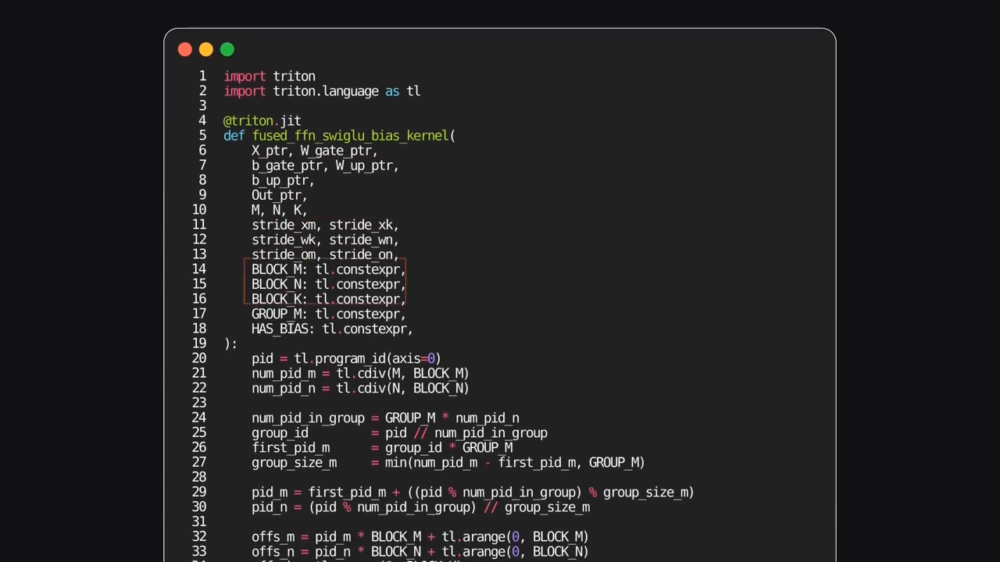
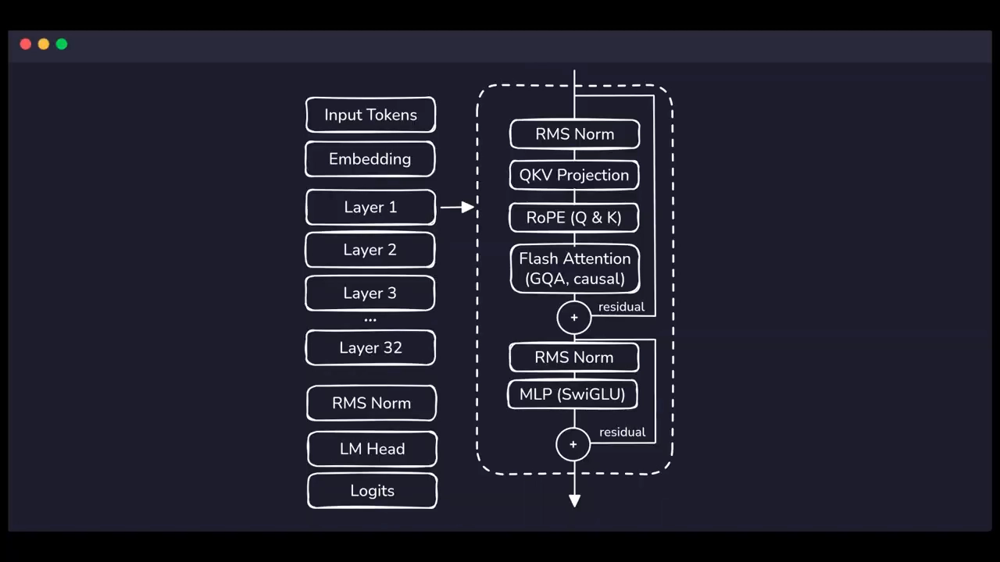
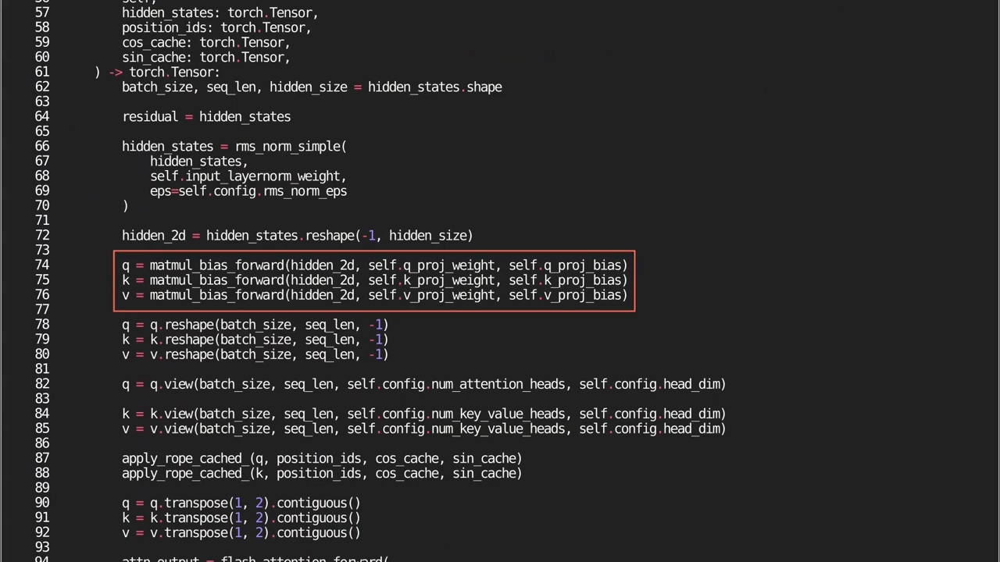
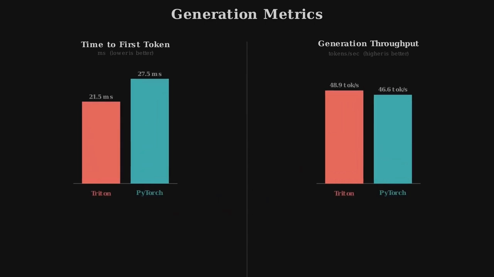

# 从零拼一个解码层：哪些融合是白拿的，哪些还隔着一次显存往返

> 视频来源：[Triton Kernels Actually Work - Here's Proof](https://www.youtube.com/watch?v=6ftMCzdrPng)（YouTube · Bielik Anatomy / Kuba）｜时长约 10 分钟
> 导读：这是「用 Triton 手写全部 kernel」系列的收尾集：把 RMSNorm、矩阵乘、RoPE、FlashAttention、SwiGLU 拼成一个 1.5B 模型的 32 层解码器并实测。本文只挑与融合有关的部分讲透——bias 怎么白拿、SwiGLU 的两个 bias 怎么一起折进累加器，以及**哪些地方视频里还没有融合、按它自己的账本该省多少**。最后一节是实测曲线，说明 kernel 级收益为什么会被一个算法级缺陷吞掉。

## 本讲要解决的核心问题（SCQA）

**背景**：手写 kernel 的教程通常停在「单个 kernel 写得对不对」。但真实的模型是一层套一层的算子链：RMSNorm、QKV 投影、RoPE、注意力、输出投影、残差加、RMSNorm、SwiGLU、down 投影、残差加。

**冲突**：每个 kernel 单独看都很快，拼起来却处处是「写回显存再读回来」的接缝。有些接缝可以免费焊死（比如 bias），有些接缝要改动算法结构才能焊（比如 RoPE 与 attention 之间）。

**疑问**：在一个能跑的真实实现里，哪些融合是「顺手就拿到」的？哪些接缝还在付费？各付多少？

**回答（中心思想）**：**尾声融合是最便宜的一类**——bias 加法本来要读写一遍整张量，焊进矩阵乘的累加器后直接变成零成本，连分支开销都能用编译期标志消掉。而**跨算子边界的融合要付设计成本**：视频里的 QKV 投影是三次独立调用、RoPE 是独立的一步、残差加也是独立的一步，每一处都还隔着一次显存往返；按视频自己给出的账本，这些正是 QKV 合并、RoPE + Attention、Add + RMSNorm 三种模式要吃掉的部分。

## 一、先看清要拼的东西：Bielik 1.5B 的形状

视频加载的是 HuggingFace 上的 Bielik 1.5B instruct 模型，打印出的结构一目了然：embedding 之后是 **32 个解码层**，最后一个 final norm 和把结果投影到词表的 LM head。每个解码层里有 attention 和 MLP 两个块。[【跳转到 00:06】](https://www.youtube.com/watch?v=6ftMCzdrPng&t=6)



把和融合有关的几个数字抄下来（后面算账要用）：

- 隐藏维度 $d = 1536$；中间维度 $d_{ff} = 8960$；词表 32000。
- `q_proj`：$1536 \to 1536$；`k_proj`、`v_proj`：$1536 \to 256$（2 个 KV head × 128 维）；`o_proj`：$1536 \to 1536$。
- `gate_proj`、`up_proj`：$1536 \to 8960$；`down_proj`：$8960 \to 1536$。
- **除了 `lm_head`，所有线性层都带 bias**——这一点决定了后面 bias 融合的收益面有多大。
- 12 个 query head 但只有 2 个 KV head（GQA），视频说这让 KV 参数少了 6 倍。

## 二、白拿的融合：bias 折进矩阵乘的累加器

### 2.1 做法：一个指针 + 一个编译期标志

带 bias 的线性层本来是 $y = xW + b$。不融合时它是两个算子：矩阵乘一个 kernel（写结果），bias 加法一个 kernel（读结果、读 bias、写结果）。融合的做法是把 bias 指针和一个**编译期布尔标志** `HAS_BIAS` 直接加进 kernel 签名。[【跳转到 02:42】](https://www.youtube.com/watch?v=6ftMCzdrPng&t=162)

```python
@triton.jit
def matmul_bias_kernel(
    a_ptr, b_ptr,
    bias_ptr,
    c_ptr,
    M, N, K,
    stride_am, stride_ak,
    stride_bk, stride_bn,
    stride_cm, stride_cn,
    BLOCK_SIZE_M: tl.constexpr,
    BLOCK_SIZE_N: tl.constexpr,
    BLOCK_SIZE_K: tl.constexpr,
    GROUP_SIZE_M: tl.constexpr,
    HAS_BIAS: tl.constexpr,
):
    ...
```



### 2.2 为什么是「零代价」

在 kernel 里检查这个标志，把 bias 那一行读进来，直接广播到累加器矩阵的每一行上。妙处在于：**bias 加法就发生在寄存器里，用的还是矩阵乘那个 FP32 累加器**，所以几乎没有性能代价——视频的原话是「这份融合是完全白拿的」。[【跳转到 02:51】](https://www.youtube.com/watch?v=6ftMCzdrPng&t=171)

把账算清楚：

| 项目 | 不融合（矩阵乘 + bias 加法两个 kernel） | 融合（一个 kernel） |
| --- | --- | --- |
| kernel 发射 | 2 次 | 1 次 |
| 整张量访存 | 矩阵乘写结果 1 次 + bias 加法读结果 1 次、读 bias 1 次、写结果 1 次 | 矩阵乘写结果 1 次 |
| 中间张量 | 1 个（矩阵乘的结果） | 0 个 |

也就是说，bias 加法那 **3 趟整张量访存（读结果、读 bias、写结果）和 1 次发射全部消失**，因为结果还在累加器寄存器里没写出去。这就是「尾声融合」为什么是最划算的一类：它不改变任何算法结构，只是把一件小事挪到数据已经在片上的时刻做。

### 2.3 编译期标志的第二个好处：分支开销也消失

因为用的是编译期常量，某一层不需要 bias 时把 `HAS_BIAS` 设成 `False`，bias 的代码会**从编译出的 kernel 里彻底消失**，连分支判断的开销都没有。这是「运行时 if」做不到的——运行时判断每次都要执行，编译期标志直接生成两份不同的机器码。[【跳转到 03:21】](https://www.youtube.com/watch?v=6ftMCzdrPng&t=201)

## 三、同一招用在 SwiGLU 上：两个 bias 一起折

### 3.1 改签名

前馈网络块里 gate 和 up 投影都带 bias，而作者原来的 SwiGLU kernel 不支持 bias，所以要补上：签名里同时接收 `b_gate_ptr` 和 `b_up_ptr`，以及同一个 `HAS_BIAS` 标志。[【跳转到 03:51】](https://www.youtube.com/watch?v=6ftMCzdrPng&t=231)

```python
@triton.jit
def fused_ffn_swiglu_bias_kernel(
    X_ptr, W_gate_ptr,
    b_gate_ptr, W_up_ptr,
    b_up_ptr,
    Out_ptr,
    M, N, K,
    ...
    HAS_BIAS: tl.constexpr,
):
```



### 3.2 折进去的位置很关键

在算完两个矩阵乘之后，有条件地把两个 bias 向量加载进 SRAM，直接广播进 FP32 累加器；然后**在应用 Swish/SiLU 激活、把 gate 和 up 相乘之前**完成加法。[【跳转到 04:09】](https://www.youtube.com/watch?v=6ftMCzdrPng&t=249)

顺序不能反：bias 必须先加，再进 SiLU 和逐元素相乘。这正好说明了融合 kernel 的一个隐含要求——**融合顺序必须与数学定义一致**，不能为了省事把算子顺序调乱。

### 3.3 这笔账

- 不融合：gate 矩阵乘 + gate bias 加法 + up 矩阵乘 + up bias 加法 + SwiGLU，至少 5 个 kernel。
- 融合后：1 个 kernel，两个 bias 都在累加器里加完，SiLU 与相乘也在寄存器里做完，只写一次输出。

省下的是 **4 次发射**，以及 gate、up 两份中间结果（各 8960 宽）的写回与读回。中间维度 8960 是隐藏维度 1536 的近 6 倍，所以这里省下的传输量比 attention 侧的 bias 融合大得多。

## 四、整层的拼装：哪些接缝还在付费

### 4.1 结构：两层归一化 + 两个残差

每个解码层做的事是：**RMSNorm → attention → 残差加 → RMSNorm → 前馈网络 → 残差加**。[【跳转到 04:51】](https://www.youtube.com/watch?v=6ftMCzdrPng&t=291)



这张图就是本小节四种融合模式的「地图」：

- **QKV Projection** 是一个方框——视频里它内部是三次独立调用，可以合成一次（水平融合）。
- **RoPE (Q & K)** 是 QKV 投影与 Flash Attention 之间的**独立一步**——这就是 RoPE + Attention 融合要吃掉的那道缝。
- **`+ residual` 与紧接的 RMS Norm** 是两个方框——这就是 Add + RMSNorm 融合要吃掉的那道缝。
- **MLP (SwiGLU)** 已经是一个方框——Gate + Up 投影合并与激活融合已经做掉了。

### 4.2 代码里的证据：三次投影、两次 RoPE、一次残差加

看 attention 块的实际代码：先做三次独立的 `matmul_bias_forward` 拿 Q、K、V；reshape 成多头格式；然后 `apply_rope_cached` **分别**作用在 `q` 和 `k` 上；最后才交给 FlashAttention。[【跳转到 05:16】](https://www.youtube.com/watch?v=6ftMCzdrPng&t=316)



这段代码本身就是三处「还没融合」的现场。按视频前面建立的账本（中间结果不回显存就省一次写回 + 一次读回），可以逐处算出来：

**（1）QKV 投影合并（水平融合）**

- 现在：3 次 kernel 发射；输入 `hidden_2d` 被读 3 次；Q、K、V 三块输出分别写 3 次。
- 合并后：把三个权重沿输出维度堆成 $1536 \to (1536 + 256 + 256) = 1536 \to 2048$ 的一个矩阵，1 次发射；输入只读 1 次；输出仍写 3 块，但可以是一次 kernel 里的连续写出、按视图切片零拷贝。
- 省下：**2 次发射 + 2 次对输入的整张量读取**。

**（2）RoPE + Attention 融合**

- 现在：apply_rope_cached 分别作用在 q 和 k 上，是独立的一步，意味着 Q、K 必须先被投影 kernel 写回 HBM，再被 RoPE kernel 读出来、算完再写回去，然后 FlashAttention 再读一遍。
- 融合后：把旋转直接做在 attention 加载 Q/K 的那一刻（或者做在投影 kernel 的尾声里），Q/K 的中间版本一次都不用落显存。
- 省下：**Q、K 各一次写回 + 各一次读回**，以及 RoPE 那一步的 kernel 发射。

**（3）Add + RMSNorm 融合**

- 现在：先把 hidden_states 存进 residual，输出投影算完之后再做一次残差加，然后才进下一个 RMSNorm。残差加是独立的一步：读输出、读 residual、写和。
- 融合后：残差加与紧随其后的 RMSNorm 合成一个 kernel——读输出与 residual、在寄存器里相加、累加平方和、缩放、写出。中间那个「和」张量根本不落地。
- 省下：**残差和这个整张量中间结果的一次写回 + 一次读回**，以及一次发射。

> 需要说明：视频里这三处**都没有做融合**，上面三笔账是按视频自己反复使用的记账方法推出来的，不是视频给出的实测数字。视频实际做掉的融合是两类：bias 折进矩阵乘累加器（尾声融合），以及 SwiGLU 内部的 gate/up 合并与激活融合。

### 4.3 还有一处细节：RoPE 缓存

视频提到在初始化时建一份 RoPE 缓存：把所有位置到最大序列长度为止的 cos、sin 值预先算好，前向时直接查表。[【跳转到 06:18】](https://www.youtube.com/watch?v=6ftMCzdrPng&t=378)

这是一个和融合不同层次的优化：它省的是「每次前向重算三角函数」的算术，而不是显存往返。两者可以叠加——查表拿到 cos/sin，再在融合 kernel 里把它乘到 Q/K 上。

## 五、实测：融合省下的时间，与它救不了的部分

### 5.1 前向延迟：平均 11%

在不同序列长度上，全套 Triton kernel 稳定更快，**平均快 11%，在 256 token 时最高快 20%**。两个边界现象值得记住：

- 序列很短时，两套实现都撞上 **20 毫秒的延迟地板**——那纯粹是 kernel 发射和结构性开销，融合砍掉一部分发射，但砍不到零。
- 序列更长时，直接撞上 RTX 4060 的**显存带宽墙**——这时候瓶颈回到搬运，融合的收益也趋于稳定。

[【跳转到 07:44】](https://www.youtube.com/watch?v=6ftMCzdrPng&t=464)

### 5.2 生成指标：首 token 快 28%，吞吐只快 5%



- **首 token 延迟（TTFT）21.5 ms vs 27.5 ms，快 28%**——这是自定义 kernel 干净可测的胜利。[【跳转到 08:26】](https://www.youtube.com/watch?v=6ftMCzdrPng&t=506)
- **整体生成吞吐 48.9 vs 46.6 token/s，只快 5%**；两边显存占用完全一样，约 3 GB。

### 5.3 为什么吞吐只快 5%：一个算法级缺陷

视频自己给出了答案：**还没有 KV Cache**。现在每生成一个 token，都要把整段历史重新算一遍注意力，这个 $O(n^2)$ 的计算噩梦把 kernel 级别的收益全吃掉了。[【跳转到 08:56】](https://www.youtube.com/watch?v=6ftMCzdrPng&t=536)

这个对比很有教学价值：**融合优化的是「每次计算搬多少数据」，而 KV Cache 优化的是「要算多少次」。** 当算法层面还在重复计算时，把每次计算的搬运砍一半，端到端也只能拿到个位数百分比的提升。先修算法，再修 kernel——顺序反了，收益就会被吞掉。

## 小结

- 一个解码层是「RMSNorm → attention → 残差加 → RMSNorm → FFN → 残差加」的链条，融合的机会全在方框之间的接缝上。
- **尾声融合最便宜**：bias 加法焊进矩阵乘的累加器，3 趟整张量访存与 1 次发射全部消失，因为结果还在寄存器里没写出去。
- 用**编译期标志** `HAS_BIAS` 能让不需要 bias 的层把这段代码彻底从 kernel 里删掉，连分支开销都没有。
- SwiGLU 的融合要把 gate、up 两个 bias 都折进累加器，且**顺序必须是先加 bias、再 SiLU、再相乘**。
- 视频里还留着三处未融合的接缝，按同一套账本可以算出各自能省多少：QKV 投影合并省 2 次发射 + 2 次读输入；RoPE + Attention 融合省 Q/K 各一次写回与读回；Add + RMSNorm 融合省残差和的一次写回与读回。
- 实测：前向平均快 11%（256 token 时 20%），首 token 快 28%，但生成吞吐只快 5%——因为缺 KV Cache，$O(n^2)$ 的重复计算把 kernel 收益吃掉了。
- 教训：**先修算法（要算多少次），再修 kernel（每次搬多少）**。

## 关键术语速查

| 术语 | 一句话解释 |
| --- | --- |
| 尾声融合（epilogue fusion） | 把 bias、激活等逐元素工作放到矩阵乘输出阶段做，此时数据还在寄存器里 |
| 累加器（accumulator） | 存放矩阵乘部分和的 FP32 寄存器数组，bias 加法可以直接加在它上面 |
| 编译期标志（`tl.constexpr`） | 编译时就确定的常量，可让不需要的代码从生成的 kernel 里彻底消失 |
| 中间张量 | 中间结果落成的显存张量；融合的目的就是让它不存在 |
| GQA | 分组查询注意力：多个 query head 共享一组 KV head，这里 12 个 query head 只有 2 个 KV head |
| RoPE | 旋转位置编码，对 Q、K 施加与位置相关的旋转；视频里它是独立的一步 |
| 残差加（residual add） | 把子层输出加回主干；与紧随的 RMSNorm 融合就是 Add + RMSNorm 模式 |
| 首 token 延迟（TTFT） | Time To First Token，从请求到吐出第一个 token 的时间 |
| KV Cache | 缓存历史 K/V，避免每生成一个 token 都重算整段历史；本实现还没有 |
| 显存带宽墙 | 带宽成为上限、算力再快也没用的状态 |